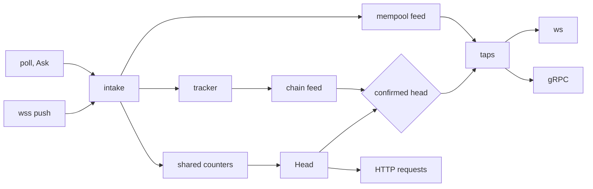

# Chain tracker: one chain feed and one head, any source in, any transport out

Status: approved design; implementation in progress on a stacked branch. Plan: [plan.md](plan.md). Supersedes the window, follower and fork-adoption parts of [data-integrity/chain-view.md](../data-integrity/chain-view.md).

Decisions:

1. The promise: a client that receives block N from any transport can fetch N over HTTP on any instance (§6.4, §6.5).
2. One `Head` per (network, lane), computed once per change; a request reads it once, and every tag form resolves to that one number (§6.4, §7).
3. Transports send a block only up to the confirmed head: enough local hash votes, and a number at or below the lane's `Latest` (§6.5).
4. Numbers travel between instances in shared counters; hashes vote only from this instance's own fetches and pushes, never from client or cached answers (§6.3, §14).
5. One freshness window W decides every freshness question (§6.1).
6. Any upstream can be a source, by opt-in; wss upstreams are sources by default. A source pushes when its transport and its upstream can, and polls otherwise (§5).
7. Logs come from `eth_getBlockReceipts`; `eth_getLogs` by block hash is the fallback (§11).
8. Consumers read shared feed state from their own cursor; the core keeps no per-consumer queue. Reorgs, resume, slow consumers and catch-up are one code path (§10).
9. The window holds `maxBackfill` of chain time, at least `reorgWindow` blocks. A reorg inside a tap's range reaches it as Reverted; anything else ends it with its transport's signal (§9).
10. On a reorg, resumable transports resend from the fork point; ws `logs` gets `removed:true`, as geth does (§10.2).
11. Resumable transports resume from the last block they applied; a cursor the instance cannot place ends the stream, so a client never keeps a branch it was not told about (§10.3).
12. `newPendingTransactions` uses the same sources and taps, over a mempool feed (§12).
13. Polls and pending-transaction subscriptions stop 60s after the last tap closes; wss `newHeads` starts with the network and stays on (§5.2).
14. Reads decide finality on `Head.Finalized`; a permanent cache write also needs the serving upstream's finalized (§6.4).
15. `translateLatestTag: false` stays the per-method opt-out; the tag-state gate skips an upstream whose `latest` state is stale (§7, §6.11).
16. Nothing needs a person: every degraded state has a detector, an automatic recovery and a time bound (§15). No switch stays set until a restart.
17. Vendors serve a block's receipts as soon as they announce its head. Assumed, not measured at the tip; §11 covers a vendor that lags.

## 1. Terms

| Term | Meaning |
|---|---|
| instance | One eRPC process; a client's next call can land on any instance |
| bt | Block time (§6.7) |
| W | Freshness window: `max(3 × bt, 2s)`, at most 60s |
| q | `evm.servedTip.quorum` (default 2); `q.Of(n)` = `max(1, min(q, n))`, `majority` = `n/2 + 1` (`common/served_tip.go`) |
| source | Upstream that feeds headers, by push (wss) or poll (any RPC client) |
| observation | One header or pending transaction from one upstream |
| intake | Parsing, validity and identity checks on each observation |
| accepted | A source header that passed intake checks 0–2 on this instance |
| lane | One use-upstream group of a network; `""` is the network-wide lane |
| voter | An upstream that is policy-eligible for the lane, not syncing, not benched, best rank (§6.2) |
| number vote | A voter's shared latest and finalized counters; they decide `Latest` and `Finalized` |
| hash vote | A voter's newest header that this instance received by push or fetched with cache reads skipped (§6.3) |
| hash voter | A voter whose hash age is at most W |
| number age | How long the lag reference has stood above an upstream's shared counter, by local receive time |
| hash age | How long the lag reference has stood above an upstream's newest hash vote |
| bench | An upstream whose number age passed its stall window leaves every ballot (§6.1) |
| lag reference | Policy-free corroborated head: 2nd-highest non-benched upstream, latest and finalized (§6.6) |
| `Head` | Per (network, lane): `Latest`, `Finalized`, `Leader`, ceiling (§6.4) |
| `Latest` | The served tip: the q-th highest voter number after caps, regression guard and guarantees |
| `Finalized` | The served finalized: the same ballot over voters' finalized numbers |
| `Leader` | The highest voter within `Latest + maxRetryableBlockDistance` |
| ceiling | Raw max head of the lane's registered upstreams, minus upstreams cordoned for chain identity |
| topic admission | Which topics a voter feeds: fallback tier only until a primary has led for 60s (§6.2) |
| Ask | "U's latest now": one fetch per upstream, single-flight, outcome to every waiter (§6.8) |
| number need, hash need | What an Ask must produce: a fresh number (a fresh shared counter does), or a hash vote (only a local fetch does) |
| settle | An Ask with a hash need, to break a tie in fork choice |
| poll source | A source without push for `newHeads`: Asked once per cadence while demanded and admitted |
| tracker | Fork choice for one (network, lane), on one goroutine; the only writer of its chain feed |
| network-wide tracker | The tracker of lane `""`: it serves taps |
| group tracker | The tracker of one use-upstream lane; it serves integrity |
| chain feed | What one tracker holds: headers by hash, pins, receipts |
| root | A held header whose parent is not held; held headers form one tree per root |
| pin | The canonical hash at a height; the head is the highest pin |
| pins | The path of pins from a root to the head |
| confirmed head | The highest pin with `q.Of(hash voters)` hash votes at or above it and a number at or below the lane's `Latest` (§6.5) |
| `PinFresh` | Confirmed, evidence quorum met, and undisputed (§6.5) |
| evidence quorum | 2 distinct vendors when the network has 2 or more, else 1 (§6.10) |
| tag-state head | The block an upstream executes `latest` at (§6.11) |
| orphan | A held header that is not pinned |
| fork point | The highest pinned block two branches share; replay starts at fork point + 1 |
| re-anchor | The pins move to another tree |
| window | What the network-wide tracker holds: the last `maxBackfill` of chain time, at least `reorgWindow` blocks |
| reorgWindow | Floor of the window; window of group trackers; walk depth; receipts depth; ws lag bound |
| logs head | The highest confirmed pin up to which every block's receipts are held or not needed |
| scheduler | Per (network, instance) limit, classes and backoff for walks, receipts and fill (§8) |
| mempool feed | Rings of deduplicated pending transactions, one per (network, variant) |
| tap | One consumer of a feed: its cursor and its read loop |
| cursor | Number and hash of the last block a tap applied |
| out of range | A cursor the feed cannot continue: below the window, on a branch whose fork point left the window, or unknown to every upstream |
| demand | Topics that open taps need; a topic is `newHeads` or `newPendingTransactions:<variant>` |
| transport | Encodes a tap's reads for one wire: ws, gRPC; Kafka later |
| resumable transport | One whose consumers reconnect from a cursor: gRPC, Kafka |

## 2. Today

| Component | Loop | Fetches | Keeps |
|---|---|---|---|
| `EvmStatePoller` | per upstream, `statePollerInterval` (30s) + traffic | `eth_getBlockByNumber(latest)` | number, timestamp; drops hash, parentHash |
| `chainFollower` (`integrity_chainfollower.go`) | per network+group, 1s ticker | `eth_getBlockByNumber(n)` per block, fresh | linked segment, 32 headers |
| `blockStreamHub` (`erpc/block_stream.go`) | `OnLatestBlock` of every upstream | `eth_getBlockByNumber(n)` per block | highest number |
| indexer + `wsupstream` | vendor wss pushes; `newHeads` subscribed at startup while the WebSocket server is on | none | indexer: last head number and hash |

Problems:

- 3 loops track one head; 2 of them fetch every block again.
- Seven numbers mean "latest": the served tip, a delivered-head floor, the vendor's own answer to `eth_getBlockByNumber(latest)`, the gRPC hub's raw max, the consensus leader's raw max, the future-block ceiling, the health tracker's reference. One client can see `eth_blockNumber` = 1003, `getBlockByNumber(latest)` = 1005 and a gRPC header at 1005 in one second.
- A pushed head reaches ws clients before a second upstream has it; another instance whose view trails answers `[]`, `null` or `-32001` for that block.
- Four rules decide whether a block is final: the `finalized` tag, response finality, cache hits and integrity each read another upstream's view.
- WebSocket heads are never checked against parentHash. A wss drop loses every event in the gap.
- `logs` uses N vendors × M filters upstream subscriptions; reorg semantics are each vendor's own.
- An HTTP-only upstream can never serve subscriptions; a wss upstream that refuses `newHeads` feeds none until its socket reconnects.
- Each transport delivers its own way: indexer fan-out into per-subscription buffers for ws; a polling hub for gRPC.
- One answer decides a pin: client and integrity answers rewrite pins (`chainView.observe`), and `ReconfirmPin` trusts whichever upstream routing picks.
- Some degraded states last until a restart: auto-ignored methods, the poller give-up, the chain-identity cordon, the follower's retry of an unreconciled block.

## 3. Shape



| Layer | Home | Owns |
|---|---|---|
| Sources | `indexer/adapters/wsupstream`, `EvmStatePoller` | wss subscriptions, reconnect, silent-`newHeads` watch; polls |
| Fetch schedule | `architecture/evm/evm_state_poller.go` | per-upstream cadence, Ask, one backoff (§6.8) |
| Source reconciler | `erpc/network_sources.go` | which topics each source feeds |
| Intake | `erpc/network_intake.go`, `EvmStatePoller.ObserveHead` | parsing, header integrity, chain identity, counters, voters, hash votes |
| Shared counters | `data/shared_state_variable.go` | per-upstream latest and finalized across instances (§14) |
| Freshness, bench, lag reference | `health/tracker.go` | number and hash ages, bench, corroborated head (§6.1, §6.6) |
| Head | `erpc/networks.go`, ballot rules in `common/served_tip.go` | `Latest`, `Finalized`, `Leader`, ceiling per lane (§6.4) |
| Tracker and chain feed | `architecture/evm/chain_tracker.go`, `chain_tracker_rules.go` | fork choice, confirmed head, window, receipts |
| Scheduler | `architecture/evm/chain_fetch.go` | walks, receipts, fill: limit, classes, backoff (§8) |
| Tag-state gate | `architecture/evm/integrity_stateprobe.go`, `checkEvmUpstreamBlockAvailability` | tag-state heads and the skip (§6.11) |
| Mempool feed | `indexer/mempool` | dedup ring per subscribe variant |
| Taps | `indexer/taps.go` | read loops, demand |
| Transports | `erpc/ws_newheads.go`, `erpc/ws_logs.go`, `erpc/grpc_stream_blocks.go` | encoding, auth, wire signals |

- Dependencies point to `indexer`: sources, transports and the tracker use its interfaces. `indexer` imports neither `erpc` nor `architecture/evm`.
- `health` cannot import `architecture/evm`: the bench reads the fetch schedule's backoff through an injected reader.
- EVM encoding (newHeads projection, log matching, proto conversion) reaches each transport from `architecture/evm` at construction.

Execution model:

- Each tracker is one goroutine with a mailbox. Observations, fetch results and ticks are messages; the loop never holds a lock across I/O.
- The mailbox never blocks a sender, and never drops fetch results or ticks: at most 16 fetches are in flight. When headers fill it, answers drop first, then each source keeps only its newest header; walks fill the heights that dropped.
- `Head` is published as one atomic value; no request computes it again.
- Taps read the state the tracker publishes after each change; a Read never takes a lock the tracker waits on.
- Tracker, reconciler, Ask and tap loops run under `recover`, counted in `erpc_unexpected_panic_total`, as the ws server's handlers do (`erpc/ws_server.go`). In the tracker, a panic drops only the message it was handling; 3 in a row reset it (§6.5).

## 4. Contracts

```go
// indexer: chain- and transport-neutral.

type Cursor struct {
    Number uint64
    Hash   [32]byte
}

type Block struct {
    Number     uint64
    Hash       [32]byte
    ParentHash [32]byte
    Header     json.RawMessage // verbatim, as first held
    Receipts   json.RawMessage // verbatim; set only for blocks ReadOpts asked for
}

type Batch struct {
    Reverted []Block // the tap's old branch, newest first
    Applied  []Block // confirmed pins from the fork point + 1, oldest first; at most reorgWindow
    Next     Cursor
}

type ReadOpts struct {
    // MayMatch: Read also returns receipts of each block whose logsBloom
    // may match. Nil: headers only.
    MayMatch func(bloom []byte) bool
    // Resumable: the tap's clients resume from their own cursor, anywhere
    // in the window, so the feed fills the whole window while it is open.
    Resumable bool
}

// ChainFeed is the reader side of one tracker.
type ChainFeed interface {
    // Head is a new tap's start: the confirmed head, else the next one.
    Head(ctx context.Context) (Cursor, error)
    // Read returns the next non-empty batch from c (§10.1), waiting as
    // needed, bounded by ctx. ErrOutOfRange: the feed cannot continue c.
    Read(ctx context.Context, c Cursor, o ReadOpts) (Batch, error)
    // Want registers a tap's ReadOpts until release.
    Want(o ReadOpts) (release func())
    // LogsHead is the logs head (§1); ws logs taps measure lag from it.
    LogsHead() Cursor
}

var ErrOutOfRange = errors.New("cursor out of range")

// OutOfRangeError is ErrOutOfRange with its reason: below_window,
// fork_left_window, cursor_unknown, lag, receipts_timeout.
type OutOfRangeError struct{ Reason string }

// MempoolFeed is the reader side of one network's pending transactions.
type MempoolFeed interface {
    Tail(variant string) uint64 // newest sequence; a new tap starts after it
    // Read waits for payloads after seq, bounded by ctx.
    // ErrOutOfRange: seq left the ring.
    Read(ctx context.Context, variant string, after uint64) (txs []json.RawMessage, next uint64, err error)
}

// Taps runs read loops: read, emit, repeat. A loop ends when ctx ends, emit
// fails, or the feed returns an error. transport and kind label metrics.
func NewTaps(projectId string, onDemandChange func(networkId string)) *Taps // the callback never blocks
func (t *Taps) RunChain(ctx context.Context, networkId, transport, kind string,
    f ChainFeed, start *Cursor, o ReadOpts, emit func(Batch) error) error // start nil: f.Head
func (t *Taps) RunMempool(ctx context.Context, networkId, transport, variant string,
    f MempoolFeed, emit func([]json.RawMessage) error) error
func (t *Taps) Demand(networkId string) []Topic

// Intake is what sources report into; erpc implements it per network.
type Intake interface {
    Header(upstreamId string, raw json.RawMessage)
    PendingTx(upstreamId, variant string, raw json.RawMessage)
    // Subscribed reports a push subscribe's answer for t: nil once it is
    // live, else the upstream's error (§5.1, §12).
    Subscribed(upstreamId string, t Topic, err error)
}

// Source feeds one upstream's observations over one transport.
type Source interface {
    Set(topics []Topic) // what to feed now; idempotent; empty stops
}
```

```go
// architecture/evm: writer side, one tracker per (network, lane).
// Observe is the only input. vote is true only for a hash vote (§6.3).
func (t *ChainTracker) Observe(upstreamId string, raw json.RawMessage, vote bool)
// Implements indexer.ChainFeed, integrity.History, ChainSegment, ReceiptCache, PinReconfirmer.

// Per-upstream part of intake, shared with SuggestLatestBlock (heights).
func (e *EvmStatePoller) ObserveHead(raw json.RawMessage) (accepted bool)
```

```go
// erpc: one per (network, lane), published atomically on each change (§6.4).
type Head struct {
    Latest, Finalized int64
    Leader            string    // upstream id
    Ceiling           int64
    CeilingAt         time.Time // local receive time of the ceiling's newest report
}
```

- Client subscriptions and streams read the network-wide tracker. A connection with a use-upstream directive gates its taps on its lane's `Latest`; the pins stay network-wide.
- Source headers vote in the network-wide tracker and in every group tracker whose selector matches their upstream. Answers to selector-scoped requests go only to their group's tracker.

## 5. Sources and intake

Example, one wss push, two wss voters:

```
1  wss newHeads   {number:0x12d, hash:0xaa, parentHash:0x9f}   up=rpc-a
2  intake         parsed; identity ok; counter rpc-a 300 → 301; rpc-a is a voter → hash vote
3  tracker        vote rpc-a → 301 0xaa; parent 300 0x9f is the head → pin 301
4  Head           counters rpc-a 301, rpc-b 301 → Latest 301
5  tracker        rpc-b pushed 0xaa too: 2 hash votes ≥ q.Of(2); 301 ≤ Latest → confirmed head 301
6  1,240 taps     wake; Read(300 0x9f) → Applied [301 0xaa]
```

### 5.1 Transports

| Upstream endpoint | Mode | Topics | Cadence |
|---|---|---|---|
| `ws`, `wss` | push, `eth_subscribe` | `newHeads`, `newPendingTransactions:<variant>` | per event |
| `http`, `https`, `grpc` | poll, `eth_getBlockByNumber(latest)` through the upstream's client | `newHeads` | the fetch schedule's cadence (§6.8) |
| gRPC `StreamBlocks` client, Kafka consumer | push | `newHeads` | not planned; each is one `Source` |

- `upstreams[].evm.subscriptionSource`: unset is true for `ws`/`wss`, false otherwise.
- Poll mode runs in the poller's goroutine. `fetchBlock("latest")` returns the header bytes; `TryUpdateIfLocallyStale` still merges polls with traffic.
- A wss upstream that refuses `eth_subscribe newHeads` as unsupported (`ErrCodeEndpointUnsupported`) feeds `newHeads` by poll, under the poll rule of §5.2, until a subscribe succeeds. Its source asks again on each reconnect and every 10 min. Other failed subscribes retry with backoff up to 30s.
- A source on a new transport registers as an upstream, so intake can gate it.

### 5.2 Which topics each source feeds

```
push u:  newHeads                       always, from network init
poll u:  newHeads                       while demand has newHeads and admitted(u)
push u:  newPendingTransactions:<v>     while demand has it and admitted(u)
```

`admitted(u)` is topic admission (§6.2).

- One reconciler per network, on one goroutine, calls `Set`: at network init, whether or not a WebSocket or gRPC server runs; then on demand changes, hash-voter changes, subscribe answers (`Intake.Subscribed`), and on a timer at W.
- Idle: no demand for 60s → polls and pending-transaction subscriptions stop.
- Silent `newHeads`: a connected push source whose `newHeads` pushed nothing for 15s, while its own head counter stood above its last push when those 15s began, reconnects its socket (`watchHeads`). A halted chain or a lagging node trips neither half. Pushes count before intake, so a gated source is not silent. Its hash vote ages out after W, before the reconnect.
- A pending-transaction topic with no message for 60s, while heads carry transactions, is subscribed again; a topic that stays silent backs off from 60s to 30 min.

### 5.3 Intake

| # | Check | Home | On fail |
|---|---|---|---|
| 0 | Parse number, hash, parentHash, timestamp, logsBloom, transactionsRoot, gasUsed into fixed types | network intake | drop; `outcome="malformed"` |
| 1 | Header integrity, while integrity is on (§13) | network intake | drop; `erpc_integrity_violation_total` |
| 2 | Chain identity on a major jump | poller, the `SuggestLatestBlock` code path | drop; async verify |
| 3 | Per-upstream head counter | poller | — |
| 4 | `voter(u)` (§6.2) | network intake | held, no hash vote |

- Checks run in this order, so a header that fails parsing, integrity or identity never moves the head counter.
- Hashes compare as bytes: `0xAB…` and `0xab…` are one block.
- Client answers to `eth_getBlockByNumber(latest)` move the head counter where the tag still reaches upstreams (`translateLatestTag: false`, `skip-interpolation`), best-effort and non-blocking (#450), and reach the trackers without a vote.
- The chain-identity cordon (`cordonForChainIdMismatch`) expires: the poller checks `eth_chainId` every 5 min and uncordons after 2 matching checks in a row; a mismatched major jump cordons again (#997).
- The poller give-up (`skipLatestBlockCheck` after 10 failures) expires after 10 min; while it holds, the upstream is no poll source (#240).
- Pending transactions pass check 4 and topic admission, then enter the mempool feed.

## 6. Head model: eleven concepts

Each concept answers one question and has one home. W (§1) is the one freshness clock: vote freshness, tag-state tolerance, the reconciler timer, the suspension window, the cold window and every re-arm read it.

### 6.1 Freshness: is upstream U current?

- Two ages, by evidence, against one reference: the lag reference (§6.6), never `Latest`, which would loop through the policy.
  - Number age reads the shared counter, by local receive time (§14).
  - Hash age reads the newest hash vote (§6.3).
- Number age decides the bench: an upstream is benched after `max(30s, 3 × its backed-off cadence)` (§6.8), and readmitted once its counter reaches the lag reference. A benched upstream is no voter.
- Hash age decides the hash voters: a voter is a hash voter while its hash age is at most W.
- A chain that makes no blocks moves no reference: every age stays 0 and nothing reconnects.

Owner: `health/tracker.go`. Readers: the `Head` ballots (bench), the confirmed head (hash voters), the reconciler, tap start, the gRPC stall rule (§10.2). Bounds: one upstream ahead with its peers stalled holds `Latest` until the bench, at most 90s. Keeps: #1263 (one bench rule, 30s floor), #1296 (lag credit for slow polls), #1208 (local samples only).

### 6.2 Voters: who votes?

- `voter(u)` = `u` in the policy's eligible set for the lane (`tipCandidateUpstreams`), not syncing, not benched, best rank (live heads before configured caps).
- No tier filter on votes: a fallback upstream's latest is fetched anyway, and its hash costs nothing more.
- Topic admission decides only which topics a voter feeds (§5.2, §12):

```
admitted(u) = voter(u) and (failover off, or u is not fallback tier,
                            or no primary has been a hash voter for 60s without a break)
```

Owner: `erpc/network_intake.go`. Readers: `Head`, the confirmed head, settle targets, the reconciler, mempool admission. Keeps: #320 (no syncing or excluded upstream), #202 (syncing never votes), #888 (eligible set), #1063 (caps rank below live heads), #836 (fallback held while a primary streams).

### 6.3 Reports: what does a voter say?

- Numbers are shared: each upstream's latest and finalized live in shared counters (§14), and every instance's `Head` reads them.
- A hash vote comes only from this instance's tracker or poller: a push, a poll-source poll, an Ask answer, or a full poll, each fetched with cache reads skipped. Client answers and cached answers never vote (#1001).
- Minority fork: a voter whose hash vote stays off the pins for longer than W loses its number vote and goes last in routing, until its hash vote is on the pins again.

Owner: `erpc/network_intake.go` (hash votes), `EvmStatePoller.ObserveHead` (numbers). Readers: `Head`, trackers, routing. Keeps: #1001, #450, #1256 (a fresh shared counter saves a fetch).

### 6.4 Head: how high may we serve, is N final, how far above may a request ask?

One `Head` per (network, lane). It is computed when an upstream head changes (local or remote), a bench changes, the policy's eligible set changes, and every 1s for every lane.

| Field | Rule |
|---|---|
| `Latest` | q-th highest voter number; caps, regression guard (1024 blocks, 60s, per instance) and guarantees (`servedTip.guaranteedFor`, `guaranteedMethods`) apply as today |
| `Finalized` | the same ballot over voters' finalized numbers; a voter without a finalized tag reports latest − the derived depth (at least 30 min of chain, #1079) |
| `Leader` | the highest voter within `Latest + maxRetryableBlockDistance` |
| ceiling | raw max of the lane's registered upstreams, minus upstreams cordoned for chain identity; `CeilingAt` = local receive time of its newest report |

- A lane is one use-upstream group, at most 16 per network. A selector without a lane (`partitionKeyFor` returns `""`) keeps the stateless pick: the same rules, computed for that request.
- Nothing is persisted or shared as a served value: a rogue value cannot spread to every instance or freeze `Latest` (#924).

Refusal rule, for block N on a request:

| N | Action |
|---|---|
| N ≤ `Latest` | serve |
| `Latest` < N ≤ ceiling + ceiling age / bt | refresh (Ask with a number need for voters below N, §6.8); an empty or null answer is a retryable miss once; the retry orders upstreams by the head predicate, head ≥ N first, with no I/O |
| above | future, only on a ceiling younger than 1 bt; an older ceiling is Asked first and N decided again, counted `future_after_refresh` |

- Sites: `tryShortCircuitFutureBlock` (with `shortCircuitFutureBlocks`, a future block gets `null` with no dispatch, #1238), `EmptyResultBeyondConfidence` (`enforceNonNullBlock`, empty-is-miss), the `eth_query` range check.
- The availability gate checks configured bounds only (#934). One head predicate adds `headLagToleranceBlocks` to `latestBlockMinus` bounds and to upstream ordering (#1099). Refreshes in the gate stay async (`handleBlockSkip`).
- A by-hash answer from a block above `Latest` waits up to 1 bt while heads refresh; then it is sent if `Latest` includes its block, else `null`.

Finality:

- Reads: N is final when N ≤ `Head.Finalized`. The `finalized` tag, cache hits, labels, integrity `IsFinalized`, narrow anchors and empty-result confidence read it.
- Permanent cache writes: N ≤ `Head.Finalized` and N ≤ the serving upstream's own finalized (#90). An upstream on a minority fork cannot write a permanent entry.
- Per-upstream finality stays per upstream for routing (`upstream/evm_upstream_ops.go`, `EvmStatePoller`): a routing fact, not a head.
- The cache write guard reads the network-wide lane's `Latest`, whatever lane the request used (#932).

Owner: `erpc/networks.go`; ballot rules `common/served_tip.go`. Readers: every request (§7), taps (§6.5), cache, consensus leader, `eth_query`, block heatmap, served-tip gauges. Keeps: #900 (advertise only what q upstreams serve), #912 (lanes), #924, #978 and #1256 (`eth_blockNumber` = `Latest`, no dispatch), #1063, #1166 (guarantees), #1263, #1273 (1s timer), #1154 (one upstream never defines the head; `Leader` within reach), #1238, #934, #1099, #932, #90, #1079.

### 6.5 Pins and confirmed head: which hash is canonical, when may a client get N?

Each tracker runs one goroutine. It holds headers by hash; a header whose parent is held hangs under it, so held headers form one tree per root.

Fork choice:

1. Hold: an empty tracker holds the first vote as a root. A vote more than `maxBackfill` after the head, by header time, becomes a root at once. Any other vote whose parent is not held is walked (§8, class 1): missing heights by number, each checked against the parentHash of the block above, and a mismatch fetched by hash from its sender. The walk stops at a held header, or after `reorgWindow` blocks, where its lowest header becomes a root. Client and integrity answers inside the window are held; they never walk.
2. Fill: every root is extended downward (§9) until it joins another tree or reaches the window base.
3. Vote: a voter's hash vote moves to its newest header once that header is held; until then its previous vote stays. An ancestor of the current vote does not move it back.
4. Choose: take the tree with the most votes; a tie keeps the tree of the pins. In it, from the root, follow the child whose subtree holds the most votes; a tie keeps the pinned child; a block with no voted child follows its pinned child. Stop at a block with no child to follow, or at a tie with no pinned child. The last block followed is the head; the path from the root to it is the pins.
5. Settle: a tie in rule 4 runs a settle (§6.8). Each answer is walked like a vote and, once held, adds one vote for this decision. No answer, or no target: the pins stay, and the settle runs again after backoff.
6. No hash voter, with demand: the tracker Asks the first voter in selection order with a hash need, once per cadence. That answer is the only vote until the next one; an answer that conflicts with the pins starts a settle.

Settle rounds:

- A round is keyed on the pinned head and the conflicting branch, never on a vote that changes each block.
- A round whose key changed never reports `decided` from votes alone.
- A client that joins a round whose answers are still walking waits for them; a client ctx that ends with answers pending gets `PinRateLimited`, never `PinUnverifiable`.
- A deferred re-check does not start the 1s reconfirm cooldown.

Confirmed head:

- The confirmed head is the highest pin with `q.Of(hash voters)` hash votes at or above it and a number at or below the lane's `Latest`. The second clause proves that q upstreams hold N.
- Cold window: for W after a tracker starts or resets, a voter that is a source and has not reported yet counts as a hash voter, so a cold instance's first header waits for a second.
- Every transport delivers only up to the confirmed head (§10). Tap lag is measured from it.
- Catch-up: while a tap is open, a pin above `Latest` Asks, with a number need, the voters whose number is below it.
- `PinFresh` = confirmed ∧ evidence quorum (§6.10) ∧ undisputed (no hash voter on another branch at that height). `ReconfirmPin(n)` returns `PinFresh` only then; otherwise it settles, or returns `PinRateLimited` when the settle cannot run.
- A hash-proven rollback lowers the shared counters (§14).

Other rules:

- A re-anchor is counted in `erpc_chain_tracker_reanchor_total`.
- A message's changes are computed first and applied in one step. A panic drops the message and counts the header as `malformed` for its sender. 3 panics in a row reset the tracker to empty, counted in `erpc_chain_tracker_reset_total`; taps continue from their cursors (§10.1).
- Each change of the confirmed head wakes the taps.
- A majority branch that reverts a block at or below `Finalized` is followed, and logged as an error (`final_hash_changed`): clients stay on the chain the upstreams serve.
- By-number answers at or below `Finalized` feed integrity's finalized anchors below the window (`observeNarrowAnchors`), only with the evidence quorum. Inside the window, pins win.

Reorg example, three voters:

```
t0  pins 99 0x01, 100 0xaa            votes A, B, C → 100 0xaa         tap cursor 100 0xaa
t1  B, C push 101 0xcc (p 0xbb)       walk: 0xbb by hash from B; links to 99 0x01
t2  choose                            0xaa {A}, 0xbb {B, C} → pins 100 0xbb, 101 0xcc; 0xaa orphan
t3  Latest 101; 2 hash votes          confirmed head 101 0xcc
t4  tap Read(100 0xaa)                Reverted [100 0xaa]; Applied [100 0xbb, 101 0xcc]
```

Owner: `architecture/evm/chain_tracker.go`, rules in `chain_tracker_rules.go`. Readers: taps, integrity, receipts, `ReconfirmPin`, suspension (§6.9). Keeps: #1001, #1014 (an unverified pin never licenses a hard reject), #1061 (the head may go lower on a deeper reorg), #1294 (no block above `Latest` is sent), #836 (heads once and in order).

### 6.6 Lag reference: how far behind is U, for routing?

- The policy-free corroborated head: the 2nd-highest non-benched upstream, for latest and for finalized (`corroboratedNetworkHead`). A network with one upstream uses it.
- It never reads `Latest`: a lag measured from the policy's output would let one rogue exclude every honest upstream.
- `Latest` and the lag reference stay apart on purpose, as do `Head.Finalized` and the reference's finalized.

Owner: `health/tracker.go`. Readers: freshness (§6.1), routing lag (`blockNumberLagAbove`, `blockSecondsLagAbove`), the finalized poll cadence (#1269). Keeps: #1154, #907, #1019, #888, #258 (no zero heads), #976 (a bogus sample does not stick), #1296.

### 6.7 Block time: how long is a block?

- The network EMA (`GetNetworkBlockTime`), sampled from poller timestamps and from the timestamps of accepted source headers. Both are local samples (#1208).
- Until the EMA has 4 samples, bt = 1s for every reader: the poller's fallback on `main`. `fallbackStatePollerDebounce` still sets the cadence then.
- The poll cadence is the poller's debounce: bt × `dynamicBlockTimeDebounceMultiplier` (0.7), at most 12s; `statePollerDebounce` overrides (#790).

Owner: `health/tracker.go`. Readers: W, the fetch schedule, the refusal band, the by-hash wait, the window. Bounds: on a halt or a restart the caps hold (cadence 12s, W 60s). Keeps: #790, #1208.

### 6.8 Fetch schedule: when do we fetch U's head?

- One schedule per upstream, with one backoff: the cadence, doubled per failure in a row, at most 60s. The bench reads this backoff (§6.1).
- Periodic poll: a poll source is Asked once per cadence while `newHeads` is demanded and the upstream is admitted. Every upstream also keeps its full poll every `statePollerInterval` (30s) plus traffic.
- Ask: single-flight per upstream; every waiter gets the one outcome. A number need is met by a shared counter fresher than the cadence; a hash need only by a local fetch with cache reads skipped.

| Caller | Need |
|---|---|
| poll source | hash |
| catch-up (§6.5) | number |
| refusal band and stale ceiling (§6.4) | number |
| `eth_blockNumber`, `eth_getBlockByNumber(latest\|finalized)` pre-forward refresh | number |
| settle: voters without a fresh hash vote, then non-voters, up to 3 | hash |
| no hash voter, with demand (§6.5 rule 6) | hash |

- An upstream that rejects `latest` 10 times stops being a poll source until the 10-min re-check.
- A panic in an Ask fails its waiters and is counted; no waiter hangs (#1060).
- At most one live poller per upstream per instance (#1007); a stuck refresh exits within its fallback timeout + 1s (#838).
- The finalized poll waits `max(debounce, depth × bt × 0.05)` (#1265); an upstream behind the reference's finalized keeps the regular cadence (#1269).

Owner: `architecture/evm/evm_state_poller.go` (`RefreshLatestBlock`). Signal: `erpc_head_ask_total`. Keeps: #1256, #790, #240, #1007, #838, #1060, #1265, #1269.

### 6.9 Suspension: is a check wrong network-wide?

One mechanism; each check has its own parameters:

| Check | Suspended when | Re-armed |
|---|---|---|
| header checks | no header at 2 heights in a row passes within W, from vendors that meet the evidence quorum; heights within `reorgWindow` of the pins | observe-only after 100 blocks; enforced after 2 passing heights |
| bloom check | 8 blocks in a row mismatch, from vendors that meet the evidence quorum, and none matches; those blocks are fetched again | after 8 matching blocks in a row |

- Suspension reads the pins, never a single upstream's tip; `offAt` is the head of the pins.
- "Bloom trusted for skipping" is separate state: it allows the receipts skip (§11), and suspension does not touch it.
- `erpc_integrity_check_suspended_total{check}` counts each suspension.

Owner: `architecture/evm/integrity_suspend.go`. Readers: integrity hooks, the receipts path.

### 6.10 Evidence quorum: is content corroborated?

- 2 distinct vendors (`Upstream.VendorName`) when the network has 2 or more; else 1.
- One predicate, read by: finalized anchors, suspension, the integrity-on `eth_getLogs` fallback, the bloom suspension, `PinFresh`.

Owner: `architecture/evm/chain_tracker_rules.go`.

### 6.11 Tag-state head: is U's `latest` state stale?

A vendor can answer `eth_call(latest)` from old state while its header head is current; head polls and the pinned state probe both pass.

| Part | Rule |
|---|---|
| Fact | Tag-state head per upstream: the block it executes `latest` at, from Multicall3 `getBlockNumber()` at `latest`. It never moves `Latest` |
| Free evidence | Every Multicall3 pack carries one `getBlockNumber()`, so each packed answer proves its own block |
| Applies to | Requests whose block reaches the upstream as the tag: tag-only methods, `skip-interpolation`. Numbered requests are unaffected |
| Reference | `Latest`, not the upstream's own head |
| Tolerance | W in time; the sample's age is credited, as #1296 credits lag |
| Skip | Positive stale evidence skips that upstream for tag requests only; no evidence admits it (#934) |
| Readmit | 3 fresh samples in a row, or a W with no stale evidence; nothing is permanent |
| All stale | Route to the upstream with the highest tag-state head and count it; `-32603` with `executedBlock` and `servedTip` only when that head is more than 60s behind `Latest`; never `-32014`, never a pinned number |
| Probe | Every upstream that gets tag requests, from network start, without integrity `follow`; at most every 2s per upstream; re-probe on each skip. Probes keep the timeout-only bypass: no retry, hedge or breaker |

- `eth_estimateGas` joins `latestTagParamIndex`, so a pinned upstream never gets it as the tag.

Owner: `architecture/evm/integrity_stateprobe.go`; the skip in `checkEvmUpstreamBlockAvailability` (`erpc/networks.go`). Keeps: #1109 (the prober publishes evidence; disproof feeds misbehavior), #1274, #1303 (probe and metric kept; its misbehavior record is replaced by the gate), #1443 (`translateLatestTag: false` stays).

## 7. Requests: one value per request

- A request reads `Head` once, before the multiplexer and the cache. Tag interpolation, every retry and hedge, `pinLatestTag`, cache keys and writes, `ResolveCacheBlockRef`, empty-result confidence, `eth_query` tag resolution and its range check, and the block heatmap use that value.
- Head unknown (cold start): tags reach upstreams unchanged; subscriptions wait.
- The original tag stays in `EvmBlockRef`; `enforceNonNullTaggedBlocks` reads it, so interpolated tags keep the null-for-tag opt-out (#477).

| Family | Methods | Rule |
|---|---|---|
| 1. Head number | `eth_blockNumber`, `erigon_blockNumber` | answer `Latest` |
| 2. Block by tag | `eth_getBlockByNumber`, `eth_getBlockReceipts`, `eth_getBlockTransactionCountByNumber`, `eth_getTransactionByBlockNumberAndIndex`, uncle-by-number, `trace_block`, `debug_traceBlockByNumber`, `trace_replayBlockTransactions`, `debug_getRaw*`, `erigon_getHeaderByNumber`, `arbtrace_block` | interpolate to `Latest`/`Finalized`; `latest` and `finalized` refresh heads before forward (§6.8); `null` for a numbered tag follows `enforceNonNullBlock` |
| 3. State at a block | `eth_call`, `eth_estimateGas`, `eth_getBalance`, `eth_getCode`, `eth_getStorageAt`, `eth_getTransactionCount`, `eth_getProof`, `eth_getAccount`, `eth_createAccessList`, `eth_simulateV1`, `eth_callMany`, `debug_traceCall`, `trace_call`, `arbtrace_call*`, `debug_storageRangeAt` | interpolate every form: an absent param means `latest`; the EIP-1898 `blockNumber` leaf is rewritten; `eth_callMany` and `eth_createAccessList` get method config |
| 4. Ranges | `eth_getLogs`, `trace_filter`, `arbtrace_filter`, `eth_query*` | an absent bound means `latest`, so `toBlock` is never above `Latest` and range limits apply |
| 5. By hash | `eth_getBlockByHash`, `eth_getTransactionByHash`, `eth_getTransactionReceipt`, `debug_traceTransaction`, `trace_transaction` | sent as is; an answer from above `Latest` follows §6.4 |
| 6. Pending | `pending` anywhere, `eth_sendRawTransaction`, pending-tx filters and subscriptions | unchanged: one node's mempool |
| 7. Safe | `safe` tag | unchanged: routed to `evm.safeBlockSource` when set, tag verbatim (#1030) |
| 8. Absolute | numbers, hashes, `earliest` | sent as is; a number above `Latest` follows the refusal rule (§6.4) |
| 9. Fees | `eth_feeHistory`, `eth_gasPrice`, `eth_maxPriorityFeePerGas`, `eth_blobBaseFee` | unchanged: `feeHistory` newest block interpolated |
| 10. Filters | `eth_newFilter`, `eth_newBlockFilter`, `eth_getFilterChanges`, `eth_getFilterLogs` | state stays on one upstream: the one exception to the promise |
| 11. Subscriptions | ws `newHeads`, `logs`, gRPC `StreamBlocks` | the confirmed head (§6.5) |

| Switch | Rule |
|---|---|
| `translateLatestTag`, `translateFinalizedTag` | on for every method; off is the per-method opt-out and covers every form (plain tag, absent param, EIP-1898): the tag reaches upstreams as is, and that method leaves the promise |
| `skip-interpolation` directive | per-request opt-out, unchanged |
| `evm.pinLatestTag` | pins a lagging upstream to the request's one number, on every attempt and hedge; must stay off for upstreams of a tag-only method |

Chains whose state works only at the tag: on HyperEVM, HyperCore read precompiles (`0x…0800`–`0x…08ff`) fail at any explicit block number, even the exact head; a nested read fails silently. At `latest` they succeed. Such methods set `translateLatestTag: false`; the tag-state gate (§6.11) protects them.

## 8. Tracker fetches

Every tracker fetch goes through one scheduler per (network, instance). Head fetches are the fetch schedule's (§6.8), not the scheduler's.

| Class | Fetches | Share |
|---|---|---|
| 1 head | walks of voted headers and by-hash mismatches | at least 1 slot |
| 2 tip receipts | receipts within `reorgWindow` of the head | at least 1 slot |
| 3 fill | fill, cursor fetches, older receipts | at least 1 slot |

- Limit: 16 fetches in flight per (network, instance). A sweep that ends in capacity errors on every upstream it tried (HTTP 429, `-32005`, compute units, a denied upstream permit) halves the share of the lowest busy class, never below 1 slot; 10 successes in a row in a class add 1 slot back. One throttled upstream is the selection policy's job (`ThrottledRate`).
- One fetch makes one sweep over the upstreams the selection policy orders, or the one upstream it names: no hedge, no network retry, timeout 10s. Failsafe config does not apply to it, an `internal` consensus policy included.
- A sweep skips an upstream whose breaker is open, and tracker fetches never feed a breaker: tracker load, such as slow receipts of large blocks, must not open a breaker that blocks clients. Subscription calls bypass the breaker entirely.
- Tracker fetches skip project and network rate limits, which budget clients. Classes 1 and 2 take upstream rate permits as client requests do. Class 3 takes one only when one is free, so catch-up never crowds out clients; a denied permit counts as a capacity error. Upstream scores count every tracker fetch.
- By-hash fetches use the cache. Every other tracker fetch skips cache reads, tags included, because a cached answer is not a fresh view.
- The scheduler's backoff is its only retry: 200 ms, doubling, capped at 5 s, per key.
- Single-flight per (selector, upstream, method, params); a fetch that names one upstream is keyed without the selector, so trackers share it. Every fetch the tracker submits keeps the tracker as a waiter. A Read's own fetch is dropped while queued when its last Read leaves. Submit never blocks: the queue holds at most one request per key. A panic in a fetch fails its waiters and is counted.
- Tracker fetches run integrity checks. A check on a tracker fetch reads only held data and skips when it needs more, so validation never fetches recursively.

## 9. Window

- Network-wide tracker: held headers whose timestamp is within `maxBackfill` of the head's, at least `reorgWindow` blocks below the head.
- Group trackers: `reorgWindow` blocks.
- Orphans: at most 4 per height; the oldest goes first.
- Receipts: held for blocks within `reorgWindow` of the head, orphans included. Older receipts are fetched for the Read that needs them and not kept.
- Matched logs: positions into the held receipts, per (block, filter).
- Fill extends a root downward (class 3): by number, each checked against the parentHash of the block above, and a mismatch fetched by hash. It runs to `reorgWindow` blocks below the head for every root; below that, only while a `Resumable` tap is open or a Read needs an older height. When fill reaches a held header, the two trees join.
- A chain halt does not empty the window: the floor of `reorgWindow` blocks stays.

## 10. Taps and transports

### 10.1 Read

From cursor `c`, first matching case:

| Case | Result |
|---|---|
| `c` below the window | `ErrOutOfRange` |
| `c` pinned | Applied: `c + 1` … |
| `c` held in the pinned tree | Reverted: `c` … fork point + 1; Applied: fork point + 1 … |
| `c` held in another tree | wait while fill links it, then the row above; fill reaches the window base first → `ErrOutOfRange` |
| `c` not held, above the confirmed head | wait until the confirmed head reaches it |
| `c` not held, inside the window | fill down to `c.Number`; `c` pinned → that row. Else fetch `c.Hash` by hash: found → held and walked, and the rows above apply; not found → `ErrOutOfRange` |

- Applied ends at the confirmed head, after `reorgWindow` blocks, or before the first block whose receipts the tap needs and the feed does not hold yet.
- Receipts a logs tap needs for a Reverted block, and the feed lacks, are fetched by hash; Read waits for them as for Applied.
- Read returns once the batch is not empty. Until then it waits for the next confirmed-head change, a fill or those receipts; a new head alone does not restart a receipts wait.
- A tap at the confirmed head reads one block per head.
- Per-block work is shared: one receipts parse with an index by address and topic0, one match per filter, one encoding per transport, cached per network and bounded by the window.

### 10.2 Per transport

| Transport | Reads | Reorg on the wire | Out of range | Wait bounds |
|---|---|---|---|---|
| ws `newHeads` | headers | each new-branch head, oldest first | restart after the confirmed head | more than `reorgWindow` behind the confirmed head, nothing Reverted → restart |
| ws `logs` | receipts where the filter bloom may match | `removed:true` logs of Reverted, newest first; then logs of Applied | close `1013`; closes from one event spread over 60s | more than `reorgWindow` behind the logs head → out of range; 60s on one block's receipts → out of range |
| ws `newPendingTransactions` | mempool | none | skip to the newest | — |
| gRPC `StreamBlocks` | headers | resend from the fork point | end, `OUT_OF_RANGE` | 60s of stalled Read → `UNAVAILABLE`; one `Send` 10s → `UNAVAILABLE` |
| Kafka, later | headers, receipts | resend from the fork point | write a reset record, then restart after the confirmed head | — |

- geth sends only the new head after a reorg; ws `newHeads` sends each new-branch head.
- ws `newHeads` is lossy, as in geth: a restart shows as a jump in numbers.
- `removed:true` logs go to every filter matching now, as geth does. They are the sent logs, from the same receipts.
- ws writes keep the deadline of 10s per message (`wsWriteDeadline`). The subscription id reaches the client before the first notification.
- gRPC stall: a Read wait counts toward the 60s only while the confirmed head stands above the cursor, or at its number on another branch, or no hash voter exists. A Read at the head of a chain that makes no blocks waits without end.
- gRPC client rule: a header with a number at or below the last one replaces that number and every number above it.
  - The first resent number is fork point + 1: the same fact as Substreams `BlockUndoSignal.last_valid_block`, with no extra message.
  - Per-block removal (Firehose `STEP_UNDO`, geth `removed:true`) costs one message per dropped block and keeps every sent payload until finality.
  - Each header carries `hash` and `parentHash`: a client can check linkage itself.
- `UNAVAILABLE` tells a gRPC client to reconnect; `OUT_OF_RANGE` tells it the cursor is gone, so it backfills by unary calls.

### 10.3 Resume

- `StreamBlocksRequest` has `optional uint64 fromBlock` and `optional bytes fromHash`: the last header the client applied.
- Both set, or neither; one alone is `INVALID_ARGUMENT`. Neither: start after the confirmed head.
- The cursor goes to Read as is; §10.1 decides replay, wait and `OUT_OF_RANGE`.
- A cursor the instance cannot place, not held and not served by hash, is `OUT_OF_RANGE`: the client backfills, so it never keeps a fork the instance cannot see.
- Proto: `blockchain-data-standards/manifesto` `evm/stream.proto`: "ascending; after a reorg, restarts at the fork point".
- Auth runs once when the stream opens, as for `eth_getBlockByNumber`; rate limits count once at open, as for ws subscriptions; no per-block request-path fetch.

### 10.4 Adding a transport

- One tap per consumer and one encoder: its own package and one registration point.
- Kafka:
  - One writer per (network, topic) across instances: a `data.Connector.Lock` lease, renewed at half its TTL. The tap stops when a renewal fails.
  - Fencing: Kafka's transactional producer, one `transactional.id` per (network, topic). Its epoch fences a writer that lost the lease; the new writer reads the cursor after `initTransactions`.
  - Cursor: number and hash of the topic's last record. Records keyed by block number; consumers apply the gRPC client rule.
- gRPC logs: `stream.proto` reserves content-selection flags; a logs flag sets `ReadOpts.MayMatch`.

## 11. Logs path

```
1  chain feed      pin 101 0xcc; logsBloom has Transfer bits; a registered MayMatch wants it
2  scheduler       eth_getBlockReceipts(0xcc), class 2 → 255 receipts, 790 logs
3  chain feed      receipts held with 0xcc; parsed once; index by address and topic0
4  tap Read        101 confirmed; filter {topics:[Transfer]} → 41 logs
5  ws transport    41 notifications for each subscription with this filter
```

- Receipts are fetched when a block is pinned, not when a tap reaches it.
- A receipts answer counts only when it is non-null, every receipt names the requested `blockHash`, and it is non-empty unless `transactionsRoot` is the empty-trie root. Anything else is a failed fetch, never "no logs".
- Bloom check: the OR of the receipt blooms must equal the header's logsBloom, on every answer. A mismatch counts against that upstream (`bloomMatch`), and the block is fetched from an upstream of another vendor. Suspension follows §6.9.
- Skip: after 8 matching blocks with transactions in a row, a block that no registered `MayMatch` wants is not fetched. Blocks whose `transactionsRoot` is the empty-trie root are never fetched.
  - Both skips apply only to headers whose hash recomputes: `blockHashRecompute` runs for this decision with integrity off too.
  - Chain profiles can turn the bloom check and both skips off.
  - Checked 2026-10-14, one block each: bloom equal on eth, sepolia, hoodi, monad.
- Fallback: receipts that fail on every upstream for 5s switch that block to `eth_getLogs` by `blockHash`. Its logs must name the block hash and pass the bloom check. With integrity on, the fallback also needs log-index contiguity and the evidence quorum agreeing on the logs; it proves less than `receiptsRoot`.
- A `logs` subscribe is refused with `ErrNoSubscriptionSource` when no upstream serves a usable method, or while every fetch of each usable method has failed for 60s. During that refusal, the feed fetches the head block's receipts once per cadence; the first success ends it.
- Auto-ignored methods (`IgnoreMethod`) expire after 10 min, so a vendor that answered "unsupported" during a deploy serves again.
- Logs travel as verbatim JSON. Receipt logs carry `blockTimestamp`; `integrity.Log` does not model it.
- Matching uses `LogsFilter.Matches` (geth `filterLogs`) in `architecture/evm/logfilter`. Integrity and the ws `logs` transport share it.
- A `logs` subscribe parses its filter as geth does (`address`, `topics`); one that does not parse fails with `-32602` before any fetch. `fromBlock`/`toBlock` are ignored, as for a live geth subscription.

Cost, measured 2026-10-14 on public RPCs, 5 consecutive blocks each:

| Chain | Block time | Receipts KB/block | All logs KB/block | Receipts RTT ms |
|---|---|---|---|---|
| eth | 12s | 540–1,790 | 339–1,212 | 116–163 |
| sepolia | 12s | 677–1,388 | 507–1,188 | 97–124 |
| hoodi | 12s | 16–173 | 11–147 | 64–130 |
| monad | ~0.4s | 41–158 | 32–136 | 68–96 |

- Sizes above are uncompressed. eRPC sends `Accept-Encoding: gzip` (`clients/http_json_rpc_client.go`); gzip cuts receipts 8–12×.
- One instance with a matching filter, on the wire: about 0.7 GB/day on eth and 2.5 GB/day on monad with gzip; about 10× more from an upstream without gzip.
- Every instance fetches its own receipts unless a shared cache serves them by hash: 2.5 receipts calls/s per instance on monad.
- Logs reach clients one receipts round trip after the confirmed head (about 70–160 ms above).
- Receipts held: eth 32 blocks × ~1 MB ≈ 32 MB; monad 32 blocks × ~125 KB ≈ 4 MB.

## 12. Mempool feed

- Sources: push transports only. A network with no push source refuses `newPendingTransactions` with `ErrNoSubscriptionSource`.
- Feed: one ring per (network, variant) of the last 10,000 entries. A variant is the subscribe params as sorted-key JSON; at most 16 per network, lingering variants included, then subscribe is refused with `ErrSubscriptionLimitExceeded`.
- A subscribe that opens a new variant waits up to 10s for its push sources' first answers (`Intake.Subscribed`). When every admitted push source answers with an error other than a capacity error, the subscribe fails with the first one, as the upstream sent it: `-32602` for bad params. Capacity errors, connection errors and timeouts open the subscription; each source retries with its backoff.
- Dedup by transaction hash over 60s, one entry per hash, at most 100,000 hashes per network.
- A new tap starts after `Tail`. A tap wakes at most every 50 ms and reads everything after its sequence. Out of range skips to the newest. No reorgs, no resume.
- Admission: a push source subscribes only while topic admission admits it (§6.2).

## 13. Integrity

| Guarantee | Integrity off | Integrity on |
|---|---|---|
| parentHash linkage, fork choice, gap fill | yes | yes |
| Header: `blockHashRecompute`, `headerConsensusInvariants`, `headerFieldShapes` | only `blockHashRecompute`, for the receipts skips (§11) | every header, every source |
| Consecutive: `baseFeeDerivation`, `timestampMonotonicity` | no | each header against its parent, found by parentHash |
| Receipts: `receiptsRootRecompute`, `bloomMatch`, `logIndexContiguity`, `sameBlockHash` | bloom only (§11) | every receipts fetch |
| Client `eth_getLogs` completeness (`getLogsCompleteness`) | n/a | warm cache whenever logs taps run |

- Consecutive checks find the parent among held headers by parentHash, never by number; a parent that is not held skips the check.
- Suspension: §6.9. Anchors and the logs fallback need the evidence quorum (§6.10).
- Tracker fetches run the checks (§8); `IsInternal` no longer skips them.
- An empty numbered trace (`trace_block` and kin) is accepted only for a pinned block whose header has `transactionsRoot` = the empty-trie root and `gasUsed` = 0, with a hash that recomputes; no acceptance-time fetch (#1201).
- `integrity.follow.enabled` opens one integrity follow tap per tracker. It holds demand, so polls run without clients, and it feeds `stateProberFor(...).onNewHead`. Out of range restarts it after the confirmed head.
- Group trackers count the voters of their lane; their settles carry the group selector.
- With integrity on, every delivered log is proven against `receiptsRoot` of a hash-linked header, except logs from the fallback (§11).
- Chain profiles still apply: Kaia excludes `receiptsRootRecompute`.

## 14. Shared state

- Per-upstream latest and finalized counters are max-only: a remote value higher than the local one is accepted whatever its timestamp.
- Timestamps decide only large rollbacks (more than 1024 blocks below the current value); smaller drops are noise (#222).
- Freshness is the local receive time, never the writer's clock: `IsStale` and every number need read when this instance received the value.
- A rejected remote state is counted in `erpc_shared_counter_remote_rejected_total{reason}`.
- Rollback write: when the pins re-anchor below a voter's counter, and that voter's own hash vote is on the new branch, its lower number is written as a large rollback is written. So `Latest`, `eth_call(latest)` and `getBlockByNumber(latest)` follow a rewound chain within 2 bt.
- Counters reject 0 and negative values, except `earliest` (#258, #1084); a v1 integer and a v2 JSON value on one key never collide (#956); the local value updates synchronously and the remote publish is async and deduped (#544, #658).
- No network-level served value is shared (#924).

Owner: `data/shared_state_variable.go`; the rollback write in `EvmStatePoller`.

## 15. Resilience

### 15.1 Failure model

| Component | Failure | Detection | Automatic recovery | Bound |
|---|---|---|---|---|
| wss source | socket drops | disconnect | reconnect, jittered 1–30s backoff; other voters carry; walks link the missed blocks | 30s |
| wss source | socket alive, `newHeads` silent (half-open TCP included) | hash age above 15s against the lag reference, so a lone instance whose head polls ride the same dead socket still sees it; a network with one upstream has only the socket's ping/pong | hash vote ages out after W; reconnect (`watchHeads`) | 30s after the reference passes its last push; ping/pong wait with one upstream |
| wss source | `newHeads` refused as unsupported | `Intake.Subscribed` error | polls instead; asks again on each reconnect and every 10 min | 10 min |
| any upstream | lags but keeps advancing | number age | benched after `max(30s, 3 × backed-off cadence)`; no hash voter after W | 90s |
| any upstream | on a minority fork | hash vote off the pins | loses its number vote and goes last in routing | W |
| any upstream | one ahead, peers stalled | number ages of the peers | `Latest` and taps wait until the peers are benched | 90s |
| any source | the chain makes no blocks | no reference moves | nothing reconnects or resubscribes | — |
| poll source | errors, 429 | failed polls | backoff up to 60s; never stops for good | 60s |
| other upstreams | poller give-up | `skipLatestBlockCheck` | expires | 10 min |
| intake | chain-identity cordon | cordon reason | `eth_chainId` every 5 min; uncordon after 2 matches | 10 min |
| intake, integrity | a check no upstream passes | §6.9 | suspended; observe-only after 100 blocks; enforced after 2 passing heights | 2 heights |
| tracker | voters disagree | split votes | the branch with the most votes; ties settle | 1 settle |
| tracker | reorg deeper than the window, or a gap past it | the majority's tree is not the pinned one | re-anchor; fill joins trees inside the window; other taps end with their transport's signal | `reorgWindow` blocks of walk |
| tracker | a message panics | `recover` | the message drops; 3 in a row reset the tracker to empty | 3 messages |
| tracker | no hash voter | hash ages | one Ask with a hash need per cadence, a settle on conflict | 12s |
| Head | ceiling stale | `CeilingAt` older than 1 bt | Ask before any "future" answer | 1 Ask |
| Head | cold start | no counters | tags pass through; taps wait for the first confirmed head | first reports |
| shared state | backend down | publish and watch errors | each instance runs on its own polls; no frozen tip after | backend back |
| shared state | a writer's clock is skewed | — | higher values win whatever their timestamp; freshness by receive time | none needed |
| shared state | chain rewinds on every upstream | pins re-anchor below counters | rollback write (§14) | 2 bt |
| tag-state gate | every upstream stale | §6.11 | route to the highest tag-state head; `-32603` past 60s | 60s |
| scheduler | rate limits | a sweep fails on capacity everywhere | halve the lowest busy class's share, never below 1 slot; classes 1 and 2 keep taking permits as clients do | 10 successes per slot |
| scheduler | fetch hangs | timeout | 10s, then backoff | 10s |
| receipts | one block not served | failed fetches | other upstreams; the `eth_getLogs` fallback; after 60s, ws `logs` taps out of range, closes spread over 60s | 60s |
| receipts | every fetch fails | 60s of failures | new `logs` subscribes refused; the head block's receipts fetched once per cadence until one succeeds | 60s |
| receipts | method auto-ignored | ignore entry | the entry expires | 10 min |
| receipts | wrong bloom from one vendor | answer check | counted on it; refetch from another vendor | 1 fetch |
| reconciler | panic, missed wake | `recover`, timer | restart; timer at W | W |
| taps | slow client | lag | ws `logs` out of range and ws `newHeads` restart past `reorgWindow`; gRPC `UNAVAILABLE` after a 10s `Send` | `reorgWindow` blocks |
| gRPC | instance lags, restarted, or fill is slow | a stalled Read | 60s, then `UNAVAILABLE`; the client reconnects | 60s |
| mempool | subscription silent | no message for 60s while blocks carry transactions | resubscribe, backing off to 30 min | 60s |
| integrity follow tap | out of range | Read error | restart after the confirmed head | 1 Read |
| Kafka writer | lease lost | renewal fails | tap stops; the transactional epoch fences it; the next holder resumes from the last record | lease TTL |
| block time | halt or restart | header timestamps | caps: cadence 12s, W 60s; the EMA recovers within 4 samples | 4 headers |

### 15.2 Bounds

| Resource | Bound | At the bound |
|---|---|---|
| Held headers | the window | the oldest leave |
| Orphans | 4 per height | the oldest leave |
| Receipts | blocks within `reorgWindow` of the head | older ones are fetched per Read and not kept |
| Matched logs | positions into held receipts | — |
| Batch | `reorgWindow` Applied blocks | the next Read continues |
| Walk | `reorgWindow` blocks in class 1 | a new root; fill continues in class 3 |
| Tracker fetches | 16 in flight per (network, instance), at least 1 per class | lower classes wait |
| Fetch queue | one request per key, and only while someone waits for it | joins the request in flight; dropped when its last waiter leaves |
| Fetch attempts | one sweep, then backoff from 200 ms to 5 s | — |
| Asks | one in flight per upstream; backoff up to 60s | waiters join it |
| Settle | 3 targets per round | the round ends undecided |
| Lanes | 16 per network | further selectors take the stateless pick |
| Tracker mailbox | fetch results and ticks never drop; headers: the newest per source | answers drop first |
| Mempool | 10,000 entries per ring; 100,000 hashes over 60s per network; 16 variants per network | the oldest leave; subscribe refused |
| ws subscriptions per connection | `server.webSocket.maxSubscriptionsPerConnection` (100) | subscribe refused, `-32005` |
| ws subscriptions per instance | `server.webSocket.maxSubscriptions`; 0 = unlimited | subscribe refused, `-32005` |
| ws connections | `server.webSocket.maxConnections` per instance and `maxConnectionsPerIP` per client IP; 0 = unlimited | `429` before the upgrade |
| ws write | 10s per message | the connection closes |
| gRPC send | 10s per message | the stream ends `UNAVAILABLE` |

The `server.webSocket` limits stay config; every other bound is a constant. Distinct log filters have no cap: each costs one index lookup per block per address or topic it names.

### 15.3 Invariants

| Invariant | Holds by |
|---|---|
| No transport sends a block above the lane's `Latest`, or one without `q.Of(hash voters)` hash votes | §6.5 |
| A block any subscriber received is fetchable over HTTP on every instance | §6.4 refusal rule, §6.5 |
| Pins form one parentHash-linked chain from a root to the head | §6.5 rules 1, 2, 4 |
| Pins change only when votes point to another branch, or a settle breaks a tie | §6.5 rules 3–6; one goroutine; only by-hash fetches read the cache (§8) |
| ws `logs` and resumable taps get a parentHash-linked sequence; every break comes with Reverted to a delivered ancestor, or with an end signal | §10.1, §10.2 |
| ws `newHeads` breaks only as a jump in numbers, after a restart | §10.2 |
| Every `removed:true` log is a sent log, from the same receipts | §9, §10.1 |
| A hash at or below `Finalized` never changes, unless the majority reverts it (logged) | §6.4, §6.5 |
| The head follows the vote majority after at most `reorgWindow` blocks of walk; no state stops it | §6.5; §15.1 |
| A slow tap never delays the tracker or another tap | §3 execution model |
| No degraded state lasts until a restart | §15.1 |

## 16. Config

```yaml
upstreams:
  - id: rpc-a
    endpoint: https://rpc.vendor.example/monad
    evm:
      subscriptionSource: true    # unset: true for ws/wss, false otherwise
networks:
  - architecture: evm
    evm:
      chainId: 143
      chainTracker:
        reorgWindow: 32           # was networks[].integrity.reorgWindow
        maxBackfill: 5m           # chain time, compared on header timestamps
    integrity:
      follow:
        enabled: true             # an integrity follow tap: polls run without clients
```

| Key | Change |
|---|---|
| `upstreams[].evm.subscriptionSource` | new |
| `networks[].evm.chainTracker.reorgWindow` | moved from `integrity.reorgWindow` (project, network, profiles) |
| `networks[].evm.chainTracker.maxBackfill` | new; replaces `integrity.follow.maxBlocksPerTick` |
| `integrity.follow.interval` (project, network, profiles) | deleted: event-driven |
| `networks[].evm.stripSubscribeFromBlockZero` | deleted: no upstream `logs` subscribe |
| `server.webSocket.subscriptionBufferSize` | deleted: no per-subscription queue |
| `indexer` (`canonicalChainDepth`, `dedupWindowSize`) | deleted: the mempool bounds in §15.2 replace `dedupWindowSize` |
| `translateLatestTag` default for `eth_getBlockByNumber` | now on, as for every method; `enforceHighestBlock` for it is deleted |

Strict decoding rejects the deleted keys and names the key: a breaking config change, no aliases. The head model adds no config key.

## 17. Signals

| Metric | Change |
|---|---|
| `erpc_chain_tracker_invariant_violations_total{project,network,invariant}` | new; invariant: `sent_above_latest`, `sent_unconfirmed`, `tap_gap`, `removed_unsent`, `pins_unlinked`, `final_hash_changed`, `latest_regressed` (only a `Latest` below a block this instance sent); must stay 0 except `final_hash_changed`, which logs a followed majority |
| `erpc_head_refusal_total{project,network,rule}` | new; rule: `served`, `retried_found`, `retried_missing` (the promise broke on this instance), `future`, `future_after_refresh` |
| `erpc_head_ask_total{project,network,reason,outcome}` | new; reason: the §6.8 caller (`poll`, `catch_up`, `refusal`, `refresh`, `settle`, `no_source`); outcome: `fetched`, `shared_fresh`, `inflight`, `backoff` |
| `erpc_chain_tracker_confirm_lag_blocks{project,network}` | new: pins head − confirmed head |
| `erpc_tap_delivery_seconds{transport,kind}` | new: confirmed-head change → write |
| `erpc_served_tip_voters{project,network,lane,rank}` | new gauge: voters per rank |
| `erpc_served_tip_quorum{project,network,lane}` | new gauge: effective q |
| `erpc_upstream_report_age_seconds{project,network,upstream,evidence}` | new gauge; evidence: `number`, `hash` (§6.1) |
| `erpc_upstream_head_benched_total` | existing; bench flaps |
| `erpc_upstream_tag_state_stale{project,network,upstream}` | new gauge: 1 while the tag-state gate skips it |
| `erpc_upstream_tag_state_all_stale_total{project,network,outcome}` | new; outcome: `routed`, `refused` |
| `erpc_shared_counter_remote_rejected_total{reason}` | new (§14) |
| `erpc_chain_tracker_source_heads_total{project,network,upstream,outcome}` | new; outcome: `voted`, `duplicate`, `malformed`, `gated_identity`, `gated_integrity`, `gated_voter` |
| `erpc_integrity_follow_head`, `_lag` | renamed `erpc_chain_tracker_head`, `_lag` |
| `erpc_integrity_follow_stall_total` | deleted: no stall states; see re-anchor and settle |
| `erpc_integrity_reorg_depth` | renamed `erpc_chain_tracker_reorg_depth` |
| `erpc_chain_tracker_reanchor_total{project,network}` | new |
| `erpc_chain_tracker_reset_total{project,network}` | new: resets after 3 panics in a row |
| `erpc_chain_tracker_settle_total{project,network,outcome}` | new; outcome: `decided`, `undecided` |
| `erpc_chain_tracker_fetch_total{project,network,kind,class,outcome}` | new; kind: `header`, `receipts`, `logs`; outcome: `ok`, `error`, `capacity` |
| `erpc_chain_tracker_fetch_slots{project,network,class}` | new gauge: current share per class |
| `erpc_source_resubscribe_total{project,network,upstream,topic}` | new: silent pending-transaction topics (§5.2) |
| `erpc_upstream_websocket_heads_stall_reconnects_total` | existing; counts silent-`newHeads` reconnects (§5.2) |
| `erpc_taps{project,network,transport,kind}` | new gauge: open taps; replaces `erpc_websocket_subscriptions_active` |
| `erpc_tap_out_of_range_total{project,network,transport,kind,reason}` | new; reason: `below_window`, `fork_left_window`, `cursor_unknown`, `receipts_timeout`, `lag`; replaces `erpc_websocket_subscription_notifications_dropped_total` |
| `erpc_network_subscription_last_head_timestamp_seconds` | existing; set on each confirmed-head change of the network-wide tracker |
| `erpc_integrity_check_suspended_total{project,network,check}` | new |
| `erpc_unexpected_panic_total` | existing; tracker, reconciler, Ask and tap loops report to it |
| `erpc_websocket_send_queue_length` | deleted with the per-subscription buffers |
| `erpc_subscription_withheld_heads_total` | deleted: `erpc_chain_tracker_source_heads_total{outcome="gated_*"}` counts the same heads per upstream and reason |
| `erpc_subscription_undelivered_total` | deleted: taps read the feed, so no event goes undelivered |
| `erpc_integrity_aux_request_total` | `kind="chain_follow"` disappears |
| `erpc_upstream_subscriptions_active` | `kind="logs"` disappears |
| `erpc_subscription_dedup_dropped_total` | `kind="logs"`, `kind="newHeads"` disappear; mempool only |
| `erpc_subscription_dedup_entries` | mempool only |

Tap metrics label `network` with the network label. Every other metric keeps its labels.

- Logs: one structured line per state transition, rate-limited per (network, kind): re-anchor, reset, settle, suspension, bench, hash-voter change, minority-fork demotion, out of range, tag-state skip, invariant violation with numbers and hashes.
- Traces: spans for tracker fetches, Asks and tap reads, under detailed tracing.

## 18. Rollout

1. Config first. Both images decode config strictly. For each deleted key, compare its configured value with its default; remove it while still on the old image, only where the value equals the default. Tuned values land with the first new-key change.
2. New image with no new keys: development → staging → one canary instance per region → everywhere. Rollback is the previous image digest, valid while no new key exists.
3. New keys (`subscriptionSource`, `evm.chainTracker.*`) only after the previous digest has left the rollback window: the old image rejects them.
4. The canary writes the same per-upstream counters the control instances read: gate each stage on canary-written vs control-polled counter agreement.
5. Go/no-go per stage, in seconds and per subscriber:
   - invariant violations 0;
   - `retried_missing` 0;
   - `eth_blockNumber` within 1 bt of control;
   - confirm lag p99 under 2 bt;
   - out-of-range and error rates within control;
   - about 1 receipts call per wanted block.
6. Dashboards and alerts on the new metrics before the canary; panels on deleted metrics replaced.
7. A permanent external probe subscribes to ws `newHeads` and `logs` on one instance and fetches every received block and its logs over HTTP from another.

## 19. Tests

The real-world suite proves the promise with real components; only vendor nodes are simulated.

```
test/chainsim     simulated chain + vendor nodes: HTTP JSON-RPC and ws eth_subscribe, app-level faults
      │ real TCP
test/realworld    fault proxy per (instance, vendor) link
      │ real TCP
eRPC              cmd/erpc binaries as subprocesses, YAML config, redis-server subprocess
      │ real TCP
clients           geth rpc.Client EthSubscribe, ethclient over HTTP, BDS gRPC StreamBlocks
      │
oracle            HTTP checks per delivered block, on the same and another instance
```

- `test/chainsim`: a non-test package. Real listeners on free ports, a control API for every fault, per-vendor views. It imports neither `erpc` nor `architecture/evm`.
- `test/realworld`: the fault proxy (latency, jitter, bandwidth, RST after N bytes, black-hole with the socket kept, close-all, refuse), instance lifecycle (start, `kill -9`, restart), Redis lifecycle (start, stop for N seconds), a clock-skew writer (publishes a counter state with `UpdatedAt` +5 min on a real key, as a peer would), config generation, client drivers, the oracle, `/metrics` scrape per instance, the scenario runner.
- `make test-realworld` runs `go test ./test/realworld/... -count=1 -v -timeout 60m`. `make test` excludes `test/`. No container runtime.
- Each scenario runs on its own chain id. Network-scoped scenarios run concurrently on shared instances, so fixed wall-clock bounds (30s bench floor, 60s primary lead, 60s receipts and gRPC waits, 5 min cordon, 10 min re-ask) overlap; instance-scoped ones (`kill -9`, Redis down, partition, clock skew) run in their own phase with fresh instances.
- Instance stderr with `WARNING: DATA RACE` or `panic:` fails the run. A failed run keeps its run directory (logs, config, client transcripts) and prints its path.
- Every scenario asserts `erpc_chain_tracker_invariant_violations_total` = 0 and `retried_missing` = 0 on every instance, unless the row says otherwise. Each tolerance is a named constant citing its spec section.

Oracle, for every block any subscriber receives, on the same instance and on another:

- ws `newHeads` header N/H: `eth_blockNumber` ≥ N on the same instance at once, and on the other within 1 bt; `eth_getBlockByHash(H)` not null on both; `eth_getBlockByNumber(N).hash` = H, or the client later receives a reorg at or below N.
- ws `logs`: every non-removed log is returned by `eth_getLogs` by block hash on both; the client's final live log set equals the canonical logs for its filter over its range; `removed:true` only for logs it received.
- gRPC `StreamBlocks`: ascending and gap-free per stream across reconnects with a resume cursor, on the other instance too; a reorg resends from the fork point; end codes as §10.2.
- Each client's chain ends equal to the canonical chain. Delivery latency per block is recorded and bounded per scenario.

Baseline B: 200 ms blocks; 4 vendor simulators (2 wss, 2 https, 2 vendor names), each behind a fault proxy; 2 eRPC instances with real Redis; per instance 2 ws `newHeads` clients, 2 ws `logs` clients (2 filters) and 2 gRPC streams that resume on the other instance. Rows run on B unless they say otherwise.

| Area | Count | IDs |
|---|---|---|
| Upstream faults | 18 | U1–U18 |
| Network faults | 7 | N1–N7 |
| Chain behaviour | 14 | C1–C14 |
| Client behaviour | 9 | D1–D9 |
| Cross-instance | 9 | X1–X9 |
| Config | 7 | K1–K7 |
| HTTP consistency | 11 | P1–P11 |
| Total | 75 | |

| ID | Setup and fault | Expected |
|---|---|---|
| U1 | one https vendor answers after 15s, for 30 blocks | no tap waits more than W; HTTP hedges; no breaker opened by a tracker fetch |
| U2 | proxy sends RST after half of a header or receipts body | fetch fails over; no malformed vote; logs complete |
| U3 | wss TCP half-open: proxy stops forwarding, socket kept | hash vote expires within W; reconnect within 15s after the counter passes; no gap past `reorgWindow` |
| U4 | https keep-alive pool black-holed | one timeout, then new connections; `Latest` keeps moving |
| U5 | 429 on every vendor for 4 blocks | nobody benched; delivery resumes within 2 bt |
| U6 | one vendor `-32005` / compute units for 60s | throttled vendor bypassed; scheduler share unchanged |
| U7 | vendor answers `null` for a block at or below its own head | retried on another upstream, never cached; client gets the block |
| U8 | vendor pushes headers with wrong hashes; integrity off and on | never pinned or sent; integrity on: counted on that upstream only |
| U9 | truncated receipts, forged log, wrong bloom from one vendor | refetched from the other vendor; logs equal canonical |
| U10 | primary 40 behind, still advancing | `Latest` unchanged; its hash vote expires; benched after 30s or more |
| U11 | 2 upstreams only; one head frozen, still answering | taps and `latest` wait for the bench (at most 90s), then flow; gRPC resumes at most once |
| U12 | one upstream reports +30M, same chainId | `Latest`, `Leader`, lag unchanged; ceiling raised, no short-circuit |
| U13 | one endpoint answers another chainId | cordoned, out of ceiling; uncordoned after 2 matches 5 min apart |
| U14 | archive syncing at head+5; `eth_getBlockByNumber(head+3)` | served by the archive in the refusal band, not `null` |
| U15 | one vendor lacks `eth_getBlockReceipts` | logs from the other vendor; subscribe accepted |
| U16 | wss refuses `newHeads` as unsupported | polled at cadence; asked again on reconnect and every 10 min |
| U17 | https refuses `latest` 10 times | give-up; re-probed after 10 min; never a stuck poll source |
| U18 | one vendor on a minority fork at the same heights, 20 blocks | taps never send its blocks; HTTP never serves them |
| N1 | +300 ms constant latency to one vendor | delivery p99 within 2 bt; `Latest` from the faster voters |
| N2 | 0–2 bt jitter on every vendor; pushes reordered | `newHeads` in order, parent-linked, no duplicate |
| N3 | instance 1 cut from vendor X for 50 blocks | instance 1 flows on vendor Y's votes; no stall |
| N4 | instance 1 cut from every vendor for 2 min; Redis up | instance 1 gRPC `UNAVAILABLE` within 60s; clients resume on instance 2 with no gap |
| N5 | vendor closes every socket every 2 blocks, for 30 blocks | jittered 1–30s backoff; no resubscribe flood; other vendors carry |
| N6 | Redis down for 60s | instances fall back to their own polls; no wedge or frozen tip after |
| N7 | 2 MB blocks; receipts link throttled to 1 Mbit | receipts timeouts → other vendor or fallback; logs complete |
| C1 | reorg 1–3 at the tip | `newHeads` gets the new branch; logs `removed:true`; gRPC resends from the fork point |
| C2 | reorg `reorgWindow` − 1 deep | as C1; no out of range |
| C3 | reorg `reorgWindow` + 4 deep | re-anchor; logs `1013` spread; `newHeads` restart |
| C4 | 2 wss voters + 1 https; 1-vs-1 tip split | only the settled hash is sent |
| C5 | head rewinds 50 blocks on every upstream | `latest` reads succeed within 2 bt |
| C6 | no blocks for 3 min, with gRPC | nothing reconnects; gRPC not cut; `Latest` frozen |
| C7 | halt, then 100 blocks in 1s | catch-up within `maxBackfill`; batches at most `reorgWindow`; no gap |
| C8 | 100 ms blocks; U5 + C1 | same results at 2× rate |
| C9 | cold instance; 0.4s blocks with integer-second timestamps | thresholds reach chain values within 4 headers |
| C10 | 100 empty blocks | no receipts fetch; `newHeads` continuous |
| C11 | 5,000-receipt blocks | logs complete; no breaker opened by tracker fetches |
| C12 | majority reverts a finalized block | followed; `final_hash_changed` logged; no permanent cache entry |
| C13 | chain without a `finalized` tag | `finalized` = latest − derived depth (at least 30 min); cache uses it |
| C14 | 2 of 4 votes on a branch that does not link | canonical stays; no stall |
| D1 | ws client stops reading for 20 blocks; gRPC client stops reading | `newHeads` restart past `reorgWindow`; gRPC `UNAVAILABLE` after the 10s send wait; other taps unaffected |
| D2 | ws clients reconnect every 10 blocks | `newHeads` restart = number jump only; logs resubscribe |
| D3 | gRPC resume on the other instance; orphan cursor; cursor below window; cursor above head | resend from fork point; `OUT_OF_RANGE`; `OUT_OF_RANGE`; wait |
| D4 | 1,000 subscribers × 3 filters, 1 instance | 1 receipts call per wanted block; delivery p99 within 2 bt |
| D5 | 1k subscribe+unsubscribe/s; unsubscribe during a send | `erpc_taps` back to 0; no write after unsubscribe |
| D6 | bad logs filter; `fromHash` without `fromBlock` | `-32602`; `INVALID_ARGUMENT` |
| D7 | `maxSubscriptionsPerConnection: 3`; 4th subscribe | `-32005` |
| D8 | 1 wss + 2 https non-sources; client load at every upstream budget for 30s | tracker Asks still get permits; no stall longer than W |
| D9 | pending stream silent with socket open | resubscribe after 60s |
| X1 | no fault | the oracle holds for every block on both instances |
| X2 | memory shared state; instance 2 serves only numbered calls | the oracle holds after at most 1 retry; never `future` for a sent block |
| X3 | cold instance joins mid-chain | `Latest` known at once; taps wait for the first confirmed head; nothing above `Latest` sent |
| X4 | `kill -9` instance 1 during a reorg | clients resume on instance 2; chains canonical |
| X5 | one writer publishes counters with `UpdatedAt` +5 min | numbers keep flowing between honest instances |
| X6 | breaker open only on instance 1 for vendor X | `Latest` may differ by instance; the oracle holds |
| X7 | old-image instance + new-image instance, one Redis | no client sees `latest` regress across instances by more than 1 bt; counters agree |
| X8 | canary instance writes a bogus +1000 head to a counter | `Latest` unchanged on control; only the ceiling rises |
| X9 | 1 wss + 2 https non-sources, 3 instances, Redis; `eth_blockNumber` traffic on instance 2 only | taps on instance 1 never wait longer than W: only voters that sent instance 1 a header within W count toward its hash quorum |
| K1 | YAML and TS configs with each deleted key | boot refuses and names the key |
| K2 | minimal YAML: 1 wss + 1 https, no `evm` block | wss is a source, https is not; q = 2; subscriptions work |
| K3 | 2 networks, `reorgWindow` 64 on one; 40-deep reorg on both | 64: Reverted; 32: re-anchor + `1013` |
| K4 | `subscriptionSource: true` on https, `false` on wss | https polled at cadence; wss no source |
| K5 | same seed and plan, integrity on vs off | identical client chains and logs |
| K6 | `servedTip.quorum: majority`, `guaranteedFor`, failover tiers | taps never above the guarantee-clamped `Latest`; no deadlock |
| K7 | `shortCircuitFutureBlocks` on and off; head+1 polling | on: `null` with 0 dispatch above the ceiling, at most 1 retry in the band; off: at most 2 dispatches |
| P1 | U10, C1 | `eth_blockNumber` ≥ N on the same instance at delivery; on the other within 1 Ask |
| P2 | C1 | `eth_getBlockByNumber(N).hash` = delivered hash, or a reorg the client was told about |
| P3 | C1 | `eth_getBlockByHash(delivered)` not null on both instances until a reorg notice |
| P4 | C1, U9 | `eth_getLogs(N,N)` = delivered logs, both instances |
| P5 | no fault | `getBlockByNumber("latest").number` = `eth_blockNumber` ≥ N |
| P6 | tip moves during the request | `eth_call(latest)` Multicall3 `getBlockNumber()` = the number the request used; cached under it |
| P7 | C12 | `finalized` = `Head.Finalized`; a hash at or below it never changes; permanent cache only if the serving upstream finalized it |
| P8 | reorg after a by-number read | the orphan is not served from cache after the reorg notice |
| P9 | head+1 polling | as K7 |
| P10 | `flashblocks*` + normal groups; use-upstream client fetches a delivered block | lane-consistent result; no `retried_missing` |
| P11 | `translateLatestTag: false` method; one stale-state vendor | stale vendor skipped; all stale → highest tag-state head, not `-32603` |

- The in-process chaos test `TestChainFeed_ConvergesUnderFaults` (`erpc/chain_feed_test.go`) stays as the fast CI test and uses the `test/chainsim` simulator. Panic recovery (`TrackerMessageHook`) is tested only there: no black-box trigger exists.

## 20. Removed, merged, one home

| Today | Fate |
|---|---|
| `chainFollower`: ticker, `advance`, `step`, `ingest`, the retry of an unreconciled block | merged into the tracker's walk and fill; re-anchor replaces the retry |
| `chainView` | becomes `ChainTracker` |
| pin writes of `chainView.observe` from `observeBlockView`, `resolveHeaderKind` and `ReconfirmPin` | replaced by `Observe` without a vote; only hash votes move pins |
| `matchRequestKind: internal` consensus for integrity's canonical fetches | no longer applies: tracker fetches follow §8, and settles replace the quorum |
| `blockStreamManager`, `blockStreamHub`, `fetchBlockHeader`, `blockStreamMaxBackfill`, `ProcessBlockStream` | deleted; gRPC is a transport over taps |
| indexer `Sink`, `StreamEvent`, `IndexedEvent`, `EventIngress`, `EventEgress`, `IngressSelector`, `NetworkHandle` | replaced by `Intake`, `Source`, feeds and taps |
| indexer `EnsureFilter`, `ReleaseFilter`, `subscribe`, `reconcile`, `partitionIngresses`, `Ingest`, `dedupe`, `fanOut`, `headMarker` | deleted |
| `networkHandle.heads`, `headSource`, `deliversHeadsFrom`, `subIngressSelector`, `tierWsIngresses`, wsupstream `HeadsLive` | replaced by the voter rule, topic admission and the source reconciler |
| `PrewarmUpstreamSubscriptions`, `prewarmInterval`, `bootstrapNetwork`, `SubscriptionManager.networks`, `bootstrapMu` | replaced by the source reconciler, which starts with each network (§5.2) |
| wsupstream `headsUnsupported`: no `newHeads` until the socket reconnects | replaced by poll mode and a re-ask every 10 min (§5.1) |
| wsupstream `EnsureFilter`, `RemoveFilter`, `FilterLive`, `stripFromBlockZero`, `isZeroBlockRef` | replaced by `Source.Set` |
| wsclient `enqueue`, `isLossy`, `runWriter`, per-subscription buffers; `WsConnection.NotificationDropped` | replaced by taps and their wait bounds |
| logs case of `DedupKeyForFilter`, logs dedup windows, `logRemoved` | deleted |
| `nullingress` | deleted |
| `IsInternal` | split: request kind `internal` for failsafe matching; the retry, hedge and breaker bypass for subscription calls, state-poller, chainId and state probes only; tracker fetches skip open breakers and never feed them (§8) |
| permanent switches: `IgnoreMethod` entries, `skipLatestBlockCheck`, the chain-identity cordon | each expires (§15.1) |
| delivered-head floor: `NoteObservedLatestBlock`, `deliveredLatestBlock`, `applyDeliveredHeadFloor`, the network counter `latestBlockShared` | deleted: no block above `Latest` is sent, so nothing lifts `Latest` |
| live bound, `live`, `SourceLive`, `newestKnown`, `erpc_source_live` | replaced by freshness (§6.1) and `erpc_upstream_report_age_seconds` |
| `authoritative(u)`, `authoritativeIn`, `EvmAuthoritativeUpstreams` | replaced by `voter(u)` and topic admission (§6.2) |
| `EvmDeliveryQuorum`, `votingSources`, the sendable head, `SendTip` | replaced by the confirmed head (§6.5) |
| `max(2, need)` floor in `PinFresh`; `confirmed_single_vendor` | replaced by `PinFresh` with the evidence quorum |
| per-request served-tip evaluation (twice per `eth_blockNumber`) | one published `Head` |
| `eth_getBlockByNumber(latest)` pass-through, post-forward raise, `pickHighestBlock`, `enforceHighestBlock` | interpolated to `Latest` |
| consensus leader as raw max | `Head.Leader` |
| `EvmLowestFinalizedBlockNumber`, per-request finality lookups | the finality split (§6.4) |
| `pinLatestTag` re-read per attempt; cache key on the word `latest` | one value per request (§7) |
| tracker block time (mean over pins) and its 12s default; the poller's separate 1s default | the EMA and its one default (§6.7) |
| tracker-owned settle and no-source fetches; their scheduler backoff | Asks in the fetch schedule (§6.8) |
| `bloomGate`'s own state machine | suspension (§6.9) |
| five separate "2 vendors" rules | the evidence quorum (§6.10) |
| #1303's misbehavior record for stale `latest` state | the tag-state gate (§6.11) |
| `stateProberFor(...).onNewHead` call in `chainFollower.advance` | the integrity follow tap |
| `ErrNoWsUpstreamAvailable` | renamed `ErrNoSubscriptionSource` |

One home per fact:

| Fact | Home |
|---|---|
| Freshness, bench | `health/tracker.go` (§6.1) |
| Who votes, which topics run | `voter(u)`, topic admission, `erpc/network_intake.go` (§6.2) |
| Hash votes | network intake (§6.3) |
| `Latest`, `Finalized`, `Leader`, ceiling, refusal rule | `Head`, `erpc/networks.go` (§6.4) |
| Canonical chain, confirmed head, `PinFresh` | the tracker (§6.5) |
| Routing lag | lag reference, `health/tracker.go` (§6.6) |
| Block time | the network EMA (§6.7) |
| When a head is fetched | the fetch schedule, `EvmStatePoller` (§6.8) |
| Check suspension | `integrity_suspend.go` (§6.9) |
| Corroboration | the evidence quorum (§6.10) |
| Tag-state head | the state prober; read by `checkEvmUpstreamBlockAvailability` (§6.11) |
| Shared counters | `data/shared_state_variable.go` (§14) |
| Silent `newHeads` | the wss source's `watchHeads`, against its own head counter |
| Pins, orphans, receipts | chain feed; only the tracker writes it |
| Walk, fill and receipts fetch limits, classes, retries, cache use | the scheduler (§8) |
| Catch-up, reorg replay, out of range | `ChainFeed.Read` |
| Wire encoding, wire signals, wait bounds | each transport (§10.2) |
| newHeads payload: block JSON minus `transactions`, `uncles`, `withdrawals`, `size` | ws transport, from `architecture/evm` |
| Log filter semantics and bloom test | `architecture/evm/logfilter` |
| Resource bounds | §15.2 |
| Reorg depth, window | `chainTracker.reorgWindow`, `chainTracker.maxBackfill` |

## 21. Risks and behaviour changes

- Subscribers get a pushed head once q upstreams report it: one poll round trip with one wss vendor (70–160 ms measured on eth, sepolia, hoodi, monad); none with two.
- One vendor ahead with its peers stalled: subscribers and `latest` wait up to 90s (the bench); gRPC reconnects at most once.
- Catch-up refreshes while a subscriber is open: at most one per upstream per cadence per instance, only for voters below the pin.
- `eth_getBlockByNumber(latest)` answers block `Latest`: up to one poll behind a vendor's newest block; it now equals `eth_blockNumber`.
- `eth_getBlockByNumber("finalized")` answers block `Finalized`, which trails up to 5% of the finality window.
- A request just above `Latest` costs one extra upstream call for an empty answer.
- `eth_blockNumber` on another instance may trail a sent head by one poll; the block itself loads.
- A by-hash lookup of a block above `Latest` waits up to 1 bt.
- Absent block params read as `latest`: the JSON-RPC default; now cacheable and consistent across upstreams.
- A voter benched by number age can step `Latest` back by one block; the block itself still loads.
- Permanent cache writes need the serving upstream's finalized too.
- An upstream on a minority fork loses its number vote after W and goes last in routing.
- A tag-only method whose upstreams all have stale state gets the freshest of them, not an error, until 60s behind.
- Logs latency rises by one receipts round trip versus vendor log pushes.
- Receipts bandwidth: see §11; every instance fetches its own unless a shared cache serves them.
- An upstream that does not gzip sends about 10× the receipts bytes.
- Decision 17 is an assumption: a vendor that announces heads before its receipts are ready delays logs by one retry per block.
- Each poll source costs one call per cadence per instance: about 3.6 calls/s per instance on monad.
- wss upstreams subscribe `newHeads` at network init, even when no WebSocket or gRPC server runs: one push per block per upstream per instance.
- With integrity on, a network where no upstream serves `eth_getBlockReceipts` serves `logs` only through the corroborated fallback (§11).
- A network with one voter follows it: `q.Of(1)` = 1, so a fork it alone is on reaches clients.
- A tie with no upstream left to settle keeps the pinned branch.
- A majority branch that reverts a finalized block is followed, and logged as an error.
- Fallback-tier polls run while no primary has led for 60s: after a primary fails, seconds of head latency, no gap.
- A polled header and a vendor push can differ in optional fields; the first held wins.
- ws `logs` slow client: today a full 256-notification buffer closes it with `1013`; now `reorgWindow` blocks of lag behind the logs head do.
- One block whose receipts fail for 60s closes every ws `logs` connection of the network with `1013`, spread over 60s.
- gRPC slow client: today it skips forward past 256 blocks; now the stream ends with `OUT_OF_RANGE` past the window, or `UNAVAILABLE` after a 10s `Send`.
- A gRPC client whose cursor is an orphan no upstream serves gets `OUT_OF_RANGE` and backfills, even after a 1-block reorg.
- gRPC `StreamBlocks` stops sending `eth_getBlockByNumber` per block through the request path: per-block rate-limit counting ends, as for ws notifications.
- Tracker fetches leave client rate limits. They share upstream permits with clients, except catch-up, which yields; when clients use a whole upstream budget, tracker fetches fail with them until load drops.
- Expiring switches re-probe failing vendors: one request per method every 10 min, one `eth_chainId` per cordoned upstream every 5 min.
- A check that no upstream passes is suspended after 2 heights; on a network with one vendor, that vendor alone can suspend it, and 8 truncated receipts answers in a row turn the bloom check off.
- Breaking config and metric renames: dashboards and configs need updates in the same release.
- `StreamBlocks` consumers that expect strictly ascending numbers see a repeat after a reorg.
