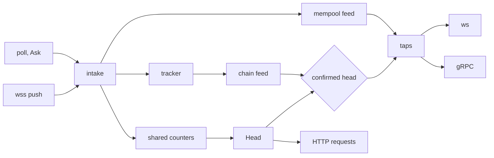

# Chain tracker: one chain feed and one head, any source in, any transport out

Status: approved design; implementation in progress on a stacked branch. Plan: [plan.md](plan.md). Supersedes the window, follower and fork-adoption parts of [data-integrity/chain-view.md](../data-integrity/chain-view.md).

Decisions:

1. The promise: a client that receives block N from any transport can fetch N over HTTP on any instance (§6.4, §6.5).
2. One `Head` per (network, lane), computed once per change; a request reads it once, and every tag form resolves to that one number (§6.4, §7).
3. One view per lane, `{Head, Firm}`, in the tracker's state: HTTP `latest` and every transport read it, so both show block N at the same instant (§6.5).
4. Numbers travel between instances in shared counters; hashes vote only from this instance's own fetches and pushes, never from client or cached answers (§6.3, §14).
5. One freshness window W decides every freshness question (§6.1).
6. Any upstream can be a source, by opt-in; wss upstreams are sources by default. A source pushes when its transport and its upstream can, and polls otherwise (§5).
7. Logs come from `eth_getBlockReceipts`; `eth_getLogs` by block hash is the fallback (§11).
8. Consumers read shared feed state from their own cursor; the core keeps no per-consumer queue. Reorgs, resume, slow consumers and catch-up are one code path (§10).
9. The window holds `maxBackfill` of chain time, at least `reorgWindow` blocks. A reorg inside a tap's range reaches it as Reverted; anything else ends it with its transport's signal (§9).
10. On a reorg, resumable transports resend from the fork point; ws `logs` gets `removed:true`, as geth does (§10.2).
11. Resumable transports resume from the last block they applied; a cursor the instance cannot place ends the stream, so a client never keeps a branch it was not told about (§10.3).
12. `newPendingTransactions` uses the same sources and taps, over a mempool feed (§12).
13. Polls and pending-transaction subscriptions stop 60s after the last tap closes; wss `newHeads` starts with the network and stays on (§5.2).
14. Reads decide finality on `Head.Finalized`; a permanent cache write also needs the serving upstream's finalized (§6.4).
15. `translateLatestTag: false` stays the per-method opt-out; the tag-state gate skips an upstream whose `latest` state is stale (§7, §6.11).
16. Nothing needs a person: every degraded state has a detector, an automatic recovery and a time bound (§15). No switch stays set until a restart.
17. Vendors serve a block's receipts as soon as they announce its head. Assumed, not measured at the tip; §11 covers a vendor that lags.

## 1. Terms

| Term | Meaning |
|---|---|
| instance | One eRPC process; a client's next call can land on any instance |
| bt | Block time (§6.7) |
| W | Freshness window: `max(3 × bt, 2s)`, at most 60s |
| q | `evm.servedTip.quorum` (default 2); `q.Of(n)` = `max(1, min(q, n))`, `majority` = `n/2 + 1` (`common/served_tip.go`) |
| source | Upstream that feeds headers, by push (wss) or poll (any RPC client) |
| observation | One header or pending transaction from one upstream |
| intake | Parsing, validity and identity checks on each observation |
| accepted | A source header that passed intake checks 0–2 on this instance |
| lane | One use-upstream group of a network; `""` is the network-wide lane |
| voter | An upstream that is policy-eligible for the lane, not syncing, not benched, best rank (§6.2) |
| number vote | A voter's shared latest and finalized counters; they decide `Latest` and `Finalized` |
| hash vote | A voter's newest header that this instance received by push or fetched with cache reads skipped (§6.3) |
| hash voter | A voter whose hash age is at most W |
| number age | How long the lag reference has stood above an upstream's shared counter, by local receive time |
| hash age | How long the lag reference has stood above an upstream's newest hash vote |
| bench | An upstream whose number age passed its stall window leaves every ballot (§6.1) |
| lag reference | Policy-free corroborated head: 2nd-highest non-benched upstream, latest and finalized (§6.6) |
| `Head` | Per (network, lane): `Latest`, `Finalized`, `Leader`, ceiling (§6.4) |
| `Latest` | The served tip: the lane's view `Head` (§6.5) |
| `Firm` | The highest block at or below `Head` that q voters hold; routing only |
| block clock | A lane's one scheduled head fetch per block when no push brought it (§6.8) |
| thin region | `Firm` < N ≤ `Head`: served, routed holders first, a miss retried (§6.4) |
| `Finalized` | The served finalized: the same ballot over voters' finalized numbers |
| `Leader` | The highest voter within `Latest + maxRetryableBlockDistance` |
| ceiling | Raw max head of the lane's registered upstreams, minus upstreams cordoned for chain identity |
| topic admission | Which topics a voter feeds: fallback tier only until a primary has led for 60s (§6.2) |
| Ask | "U's latest now": one fetch per upstream, single-flight, outcome to every waiter (§6.8) |
| number need, hash need | What an Ask must produce: a fresh number (a fresh shared counter does), or a hash vote (only a local fetch does) |
| settle | An Ask with a hash need, to break a tie in fork choice |
| tracker | Fork choice for one (network, lane), on one goroutine; the only writer of its chain feed |
| network-wide tracker | The tracker of lane `""`: it serves taps |
| group tracker | The tracker of one use-upstream lane; it serves integrity |
| chain feed | What one tracker holds: headers by hash, pins, receipts |
| root | A held header whose parent is not held; held headers form one tree per root |
| pin | The canonical hash at a height; the head is the highest pin |
| pins | The path of pins from a root to the head |
| `Head` | The view's head: the highest pin one counted hash vote holds, undisputed, within the guarantees, sticky until the pins move (§6.5) |
| `PinFresh` | Confirmed, evidence quorum met, and undisputed (§6.5) |
| evidence quorum | 2 distinct vendors when the network has 2 or more, else 1 (§6.10) |
| tag-state head | The block an upstream executes `latest` at (§6.11) |
| orphan | A held header that is not pinned |
| fork point | The highest pinned block two branches share; replay starts at fork point + 1 |
| re-anchor | The pins move to another tree |
| window | What the network-wide tracker holds: the last `maxBackfill` of chain time, at least `reorgWindow` blocks |
| reorgWindow | Floor of the window; window of group trackers; walk depth; receipts depth; ws lag bound (`reorgWindow` × bt of delivery delay) |
| logs head | The highest confirmed pin up to which every block's receipts are held or not needed |
| scheduler | Per (network, instance) limit, classes and backoff for walks, receipts and fill (§8) |
| mempool feed | Rings of deduplicated pending transactions, one per (network, variant) |
| tap | One consumer of a feed: its cursor and its read loop |
| cursor | Number and hash of the last block a tap applied |
| out of range | A cursor the feed cannot continue: below the window, on a branch whose fork point left the window, or unknown to every upstream |
| demand | Topics that open taps need, each at the fastest pace its taps need; a topic is `newHeads` or `newPendingTransactions:<variant>`. A client tap's pace is every block; the integrity follow tap's is `integrity.follow.interval` (1s) |
| transport | Encodes a tap's reads for one wire: ws, gRPC; Kafka later |
| resumable transport | One whose consumers reconnect from a cursor: gRPC, Kafka |

## 2. Today

| Component | Loop | Fetches | Keeps |
|---|---|---|---|
| `EvmStatePoller` | per upstream, `statePollerInterval` (30s) + traffic | `eth_getBlockByNumber(latest)` | number, timestamp; drops hash, parentHash |
| `chainFollower` (`integrity_chainfollower.go`) | per network+group, 1s ticker | `eth_getBlockByNumber(n)` per block, fresh | linked segment, 32 headers |
| `blockStreamHub` (`erpc/block_stream.go`) | `OnLatestBlock` of every upstream | `eth_getBlockByNumber(n)` per block | highest number |
| indexer + `wsupstream` | vendor wss pushes; `newHeads` subscribed at startup while the WebSocket server is on | none | indexer: last head number and hash |

Problems:

- 3 loops track one head; 2 of them fetch every block again.
- Seven numbers mean "latest": the served tip, a delivered-head floor, the vendor's own answer to `eth_getBlockByNumber(latest)`, the gRPC hub's raw max, the consensus leader's raw max, the future-block ceiling, the health tracker's reference. One client can see `eth_blockNumber` = 1003, `getBlockByNumber(latest)` = 1005 and a gRPC header at 1005 in one second.
- A pushed head reaches ws clients before a second upstream has it; another instance whose view trails answers `[]`, `null` or `-32001` for that block.
- Four rules decide whether a block is final: the `finalized` tag, response finality, cache hits and integrity each read another upstream's view.
- WebSocket heads are never checked against parentHash. A wss drop loses every event in the gap.
- `logs` uses N vendors × M filters upstream subscriptions; reorg semantics are each vendor's own.
- An HTTP-only upstream can never serve subscriptions; a wss upstream that refuses `newHeads` feeds none until its socket reconnects.
- Each transport delivers its own way: indexer fan-out into per-subscription buffers for ws; a polling hub for gRPC.
- One answer decides a pin: client and integrity answers rewrite pins (`chainView.observe`), and `ReconfirmPin` trusts whichever upstream routing picks.
- Some degraded states last until a restart: auto-ignored methods, the poller give-up, the chain-identity cordon, the follower's retry of an unreconciled block.

## 3. Shape



| Layer | Home | Owns |
|---|---|---|
| Sources | `indexer/adapters/wsupstream`, `EvmStatePoller` | wss subscriptions, reconnect, silent-`newHeads` watch; polls |
| Fetch schedule | `architecture/evm/evm_state_poller.go` | per-upstream cadence, Ask, one backoff (§6.8) |
| Source reconciler | `erpc/network_sources.go` | which topics each source feeds |
| Intake | `erpc/network_intake.go`, `EvmStatePoller.ObserveHead` | parsing, header integrity, chain identity, counters, voters, hash votes |
| Shared counters | `data/shared_state_variable.go` | per-upstream latest and finalized across instances (§14) |
| Freshness, bench, lag reference | `health/tracker.go` | number and hash ages, bench, corroborated head (§6.1, §6.6) |
| Head | `erpc/networks.go`, ballot rules in `common/served_tip.go` | `Latest`, `Finalized`, `Leader`, ceiling per lane (§6.4) |
| Tracker and chain feed | `architecture/evm/chain_tracker.go`, `chain_tracker_rules.go` | fork choice, confirmed head, window, receipts |
| Scheduler | `architecture/evm/chain_fetch.go` | walks, receipts, fill: limit, classes, backoff (§8) |
| Tag-state gate | `architecture/evm/integrity_stateprobe.go`, `checkEvmUpstreamBlockAvailability` | tag-state heads and the skip (§6.11) |
| Mempool feed | `indexer/mempool` | dedup ring per subscribe variant |
| Taps | `indexer/taps.go` | read loops, demand |
| Transports | `erpc/ws_newheads.go`, `erpc/ws_logs.go`, `erpc/grpc_stream_blocks.go` | encoding, auth, wire signals |

- Dependencies point to `indexer`: sources, transports and the tracker use its interfaces. `indexer` imports neither `erpc` nor `architecture/evm`.
- `health` cannot import `architecture/evm`: the bench reads the fetch schedule's backoff through an injected reader.
- EVM encoding (newHeads projection, log matching, proto conversion) reaches each transport from `architecture/evm` at construction.

Execution model:

- Each tracker is one goroutine with a mailbox. Observations, fetch results and ticks are messages; the loop never holds a lock across I/O.
- The mailbox never blocks a sender, and never drops fetch results or ticks: at most 16 fetches are in flight. When headers fill it, answers drop first, then each source keeps only its newest header; walks fill the heights that dropped. Client answers never grow it without bound: a client answer for a block below the window is dropped before it is queued, and integrity's finalized anchors are recorded outside the tracker's goroutine.
- The tracker takes its mailbox in batches: source votes and fetch results before client answers, then one read of the voters and one update for the whole batch, so a burst of client answers delays a vote by at most one batch.
- `Head` is published as one atomic value; no request computes it again.
- Taps read the state the tracker publishes after each change; a Read never takes a lock the tracker waits on.
- Tracker, reconciler, Ask and tap loops run under `recover`, counted in `erpc_unexpected_panic_total`, as the ws server's handlers do (`erpc/ws_server.go`). In the tracker, a panic drops only the message it was handling; 3 panics of one message kind, with none of that kind handled cleanly between them, reset it (§6.5). Calls from the tracker into the network's head code recover on their own and never fail a message.

## 4. Contracts

```go
// indexer: chain- and transport-neutral.

type Cursor struct {
    Number uint64
    Hash   [32]byte
}

type Block struct {
    Number     uint64
    Hash       [32]byte
    ParentHash [32]byte
    Header     json.RawMessage // verbatim, as first held
    Receipts   json.RawMessage // verbatim; set only for blocks ReadOpts asked for
    // Ready is when the block became deliverable to this Read: when it
    // first reached the confirmed head, or the logs head for a Read with
    // MayMatch. ws taps measure lag from it (§10.2).
    Ready time.Time
}

type Batch struct {
    Reverted []Block // the tap's old branch, newest first
    Applied  []Block // confirmed pins from the fork point + 1, oldest first; at most reorgWindow
    Next     Cursor
}

type ReadOpts struct {
    // MayMatch: Read also returns receipts of each block whose logsBloom
    // may match. Nil: headers only.
    MayMatch func(bloom []byte) bool
    // Resumable: the tap's clients resume from their own cursor, anywhere
    // in the window, so the feed fills the whole window while it is open.
    Resumable bool
    // Pace: the slowest this tap needs heads at; 0 is every block. The
    // tap's demand carries it (§3 demand); a Read ignores it.
    Pace time.Duration
}

// ChainFeed is the reader side of one tracker.
type ChainFeed interface {
    // Head is a new tap's start: the confirmed head, else the next one.
    Head(ctx context.Context) (Cursor, error)
    // Read returns the next non-empty batch from c (§10.1), waiting as
    // needed, bounded by ctx. ErrOutOfRange: the feed cannot continue c.
    Read(ctx context.Context, c Cursor, o ReadOpts) (Batch, error)
    // Want registers a tap's ReadOpts until release.
    Want(o ReadOpts) (release func())
}

var ErrOutOfRange = errors.New("cursor out of range")

// OutOfRangeError is ErrOutOfRange with its reason: below_window,
// fork_left_window, cursor_unknown, lag, reorg_depth, receipts_timeout.
type OutOfRangeError struct{ Reason string }

// MempoolFeed is the reader side of one network's pending transactions.
type MempoolFeed interface {
    Tail(variant string) uint64 // newest sequence; a new tap starts after it
    // Read waits for payloads after seq, bounded by ctx.
    // ErrOutOfRange: seq left the ring.
    Read(ctx context.Context, variant string, after uint64) (txs []json.RawMessage, next uint64, err error)
}

// Taps runs read loops: read, emit, repeat. A loop ends when ctx ends, emit
// fails, or the feed returns an error. transport and kind label metrics.
func NewTaps(logger *zerolog.Logger, projectId string, onDemandChange func(networkId string)) *Taps // the callback never blocks
func (t *Taps) RunChain(ctx context.Context, networkId, transport, kind string,
    f ChainFeed, start *Cursor, o ReadOpts, emit func(Batch) error) error // start nil: f.Head
func (t *Taps) RunMempool(ctx context.Context, networkId, transport, variant string,
    f MempoolFeed, emit func([]json.RawMessage) error) error
func (t *Taps) Demand(networkId string) []Topic
// Pace is the fastest pace the open taps of networkId need topic at;
// ok is false while no tap needs it.
func (t *Taps) Pace(networkId string, topic Topic) (pace time.Duration, ok bool)

// Intake is what sources report into; erpc implements it per network.
type Intake interface {
    Header(upstreamId string, raw json.RawMessage)
    PendingTx(upstreamId, variant string, raw json.RawMessage)
    // Subscribed reports a push subscribe's answer for t: nil once it is
    // live, else the upstream's error (§5.1, §12).
    Subscribed(upstreamId string, t Topic, err error)
}

// Source feeds one upstream's observations over one transport.
type Source interface {
    Set(topics []Topic) // what to feed now; idempotent; empty stops
}
```

```go
// architecture/evm: writer side, one tracker per (network, lane).
// Observe is the only input. vote is true only for a hash vote (§6.3).
func (t *ChainTracker) Observe(upstreamId string, raw json.RawMessage, vote bool)
// Implements indexer.ChainFeed, integrity.History, ChainSegment, ReceiptCache, PinReconfirmer.

// Per-upstream part of intake, shared with SuggestLatestBlock: a source
// header's height, parsed once by intake, and when its evidence was taken.
func (e *EvmStatePoller) ObserveHead(number int64, at time.Time) (accepted bool)
```

```go
// erpc: one per (network, lane), published atomically on each change (§6.4).
type Head struct {
    Latest, Finalized int64
    Leader            string    // upstream id
    Ceiling           int64     // raw max of the counted reports
    OldestReportAt    time.Time // when the oldest counted report's evidence was taken (§6.4)
}
```

- Client subscriptions and streams read the network-wide tracker. A connection with a use-upstream directive gates its taps on its lane's `Latest`; the pins stay network-wide.
- Source headers vote in the network-wide tracker and in every group tracker whose selector matches their upstream. Answers to selector-scoped requests go only to their group's tracker.

## 5. Sources and intake

Example, one wss push, two wss voters:

```
1  wss newHeads   {number:0x12d, hash:0xaa, parentHash:0x9f}   up=rpc-a
2  intake         parsed; identity ok; counter rpc-a 300 → 301; rpc-a is a voter → hash vote
3  tracker        vote rpc-a → 301 0xaa; parent 300 0x9f is the head → pin 301
4  Head           counters rpc-a 301, rpc-b 301 → Latest 301
5  tracker        rpc-b pushed 0xaa too: 2 hash votes ≥ q.Of(2); 301 ≤ Latest → confirmed head 301
6  1,240 taps     wake; Read(300 0x9f) → Applied [301 0xaa]
```

### 5.1 Transports

| Upstream endpoint | Mode | Topics | Cadence |
|---|---|---|---|
| `ws`, `wss` | push, `eth_subscribe` | `newHeads`, `newPendingTransactions:<variant>` | per event |
| `http`, `https`, `grpc` | poll, `eth_getBlockByNumber(latest)` through the upstream's client | `newHeads` | the fetch schedule's cadence (§6.8) |
| gRPC `StreamBlocks` client, Kafka consumer | push | `newHeads` | not planned; each is one `Source` |

- `upstreams[].evm.subscriptionSource`: unset is true for `ws`/`wss`, false otherwise.
- Poll mode runs in the poller's goroutine. `fetchBlock("latest")` returns the header bytes; `TryUpdateIfLocallyStale` still merges polls with traffic.
- A wss upstream that refuses `eth_subscribe newHeads` as unsupported (`ErrCodeEndpointUnsupported`) feeds `newHeads` by poll, under the poll rule of §5.2, until a subscribe succeeds. Its source asks again on each reconnect and every 10 min. Other failed subscribes retry with backoff up to 30s.
- A source on a new transport registers as an upstream, so intake can gate it.

### 5.2 Which topics each source feeds

```
push u:  newHeads                       always, from network init
poll u:  newHeads                       while demand has newHeads and admitted(u)
push u:  newPendingTransactions:<v>     while demand has it and admitted(u)
```

`admitted(u)` is topic admission (§6.2).

- One reconciler per network, on one goroutine, calls `Set`: at network init, whether or not a WebSocket or gRPC server runs; then on demand changes, hash-voter changes, subscribe answers (`Intake.Subscribed`), and on a timer at W.
- Idle: no demand for 60s → polls and pending-transaction subscriptions stop.
- Silent `newHeads`: a connected push source whose `newHeads` pushed nothing for 15s, while its own head counter stood above its last push when those 15s began, reconnects its socket (`watchHeads`). A halted chain or a lagging node trips neither half. Pushes count before intake, so a gated source is not silent. Its hash vote ages out after W, before the reconnect.
- A pending-transaction topic with no message for 60s, while heads carry transactions, is subscribed again; a topic that stays silent backs off from 60s to 30 min.

### 5.3 Intake

| # | Check | Home | On fail |
|---|---|---|---|
| 0 | Parse number, hash and parentHash into fixed types; timestamp (hex, decimal string or integer, as main reads it), logsBloom, transactionsRoot and gasUsed too, when present: one that does not parse counts as absent. A header without them still votes: it gives no block time sample, no bloom verdict and no receipts skip, and an empty receipts answer for it is a failed fetch (§11). With integrity on, such a header still faces check 1, where its hash must recompute | network intake | drop; `outcome="malformed"` |
| 1 | Header integrity, while integrity is on (§13) | network intake | drop; `erpc_integrity_violation_total` |
| 2 | Chain identity on a major jump | poller, `ObserveHead` | the header waits for its `eth_chainId` check and votes once it passes; drop when it fails, `outcome="gated_identity"`. Client answers check in the background (`SuggestLatestBlock`) |
| 3 | Per-upstream head counter | poller | — |
| 4 | `voter(u)` (§6.2) | network intake | held, no hash vote |

- Checks run in this order, so a header that fails parsing, integrity or identity never moves the head counter.
- Hashes compare as bytes: `0xAB…` and `0xab…` are one block.
- Client answers to `eth_getBlockByNumber(latest)` move the head counter where the tag still reaches upstreams (`translateLatestTag: false`, `skip-interpolation`), best-effort and non-blocking (#450), and reach the trackers without a vote.
- The chain-identity cordon (`cordonForChainIdMismatch`) expires: the poller checks `eth_chainId` every 5 min and uncordons after 2 matching checks in a row; a mismatched major jump cordons again (#997).
- While an upstream is cordoned for chain identity, every head it reports — poll, push or client answer — is dropped before its counter, so a cross-wired endpoint never moves a counter; only the 5-minute recheck (2 matches) lifts the cordon.
- Pending transactions pass check 4 and topic admission, then enter the mempool feed.

## 6. Head model: eleven concepts

Each concept answers one question and has one home. W (§1) is the one freshness clock: vote freshness, tag-state tolerance, the reconciler timer, the suspension window and every re-arm read it.

### 6.1 Freshness: is upstream U current?

- Two ages, by evidence, against one reference: the lag reference (§6.6), never `Latest`, which would loop through the policy.
  - Number age reads the shared counter, by local receive time (§14): how long U's counter, credited one fetch cadence, has stood below the reference, counted only while the reference rose within W.
  - Hash age reads the newest hash vote (§6.3): how long since another voter's first local header above U's vote, at or below the reference, arrived.
- Number age decides the bench: an upstream is benched after `max(30s, 3 × its backed-off cadence)` (§6.8), and readmitted once its counter reaches the lag reference. A wss source's cadence is its poll cadence, so it benches at the 30s floor. A benched upstream is no voter.
- #1263's stall rules stay beside number age: a head frozen above peers whose newest blocks are a stall window younger is benched by block age, so a frozen pair above the chain never benches the honest pair below it.
- Hash age decides the hash voters: a voter is a hash voter while its hash age is at most W and its channel answers. A push source's channel is its socket; any other voter's is its polls: once its failed polls of `latest` cover at least W, from the first one's send to the last one's failure, with no success since, its hash vote expires as a closed socket's does, until a poll succeeds. One timeout as long as W covers W alone; two quick 429s do not. A failed poll is one the node failed (transport error, timeout, 5xx, 429) or the vendor refused us (401, 403: a ban or a revoked key); eRPC's own refusals (local rate limit, open breaker, skip) and unsupported or client-error answers are no poll: they neither fail nor back off, and a failure whose request was sent before the last success does not count. A halted chain still answers polls and keeps its hash voters; an instance cut from its vendors loses them, so its streams end (§10.2).
- Routing hints, ordering only; every upstream stays eligible:
  - Reached N: for a request at block N, by number or by a block hash the tracker holds, the upstreams that reached N go first, the policy's order kept within each part. A push source (a wss upstream whose `newHeads` subscription is live) reached N when its hash vote on this instance did, since its requests ride that socket; any other upstream when its head counter did. Tracker fetches use the same rule (§8). N is the block the client named, read before §7 pins a tag: a tag pinned to the request's `Head` is a request with no block, as on main. Ordered by the pin, the policy's first upstream, polled every 1s on a 0.1s chain and a few blocks below `Latest`, went behind a far node at `Latest`, and the far node took the tip calls (P15).
  - A request with no block: a push source whose hash age exceeds W, or whose socket closed, goes after the others until it reports again, so a half-open socket holds no client request. Hash age never reorders any other upstream: its freshness follows the poll schedule, which is no evidence of a fault. Being behind by less than W reorders nobody.
- A chain that makes no blocks moves no reference: every age stays 0 and nothing reconnects.

Owner: `health/tracker.go`. Readers: the `Head` ballots (bench), the confirmed head (hash voters), routing (sources), the reconciler, tap start, the gRPC stall rule (§10.2). Bounds: one upstream ahead with its peers stalled holds `Latest` until the bench, at most 90s. Keeps: #1263 (one bench rule, 30s floor), #1296 (lag credit for slow polls), #1208 (local samples only).

### 6.2 Voters: who votes?

- `voter(u)` = `u` in the policy's eligible set for the lane (`tipCandidateUpstreams`), not syncing, not benched, not cordoned for chain identity, best rank (live heads before configured caps). It is one function: the `Head` ballots, `Leader`, the Asks that move `Latest` (refresh, catch-up, band), the hash voters and topic admission all take their voters from it.
- A chain-identity cordon (§5.3) takes `u` out of the voters when it is set and back in when the recheck lifts it, not at the policy's next pass: a cross-wired upstream counts in no quorum or majority, so on 2 voters the other alone re-anchors the pins after a gap no walk links.
- A number vote needs a head. A voter on a minority fork has none (§6.3), so the ballots, `Leader` and the Asks that move `Latest` skip it; its hash vote still counts, which is how it returns. A poller with no head yet is a voter for topic admission only: it gets its first head once admitted.
- No tier filter on votes: a fallback upstream's latest is fetched anyway, and its hash costs nothing more.
- A request's `Head` counts only the voters that serve its method (`servesMethod`, the filter `Forward` applies; every voter when none does; every voter for `eth_blockNumber`, which reports the view). Such a scope (`tipScope`) forms no lane: it reads its selector lane's view capped at the state lane's ceiling (§6.5), `Finalized` and `Leader` from their ballot. Per-method voter sets are built on first use and rebuilt when the upstreams or a method filter (an auto-ignore or its expiry) change; uniform filters keep every method on its selector's lane. Lanes, trackers and streams stay per selector: one view per lane.
- Topic admission decides only which topics a voter feeds (§5.2, §12):

```
admitted(u) = voter(u) and (failover off, or u is not fallback tier,
                            or no primary source has streamed for 60s without a break)
```

- A source streams while the newest header its own channel brought, a push for a wss source or a poll-source poll for an http source, has a hash age of at most W. Its other polls still vote (§6.3) but do not count here, so a primary whose pushes stop releases the fallback's topics, pending transactions included, while its polls still serve heads.

Owner: `erpc/network_intake.go`. Readers: `Head`, the confirmed head, settle targets, the reconciler, mempool admission. Keeps: #320 (no syncing or excluded upstream), #202 (syncing never votes), #888 (eligible set), #1063 (caps rank below live heads), #836 (fallback held while a primary streams).

### 6.3 Reports: what does a voter say?

- Numbers are shared: each upstream's latest and finalized live in shared counters (§14), and every instance's `Head` reads them. Every `latest` header this instance fetches from an upstream, by poll, Ask or settle, also moves that upstream's counter. A header at the counter's height, the upstream's current vote included, moves no vote yet dates the counter's report at its evidence time (§6.4 ceiling), with no shared write: on a halted chain, or between slow blocks, no newer header would. One below the counter never dates it (§6.8).
- A hash vote comes only from this instance's tracker or poller: a push, a poll-source poll, an Ask answer, or any other poll of the upstream's `latest` (full poll, refresh, catch-up, a client read of latest sent as the tag, §6.4 client read), each fetched with cache reads skipped. So an upstream that is no source votes too, as fresh as its last poll. Other client answers and cached answers never vote (#1001).
- Off the pins: a hash vote is off the pins only when it is not pinned, does not descend from the head, and its first block off the pins is at a height the pins hold. An unlinked vote above the head, or one whose tree starts below the pins' first block, is no fork evidence: no fork refresh, no fork poll, no demotion. A linked branch that leaves the pins below the head and runs above it is off the pins.
- Minority fork: a hash vote off the pins first refreshes the votes behind the pins: the tracker Asks, with a fork need (§6.8: only a fetch sent after the pins moved meets it), the voters that back the pins there with a vote older than it and the voters with no fresh hash vote, oldest evidence first, up to 3 (a settle, §6.8). A vote from before a reorg is no evidence of a fork: those voters answer on the new branch, and the pins move (§19 P1). If the pins still hold after their answers, the tracker polls the off voter at once, and at most once per W while its vote stays off; a voter whose newest hash vote is still off the pins W after the first such poll loses its number vote and goes last in routing, until its hash vote is on the pins again.

Owner: `erpc/network_intake.go` (hash votes), `EvmStatePoller.ObserveHead` (numbers). Readers: `Head`, trackers, routing. Keeps: #1001, #450, #1256 (a fresh shared counter saves a fetch).

### 6.4 Head: how high may we serve, is N final, how far above may a request ask?

One `Head` per (network, lane). One loop per network computes the lanes a change can move: a lane when the head of an upstream in it changes (local or remote); every lane when a bench changes, the policy's eligible set changes, and every 1s.

| Field | Rule |
|---|---|
| `Latest`, `LatestHash`, `Firm` | the lane's view (§6.5): `Head`'s number and hash, read from the tracker's state once per request; no number ballot, no regression guard |
| `Finalized` | the same ballot over voters' finalized numbers; a voter without a finalized tag (its tag refused 10 times in a row, never answered) reports latest − the derived depth: 30 min of chain at the block time floor (§6.7), at least `fallbackFinalityDepth` (#1079); until either is known, a voter has no finalized vote. Such a voter's value (derived, or a number stored before its tag was given up) votes only while no voter can attest one: with any voter whose tag answers, the quorum is min(q, those voters), so one attesting voter serves its value as a one-voter ballot does (measured on celo: a reader's tag answers unsupported, and as one of two voters it held `Finalized` 9-13 min behind main). Each advance served on fewer attestations than q of the lane's voters counts in `erpc_finalized_under_quorum_total`. It never steps back while a voter still backs it (#1353): each lane keeps a floor, the highest `Finalized` it served, applied after the guarantees; a computed value below the floor serves the floor while the floor is at or below the backing, the lowest of the lane's highest finalized vote and each constraining guarantee subset's highest, and the drop is at most `servedTip.maxRegressionBlocks` (0 = 1024, also with the regression guard off); with no voter backing it, or a deeper drop, the floor drops to the computed value, and a voter that returns later does not restore it. A held value above the served `Latest` is capped at `Latest`, never below the computed value: each voter's finalized is at or below its latest, so the served pair keeps that order. A change of voters (one leaves a majority ballot, a guarantee member leaves, a lagger rejoins a lone leader on a two-upstream network) is no reason for finality to go back. On the network-wide lane the floor is also shared across instances (§14), so a client moved to another instance never sees finality go back either: a computed value above the shared one raises it (held values never publish); a computed value below it serves it under the same rule (backed here, within `maxRegressionBlocks`); a shared value no local voter backs is ignored while unbacked and applies again once a voter backs it, as on main (#1356, #1364) |
| `Leader` | the highest voter within `Latest + maxRetryableBlockDistance` |
| ceiling | raw max of the reports of the lane's registered upstreams, minus upstreams cordoned for chain identity and upstreams that are no push source whose polls fail as §6.1 defines (failed polls spanning W with no success since; one failed poll, a 429 included, keeps the upstream counted; a push source's channel is its socket, so its polls never drop it); `OldestReportAt` = the oldest time at which those reports' evidence was taken: for an answer, a poll's or a client request's that reached the upstream as the `latest` tag, the time its request was sent (it can show no later head than the node had then); for a push, its receive time. An interpolated client request is no report: its answer shows the upstream holds block N, not that its head is N |

- A lane is one use-upstream group, at most 16 per network. A selector without a lane (`partitionKeyFor` returns `""`) keeps the stateless pick: the same rules, computed for that request.
- No served `Latest` is persisted or shared: a rogue value cannot spread to every instance or freeze `Latest` (#924). The shared `Finalized` floor cannot do either: only values an instance served enter it, and an instance serves it only while one of its own voters backs it.

Refusal rule, for block N on a request:

| N | Action |
|---|---|
| N ≤ `Firm` | serve |
| `Firm` < N, a block the lane's view pins (held), whatever `Latest` and the ceiling | serve, nothing Asked: the block exists, only who holds it is open, and a method only some upstreams serve caps `Latest` and the ceiling below it. The first attempt and the miss's one retry each go to the request's routed upstreams ordered by when each most likely holds N: those whose evidence holds N first, then N's first sight plus each one's held wait, the shortest of its last 8 hold bounds (§6.8 block clock) at or past its longest bound without the block, else that bound; an upstream with no bound at the first sight, so its answer measures it. The attempt waits for the first, at most W. Each answer at N, served or missing, is a free hold bound of its upstream. The longest bound alone (the thin hold wait) waits on a bound a vote took a block later, and serves a follow-up a block late; a refusal Ask per miss cost P21-avax's follow-up `eth_call` 3.3-3.8 head fetches per block (§19 P21-avax) |
| `Firm` < N ≤ `Latest` (thin) | serve, holders first: an interpolated `latest` routes as block N, upstreams whose hash vote, counter or a by-number answer here holds N first, no credit above `Firm`; on the first attempt, any method, also each upstream whose hold wait passed since N's first sight (§6.8 block clock: the longest of its last 8 bounds on how long after a block's first sight it held the block, each a fetch that found it without the block, or with it; the latest or a lower bound alone credited a vendor trailing by 200 ms too soon: 7% of P20-flash's thin reads missed, each a retry, latest p99 95 ms against 35 ms; an upstream none of whose bounds saw it hold a block gets none: lower bounds alone credited a node 10 blocks behind on one 112 µs lack), so the Leader goes first only while the others most likely lack N (§19 P20-asym, P20-flash); an empty or null answer, or a missing-data error, is a retryable miss once per leg: the retry waits for the Ask of the voters lacking N, at most W or until one answers N, then holders first by evidence only. A family-2 answer at `Latest` whose hash is not `LatestHash` is such a miss |
| `Latest` < N ≤ ceiling | refresh (Ask with a number need for the lane's upstreams below N that the ceiling counts, voters first, §6.8); an empty or null answer, or a missing-data error, a range refused per upstream included, is a retryable miss once per request, its hedges included; the retry waits for that Ask until it answers, at most W, then orders the request's routed upstreams by the head predicate, head ≥ N first, with no further I/O; the answer after it goes to the client as the upstream gave it |
| above | future, only when every counted report is younger than 1 bt; the older ones are Asked first (one poll each, single-flight, at most once per bt) and N decided again, counted `future_after_refresh`; a report still older than 1 bt after the Ask keeps N in the band; an estimate of where a stale upstream is now never stands in for asking it; until the first block time sample, every report counts as older than 1 bt |

- Near future: a request whose N is above the ceiling by at most (W + A) / bt + 1 blocks, A being the age of the ceiling's evidence (now − `OldestReportAt`), first waits for the ceiling to reach N, at most W, while the lane's voters below N are Asked at the block-time pace (single-flight), at once and every bt after. A counts because the chain kept making blocks since those reports were taken: measured from the ceiling alone, a block the chain makes within W would be refused at once. The + 1 is the block the chain may have made right after the report: a report taken just now can trail the chain by one block, so without it a block W of chain above the nodes' head would be refused (§19 P12). The bound only chooses between waiting and refusing now; it never serves anything. This holds whether the rule called N future or kept it in the band for a report still older than 1 bt: a slow vendor's stale report must not turn a block the chain is about to make into an error. N is decided again each time the ceiling moves. When W ends with N still above the ceiling, a future N is refused, counted `future_after_wait`, and a band N takes the band's one retry. A client that polls a block or a log range a few blocks ahead of the vendors gets it, not an error. With `shortCircuitFutureBlocks`, a future block still gets `null` at once (#1238).
- Every leg of a request gets the band's one retry: a consensus slot or a hedge pinned to one upstream retries in the head-first order too, and a miss in one leg never stops another. Today's image served such misses through its sibling legs; a leg that stopped its siblings would turn them into client errors.
- The head promise: an `eth_getBlockByNumber` of a block in the head region, `Latest` − `reorgWindow` < N ≤ `Latest`, answered `null` or with a missing-data error after the retry broke it, counted `served_missing` (§17). Other methods at or below `Latest`, and blocks below the head region, are not judged: a `null` or missing-data answer there can be legit or is block availability.
- Sites: `tryShortCircuitFutureBlock` (with `shortCircuitFutureBlocks`, a future block gets `null` with no dispatch, #1238), `EmptyResultBeyondConfidence` (`enforceNonNullBlock`, empty-is-miss), the `eth_query` range check, and the `eth_getLogs` and `trace_filter` range check: a future `toBlock` is refused, never dispatched, since a node answers a range above its head with the part it has.
- The availability gate checks configured bounds only (#934). One head predicate adds `headLagToleranceBlocks` to `latestBlockMinus` bounds in the gate and in upstream ordering (#1099); votes and the ceiling keep the bound. A `latestBlockMinus` bound in the gate follows the head ordering reads (reached N: the hash vote of a push source, else the credited counter, a by-number answer, the thin region's measured lack), never the raw counter alone: a counter polled every 10s is blocks stale, and ordering put first an upstream the gate then skipped (monad-testnet, §19 P20-pair). One that still lacks N answers missing, and the refusal rule's retry takes the next.
- Ordering credits each head with the chain's progress since its report (#1352): for the head-first order of a block read, an upstream's head is its newest report plus the blocks the network made since, beyond the lag the upstream had at that report, at most (now − report time) / bt, and never above `Latest`. So a fast vendor polled rarely is not ordered behind a slower one polled often. The credit orders only: it never decides serve, band or future, and an upstream that is benched, above `Latest`, or with no known head gets none.
- A read of the Head's own block (`Latest`, by number, or a family-2 `latest` tag interpolated to it): the upstreams that reached it are ordered by the round trip the lane's block clock measured to each, fastest first, those it never measured after, equals in the policy's order: any holder serves the block, and a miss of the cache seed at a fresh Head went in the policy's order to holders 63-158 ms away while a 9 ms voter took none (base-sepolia, monad-testnet; §19 P20-asym-slow). It orders only; no request is added.
- Client read: a client's `eth_getBlockByNumber(latest)`, `full` either way, that the cache misses or no cache holds, goes to each routed upstream as the tag, not as the Head's number: the same request the old image sends, so each is that upstream's poll of `latest` at no extra request. It names no block an upstream must hold, so its upstreams go by the clock's round trip alone, fastest first, with no holder split and no held wait (P20-zora: the thin region's holder split sent 31% of reads to vendors 80-110 ms away, latency p90 98 ms against the old image's 7 ms). Its answer goes to intake as that poll (`EvmStatePoller.ReadLatest`; with `full`, its header without the body, which seeds no cache entry), and while it is out it is the upstream's head fetch, which an Ask joins when no fetch was out first; the clock takes its sight as any poll's, so its own fetches drop on a lane clients read often (§6.8). The answer is served only once the view takes it: its number at or above the request's `Latest`, its hash pinned, at or below the view's `Head`, now or once the tracker handled its mailbox, at most 50 ms, never a fetch or another upstream. Else (below the request's `Latest`, another branch, a header intake refused, a view that needs a walk or more votes) the attempt serves the request's `Head` block instead: the cache's seed of it, else a read of it by number, holders first (the refusal rule's retry order); that leg reads by number from then on, and the answer is never served, cached or kept as the fallback answer. Counted in `erpc_chain_tracker_latest_read_total` by outcome (`served`, `head`, `failed`). An answer above the request's `Latest` is never cached under its key, and such reads share in-flight answers only with each other. Not for a request a use-upstream directive pins, a method other than `eth_getBlockByNumber`, a consensus policy (its slots would compare different blocks), or the cache anchor (`followCacheHead`, whose `Latest` may trail the view's). Before, on the shadow's networks with no cache (zora-mainnet, zora-sepolia, unichain-testnet, mantle-mainnet), each read went by number and the poll clock sighted a block 0.2-0.3 s after clients read it: 21-52% of reads got the slot before, 0.35-0.44 s older than main's; P20-zora reproduced it (17% a block behind, p50 0.46 s older) and now serves none behind.
- The band's and the thin retry's wait for the Ask of the voters lacking N ends at the first answer that reaches N: the retry has a holder then, and one slow voter never holds it (rule 2; base-sepolia: 184 ms of one vendor's Ask in a 497 ms read). The other fetches run on.
- A by-hash answer (the §7 by-hash family, `eth_getLogs` by `blockHash` included), from an upstream or from the cache, from a block above `Latest` proves that block (number and hash) exists. The wait is a read that needs the view to move: it is the lane's demand (§6.8) at once, and the block clock takes the proof (§6.8 proof probe), preferring as prover the upstream that answered, or for a cache answer the cache's own upstream when it is a lane voter (its endpoint's host:port is the cache connector's server: Prism's answer above `Latest` sent the probe to the fastest-scored vendor, which lacked the block twice, and the block came 2.3 s later from Prism's voter; avalanche shadow trace `0e93eeb0`), else the lane's first voter whose counter holds the block. That fetch moves `Latest` within its round trip when the header serves at 1 holder; a header that serves only at q holders (a mismatch, §6.5) gets them from the clock's holder fetch. The answer is sent once `Latest` includes its block, and its upstream then counts as the block's holder (a by-number answer's evidence, §6.5). It is `null` only when the view pins another block at that number, or when W passed with neither. A request that ends during the wait gets `null`. Each wait counts in `erpc_head_refusal_total` by its outcome.
- An upstream the availability gate skips for block N above the request Head's `Latest` is Asked in the background, as main polled it: the request never waits on it. A skip at or below `Latest`, or of a held block, Asks nothing: the clock fetched that block for the lane, and an Ask per skipped upstream cost a block up to one fetch per voter (monad-testnet: 2.9 head fetches per block).

Finality:

- Reads: N is final when N ≤ `Head.Finalized`. The `finalized` tag, cache hits, labels, integrity `IsFinalized`, narrow anchors and empty-result confidence read it. `Finalized` moves by the full poll and the `finalized`-tag refresh; a numbered read above it polls nothing. A request that names the `finalized` tag (any method, any param) starts the lane's finalized refresh (§6.8) and takes `Head.Finalized` at once: the refresh runs in the background, so under steady reads the reports stay within W. At the idle edge, fewer than q reports within W, it waits neither: it serves the ballot of the voters' last polls, and the refresh it starts brings the next request theirs. A wait there cost every celo read a poll (93% over 50 ms measured: reads about W apart, voters polled every 5-10 s), where main answered from its realtime cache or one upstream; the price is the first request after an idle W, which may serve a finalized up to one full poll old (§19 P7: 51 blocks below Latest − 64 on Ethereum). One up to a finalized debounce old served each finality step 9-23 s after main did on Ethereum (§19 P17). An interpolated `finalized` tag has the finality of the number it runs at, the number its cache key holds, not a tag's realtime: a cache serves it until the next step, where it once missed every policy and sent each read upstream (§19 P17). A `finalized` tag that reaches upstreams as is stays realtime, as does `latest` (#560).
- Permanent cache writes: N ≤ `Head.Finalized` and N ≤ the serving upstream's own finalized (#90): its polls of the `finalized` tag and its answers to a tag it was sent, never an interpolated request it served. An upstream on a minority fork cannot write a permanent entry.
- Per-upstream finality stays per upstream for routing (`upstream/evm_upstream_ops.go`, `EvmStatePoller`): a routing fact, not a head.
- The cache write guard reads the network-wide lane's `Latest`, whatever lane the request used (#932).

Owner: `erpc/networks.go`; ballot rules `common/served_tip.go`. Readers: every request (§7), taps (§6.5), cache, consensus leader, `eth_query`, block heatmap, served-tip gauges. Keeps: #900 (advertise only what q upstreams serve: `Firm` by proof; a method-only scope's `Latest`, the block state reads pin to, by what q likely hold by measured lack, §6.5 state lane), #912 (lanes), #924, #978 and #1256 (`eth_blockNumber` = `Latest`, no dispatch), #1063, #1166 (guarantees), #1263, #1273 (1s timer), #1154 (one upstream never defines the head; `Leader` within reach), #1238, #934, #1099, #932, #90, #1079.

### 6.5 Pins and confirmed head: which hash is canonical, when may a client get N?

Each tracker runs one goroutine. It holds headers by hash; a header whose parent is held hangs under it, so held headers form one tree per root.

Fork choice:

1. Hold: an empty tracker holds the first vote as a root. A vote more than `maxBackfill` after the head, by header time, becomes a root at once. Any other vote whose parent is not held is walked (§8, class 1): missing heights by number, each checked against the parentHash of the block above, and a mismatch fetched by hash from its sender. The walk stops at a held header, or after `reorgWindow` blocks, where its lowest header becomes a root. Client and integrity answers inside the window are held; they never walk. History serves a tracker from its first tap, integrity follow included, or, on a network whose integrity config runs a check that reads pins, from the network's first client request (`ClientRequested`), never from boot: the first checked client request, as main started its chain view (`f9d1885e` `hooks.go:175`, `integrity_chainview.go:795-801`). A tracker that no history serves never fills, and walks only while its lane has demand (§6.8): a read of latest within 2 W. There a vote that skipped a block the tracker never fetched links by one fetch, and the view takes it from one holder; as a root at once it held the view below a held header until a voter majority re-anchored the pins, 1.1 blocks behind on a 0.3 s chain whose voters are polled every 0.5 s. Without demand, a vote whose parent is not held becomes a root at once and replaces the older trees, and that is no re-anchor. Its first tap or checked client request starts history from its head.
2. Fill: every root is extended downward (§9) until it joins another tree, reaches the window base, names the all-zero parentHash (the chain's first block), or names a parent no upstream returns by hash in one full sweep: that root is final, never fetched below.
3. Vote: a voter's hash vote moves to its newest header once that header is held; until then its previous vote stays. An ancestor of the current vote does not move it back; a lower header with a later timestamp is no ancestor (a chain that restarted lower, §19 C16).
4. Choose: take the tree with the most votes; a tie keeps the tree of the pins, else takes the root with the highest block. On a tracker history serves, another tree takes the pins (a re-anchor) only with the votes of more than half the lane's voters: a poll-only voter's hash age passes W between its polls while a vote off the pins is polled each W (§6.3), so the fresh votes alone may be a minority fork's (§19 C14). In it, from the root, follow the child whose subtree holds the most votes; a tie keeps the pinned child; a block with no voted child follows its pinned child. Stop at a block with no child to follow, or at a tie with no pinned child. The last block followed is the head; the path from the root to it is the pins. While a settle over a tree without the pins is out, the pins still extend on their own tree.
5. Settle: on a tracker that walks (rule 1), a tie in rule 4, or a hash vote off the pins (§6.3), runs a settle (§6.8). A tracker that does not walk takes rule 4's tie-break: its roots never link, so a tie there is the usual state of a chain faster than its polls, not a fork; a vote off the pins still runs a settle there. Each answer is walked like a vote; once held, a voter's answer is its hash vote, and a non-voter's adds one vote for this decision only: it counts while the votes alone still meet that tie or dispute, and backs no head above the one decided. The pins stay while a round is out, at most W from its start (a round over a tree without the pins only keeps them from moving off their tree, rule 4); walks still out then count as no answer. No answer: the settle runs again after the Ask's backoff. A tie, dispute or refresh with no target starts no round, logs nothing and sets no retry: the next vote runs rule 4 again. A refresh (§6.3) runs once per voter and fork point; any round that ends over a dispute counts as the refresh of every vote it disputes.

Settle rounds:

- A round is keyed on the pin the conflicting branch disputes (the pin at its fork height) and that branch's hash, never on the top pin or a vote that changes each block. A decided round re-keys on the block it pinned.
- A round whose key changed never reports `decided` from votes alone.
- A client that joins a round whose answers are still walking waits for them; a client ctx that ends with answers pending gets `PinRateLimited`, never `PinUnverifiable`.
- A deferred re-check does not start the 1s reconfirm cooldown.

View: one per lane, `{Head, Firm}`, in the tracker's published state, swapped as one pointer. HTTP `latest` (§7) and every tap read that one state.

- `Head` is the highest pin with at least 1 counted hash vote at or above it on the pinned branch when its header's proof allows one holder, else q counted votes; undisputed, at most each guarantee subset's majority holder number; the previous `Head` stays while it is still pinned, higher and within the guarantees, so only a pins move or a guarantee lowers it. Header proof, decided once per held header against the header-format registry beside integrity's chain architectures (`integrity/header_formats.go`, `VerifyBlockHash`; each format a function of the chain id and the block's top-level keys; the formats the next item lists): verified (a registered format reproduces the claimed hash, on any held copy of that hash) serves at 1 holder, and the network remembers that one of its headers verified, for the process, and its chain id the format that did; mismatch (after a header of the network verified, that format encodes this header to another hash) needs q holders, as an unproven hash did (§19 U8 with integrity off): a format gone stale at a fork only slows its chain, never serves bad data; unverified (any other header) serves at 1 holder too, liberally, never waits. Unverified covers two cases. Before any header of the network verified, no format reproduces it: of 321 fleet chains 81 carry keys the standard format does not know and 39 hash otherwise with known keys, so a hash the registry does not reproduce is mostly a format it does not know, not a forged header. After one verified, the network's format cannot encode it: it lacks keys the format needs or carries keys it does not know, as from a source that re-serializes blocks (2026-11-04: one reader served Tempo headers with 26 of 31 keys and Avalanche C-Chain headers with 24 of 36, hashes right); the standard format still encodes such a header, to another hash, so only the network's own format can disprove it. Owner's decision for conflict A (2026-11-04): cover the chains we know, and serve a chain we have not looked at liberally; `erpc_chain_tracker_header_proof_total` counts held headers per network by proof and reason (`unencodable`, `hash_differs`), so every unverified or mismatching chain shows. A block served from 1 holder may later be replayed to taps as a 1-block reorg. Undisputed: no hash voter votes another branch of the pins' tree at its height, unless the pinned branch above that fork point holds at least q counted votes and more than the votes off the pins at or below it: the fork choice weighed those, so one vendor on a minority fork never holds the view back, and a branch that may yet win stays disputed. A vote in a tree without the pins disputes nothing: that tree takes the pins only by a re-anchor (rule 4), which taps replay as a reorg.
- Header formats registered, by name: `ethereum`, `arbitrum-nitro`, `bsc`, `opbnb`, `skale`, `sonic`, `morph`, `citrea`, `megaeth`, `base-timestamp-ms`, `coreth`, `subnet-evm`, `berachain`, `xdpos`, `fuse`, `frontier`, `lightlink`, `tempo`, `rootstock`, `etherlink`, `aurora`, `zksync`. A chain tries the format it last verified with first, then the list. Keys a client keeps beside the header (not hashed) stay as the source gave them: the hash proves the hashed fields only; a derived key inconsistent with its hashed field encodes nothing. Families whose block hash is not a header hash (a consensus-layer hash and the like) never verify: they stay unverified and are served liberally.
- A lane whose voters are all static caps (`blockAvailability.upper`) is capped at their highest cap: no voter serves a block above it (rule 4).
- A guarantee cap below the pins (a guarantee subset lagging past the window) leaves the view without `Head`: taps hold, and HTTP serves the cap's number alone, with no hash, as a selector's cap the pins do not hold. It never serves a block the guarantee subset lacks, and never 0 while votes back a pin.
- `Firm` is the highest block at or below `Head` that q voters hold: q counted hash votes at or above it, or the q-th highest of the voters' shared counters and this instance's by-number client answers from them. It routes and decides the thin region (§6.4); nothing serves it alone. Every counter move, on any instance, wakes the lane's tracker.
- State lane: a method-only scope's (§6.2) `Latest`, the block its state reads pin to, is the q-th highest of each voter's highest block held by proof (as `Firm` counts it) or most likely held (the thin hold wait passed since that block's first sight, §6.4 thin, the one likelihood rule), the latter at most its head plus the chain's progress since its report beyond its lag then (the ordering credit, #1352), and all at most the view's `Head`. Without that cap a node 10 blocks behind at its report was credited the view's head on one 112 µs bound taken in a boot burst of sights. A voter that still lacks the block answers missing data, never wrong data, and the refusal rule takes a holder (§6.4 held); main serves no such promise, forwarding the tag. `Firm` and every proof consumer (finality, permanent cache writes, `PinFresh`, ordering, the refusal retry's evidence, guarantee subsets) count proof only. By proof alone, the q-th vendor head trails by the blocks between non-leading voters' turns: P21-avax's `eth_call(latest)` served blocks 1.58 s old against main's 1.36 s (p90 3.79 s against 2.04 s); with likely holders 0.97 s against 1.36 s (p90 1.54 s against 2.06 s), no call failed.
- Guarantees, per instance: a tap writes N only from a state whose `Head` ≥ N on N's branch; HTTP answers N only from a state whose `Head` = N, so every tap emits N the instant HTTP shows it; `getBlockByNumber(latest).hash` = the hash taps send at N; `eth_blockNumber` = that number = the request's interpolated `latest`.
- Every transport delivers only up to its lane's `Head` (§10). Tap lag is measured from it; a lane tap's block is ready when its lane's view reached it.
- `PinFresh` = q counted hash votes ∧ evidence quorum (§6.10) ∧ undisputed. `ReconfirmPin(n)` returns `PinFresh` only then; otherwise it settles, or returns `PinRateLimited` when the settle cannot run.
- A hash-proven rollback lowers the shared counters (§14).

Other rules:

- A re-anchor is counted in `erpc_chain_tracker_reanchor_total`.
- A message's changes are computed first and applied in one step. A panic drops the message and counts the header as `malformed` for its sender. 3 panics of one message kind (source votes count apart from client answers), with no message of that kind handled cleanly between them, reset the tracker to empty, counted in `erpc_chain_tracker_reset_total`; taps continue from their cursors (§10.1). Other kinds come between any two of one kind, so a state that breaks only source votes, or only fetch answers, still resets, while one vendor's bad header among clean ones never does.
- Each change of the confirmed head wakes the taps.
- A pin is final when it is at or below `Finalized` and finalized evidence this instance holds covers its hash: a `finalized` poll this instance sent answered a header on the pinned path at or above the pin; for a voter whose finality is the derived depth (no `finalized` tag), its derived number covers the pins below it. A pin keeps the finality it had on the path it was pinned on, so a re-anchor's old pins that fill links later are judged as they were. A pin at or below `Finalized` that no such evidence covers is not final: an upstream can still answer a sibling there before its next head, as single-upstream parachains do a few blocks behind their head, and its revert is a reorg.
- A majority branch that reverts a final pin is followed, and logged as an error (`final_hash_changed`): clients stay on the chain the upstreams serve. Only an instance whose own `finalized` polls covered the pin logs it: a poll another instance sent reaches this one as a number in the shared counter, without the header. `Finalized` moves by the full poll and the `finalized`-tag refresh (§6.4 Finality): without tag reads it trails up to one full poll, as main's finality did, so a revert above it is followed without the log.
- Every reverted pin at or below `Finalized`, final or not, is read past its permanent cache entry by each instance that followed the revert, and the fresh answer rewrites the shared entry: a permanent write needs only the serving upstream's finalized number (§6.4), so no hash evidence bounds what such an entry holds. An instance started after the revert reads the entry as stored.
- A cached answer above `Finalized` that names a block (a block, or a receipt or log of one) whose number the network-wide or the request's lane tracker pins with another hash is skipped, and the fresh answer rewrites the entry (§19 P8): the tracker follows a reorg whose new head links to a held parent, or whose blocks a client read by hash first, with no by-number fetch that would rewrite it.
- By-number answers at or below `Finalized` feed integrity's finalized anchors below the window (`observeNarrowAnchors`), only with the evidence quorum. Inside the window, pins win.

Reorg example, three voters:

```
t0  pins 99 0x01, 100 0xaa            votes A, B, C → 100 0xaa         tap cursor 100 0xaa
t1  B, C push 101 0xcc (p 0xbb)       walk: 0xbb by hash from B; links to 99 0x01
t2  choose                            0xaa {A}, 0xbb {B, C} → pins 100 0xbb, 101 0xcc; 0xaa orphan
t3  Latest 101; 2 hash votes          confirmed head 101 0xcc
t4  tap Read(100 0xaa)                Reverted [100 0xaa]; Applied [100 0xbb, 101 0xcc]
```

Owner: `architecture/evm/chain_tracker.go`, rules in `chain_tracker_rules.go`. Readers: taps, integrity, receipts, `ReconfirmPin`, suspension (§6.9). Keeps: #1001, #1014 (an unverified pin never licenses a hard reject), #1061 (the head may go lower on a deeper reorg), #1294 (no block above `Latest` is sent), #836 (heads once and in order).

### 6.6 Lag reference: how far behind is U, for routing?

- The policy-free corroborated head: the 2nd-highest non-benched upstream, for latest and for finalized (`corroboratedNetworkHead`). A network with one upstream uses it.
- It never reads `Latest`: a lag measured from the policy's output would let one rogue exclude every honest upstream.
- `Latest` and the lag reference stay apart on purpose, as do `Head.Finalized` and the reference's finalized.

Owner: `health/tracker.go`. Readers: freshness (§6.1), routing lag (`blockNumberLagAbove`, `blockSecondsLagAbove`), the finalized poll cadence (#1269). Keeps: #1154, #907, #1019, #888, #258 (no zero heads), #976 (a bogus sample does not stick), #1296.

### 6.7 Block time: how long is a block?

- The network EMA (`GetNetworkBlockTime`), sampled from poller timestamps and from the timestamps of source headers the confirmed head reached. Both are local samples (#1208). A sample above 3× the EMA counts as 3× the EMA, so one span across a halt never sets W to its 60s cap; a sample over more than 3× the EMA's blocks per sample (downtime, a bogus head) weighs as 3× them, at its own seconds per block.
- A sample spans two observations whose timestamps differ: seconds elapsed over blocks elapsed. Equal timestamps extend the span, so integer-second timestamps need no special case: on a 0.4s chain each sample spans 2 or 3 blocks; on a chain with blocks of 1s or more, each block is one sample. The EMA is the EMA of the samples' seconds over the EMA of their blocks, never an EMA of each sample's ratio: that weighs a 3-block span as much as a 4-block one, and on a 0.3s chain polled every 0.21s it read 2–8% long (P12's runs: 311–324ms median, 330–353ms p90).
- Until the first sample, bt = 1s for every reader, the poll cadence included (0.7s); the first sample seeds the EMA. A seed is one span, and one across a pause overstates bt by the pause (linea seeded 62 s on 9 s blocks): a second sample of blocks made 3× faster seeds the EMA again, as the halt cap clips a later span. `fallbackStatePollerDebounce` has no default any more: set, it overrides that cold-start cadence.
- The floor (`GetNetworkBlockTimeFloor`): the shorter of the EMA and (Δts − 1s) / Δblocks from the timestamp change the spans start at to the newest one, as integer timestamps truncate each end by under 1s; a span the halt cap clips restarts it. The derived finality depth reads it, since it promises at least 30 min of chain (§6.4): a cold seed one block late runs the EMA 25% long on a 0.2s chain.
- The poll cadence is the poller's debounce: bt × `dynamicBlockTimeDebounceMultiplier` (0.7), at most 12s; `statePollerDebounce` overrides (#790).

Owner: `health/tracker.go`. Readers: W, the fetch schedule, the refusal band, the by-hash wait, the window; the floor: the derived finality depth. Bounds: on a halt or a restart the caps hold (cadence 12s, W 60s). Keeps: #790, #1208.

### 6.8 Fetch schedule: when do we fetch U's head?

- One schedule per upstream, with one backoff: the cadence, doubled per failure in a row, at most 60s. The bench reads this backoff (§6.1).
- Block clock, one per lane tracker with demand (taps needing `newHeads`, a by-hash wait (§6.4), or a read of `latest` within 2 W: reads W to 2 W apart meet a running clock, not an idle edge that costs q fetches): when no push brought block N+1, it spends the voters' turns at the times N+1 may arrive, a ladder of rungs. P is N+1's predicted first sight: a median fit of the last 8 phase points, spaced by the block time estimate over their slots, whose error moves the fit by half the points: 8 keep a cold estimate from moving fires by a block. A sight a block or more after its predicted sight comes that many slots later (missed slots, a halt), so a missed slot moves no phase: by numbers alone the next 4 blocks were predicted a slot early. The phase is when blocks become available, not when one first reached the instance: on a lane no push fed yet a first sight is one when it came before its predicted sight, or after a ladder answer below its number bounded it from below: a fire that found the block at once says only when the clock fired, and as a phase point it moved each next fire later until one fetch brought two blocks (two voters polled every 5 blocks: 0.91 sights a block, served latest 1.2 s older than main); once a push brought one, only an on-time push (no later than its predicted sight plus the push allowance) and, while the lane is not push-fed, a fetch answer before its predicted sight are: a fetch answer only bounds availability from above, and a late push says when its source sent the block. Candidates: voters neither backing off nor cordoned for chain identity (their heads never vote, §5). Turns: a voter's `statePollerInterval` I is what its operator pays to read its head; its turn is due for N+1 when its last local fetch was sent I or more before S_k, the ladder's last sight, and it takes at most one turn per block, so the clock reads it at most once a block and once an interval (I = 0 pays for no turn). Each turn the clock plans, a rung, a laggard's vote, a tail rung, or a due voter's wait past the turns per block, tells that voter's poll (`ClockTurn`): until the turn's time its latest part is met by a local fetch sent within I plus a block, at most 2 I: a turn lands at most a block after it is due, so the poll fetches only when the clock did not send it, and no untimed poll meets a rung. A poll the clock planned no turn of fetches every I, whatever the block time estimate (linea's cold 62 s estimate held its polls 72 s). Rungs: the due voters with hold bounds whose score, round trip plus held wait (§6.4 held), is within bt/4 of the fastest such voter's, k of them, fastest first; the other due voters (laggards, a voter with no hold bound included: it gets no credit) vote at the sight, which measures them. The last rung sights N+1 at S_k = P + off·bt, the offset kept in block times so it holds while the estimate moves; rung j at S_k − (k−j)·Δ, Δ = (S_k − (P + lo))/k, lo the fit's lowest residual; each is sent its voter's round trip before. With k = 0 the fastest voter fetches at S_k: the block's one fetch, so the clock fetches at least once a block. The first sight of N+1 from any channel stops the ladder: the voters of the rungs not sent and the laggards fetch at once as votes, q hash votes within a round trip of the sight, each a turn the voter's poll would else fetch, and each a counter that routes reads of N+1 to the nearest holder (with only q − 1 of them P22's latest reads went 10 ms further). If S_k answers below N+1, tail rungs follow to voters in score order until N+1 comes: the first after max(2 RTT, min(Δ, bt/10)), an explicit `statePollerDebounce` d after d (#790), the j-th at S_k + (j−1)·bt / max(1, Σ_v min(1, bt/I_v)), the lane's turn rate, never backing off, so a late proposal (3-6 s into an Ethereum slot) or a missed slot's block is seen within a turn of its arrival. A lane the ladder does not run (push-fed, a pace) sends at most k tail rungs, then fires that bring no block double the next delay, up to W. A rung unanswered by RTT p95 + max(RTT, bt/10) sends the next rung now, a tail rung when none is left; a fetch off the ladder (catch-up, guarantee, holder, idle edge, cold) holds it until it answers or that time passes. The offset moves once per block, at N+1's first sight: up 32/400 when S_k answered below N+1, at most the first tail rung was sent and the sight came before P + bt/2, down 1/400 when S_k did not answer below it, and not at all otherwise: a late proposal, a missed slot or a halt says nothing of the spread, so it settles where 3% of the blocks need a tail rung and leaves late proposals to the tail. S_k's own answer decides, not send times: its fetch is sent a few µs after the clock decides to send it. A ladder answer whose Ask another fetch met (joined) at or below the top sight says nothing of N+1: no offset move, no tail; the rung goes again at once to the same voter, once, and the answer it took makes that fetch fresh. The lane is push-fed until 4 first sights in a row came by no on-time push (late pushes, fetches); then it runs the ladder until an on-time push returns. While push-fed, the clock fetches only to hedge a late push, once, at the push allowance, the fit's largest residual over its phase points (at least bt/10, at most bt), after the predicted sight, not a round trip before it; each voter whose turn is due fetches at each first sight as a vote. A sight before the last rung was sent skips it. Demand at a pace (the integrity follow tap): one fetch at S_k, no sooner than the pace after the last, and no turns. The idle edge, holder and guarantee fetches name the voters they need and keep them; a catch-up fetches the fastest first. Hold bounds, the last 8 per voter: a fetch (a clock answer or a polled vote) sent at s that answered N bounds N's hold from above by s minus N's first sight; one where a fetch sent at e < s brought a number above N bounds that number's hold from below by s − e, whichever answer reached the instance first, decided at the first sight above N, or at once when one is held, once per answer. A voter whose vote brings a number first holds it at 0; a pushing voter that reports at least once a block and newly reaches a number another channel brought first holds it by the time since that first sight. (Receive times alone never marked a voter 0.3 blocks behind with the lowest round trip late: the fetch that brought each block first was sent before its probe and arrived after the probe's early answer, and 94% of its probes came early. An EMA of the lower bounds alone, votes at the sight 0-30 ms after it, scored vendors trailing by 200 ms as fast: every one of 146 trailing turns took a rung, 5 of them unmeasured, and 115 of their probes answered early, while their longest hold bound read p50 268 ms; P20-pair, 1.035-1.105 head fetches per block.) No demand: the clock stops and plans no turn. Idle edge: the first `latest` read after that fetches the q fastest voters at once (no turns): the answer jumps over blocks the pins lack, and one vote on an unlinked root loses to the older votes, so q answers link it in one round trip. Each tag read of the edge waits until the view reaches the fetched head, at most W; a head number waits only while the view has stood for W, else answers at once. Budget: ≤ max(1, Σ_v min(1, bt/I_v)) + 0.05 head fetches per new block per lane: the operator's intervals set it. Every clock Ask is counted by kind and outcome (`erpc_head_clock_total`, §17); a full poll's latest part Asks with reason `poll`, so the clock's fetches are the clock Asks fetched.
- Turns per block: at most ceil(Σ_v min(1, bt/I_v)) voters take a turn in one block, those waiting longest first; a due voter past them waits a block, which its poll's extra block allows. So a lane whose turns come 0.28 times a block spends one fetch on a block where two fall, and its budget holds.
- Proof probe: a proof that block N+1 or a block above it exists, a by-hash wait's answer (§6.4) or a cache sighting, replaces N+1's ladder with one probe, once per block. It goes to a voter whose turn falls in N+1, so the block's fetch is that turn and no turn votes after it, sent once that voter most likely holds the block: its longest hold bound (the thin hold wait, §6.4) after the proof, at once with none; the prover's own turn first. With no turn due, to the prover now when it is a free voter, else to the fastest free voter. The other turns vote at N+1's sight. A later proof of N+1 fetches nothing, and a probe that answers early leaves N+1 to the ladder's tail; N+1's sight moves no offset, the ladder having not run. Sent to the prover beside a turn it did not take, the turn voted again at sight and answered the same block: 0.25 of zora-mainnet's 1.39 head fetches per block on image 21 were such votes (452 an hour), its receipts above `Latest` proving most blocks.
- Cache head: a network whose cache has a head-aware realtime policy (the `followCacheHead` anchor's source, §6.4) polls that connector's head while the network-wide lane has demand, every min(bt, TTL)/8, 50 ms-1 s, with or without the anchor, one poll for both; without demand it fetches nothing. Each new fresh head is the poll of `latest` of the cache's own upstream when it is a voter (its endpoint's host:port is the connector's server): the same request to the same server, through intake's checks, a vote as that voter's poll is (`HeaderCached`). The clock takes it as a push whose late allowance is bt: the poll brings a block within bt/8 of the cache holding it, before any fetch could, so only a missed slot or a stalled cache leaves a block a slot late, and a fetch sooner finds nothing; after a hedge that finds nothing, tails back off from bt. Each voter whose turn is due at such a sight votes at that sight's evidence time plus its held wait (§6.4 held), at most bt later (a held vote), not at the sight: the cache holds a block before the vendors, and a vote at its sight answers the block before, so the state lane's ceiling (§6.5) trailed a block more (P21-avax: `eth_call(latest)` 2.46 s old against main's 1.34 s at f79c8b02). A held vote the next sight comes before votes at that sight. With no such voter, each new head is a proof of its block for the network-wide lane (proof probe); it adds no demand. Avalanche: Prism learns a block about 0.4 s before the vendors; as a proof only, the view showed blocks 0.6 s later than main, which serves Prism's head, with 7-16% of clock fetches early; as its voter's poll, with held votes and the state lane's likely holders, P21-avax served latest 77 ms behind the old image at p50 (most of it the bt/8 poll), `eth_call(latest)` 0.97 s old against main's 1.36 s (p90 1.54 s against 2.06 s), 0.87-0.88 head fetches per block, 2 failed follow-up `eth_call`s against main's 225.
- Methods a source serves: a gRPC BDS upstream serves only the methods its client maps (blocks, receipts, logs, traces, balances, chain id); for any other method it is no server (§6.4 a method only some upstreams serve), so `eth_call(latest)` never takes a block only Prism holds, which no vendor could execute yet (P21-avax: 148 of 1511 calls failed before).
- Catch-up: a counted vote above the pins off their tree (a tracker that does not walk holds a vote that jumped blocks as its own root, and rule 4 weighs it against the older votes on the pins) makes the clock fetch at once each voter whose vote is on the pins and whose last clock answer was sent before that vote's first sight, one at a time, once per such vote. Outside the per-block budget: it runs only after a jump the tracker could not walk.
- Holder: while the highest voted pin serves only at q counted votes (a mismatch header, §6.5) and has fewer, the clock fetches at once each voter whose vote is on the pins below it and whose last clock answer was sent before that pin's first sight, as many as it lacks, once per such pin: a push brings that pin every block and makes each probe needless, so the view would else stay below the pins until a full poll. It runs only on a mismatch.
- Bind: an upstream bootstraps before its network binds intake; the header its bootstrap poll fetched goes to intake at the bind, its first hash vote, at the fetch's send time.
- Full poll: every upstream keeps its poll every `statePollerInterval` (30s); its `latest` part is a hash need met by any local fetch sent within the interval, or within the interval plus a block while the clock takes its turns, so it adds no head fetch while the clock runs.
- Seed: a fetched `latest` header that passed intake is written as the cache entry of `eth_getBlockByNumber(N, false)` where a policy keeps it. A `latest` read interpolated to N above `Finalized` reads and writes the unfinalized policies at N beside the realtime ones (key N, §7), so the first tag read of each block is a cache hit; a cached block at `Head`'s number with another hash than `Head`'s is a miss, as an upstream's (§7 family 2).
- Ask: single-flight per upstream; it joins a fetch in flight, and every waiter gets the one outcome: the answer, an error, or `backoff` when the upstream is backing off. Each Ask names its need and its pace (table below), the oldest evidence it accepts, never below the cadence. Each answer carries the time its evidence was taken (the meeting fetch's send, or the shared counter's report). A caller that Asks again at its own ticks passes the time of the answer it last took from that upstream: evidence taken at or before it meets no Ask (shared counter, fetch within the pace, fork fetch, backoff), so each tick takes a new answer and the caller fetches at most once per tick. Without it, a tick a few µs short of the pace after the previous one took that tick's fetch, and the near-future wait saw a new head every 2 bt. The near-future wait, settle retries and the block clock pass it; every other Ask passes none: one-shot Askers, and loops that run each pass or at their own answer's Next (full polls, fork polls), where a joined fetch is met again on a pass soon after its Next. A number need is met by a shared counter fresher than the pace; a hash need only by a local fetch sent within the pace, cache reads skipped; a fork need (§6.3) only by a fetch sent after the pins moved. A fetch sent within an Ask's pace answers it, whatever that fetch's outcome, so callers keep no fetch pacer of their own; only node failures (transport, timeout, 5xx, 429) double the backoff. So an upstream gets at most one Ask fetch per cadence per instance from callers without a floor, and Asks skip rate limits: client load at an upstream's budget never stalls its head (§19 D8).
- Oldest evidence first, wherever voters are ordered by it (catch-up, settles): a voter's evidence time on an axis is the later of its newest report there and the send time of this instance's last Ask of it on that axis. A voter whose answers sit below its own counter (counters only rise, §14) never refreshes its report time; ordered by reports alone it would take every slot while the voters that could move `Latest` wait (§19 P1).

| Caller | Need | Pace |
|---|---|---|
| block clock (§6.8) | hash | a fetch newer than the clock's last answer from that voter and than the top block's first sight |
| refusal band, thin retry and stale ceiling (§6.4) | number | 1 bt |
| near-future wait (§6.4) | number | 1 bt; after the wait's last answer from that voter |
| by-hash wait (§6.4) and cache sighting: the block clock's proof probe (§6.8) | hash | a fetch newer than the clock's last answer from that voter and than the top block's first sight |
| a request naming the `finalized` tag (§6.4 Finality), waited for | number | the voter whose finalized report is oldest and older than its cadence (while fewer than q voters reported within W, as many as `Finalized` lacks), and every voter with no finalized number yet: cadence; for W after a finality step, as many of the voters below it as `Finalized` lacks, oldest finalized report first: once since the step began |
| availability-gate skip (§6.4) above the request Head's `Latest`, in the background | number | cadence |
| settle: for a tie, the voters whose vote decides neither tied block (no fresh hash vote, a vote below the split or in another tree), then non-voters, up to 3 (hash); for a vote off the pins (§6.3), the voters that back the pins with an older vote and the voters with no fresh hash vote, oldest evidence first, up to 3 (fork) | hash, fork | cadence; a fork need: sent after the pins moved; after the last settle answer from that target |
| a vote still off the pins after its settle (§6.3) | hash | W |

- The finalized refresh a `finalized`-tag request starts walks the lane's voters: `Finalized` is the q-th highest finalized vote, a voter's finality depth is its own, and a replica may trail the nodes, so any voter may see a finality step first (§19 P7, P18). A lane that saw its `Finalized` advance learns its finality step and depth: the smallest advance and the smallest depth below the voters' sight of the head (their highest latest, at most W of blocks above the view) at an advance among its last 8. While the lane had a `finalized`-tag request within 2 W (finality demand, as the block clock's), each new sight at least `Finalized` + step + depth makes the next step due (a clock that fetches about one voter a block has a block's q-th report a block or more after its first, the view later still; each voter's finalized moves with its own head): one background refresh polls as many voters below `Finalized` + step as `Finalized` lacks to reach it, fastest finalized round trip first, at once, so `Finalized` follows the step within a round trip of the voters' reports of the block that makes it, before the next request comes (§19 P17-avax, P19); while a due step started within W, requests poll nothing, and otherwise (a head that stands while finality moves, steps further apart than W) they walk the voters as below. Avalanche: q polls per block, where main forwarded each read. Before a lane learned its step, or after 2 W without demand: while q voters reported finalized within W the request does not wait: one background refresh per lane at a time polls the voter whose finalized report is oldest, among those older than their cadence, as main sent each `finalized`-tag read to an upstream: successive requests walk the voters, at most one poll per refresh. At the idle edge, fewer than q such reports, the refresh polls as many as `Finalized` lacks at once, oldest first, at most W; the request does not wait for it (§6.4, §19 P17-celo). A voter with no finalized number yet polls on every refresh, at its cadence, until it answers or its tag is given up. A voter finalized above the highest any voter reported before, by any poll, the refresh's own poll included, starts a step: for W after, as many of the voters still below it as `Finalized` lacks to reach it (q less the voters at or above it) poll once since the step began, fastest finalized round trip first, at once on the refresh that saw the step too, so `Finalized` follows the step within a round trip of the first poll that saw it (§19 P17, P18). A voter that has not reached the step leaves the next one to the next refresh; polling every voter below a step cost 6 polls per step (§19 P19). A voter whose `finalized` tag is given up has no finalized poll: its vote is derived from its latest (§6.4), so neither walk polls it.
- A poller method (`latest`, `finalized`, the syncing check) refused 10 times before any success is given up for 10 min, then retried; an upstream given up on `latest` gets no clock fetch meanwhile.
- A panic in an Ask fails its waiters and is counted; no waiter hangs (#1060).
- At most one live poller per upstream per instance (#1007); a stuck refresh exits within its fallback timeout + 1s (#838).
- The finalized poll waits `max(debounce, depth × bt × 0.05)` (#1265); an upstream behind the reference's finalized keeps the regular cadence (#1269).

Owner: `architecture/evm/evm_state_poller.go` (`Ask`). Signal: `erpc_head_ask_total`. Keeps: #1256, #790, #240, #1007, #838, #1060, #1265, #1269.

### 6.9 Suspension: is a check wrong network-wide?

One mechanism; each check has its own parameters:

| Check | Suspended when | Re-armed |
|---|---|---|
| header checks | no header at 2 heights in a row passes within W, from vendors that meet the evidence quorum; heights within `reorgWindow` of the pins | observe-only after 100 blocks; enforced after 2 passing heights |
| bloom check | 8 blocks in a row mismatch, from vendors that meet the evidence quorum, and none matches; those blocks are fetched again | after 8 matching blocks in a row |

- Suspension reads the pins, never a single upstream's tip; `offAt` is the head of the pins.
- "Bloom trusted for skipping" is separate state: it allows the receipts skip (§11), and suspension does not touch it.
- While a check is suspended, a failing verdict only restarts the count to re-arm it: it does not count against the upstream, and nothing is fetched again.
- `erpc_integrity_check_suspended_total{check}` counts each suspension.

Owner: `architecture/evm/integrity_suspend.go`. Readers: integrity hooks, the receipts path.

### 6.10 Evidence quorum: is content corroborated?

- 2 distinct vendors (`Upstream.VendorName`) when the network has 2 or more; else 1. An upstream without a vendor name is a vendor of its own. A use-upstream group counts the network's vendors, not its own: a group of one vendor on a network of two never corroborates alone, and with integrity on its `eth_getLogs` fallback holds nothing. An answer counts for its upstream's vendor only while that upstream is on the network.
- One predicate, read by: finalized anchors, suspension, the integrity-on `eth_getLogs` fallback, the bloom suspension, `PinFresh`.

Owner: `architecture/evm/chain_tracker_rules.go`.

### 6.11 Tag-state head: is U's `latest` state stale?

A vendor can answer `eth_call(latest)` from old state while its header head is current; head polls and the pinned state probe both pass.

| Part | Rule |
|---|---|
| Fact | Tag-state head per upstream: the block it executes `latest` at, from Multicall3 `getBlockNumber()` at `latest`; on an Arbitrum Nitro chain, where Multicall3 returns the parent chain's height, from ArbSys `arbBlockNumber()`. A network is Nitro when ArbSys (`0x64`) answers there, whatever its chainId (Arbitrum One, Nova, Sepolia, every Orbit chain), decided on its first probe and kept. It never moves `Latest` |
| Free evidence | Every Multicall3 pack sent with the tag carries one such call, stripped from the client's results, so each packed answer proves its own block |
| Applies to | Family-3 requests (§7) whose block reaches the upstream as the tag: `translateLatestTag: false` methods, `skip-interpolation`. Numbered requests, other families (tracker fetches included) and requests while Head is unknown are unaffected |
| Reference | The deciding request's `Latest` (its lane's), not the upstream's own head; where no request decides (gauges, probe logs), the network-wide `Latest`. A sample keeps its block and send time and is judged when read |
| Tolerance | W in time: a sample is stale when `Latest` at its send time is more than W of chain above its block; so the sample's age is credited, as #1296 credits lag |
| Skip | Positive stale evidence skips that upstream for tag requests only, decided once per request before its first attempt; no evidence admits it (#934) |
| Readmit | 3 fresh samples in a row, or the probe interval plus W with no stale sample (W alone can fall between two probes); nothing is permanent |
| All stale | Route to the upstream with the highest tag-state head, credited by its sample's age, and count it; `-32603` with `executedBlock` (that credited head) and `servedTip` only when that head is more than 60s behind `Latest`; never `-32014`, never a pinned number |
| Probe | Every upstream that gets tag requests (a family-3 method keeps the tag on it, or a `skip-interpolation` state request reached it in the last 10 min), from the network's first client request, as on main, with or without integrity `follow`: on each change of `Latest`, at most every 2s per upstream, a packed sample counting as one; re-probe on each skip. Probes send the tag, keep the timeout-only bypass (no retry, hedge or breaker), and the gate never skips them |

- `pinLatestTag`, the shadow pin and the gate read one family-3 map, so a pinned upstream never gets a state method as the tag, `eth_estimateGas` included.
- The multiplexer merges only requests that route alike: its key includes the `UseUpstream` directive, so a probe never shares an answer with a client request routed elsewhere.

Owner: `architecture/evm/integrity_stateprobe.go`; the skip in `checkEvmUpstreamBlockAvailability` (`erpc/networks.go`). Keeps: #1109 (the prober publishes evidence; disproof feeds misbehavior), #1274, #1303 (probe and metric kept; its misbehavior record is replaced by the gate), #560 (`translateLatestTag: false` stays).

## 7. Requests: one value per request

- A request reads `Head` once, before the multiplexer and the cache. Tag interpolation, every retry and hedge, `pinLatestTag`, the shadow pin, cache keys and writes, `ResolveCacheBlockRef`, empty-result confidence, `eth_query` tag resolution and its range check, and the block heatmap use that value. A shadow pins its tag to the number the primary was sent: the answer's own number when it has one, else the request's `Latest`; the serving upstream's head only when the tag reached it as is.
- Head unknown (cold start): tags reach upstreams unchanged; subscriptions wait.
- The original tag stays in `EvmBlockRef`; `enforceNonNullTaggedBlocks` reads it, so interpolated tags keep the null-for-tag opt-out (#477).
- Read after a stream event: a client that received block N from a tap reads N at once on any instance by naming it, by number or by hash (EIP-1898 `blockHash` for state): a number at or below the ceiling is served or retried in the band (§6.4), a by-hash answer above `Latest` waits for it (§6.4). `latest` promises less: on the delivering instance it answers ≥ N, since taps send only up to `Latest` (§6.5); on another instance it answers that instance's `Latest`, which may trail N by the instances' delivery skew (§19 R1: 1 block, reads sent at most 21 ms after the delivery, under load), with no wait and no error. A client that needs state at least as new as N names N, never `latest`.

| Family | Methods | Rule |
|---|---|---|
| 1. Head number | `eth_blockNumber`, `erigon_blockNumber` | answer `Latest`, the view's `Head`, at once; only the first read after W without demand, while the view has stood for W, waits for the idle edge's fetch (§6.8); `erigon_blockNumber` with a block param: `finalized` answers `Finalized`, any value but `latest` is forwarded as is |
| 2. Block by tag | `eth_getBlockByNumber`, `eth_getBlockReceipts`, `eth_getBlockTransactionCountByNumber`, `eth_getTransactionByBlockNumberAndIndex`, uncle-by-number, `trace_block`, `debug_traceBlockByNumber`, `trace_replayBlockTransactions`, `debug_getRaw*`, `erigon_getHeaderByNumber` | interpolate to `Latest`/`Finalized`; an interpolated `latest` reads the view (its block's hash is `LatestHash`), and an `eth_getBlockByNumber(latest)` the cache misses reaches upstreams as the tag (§6.4 client read); a `finalized` reads `Head.Finalized` at once and starts the finalized refresh, never waiting for it (§6.4, §6.8); `null` for a numbered tag follows `enforceNonNullBlock` |
| 3. State at a block | `eth_call`, `eth_estimateGas`, `eth_getBalance`, `eth_getCode`, `eth_getStorageAt`, `eth_getTransactionCount`, `eth_getProof`, `eth_getAccount`, `eth_createAccessList`, `eth_simulateV1`, `eth_callMany`, `debug_traceCall`, `trace_call`, `debug_storageRangeAt` | interpolate every form: an absent param means `latest`; the EIP-1898 `blockNumber` leaf is rewritten; `eth_callMany` and `eth_createAccessList` get method config |
| 4. Ranges | `eth_getLogs`, `trace_filter`, `eth_query*` | an absent bound means `latest`, so `toBlock` is never above `Latest` and range limits apply |
| 5. By hash | `eth_getBlockByHash`, `eth_getTransactionByHash`, `eth_getTransactionReceipt`, `trace_transaction`, `eth_getLogs` by `blockHash`; `debug_traceTransaction` too, but its answer names no block, so it is sent as is | sent as is; an answer from above `Latest` follows §6.4 |
| 6. Pending | `pending` anywhere, `eth_sendRawTransaction`, pending-tx filters and subscriptions | unchanged: one node's mempool |
| 7. Safe | `safe` tag | unchanged: routed to `evm.safeBlockSource` when set, tag verbatim (#1030) |
| 8. Absolute | numbers, hashes, `earliest` | sent as is; a number above `Latest` follows the refusal rule (§6.4) |
| 9. Fees | `eth_feeHistory`, `eth_gasPrice`, `eth_maxPriorityFeePerGas`, `eth_blobBaseFee` | unchanged: `feeHistory` newest block interpolated |
| 10. Filters | `eth_newFilter`, `eth_newBlockFilter`, `eth_getFilterChanges`, `eth_getFilterLogs` | state stays on one upstream: the one exception to the promise |
| 11. Subscriptions | ws `newHeads`, `logs`, gRPC `StreamBlocks` | up to the lane's view `Head` (§6.5) |

| Switch | Rule |
|---|---|
| `translateLatestTag`, `translateFinalizedTag` | on for every method but `arbtrace_*`; off is the per-method opt-out and covers every form (plain tag, absent param, EIP-1898): the tag reaches upstreams as is, an absent selector as the literal `latest`, and that method leaves the promise |
| `skip-interpolation` directive | per-request opt-out: tags and absent selectors reach upstreams as the client sent them |
| `evm.pinLatestTag` | pins a lagging upstream to the request's one number, on every attempt and hedge; never a request whose tag reaches upstreams as is (`translateLatestTag: false`, `skip-interpolation`), whatever the upstream sets |

Chains whose state works only at the tag: on HyperEVM, HyperCore read precompiles (`0x…0800`–`0x…08ff`) fail at any explicit block number, even the exact head; a nested read fails silently. At `latest` they succeed. Such methods set `translateLatestTag: false`; the tag-state gate (§6.11) protects them.

`arbtrace_*` default to `translateLatestTag: false`, absent params staying absent: Arbitrum classic nodes serve them, and their `latest` is not the network's.

## 8. Tracker fetches

Every tracker fetch goes through one scheduler per (network, instance). Head fetches are the fetch schedule's (§6.8), not the scheduler's.

| Class | Fetches | Share |
|---|---|---|
| 1 head | walks of voted headers, by-hash mismatches, and integrity's canonical header fetches on the client path | at least 1 slot |
| 2 tip receipts | receipts within `reorgWindow` of the head | at least 1 slot |
| 3 fill | fill, cursor fetches, older receipts | at least 1 slot |

- Limit: 16 fetches in flight per (network, instance). A sweep that ends in capacity errors on every upstream it tried (HTTP 429, `-32005` or compute units in any HTTP status, a denied upstream permit) halves the share of the lowest busy class, never below 1 slot, whatever its fetches in flight; 10 successes in a row in a class add 1 slot back. A capacity backoff ends at the network's next fetch an upstream answers (a cache hit proves nothing about capacity), so tip fetches resume within 2 bt once capacity returns. One throttled upstream is the selection policy's job (`ThrottledRate`).
- One fetch makes one sweep over the upstreams the selection policy orders, or the one upstream it names: no hedge, no network retry, timeout 10s. Failsafe config does not apply to it, an `internal` consensus policy included. A fetch for block N orders them by the reached-N hint (§6.1), so a half-open socket never makes the tip's receipts wait out its attempt share, and HTTP upstreams keep their share of tracker load.
- An attempt of a sweep gets what remains of the 10s over the number of upstreams, plus 1s, so one slow upstream cannot end the sweep. A receipts or logs sweep that fails with an attempt cut at its share, or at the 10s, is slow, not absent: a big block's answer can take longer than any share on every upstream, and sweeping again cuts it again. The block's next attempts each name one upstream not yet asked this round, with the whole 10s, as after a mismatch (§11); with every upstream asked, a new round sweeps.
- A sweep skips an upstream whose breaker is open, and tracker fetches never feed a breaker: tracker load, such as slow receipts of large blocks, must not open a breaker that blocks clients. Subscription calls bypass the breaker entirely.
- Tracker fetches skip project and network rate limits, which budget clients. Classes 1 and 2 take upstream rate permits as client requests do. Class 3 takes one only when one is free, so catch-up never crowds out clients; a denied permit counts as a capacity error. Upstream scores count every tracker fetch.
- By-hash fetches use the cache. Every other tracker fetch skips cache reads, tags included, because a cached answer is not a fresh view.
- The scheduler's backoff is its only retry: 200 ms, doubling, capped at 5 s, per key.
- A walk or fill step fetches by hash only on a mismatch: an answer whose hash is not the parentHash of the block above, no block, an answer that does not decode, or one an integrity check rejected. A capacity refusal, timeout or transport failure is none: the next attempt is by number again, after the key's backoff.
- Single-flight per (selector, upstream, method, params); a fetch that names one upstream is keyed without the selector, so trackers share it. Every fetch the tracker submits keeps the tracker as a waiter. A Read's own fetch is dropped while queued when its last Read leaves. Submit never blocks: the queue holds at most one request per key. A panic in a fetch fails its waiters and is counted.
- Tracker fetches run integrity checks. A check on a tracker fetch reads only held data and skips when it needs more, so validation never fetches recursively.

## 9. Window

- Network-wide tracker: held headers whose timestamp is within `maxBackfill` of the head's, at least `reorgWindow` blocks below the head. A tree above the head (a chain that restarted lower) is held by the same timestamp rule, voted or not.
- Group trackers: `reorgWindow` blocks.
- Orphans: at most 4 per height; the oldest goes first.
- Receipts: held for blocks within `reorgWindow` of the head, orphans included. Older receipts are fetched for the Read that needs them and not kept.
- Matched logs: positions into the held receipts, per (block, filter).
- Fill extends a root downward (class 3): by number, each checked against the parentHash of the block above, and a mismatch fetched by hash. It runs to `reorgWindow` blocks below the head for every root of a tracker that history serves (§6.5 rule 1); below that, only while a `Resumable` tap is open or a Read needs an older height. When fill reaches a held header, the two trees join.
- A chain halt does not empty the window: the floor of `reorgWindow` blocks stays.

## 10. Taps and transports

### 10.1 Read

From cursor `c`, first matching case:

| Case | Result |
|---|---|
| `c` below the window | `ErrOutOfRange` |
| `c` pinned | Applied: `c + 1` … |
| `c` held in the pinned tree | Reverted: `c` … fork point + 1; Applied: fork point + 1 … |
| `c` held in another tree | wait while fill links it, then the row above; fill reaches the window base first → `ErrOutOfRange` |
| `c` not held, above the confirmed head | wait until the confirmed head reaches it. A cursor at or below the highest ceiling this instance has seen, once the network-wide ceiling has stood below it for W since its last fall (no upstream reports its height any more: a chain that restarted lower, §19 C16) → `ErrOutOfRange` (`cursor_unknown`); a cursor above every height this instance has seen waits (§19 D3) |
| `c` not held, below the lowest pin, fill short of the window base | fetch `c.Hash` by hash, once per Read: a header older than the window below the head (§9: `maxBackfill`, by header time) → `ErrOutOfRange` (`below_window`) at once; null from every upstream → `ErrOutOfRange` (`cursor_unknown`, §10.3); else the row below |
| `c` not held, inside the window | fill down to `c.Number`; `c` pinned → that row. Else fetch `c.Hash` by hash: found → held and walked, and the rows above apply; not found → `ErrOutOfRange` |

- Applied ends at the confirmed head, after `reorgWindow` blocks, or before the first block whose receipts the tap needs and the feed does not hold yet.
- Receipts a logs tap needs for a Reverted block, and the feed lacks, are fetched by hash; Read waits for them as for Applied.
- Read returns once the batch is not empty. Until then it waits for the next confirmed-head change, a fill or those receipts; a new head alone does not restart a receipts wait.
- A tap at the confirmed head reads one block per head.
- Per-block work is shared: one receipts parse, one match per filter, one encoding per transport, cached per network and bounded by the window. The fetch's answer check builds the index by address and topic0 in that parse when a registered `MayMatch` wants the block, so its time counts as receipts wait, before the logs head; receipts fetched while none wanted the block are indexed the first time a logs tap reads them. Prefetched receipts that only client checks read keep no index and no copies of their logs.

### 10.2 Per transport

| Transport | Reads | Reorg on the wire | Out of range | Wait bounds |
|---|---|---|---|---|
| ws `newHeads` | headers | each new-branch head, oldest first | restart after the confirmed head | the block after its cursor reached the confirmed head more than `reorgWindow` × bt ago, nothing Reverted → restart |
| ws `logs` | receipts where the filter bloom may match | `removed:true` logs of Reverted, newest first; then logs of Applied | close `1013`; closes from one event spread over 60s | the block after its cursor reached the logs head more than `reorgWindow` × bt ago → out of range (`lag`); a batch that reverts more than `reorgWindow` of the blocks the tap sent → out of range (`reorg_depth`); 60s on one block's receipts → out of range |
| ws `newPendingTransactions` | mempool | none | skip to the newest | — |
| gRPC `StreamBlocks` | headers | resend from the fork point | end, `OUT_OF_RANGE` | 60s of stalled Read → `UNAVAILABLE`; one `Send` 10s → `UNAVAILABLE` |
| Kafka, later | headers, receipts | resend from the fork point | write a reset record, then restart after the confirmed head | — |

A ws tap's lag is the age of the block after its cursor: how long that block has been deliverable. A client that stops reading for `reorgWindow` blocks crosses the bound (§19 D1); a burst never does, since its blocks just arrived and a tap that reads takes them in batches (§19 C7). Each pin is stamped once when it first reaches the confirmed head and once when it first reaches the logs head; a block a revert removes loses its stamps. A block whose receipts a tap needs and the feed does not hold gets no logs-head stamp, even where the logs head passes it below the window: the logs Read that fetches its receipts stamps it when it returns it, so a receipts wait (the §11 fallback included) is never lag. A tap's next block counts as deliverable no earlier than the block the tap sent last became deliverable, so a backlog behind a block the tap waited on is not lag either, while a client that stops reading still crosses the bound. The clock stops while the tap waits in its Read: a block deliverable when the tap asked counts as deliverable that much later, so receipts the feed let go (§9) and the Read fetches again are never lag; a block that became deliverable during the Read counts from its return. A lane tap's block is deliverable from the later of that stamp and the first time the lane's `Latest` reached it, so a lane that trails the network-wide head is not lag. No block is deliverable to a tap before the tap starts, when its loop runs and the client has the id, so a loop that starts late on a loaded instance begins with no lag. Only ws `logs` also ends on a batch that reverts more than `reorgWindow` of the blocks it sent: their `removed:true` logs need receipts the feed holds only `reorgWindow` deep, and an orphaned block may no longer be served; `newHeads` needs only headers, held for the window, so it sends the new branch from the fork point + 1 (§19 C3).

- geth sends only the new head after a reorg; ws `newHeads` sends each new-branch head.
- ws `newHeads` is lossy, as in geth: a restart shows as a jump in numbers.
- `removed:true` logs go to every filter matching now, as geth does. They are the sent logs, from the same receipts.
- Each ws connection has one writer: answers and notifications queue to it in order, encoded before they queue, at most 64 KiB queued beyond the socket, or one larger message alone. Each write has a deadline of 10s (`wsWriteDeadline`); a producer that cannot queue waits up to the same 10s. A write or a wait that fails ends the connection, as a write past its deadline always did: the client sees it close, and no tap stops while its connection stays open. The writer skips a notification whose subscription was removed, so none follows the unsubscribe answer. At close, the answers still queued (cancelled requests' errors included) are written within 10s of the close, then the close frame; the notifications still queued are dropped. The subscription id reaches the client before the first notification. A ws tap starts after the confirmed head of its subscribe, fixed before the id is written, so it sends every block confirmed after the client has the id, however late its loop runs.
- gRPC stall: a Read wait counts toward the 60s only while the confirmed head stands above the cursor, or at its number on another branch, or no hash voter exists, counted then from the newest hash vote's arrival. A Read at the head of a chain that makes no blocks waits without end.
- gRPC client rule: a header with a number at or below the last one replaces that number and every number above it.
  - The first resent number is fork point + 1: the same fact as Substreams `BlockUndoSignal.last_valid_block`, with no extra message.
  - Per-block removal (Firehose `STEP_UNDO`, geth `removed:true`) costs one message per dropped block and keeps every sent payload until finality.
  - Each header carries `hash` and `parentHash`: a client can check linkage itself.
- `UNAVAILABLE` tells a gRPC client to reconnect; `OUT_OF_RANGE` tells it the cursor is gone, so it backfills by unary calls. The server's connection age (10 min, 30s grace, ±10%, #977) also ends every stream with `UNAVAILABLE` within about 11 min; a client that resumes from its cursor (§10.3) misses nothing.

### 10.3 Resume

- `StreamBlocksRequest` has `optional uint64 fromBlock` and `optional bytes fromHash`: the last header the client applied.
- Both set, or neither; one alone is `INVALID_ARGUMENT`. Neither: start after the confirmed head.
- The cursor goes to Read as is; §10.1 decides replay, wait and `OUT_OF_RANGE`.
- A cursor the instance cannot place, not held and not served by hash, is `OUT_OF_RANGE`: the client backfills, so it never keeps a fork the instance cannot see.
- Proto: `blockchain-data-standards/manifesto` `evm/stream.proto`: "ascending; after a reorg, restarts at the fork point".
- Auth runs once when the stream opens, as for `eth_getBlockByNumber`; rate limits count once at open, as for ws subscriptions; no per-block request-path fetch.

### 10.4 Adding a transport

- One tap per consumer and one encoder: its own package and one registration point.
- Kafka:
  - One writer per (network, topic) across instances: a `data.Connector.Lock` lease, renewed at half its TTL. The tap stops when a renewal fails.
  - Fencing: Kafka's transactional producer, one `transactional.id` per (network, topic). Its epoch fences a writer that lost the lease; the new writer reads the cursor after `initTransactions`.
  - Cursor: number and hash of the topic's last record. Records keyed by block number; consumers apply the gRPC client rule.
- gRPC logs: `stream.proto` reserves content-selection flags; a logs flag sets `ReadOpts.MayMatch`.

## 11. Logs path

```
1  chain feed      pin 101 0xcc; logsBloom has Transfer bits; a registered MayMatch wants it
2  scheduler       eth_getBlockReceipts(0xcc), class 2 → 255 receipts, 790 logs
3  chain feed      receipts held with 0xcc; parsed once; index by address and topic0
4  tap Read        101 confirmed; filter {topics:[Transfer]} → 41 logs
5  ws transport    41 notifications for each subscription with this filter
```

- Receipts are fetched when a block is pinned, not when a tap reaches it, while they are demanded: a registered `MayMatch` wants the block, or a client check read receipts on the network within the last W, so the next client receipt finds its block's receipts held or in flight.
- A receipts answer counts only when it is non-null, every receipt names the requested `blockHash`, and it is non-empty unless the block is empty: its `transactionsRoot` is the empty-trie root, or, on a network that sets `validateTransactionsRoot: false` (its roots are not Ethereum's trie: Hedera, Kaia), its `gasUsed` is 0. Anything else is a failed fetch, never "no logs". An empty block's receipts are never fetched.
- A client check that waits on a block's receipts fetch (`receiptVsBlock`) gets the answer once it meets the rules above. The receipts checks that are on (§13) run right after; only receipts that pass them are held, so logs taps and later reads see checked receipts only. A failed fetch of any kind, a failed check included, counts against its upstream, and the fetch goes on in the same sweep, to an upstream of another vendor first, as after a bloom mismatch.
- A client check whose receipts fetch failed waits on the block's refetch while an upstream that has not failed this block remains. Once every upstream failed it, the check is unverifiable and passes at once: an unverified check never rejects (#1014).
- Bloom check: the OR of the receipt blooms must equal the header's logsBloom, on every answer. A mismatch counts against that upstream (`bloomMatch`), and the block is fetched from an upstream of another vendor. Suspension follows §6.9.
- Skip: after 8 matching blocks with transactions in a row, a block that no registered `MayMatch` wants is not fetched. Blocks whose `transactionsRoot` is the empty-trie root are never fetched.
  - Both skips apply only to headers whose hash recomputes: `blockHashRecompute` runs for this decision with integrity off too.
  - Chain profiles can turn the bloom check and both skips off.
  - Checked 2026-10-14, one block each: bloom equal on eth, sepolia, hoodi, monad.
- Fallback: a block switches to `eth_getLogs` by `blockHash` when its receipts have failed on every upstream for 5s, or when no receipts fetch on the network has succeeded for 5s: on a fast chain a block leaves the window sooner. A receipts success ends the network-wide switch. Its logs must name the block hash and pass the bloom check. With integrity on, the fallback also needs log-index contiguity and the evidence quorum agreeing on the logs; it proves less than `receiptsRoot`.
- A `logs` subscribe is refused with `ErrNoSubscriptionSource` when no upstream serves a usable method, or while every fetch of each usable method has failed for 60s. During that refusal, the feed fetches the head block's receipts once per cadence; the first success ends it.
- Auto-ignored methods (`IgnoreMethod`) expire after 10 min, so a vendor that answered "unsupported" during a deploy serves again.
- Logs travel as verbatim JSON. Receipt logs carry `blockTimestamp`; `integrity.Log` does not model it.
- Matching uses `LogsFilter.Matches` (geth `filterLogs`) in `architecture/evm/logfilter`. Integrity and the ws `logs` transport share it.
- A `logs` subscribe parses its filter as geth does (`address`, `topics`); one that does not parse fails with `-32602` before any fetch. As in geth, a filter holds at most 1,000 addresses, 4 topic positions and 1,000 values per position; more fails with `-32602`. `fromBlock`/`toBlock` are ignored, as for a live geth subscription.

Cost, measured 2026-10-14 on public RPCs, 5 consecutive blocks each:

| Chain | Block time | Receipts KB/block | All logs KB/block | Receipts RTT ms |
|---|---|---|---|---|
| eth | 12s | 540–1,790 | 339–1,212 | 116–163 |
| sepolia | 12s | 677–1,388 | 507–1,188 | 97–124 |
| hoodi | 12s | 16–173 | 11–147 | 64–130 |
| monad | ~0.4s | 41–158 | 32–136 | 68–96 |

- Sizes above are uncompressed. eRPC sends `Accept-Encoding: gzip` (`clients/http_json_rpc_client.go`); gzip cuts receipts 8–12×.
- One instance with a matching filter, on the wire: about 0.7 GB/day on eth and 2.5 GB/day on monad with gzip; about 10× more from an upstream without gzip.
- Every instance fetches its own receipts unless a shared cache serves them by hash: 2.5 receipts calls/s per instance on monad.
- Logs reach clients one receipts round trip after the confirmed head (about 70–160 ms above).
- Receipts held: eth 32 blocks × ~1 MB ≈ 32 MB; monad 32 blocks × ~125 KB ≈ 4 MB.

## 12. Mempool feed

- Sources: push transports only. A network with no push source refuses `newPendingTransactions` with `ErrNoSubscriptionSource`; a configured push source counts while it reconnects (§6.2).
- Feed: one ring per (network, variant) of the last 10,000 entries. A variant is the subscribe params as sorted-key JSON; at most 16 per network, lingering variants included, then subscribe is refused with `ErrSubscriptionLimitExceeded`.
- A subscribe that opens a new variant waits up to 10s for its push sources' first answers (`Intake.Subscribed`). When every admitted push source answers with an error other than a capacity error, the subscribe fails with the first one, as the upstream sent it: `-32602` for bad params. Capacity errors, connection errors and timeouts open the subscription; each source retries with its backoff.
- Dedup by transaction hash over 60s, one entry per hash, at most 100,000 hashes per network.
- A new tap starts after `Tail`. A tap wakes at most every 50 ms and reads everything after its sequence. Out of range skips to the newest. No reorgs, no resume.
- Admission: a push source subscribes only while topic admission admits it (§6.2).

## 13. Integrity

| Guarantee | Integrity off | Integrity on |
|---|---|---|
| parentHash linkage, fork choice, gap fill | yes | yes |
| Header: `blockHashRecompute`, `headerConsensusInvariants`, `headerFieldShapes` | only `blockHashRecompute`, for the receipts skips (§11) | every header, every source |
| Consecutive: `baseFeeDerivation`, `timestampMonotonicity` | no | each header against its parent, found by parentHash |
| Receipts: `receiptsRootRecompute`, `bloomMatch`, `logIndexContiguity`, `sameBlockHash` | bloom only (§11) | every receipts fetch |
| Client `eth_getLogs` completeness (`getLogsCompleteness`) | n/a | warm cache whenever logs taps run |

- Consecutive checks find the parent among held headers by parentHash, never by number; a parent that is not held skips the check.
- Suspension: §6.9. Anchors and the logs fallback need the evidence quorum (§6.10).
- Tracker fetches run the checks (§8). A head poll or Ask answer is checked once, by intake (§5.3 check 1), not again after its forward.
- An empty numbered trace (`trace_block` and kin) is accepted only for a pinned block whose header has `transactionsRoot` = the empty-trie root and `gasUsed` = 0, with a hash that recomputes; no acceptance-time fetch (#1201).
- `integrity.follow.enabled` opens one integrity follow tap per tracker at the network's first client request, as main's follower started, and keeps it open. It holds demand at the pace of `integrity.follow.interval` (1s), and feeds `stateProberFor(...).onNewHead`, so the state probes start with it. Out of range restarts it after the confirmed head.
- A pinned state probe at block N goes only to the upstreams whose head counter reached N; an upstream below N is probed at a later pin it reached. Its block comes from the confirmed head, so the probe never meets the refusal rule (§6.4): it Asks no head, and a lagging upstream's missing state never counts as a failed probe.
- Group trackers count the voters of their lane; their settles carry the group selector. A network holds at most 16 of them, the lanes of §6.4; a selector past the 16th has no group tracker, and its integrity checks read the network-wide tracker.
- With integrity on, every delivered log is proven against `receiptsRoot` of a hash-linked header, except logs from the fallback (§11).
- Chain profiles still apply: Kaia excludes `receiptsRootRecompute`.

## 14. Shared state

- Per-upstream latest and finalized counters are max-only on every path (pubsub, initial fetch, reconcile, background push): a remote value higher than the local one is accepted whatever its timestamp (#1243), unless it is stamped before the counter's last large drop or rewind (below). Earliest, cordon and SVM floor counters keep timestamp order.
- Timestamps decide only large rollbacks (more than 1024 blocks below the current value); smaller drops are noise (#222). A counter keeps the time of its last such drop or rewind while it rises from there: a higher state stamped before that time never wins, however high, so an older state never undoes a drop, not even one whose publish was lost to another instance's lock (§19 C16).
- A large rollback, local or remote, applies only once its lower side moved (#1362): a later proposal above the one held, with no reading within 1024 of the counter in between; lower readings alone for 5 minutes also apply. A provider whose load balancer now and then answers from a node stuck far behind repeats one value, and its readings at the real head clear the hold, so it never pulls latest or finalized back; a real deep reorg or a chain restarted lower applies one reading later. The held value lives in the counter's state beside the drop times, swapped in the same CAS. A rise whose evidence predates the last drop clears nothing. A rewind-marked state is never held. A held remote state moves the order key past it, as a small rollback does, and counts as `held_rollback`.
- Freshness is this instance's clock, never the writer's: every number need reads the report time (a local report's send time, a remote value's receive time); `IsStale` also counts the end of each refresh attempt, an answer, an error or a timeout, so refreshes are debounced.
- Connectors deliver every change of a counter's value or timestamp, and the counter decides; the DynamoDB watch no longer drops an older timestamp.
- A rejected remote state is counted in `erpc_shared_counter_remote_rejected_total{reason}`.
- Rollback write: when the pins move to a branch whose head is below the old pinned head (a reorg or re-anchor down, never a catch-up), each voter whose own fresh hash vote is on the new branch below its counter gets that lower number written with a rewind mark, at the switch or later when its fresh vote reaches the pins. A fresh vote here is one that arrived on this instance within W. Hash age cannot judge it: after a rewind on every upstream, hash age still runs from the old branch's higher headers, so no voter would count until the counters fell, and only this write lowers them. A vote from before a gap is no evidence. Another instance accepts a marked value newer than its own, as a large rollback, without counting it against the upstream; the health tracker's head follows it. So `Latest`, `eth_call(latest)` and `getBlockByNumber(latest)` follow a rewound chain within 2 bt on every instance (§19 C5).
- Counters reject 0 and negative values, except `earliest` (#258, #1084); a v1 integer and a v2 JSON value on one key never collide (#956); the local value updates synchronously and the remote publish is async and deduped (#544, #658).
- No network-level served `Latest` is shared (#924). The network-wide `Finalized` floor is (§6.4): `network/<project>/<network>/finalizedBlock`, max-only (`ignoreRollbackOf` 1024), raised only by a computed value above it; nothing publishes it downward. An instance ignores a shared value no local voter backs (stale, a chain that restarted lower, a rogue value) or one more than `maxRegressionBlocks` above its computed value, so a chain that restarted lower is followed at once.

Owner: `data/shared_state_variable.go`; the rollback write in `EvmStatePoller`.

## 15. Resilience

### 15.1 Failure model

| Component | Failure | Detection | Automatic recovery | Bound |
|---|---|---|---|---|
| wss source | socket drops | disconnect | reconnect, jittered 1–30s backoff; other voters carry; walks link the missed blocks | 30s |
| wss source | socket alive, `newHeads` silent (half-open TCP included) | hash age above 15s against the lag reference, so a lone instance whose head polls ride the same dead socket still sees it; a network with one upstream has only the socket's ping/pong | hash vote ages out after W; reconnect (`watchHeads`) | 30s after the reference passes its last push; ping/pong wait with one upstream |
| wss source | `newHeads` refused as unsupported | `Intake.Subscribed` error | polls instead; asks again on each reconnect and every 10 min | 10 min |
| any upstream | lags but keeps advancing | number age | benched after `max(30s, 3 × backed-off cadence)`; no hash voter after W | 90s |
| any upstream | on a minority fork | hash vote off the pins | loses its number vote and goes last in routing | W |
| any upstream | one ahead, peers stalled | number ages of the peers | `Latest` and taps wait until the peers are benched | 90s |
| any source | the chain makes no blocks | no reference moves | nothing reconnects or resubscribes | — |
| polled voter | errors, 429 | failed polls and clock fetches | backoff up to 60s; never stops for good; failed polls spanning W with no success end its hash vote | 60s |
| any upstream | poller give-up: a method refused 10 times before any success | the give-up | expires, then retried | 10 min |
| intake | chain-identity cordon | the `availability` cordon the poller set | every head it reports dropped before its counter; `eth_chainId` every 5 min; uncordon after 2 matches, the only way out | 10 min |
| intake, integrity | a check no upstream passes | §6.9 | suspended; observe-only after 100 blocks; enforced after 2 passing heights | 2 heights |
| tracker | voters disagree | split votes | the branch with the most votes; ties settle | 1 settle |
| tracker | reorg deeper than `reorgWindow`, or a gap past it | the majority's tree is not the pinned one | re-anchor; fill joins the trees at the fork point while the window holds it; taps then get Reverted per §10.2 (a ws `logs` tap that sent more than `reorgWindow` of the reverted blocks ends `1013`, `reorg_depth`); a fork point outside the window ends taps with their transport's signal | `reorgWindow` blocks of walk |
| tracker | a message panics | `recover` | the message drops; 3 panics of one message kind with no clean one of that kind between them reset the tracker to empty | 3 panics |
| tracker | no hash voter | hash ages | one Ask with a hash need per cadence, a settle on conflict | 12s |
| Head | an upstream's report is older than 1 bt | `OldestReportAt` | Asked before any "future" answer | 1 Ask |
| Head | cold start, or no voter (all syncing or excluded) | `Latest` unknown | tags pass through; taps wait for the first confirmed head | first voter report |
| shared state | backend down | publish and watch errors | each instance runs on its own polls; no frozen tip after | backend back |
| shared state | a writer's clock is skewed | — | higher values win whatever their timestamp; freshness by receive time | none needed |
| shared state | chain rewinds on every upstream | the pins move down, fresh votes below counters | rollback write (§14) | 2 bt |
| tag-state gate | every upstream stale | §6.11 | route to the highest tag-state head; `-32603` past 60s | 60s |
| scheduler | rate limits | a sweep fails on capacity everywhere | halve the lowest busy class's share, never below 1 slot; classes 1 and 2 keep taking permits as clients do | 10 successes per slot |
| scheduler | fetch hangs | timeout | 10s, then backoff | 10s |
| receipts | one block not served | failed fetches | other upstreams; the `eth_getLogs` fallback; after 60s, ws `logs` taps out of range, closes spread over 60s | 60s |
| receipts | every fetch fails | 60s of failures | new `logs` subscribes refused; the head block's receipts fetched once per cadence until one succeeds | 60s |
| receipts | method auto-ignored | ignore entry | the entry expires | 10 min |
| receipts | wrong bloom from one vendor | answer check | counted on it; refetch from another vendor | 1 fetch |
| reconciler | panic, missed wake | `recover`, timer | restart; timer at W | W |
| taps | slow client | lag | ws `logs` out of range and ws `newHeads` restart once the block after the cursor has waited `reorgWindow` × bt; gRPC `UNAVAILABLE` after a 10s `Send` | `reorgWindow` × bt |
| gRPC | instance lags, restarted, or fill is slow | a stalled Read | 60s, then `UNAVAILABLE`; the client reconnects | 60s |
| mempool | subscription silent | no message for 60s while blocks carry transactions | resubscribe, backing off to 30 min | 60s |
| integrity follow tap | out of range | Read error | restart after the confirmed head | 1 Read |
| state prober | an upstream's `eth_getProof` keeps failing | 10 errors in a row, no success | its proof probes stop; context probes go on | 10 min |
| Kafka writer | lease lost | renewal fails | tap stops; the transactional epoch fences it; the next holder resumes from the last record | lease TTL |
| block time | halt or restart | header timestamps | a span across the halt counts as at most 3× the EMA; caps: cadence 12s, W 60s | 1 sample |

### 15.2 Bounds

| Resource | Bound | At the bound |
|---|---|---|
| Held headers | the window | the oldest leave |
| Orphans | 4 per height | the oldest leave |
| Receipts | blocks within `reorgWindow` of the head | older ones are fetched per Read and not kept |
| Matched logs | positions into held receipts | — |
| Batch | `reorgWindow` Applied blocks | the next Read continues |
| Walk | `reorgWindow` blocks in class 1 | a new root; fill continues in class 3 |
| Tracker fetches | 16 in flight per (network, instance), at least 1 per class | lower classes wait |
| Fetch queue | one request per key, and only while someone waits for it | joins the request in flight; dropped when its last waiter leaves |
| Fetch attempts | one sweep, then backoff from 200 ms to 5 s | — |
| Asks | one in flight per upstream; backoff up to 60s | waiters join it |
| Settle | 3 targets per round | the round ends undecided |
| Lanes | 16 per network | further selectors take the stateless pick |
| Tracker mailbox | fetch results and ticks never drop; headers: the newest per source | answers drop first |
| Mempool | 10,000 entries per ring; 100,000 hashes over 60s per network; 16 variants per network | the oldest leave; subscribe refused |
| ws subscriptions per connection | `server.webSocket.maxSubscriptionsPerConnection` (100) | subscribe refused, `-32005` |
| ws subscriptions per instance | `server.webSocket.maxSubscriptions`; 0 = unlimited | subscribe refused, `-32005` |
| ws connections | `server.webSocket.maxConnections` per instance and `maxConnectionsPerIP` per client IP; 0 = unlimited | `429` before the upgrade |
| ws write | 10s per message | the connection closes |
| gRPC send | 10s per message | the stream ends `UNAVAILABLE` |

The `server.webSocket` limits stay config; every other bound is a constant. Distinct log filters have no cap: each costs one index lookup per block per address or topic it names.

### 15.3 Invariants

| Invariant | Holds by |
|---|---|
| No transport sends a block above the lane's `Latest`, or one without `q.Of(hash voters)` hash votes | §6.5 |
| A block any subscriber received is fetchable over HTTP on every instance | §6.4 refusal rule, §6.5 |
| Pins form one parentHash-linked chain from a root to the head | §6.5 rules 1, 2, 4 |
| Pins change only when votes point to another branch, or a settle breaks a tie | §6.5 rules 3–6; one goroutine; only by-hash fetches read the cache (§8) |
| ws `logs` and resumable taps get a parentHash-linked sequence; every break comes with Reverted to a delivered ancestor, or with an end signal | §10.1, §10.2 |
| ws `newHeads` breaks only as a jump in numbers, after a restart | §10.2 |
| Every `removed:true` log is a sent log, from the same receipts | §9, §10.1 |
| A hash at or below `Finalized` never changes, unless the majority reverts it (logged) | §6.4, §6.5 |
| The head follows the vote majority after at most `reorgWindow` blocks of walk; no state stops it | §6.5; §15.1 |
| A slow tap never delays the tracker or another tap | §3 execution model |
| No degraded state lasts until a restart | §15.1 |

## 16. Config

```yaml
upstreams:
  - id: rpc-a
    endpoint: https://rpc.vendor.example/monad
    evm:
      subscriptionSource: true    # unset: true for ws/wss, false otherwise
networks:
  - architecture: evm
    evm:
      chainId: 143
      chainTracker:
        reorgWindow: 32           # was networks[].integrity.reorgWindow
        maxBackfill: 5m           # chain time, compared on header timestamps
    integrity:
      follow:
        enabled: true             # an integrity follow tap from the network's first client request
```

| Key | Change |
|---|---|
| `upstreams[].evm.subscriptionSource` | new; push only: `true` on an endpoint that is not `ws`/`wss` is refused at load, naming the key (no poll sources: the block clock fetches every other upstream's head, §6.8) |
| `networks[].evm.chainTracker.reorgWindow` | moved from `integrity.reorgWindow` (project, network, profiles) |
| `networks[].evm.chainTracker.maxBackfill` | new; replaces `integrity.follow.maxBlocksPerTick` |
| `networks[].evm.stripSubscribeFromBlockZero` | deleted: no upstream `logs` subscribe |
| `server.webSocket.subscriptionBufferSize` | deleted: no per-subscription queue |
| `indexer` (`canonicalChainDepth`, `dedupWindowSize`) | deleted: the mempool bounds in §15.2 replace `dedupWindowSize` |
| `translateLatestTag` default for `eth_getBlockByNumber` | now on, as for every method; `enforceHighestBlock` for it is deleted |
| `translateLatestTag` default for `arbtrace_*` | off: classic nodes serve them (§7) |
| `networks[].evm.fallbackStatePollerDebounce` | default removed (was 5s): unset, the cold-start cadence follows bt's 1s default (§6.7) |

Strict decoding rejects the deleted keys and names the key: a breaking config change, no aliases. The one-view head model (§6.5, §6.8) adds and removes no config key.

## 17. Signals

| Metric | Change |
|---|---|
| `erpc_chain_tracker_invariant_violations_total{project,network,invariant}` | new; invariant: `sent_above_head` (a tap wrote a block above its lane's view Head, or one the pins no longer hold), `tap_gap`, `removed_unsent`, `pins_unlinked`, `final_hash_changed`, `latest_regressed` (a lane's view Head fell while its pin still stands: only a pins move may lower it); must stay 0 except `final_hash_changed`, which logs a followed majority. `sent_above_latest` and `sent_unconfirmed` are deleted, merged into `sent_above_head` |
| `erpc_head_refusal_total{project,network,rule}` | new; rule: `served`, `thin_found` and `thin_missing` (a thin-region read, `Firm` < N ≤ `Latest`, found or still empty or missing after its retry), `retried_found`, `retried_missing` (a band read, above `Latest` and at most the ceiling, answered empty or missing after the retry: a vendor head no node serves yet; expected at a low rate where clients read ahead), `served_missing` (`eth_getBlockByNumber` of a block in the head region, `Latest` − `reorgWindow` < N ≤ `Latest`, whose final answer is a JSON `null` or a missing-data error after the retry: the head promise broke on this instance; must stay 0. Other methods are not counted: their `null` or missing-data answer at or below `Latest` can be legit, a transaction or uncle index past the block's count, a state read on a pruned node; nor is a block below the head region, which is block availability, not the head promise), `future`, `future_after_refresh`, `future_after_wait` (near future, §6.4); the by-hash wait (§6.4): `held_served`, `held_null` |
| `erpc_head_ask_total{project,network,reason,outcome}` | new; reason: the §6.8 caller (`clock`, `poll`: a full poll's latest part, `refusal`, `settle`); `catch_up`, `refresh`, `no_source` are deleted with their callers; outcome: `fetched`, `shared_fresh`, `inflight`, `backoff` |
| `erpc_head_clock_total{project,network,lane,kind,outcome}` | new; one per clock Ask's answer; kind: `rung` (a ladder rung before the last), `probe` (the last rung, S_k, or the block's one fetch), `retry` (a tail rung, or a fetch whose delay doubles), `vote` (a turn sent at the block's sight, on a cache-fed lane at its held vote, §6.8 cache head), `catch_up`, `guarantee`, `holder`, `edge`, `cold` (before any sight); outcome: `new`, `early` (a rung's, probe's or retry's answer at its top), `behind` (another channel brought the block first), `same` (another kind's answer at its top), `failed`, `dropped` (answered after a clock reset), `joined` (another fetch met the Ask: no fetch), `skipped_push` (a last rung a push or another local fetch made needless: no fetch). Every outcome but `joined` and `skipped_push` is a fetch, so their sum equals `erpc_head_ask_total{reason="clock",outcome="fetched"}` (§6.8) |
| `erpc_chain_tracker_header_proof_total{project,network,proof,reason}` | new; headers the network-wide tracker held, by proof (§6.5): `verified`, `unverified` (1 holder), `mismatch` (q holders); reason for the last two: `unencodable`, `hash_differs` |
| `erpc_head_view_lag_seconds{project,network,lane}` | new histogram: a block's first local sight → the view swap that made it Head |
| `erpc_head_firm_lag_blocks{project,network,lane}` | new gauge: Head − Firm, the thin region |
| `erpc_chain_tracker_confirm_lag_blocks{project,network}` | new: pins head − view Head; with no Head, the number of pins |
| `erpc_tap_delivery_seconds{transport,kind}` | new: block ready (view-Head stamp, a lane tap's from its lane's view; logs-head stamp for logs taps) → end of the tap's write |
| `erpc_served_tip_voters`, `erpc_served_tip_quorum` | deleted with the number-vote `Latest` ballot |
| `erpc_network_served_tip_regression_total` | `axis="latest"` disappears: the regression guard runs on `Finalized` only |
| `erpc_upstream_report_age_seconds{project,network,upstream,evidence}` | new gauge; evidence: `number`, `hash` (§6.1) |
| `erpc_upstream_head_benched_total` | existing; bench flaps |
| `erpc_upstream_tag_state_stale{project,network,upstream}` | new gauge: 1 while the tag-state gate skips it |
| `erpc_upstream_tag_state_all_stale_total{project,network,outcome}` | new; outcome: `routed`, `refused` |
| `erpc_shared_counter_remote_rejected_total{reason}` | new (§14) |
| `erpc_chain_tracker_source_heads_total{project,network,upstream,outcome}` | new; outcome: `voted`, `duplicate`, `malformed`, `gated_identity`, `gated_integrity`, `gated_voter` |
| `erpc_integrity_follow_head`, `_lag` | renamed `erpc_chain_tracker_head`, `_lag` |
| `erpc_integrity_follow_stall_total` | deleted: no stall states; see re-anchor and settle |
| `erpc_integrity_reorg_depth` | renamed `erpc_chain_tracker_reorg_depth` |
| `erpc_chain_tracker_reanchor_total{project,network}` | new |
| `erpc_chain_tracker_reset_total{project,network}` | new: resets after 3 panics of one message kind with no clean one between them |
| `erpc_chain_tracker_latest_read_total{project,network,outcome}` | new: client `eth_getBlockByNumber(latest)` attempts sent as the tag (§6.4 client read); outcome `served`, `head` (the Head's block served instead), `failed` (no answer) |
| `erpc_chain_tracker_settle_total{project,network,reason,outcome}` | new; reason: `tie` (rule 4), `fork` (the §6.3 refresh), `recheck` (`ReconfirmPin`); outcome: `decided`, `undecided`. The `chain tracker settle ended` log names the reason and the key the round started with |
| `erpc_chain_tracker_fetch_total{project,network,kind,class,outcome}` | new; kind: `header`, `receipts`, `logs`; outcome: `ok`, `error`, `capacity` |
| `erpc_chain_tracker_fetch_slots{project,network,class}` | new gauge: current share per class |
| `erpc_source_resubscribe_total{project,network,upstream,topic}` | new: silent pending-transaction topics (§5.2) |
| `erpc_upstream_websocket_heads_stall_reconnects_total` | existing; counts silent-`newHeads` reconnects (§5.2) |
| `erpc_taps{project,network,transport,kind}` | new gauge: open taps; replaces `erpc_websocket_subscriptions_active` |
| `erpc_tap_end_total{project,network,transport,kind,reason,detail}` | new; reason `out_of_range` with detail `below_window`, `fork_left_window`, `cursor_unknown`, `receipts_timeout`, `reorg_depth`; reason `lagging` with detail `lag`; replaces `erpc_websocket_subscription_notifications_dropped_total` |
| `erpc_network_subscription_last_head_timestamp_seconds` | existing; set on each confirmed-head change of the network-wide tracker |
| `erpc_integrity_check_suspended_total{project,network,check}` | new |
| `erpc_unexpected_panic_total` | existing; tracker, reconciler, Ask and tap loops report to it |
| `erpc_websocket_send_queue_length` | deleted with the per-subscription buffers |
| `erpc_subscription_withheld_heads_total` | deleted: `erpc_chain_tracker_source_heads_total{outcome="gated_*"}` counts the same heads per upstream and reason |
| `erpc_subscription_undelivered_total` | deleted: taps read the feed, so no event goes undelivered |
| `erpc_upstream_stale_finalized_block_total` | deleted with the post-forward raise (§20): `finalized` reads `Head.Finalized` |
| `erpc_upstream_stale_latest_block_total` | `category="eth_getBlockByNumber"` disappears with the post-forward raise (§20); `eth_blockNumber` is answered from `Head`, so the series left rarely moves. The bundled dashboards drop both stale-block panels |
| `erpc_integrity_aux_request_total` | `kind="chain_follow"` disappears |
| `erpc_upstream_subscriptions_active` | `kind="logs"` disappears |
| `erpc_subscription_dedup_dropped_total` | `kind="logs"`, `kind="newHeads"` disappear; mempool only |
| `erpc_subscription_dedup_entries` | mempool only |

Tap metrics label `network` with the network label. Every other metric keeps its labels.

- Logs: one structured line per state transition, rate-limited per (network, kind): re-anchor, reset, settle, suspension, bench, hash-voter change, minority-fork demotion, out of range, tag-state skip, invariant violation with numbers and hashes.
- Traces: spans for tracker fetches, Asks and tap reads, under detailed tracing.

## 18. Rollout

1. Config first. Both images decode config strictly. For each deleted key, compare its configured value with its default; remove it while still on the old image, only where the value equals the default.
2. New image with no new keys: development → staging → one region or one fleet at a time → everywhere. Rollback is the previous image digest, valid while no new key exists. Every config a stage deploys boots both images, so a pod of either image that restarts during a roll or a rollback reads a config it accepts: a stage moves the image and nothing else. A tuned value of a moved key (`integrity.reorgWindow`) is removed first, while still on the old image: the window's `maxBackfill` of chain time already holds at least as many headers on the chains that set it (arbitrum 1024 blocks ≈ 3.6 min of chain).
3. Other new keys (`subscriptionSource`, `evm.chainTracker.*`) only after the previous digest has left the rollback window: the old image rejects them.
4. The canary writes the same per-upstream counters the control instances read: gate each stage on canary-written vs control-polled counter agreement. While old and new images share one backend, old pods ignore the rewind mark (§14), and a rewind of up to 1024 blocks reaches them by no path: their own polls treat it as noise (#222), so they keep the higher counter until the chain passes it; a deeper one counts a large rollback against the upstream on old pods.
5. Go/no-go per stage, in seconds and per subscriber:
   - invariant violations 0;
   - `served_missing` 0;
   - `eth_blockNumber` within 1 bt of control;
   - confirm lag p99 under 2 bt;
   - out-of-range and error rates within control;
   - about 1 receipts call per wanted block.
6. Dashboards and alerts on the new metrics before the canary; panels on deleted metrics replaced.
7. A permanent external probe subscribes to ws `newHeads` and `logs` on one instance and fetches every received block and its logs over HTTP from another.

## 19. Tests

The real-world suite proves the promise with real components; only vendor nodes are simulated.

```
test/chainsim     simulated chain + vendor nodes: HTTP JSON-RPC and ws eth_subscribe, app-level faults
      │ real TCP
test/realworld    fault proxy per (instance, vendor) link
      │ real TCP
eRPC              cmd/erpc binaries as subprocesses, YAML config, redis-server subprocess
      │ real TCP
clients           geth rpc.Client EthSubscribe, ethclient over HTTP, BDS gRPC StreamBlocks
      │
oracle            HTTP checks per delivered block, on the same and another instance
```

- `test/chainsim`: a non-test package. Real listeners on free ports, a control API for every fault, per-vendor views. It imports neither `erpc` nor `architecture/evm`.
- `test/realworld`: the fault proxy (latency, jitter, bandwidth, a cut after N bytes: FIN, then RST, since a host may drop the reset; black-hole with the socket kept, close-all, refuse), instance lifecycle (start, `kill -9`, restart), Redis lifecycle (start, stop for N seconds), a clock-skew writer (publishes a counter state with `UpdatedAt` +5 min on a real key, as a peer would), config generation, client drivers, the oracle, `/metrics` scrape per instance, the scenario runner.
- `make test-realworld` runs `go test ./test/realworld/... -count=1 -v -timeout 60m`. `make test` excludes `test/`. No container runtime.
- Each scenario runs on its own chain id. Network-scoped scenarios run concurrently on shared instances, so fixed wall-clock bounds (30s bench floor, 60s primary lead, 60s receipts and gRPC waits, 5 min cordon, 10 min re-ask) overlap; instance-scoped ones (`kill -9`, Redis down, partition, clock skew) run in their own phase with fresh instances.
- Instance stderr with `WARNING: DATA RACE` or `panic:` fails the run. A failed run keeps its run directory (logs, config, client transcripts) and prints its path.
- Every scenario asserts `erpc_chain_tracker_invariant_violations_total` = 0 and `served_missing` = 0 on every instance, and `retried_missing` = the scenario's own band probes, unless the row says otherwise; the invariant series are exported at 0 from network start and never swept as idle. Each tolerance is a named constant citing its spec section.

Oracle, for every block any subscriber receives, on the same instance and on another:

- ws `newHeads` header N/H: `eth_blockNumber` ≥ N on the same instance at once, and on the other within 1 bt; `eth_getBlockByHash(H)` not null on both; `eth_getBlockByNumber(N).hash` = H on the same instance at once and on the other within W (two instances follow the same voters, so they disagree on a branch for at most W), or the client later receives a reorg at or below N.
- ws `logs`: every non-removed log is returned by `eth_getLogs` by block hash on both; the client's final live log set equals the canonical logs for its filter over its range; `removed:true` only for logs it received.
- gRPC `StreamBlocks`: ascending and gap-free per stream across reconnects with a resume cursor, on the other instance too; a reorg resends from the fork point; end codes as §10.2.
- Each client's chain ends equal to the canonical chain. Delivery latency per block is recorded and bounded per scenario.

Baseline B: 200 ms blocks; 4 vendor simulators (2 wss, 2 https, 2 vendor names), each behind a fault proxy; 2 eRPC instances with real Redis; per instance 2 ws `newHeads` clients, 2 ws `logs` clients (2 filters) and 2 gRPC streams that resume on the other instance. Rows run on B unless they say otherwise.

| Area | Count | IDs |
|---|---|---|
| Upstream faults | 20 | U1–U20 |
| Network faults | 7 | N1–N7 |
| Chain behaviour | 18 | C1–C18 |
| Client behaviour | 9 | D1–D9 |
| Cross-instance | 9 | X1–X9 |
| Config | 7 | K1–K7 |
| HTTP consistency | 20 | P1–P13, P15–P18 (3 delays), P11-nitro |
| Vendor cost | 3 | Z1–Z3 |
| Read after event | 1 | R1 |
| Total | 94 | |

| ID | Setup and fault | Expected |
|---|---|---|
| U1 | one https vendor answers after 15s, for 30 blocks | no tap waits more than W; HTTP hedges; no breaker opened by a tracker fetch |
| U2 | 3 https vendors; the proxy cuts the first one's connection (FIN, then RST) after half of a header or receipts body | fetch fails over at once; no malformed vote; logs complete |
| U3 | wss TCP half-open: proxy stops forwarding, socket kept | hash vote expires within W; no tap waits more than W after another voter's first header for a block; reconnect within 15s after the counter passes; no gap past `reorgWindow` |
| U4 | https keep-alive pool black-holed | its next fetch (a clock turn or its full poll, every `statePollerInterval`) costs one timeout, then new connections; `Latest` keeps moving |
| U5 | 429 on every vendor for 4 blocks | nobody benched; delivery resumes within 2 bt |
| U6 | one vendor `-32005` / compute units for 60s; then every vendor for 10s | one vendor: bypassed, scheduler share unchanged; every vendor: the lowest busy class's share halves (`erpc_chain_tracker_fetch_slots`), then grows back by 10 successes per slot |
| U7 | vendor answers `null` for a block at or below its own head | retried on another upstream, never cached; client gets the block |
| U8 | vendor pushes headers with wrong hashes; integrity off and on | never pinned or sent; integrity on: counted on that upstream only |
| U9 | truncated receipts, forged log, wrong bloom from one vendor | refetched from the other vendor; logs equal canonical |
| U10 | primary 40 behind, still advancing | `Latest` unchanged; its hash vote expires; benched after 30s or more |
| U11 | 2 upstreams only; one head frozen, still answering | a block serves at 1 hash-proven holder (§6.5): taps and `latest` follow the other upstream throughout, no wait for the bench; no gap, no `newHeads` restart, no `1013`; no gRPC stream ends |
| U12 | one upstream reports +30M, same chainId | `Latest`, `Leader`, lag unchanged; ceiling raised, no short-circuit; its band probe counts one `retried_missing` |
| U13 | one endpoint answers another chainId | cordoned, out of ceiling; uncordoned after 2 matches 5 min apart |
| U14 | archive syncing at head+5; `eth_getBlockByNumber(head+3)` | served by the archive in the refusal band, not `null`; an answer that lands after the other vendors reach head+3 (2 blocks later) comes from them: a latency verdict |
| U15 | one vendor lacks `eth_getBlockReceipts` | logs from the other vendor; subscribe accepted |
| U16 | wss refuses `newHeads` as unsupported | asked again on reconnect and every 10 min; votes by push once it subscribes |
| U17 | deleted: an https poll source's give-up; poll sources are deleted (§6.8 block clock) | — |
| U18 | one HTTP vendor that is no source on a minority fork at the same heights, 20 blocks | taps never send its blocks; HTTP never serves them once W has passed since this instance first polled a fork header from it (its hash vote, §6.3) |
| U19 | one https vendor answers HTTP 403 with an HTML body (a CDN ban or a revoked key); clients ask head+1 with `shortCircuitFutureBlocks` on | its polls fail (§6.1): its Asks back off and it leaves the ceiling, so a block above every other voter's head is `null` with no dispatch |
| U20 | the first-ranked https vendor pruned below head−100 answers HTTP 403 with an HTML body (U20-403), or `null` and `[]` for logs (U20-null); gRPC streams resume 200 deep | every stream gets every canonical header up to the head from another vendor; no tap ends out of range |
| N1 | +300 ms constant latency to one vendor | delivery p99 within 2 bt; `Latest` never held at the slowed vendor's number while q other voters report higher |
| N2 | 0–2 bt jitter on every vendor; pushes reordered | `newHeads` in order, parent-linked, no duplicate |
| N3 | instance 1 cut from vendor X for 50 blocks | instance 1 flows on vendor Y's votes; no stall |
| N4 | instance 1 cut from every vendor for 2 min; Redis up; also alone without Redis (N4-lone) | instance 1 gRPC `UNAVAILABLE` within 60s, whether its voters push or poll; clients resume on instance 2 with no gap |
| N5 | vendor closes every socket every 2 blocks, for 30 blocks | jittered 1–30s backoff; no resubscribe flood; other vendors carry |
| N6 | Redis down for 60s | instances fall back to their own polls; no wedge or frozen tip after |
| N7 | 2 MB blocks; receipts link throttled to 1 Mbit | receipts timeouts → other vendor or fallback; logs complete |
| C1 | reorg 1–3 at the tip | `newHeads` gets the new branch; logs `removed:true`; gRPC resends from the fork point |
| C2 | reorg `reorgWindow` − 1 deep | as C1; no out of range |
| C3 | reorg `reorgWindow` + 4 deep | re-anchor; `newHeads` and gRPC get the new branch from the fork point + 1; ws `logs` close `1013`, spread over 60s |
| C4 | 2 wss voters + 1 https; 1-vs-1 tip split | a 1-holder block may reach a stream client once, at its tip; the client's next delivery is the canonical block at that height as a replace, within the bound; its logs come back `removed: true` (§6.5 `Head`: served from 1 holder, replayed as a 1-block reorg); the split counts decided rounds of reason `tie` |
| C5 | head rewinds 50 blocks on every upstream | `latest` reads succeed within 2 bt; a settle's answers from more than half the voters move the pins down, the rollback write follows; `latest_regressed` stays 0: a pins move lowers the view |
| C6 | no blocks for 3 min, with gRPC | nothing reconnects; gRPC not cut; `Latest` frozen |
| C7 | halt, then 100 blocks in 1s | catch-up within `maxBackfill`; batches at most `reorgWindow`; no gap |
| C8 | 100 ms blocks; U5 + C1 | same results at 2× rate |
| C9 | cold instance; 0.4s blocks with integer-second timestamps | bt = 1s until the second timestamp change (at most 6 headers), then within 25% of 400 ms; never 0, never 12s; W stays at its 2s floor |
| C10 | 100 empty blocks | no receipts fetch; `newHeads` continuous |
| C11 | 5,000-receipt blocks | logs complete; no breaker opened by tracker fetches |
| C12 | majority reverts a block at or below `Head.Finalized`, refreshed by a `finalized`-tag read just before the revert | followed; `final_hash_changed` logged; no permanent cache entry |
| C13 | chain without a `finalized` tag | `finalized` = latest − derived depth (at least 30 min); cache uses it |
| C14 | 2 of 4 votes on a branch that does not link | canonical stays; no stall |
| C15 | hashes and roots not Ethereum's (Hedera, Kaia): no header hash recomputes, an empty block's `transactionsRoot` is keccak(""); `validateTransactionsRoot: false` | `gasUsed` 0 is an empty block: its receipts are never fetched; no receipts or logs fetch fails; no tap ends `1013` |
| C16 | testnet reset: every vendor restarts on a new genesis with the same chainId, its head dropping from millions to 10 | `eth_blockNumber` follows within 2 min (the 60s regression guard, then 60s); every tap restarts on the new chain; a gRPC stream resumed after the reset from an old-chain cursor ends `OUT_OF_RANGE` within W of the ceiling's drop; every latest counter follows and stays on the new chain; no read answers from the old chain, its cached final block included; a read of an old-chain block at or below `Latest` while the guard holds it may count `served_missing`: no upstream serves the old chain any more |
| C17 | no block for 30 min, past `maxBackfill`, then 20 blocks on demand, each 0–60s after the last | no upstream benched; W stays under its 60s cap; every tap gets every block within its bound |
| C18 | one wss upstream that finalizes 2 below its head; chain halted; a reorg 3 deep reverts the block one instance's own finalized poll covered | `final_hash_changed` counted only on that instance; every client told of the reorg |
| C19 | baseline B at 0.25s blocks; reorgs 1–3 deep every 4–8 blocks for 2 min; 20 latest reads/s per instance, half `eth_blockNumber`, half `eth_getBlockByNumber(latest)`; 2 instances, Redis | no read error; every answered hash a block of the chain at its number; every stream in order and told of each reorg; each `eth_getBlockByNumber(latest)` hash one the instance's `newHeads` holds or sends within 1 bt, or reverted less than 1 bt before the answer |
| D1 | ws client stops reading for 20 blocks; gRPC client stops reading | `newHeads` restart past `reorgWindow`; gRPC `UNAVAILABLE` after the 10s send wait; other taps unaffected |
| D2 | ws clients reconnect every 10 blocks | `newHeads` restart = number jump only; logs resubscribe |
| D3 | gRPC resume on the other instance; orphan cursor; cursor below window while fill is short of its base; cursor above head | resend from fork point; `OUT_OF_RANGE`; `OUT_OF_RANGE` after one by-hash fetch, without waiting for fill; wait |
| D4 | 1,000 subscribers × 3 filters, 1 instance | 1 receipts call per wanted block; delivery p99 within 2 bt |
| D5 | 1k subscribe+unsubscribe/s; unsubscribe during a send | `erpc_taps` back to 0; no write after unsubscribe |
| D6 | bad logs filter; `fromHash` without `fromBlock` | `-32602`; `INVALID_ARGUMENT` |
| D7 | `maxSubscriptionsPerConnection: 3`; 4th subscribe | `-32005` |
| D8 | 1 wss + 2 https non-sources; client load at every upstream budget for 30s | head Asks keep fetching (`erpc_head_ask_total{outcome="fetched"}` rises on each instance): they take no permit (§6.8); no stall longer than W |
| D9 | pending stream silent with socket open | resubscribe after 60s |
| X1 | no fault | the oracle holds for every block on both instances |
| X2 | memory shared state; instance 2 serves only numbered calls | the oracle holds after at most 1 retry; never `future` for a sent block |
| X3 | cold instance joins mid-chain | `Latest` known at once; taps wait for the first confirmed head; nothing above `Latest` sent |
| X4 | `kill -9` instance 1 during a reorg | clients resume on instance 2; chains canonical |
| X5 | one writer publishes counters with `UpdatedAt` +5 min | numbers keep flowing between honest instances |
| X6 | breaker open only on instance 1 for vendor X | `Latest` may differ by instance; the oracle holds |
| X7 | old-image instance + new-image instance, one Redis | no client sees `latest` regress across instances by more than 1 bt; counters agree |
| X8 | canary instance writes a bogus +1000 head to a counter | `Latest` unchanged on control; only the ceiling rises: a probe above `Latest`, inside it, is dispatched and counts one `retried_missing` |
| X9 | 1 wss + 2 https non-sources, 3 instances, Redis; `eth_blockNumber` traffic on instance 2 only | taps on instance 1 never wait longer than W after the block's first header there: only voters that sent instance 1 a header within W count toward its hash quorum |
| X10 | 1 wss + 2 https, 2 instances, Redis, 0.25s blocks; instance 1's links to the https vendors 60 ms longer each way; instance 2 takes 20 `eth_blockNumber`/s; instance 1 a ws `newHeads` subscriber and a sampler reading `eth_blockNumber` and `eth_getBlockByNumber(latest)` every 10 ms, for 3 min | on instance 1: a read sent after the subscriber got N answers ≥ N, unless the stream reverts below it; a read answering N (hash H) finds the subscriber holding it, or it arrives within 100 ms (the tap's write queue); no answer names a hash the stream reverted; the stream in order; head fetches at most 1.05 per new block on each instance; no read error |
| K1 | YAML and TS configs with each deleted key | boot refuses and names the key |
| K2 | minimal YAML: 1 wss + 1 https, no `evm` block | wss is a source, https is not; q = 2; subscriptions work |
| K3 | 2 networks, `reorgWindow` 64 on one; 40-deep reorg on both | 64: Reverted; 32: re-anchor + `1013` |
| K4 | `subscriptionSource: false` on wss; `true` on https | wss no source; https refused at load (no poll sources, §6.8) |
| K5 | same seed and plan, integrity on vs off | identical client chains and logs |
| K6 | `servedTip.quorum: majority`, `guaranteedFor`, failover tiers | taps never above the guarantee-clamped `Latest`; no deadlock |
| K7 | `shortCircuitFutureBlocks` on and off; head+1 polling | on: `null` with 0 dispatch above the ceiling, at most 1 retry in the band; off: at most 2 dispatches; each band probe counts one `retried_missing` |
| P1 | U10, C1 | `eth_blockNumber` ≥ N on the same instance at delivery; on the other within 1 Ask |
| P2 | C1 | `eth_getBlockByNumber(N).hash` = delivered hash, or a reorg the client was told about |
| P3 | C1 | `eth_getBlockByHash(delivered)` not null on both instances until a reorg notice |
| P4 | C1, U9 | `eth_getLogs(N,N)` = delivered logs, both instances |
| P5 | no fault | `getBlockByNumber("latest").number` = `eth_blockNumber` ≥ N |
| P6 | tip moves during the request | `eth_call(latest)` Multicall3 `getBlockNumber()` = the number the request used; cached under it |
| P7 | C12 | `finalized` = `Head.Finalized`; a hash at or below it never changes; permanent cache only if the serving upstream finalized it |
| P8 | reorg after a by-number read | the orphan is not served from cache after the reorg notice |
| P9 | head+1 polling | as K7 |
| P10 | `flashblocks*` + normal groups; use-upstream client fetches a delivered block | lane-consistent result; no `retried_missing`, no `served_missing` |
| P11 | `translateLatestTag: false` method; one stale-state vendor, then all stale, then all more than 60s stale | stale vendor skipped; all stale → highest tag-state head, not `-32603`; all past 60s → `-32603` with `executedBlock` and `servedTip`, counted `refused` |
| P11-nitro | a Nitro chain other than Arbitrum One: Multicall3 `getBlockNumber()` answers the parent chain's height, ArbSys `arbBlockNumber()` the chain's own; `skip-interpolation` `eth_call(latest)` | the first probe finds Nitro; every tag-state head is the chain's own height; every call served at `Latest`; no upstream counted stale |
| P12 | 0.3s blocks; clients ask `eth_getLogs` and `eth_getBlockByNumber` 1–5 blocks above every vendor's head, through consensus slots and hedges, with fresh reports and with one vendor's reports older than 1 bt; one slot's upstream misses a block at or below `Latest` | each answered once the chain reaches its block, within W, with no block-unavailable error; the missing slot retries in head-first order and its siblings are not stopped; a block more than W of chain ahead gets an error: refused, counted `future`, or after the band's retry when a report stays older than 1 bt |
| P13 | 4 https vendors, 0.25s blocks, full poll every 10s, no subscription; a reader sends `eth_getBlockByNumber(latest)` and `eth_blockNumber`, alternating, each after 7.5s idle; then the same reads at 1/s | each idle read answers a block the chain had not passed more than W before the request; at 1/s, lag p99 at most 5 blocks and at most q refresh Asks per read |
| P15 | 5 https upstreams, 0.1s blocks, polled every 1s; policy order: one 3 blocks behind the chain, a node 170 ms away, 3 near upstreams; 1 old-image and 1 new-image instance, own state each; per image 30 `eth_call(latest)` and 2 `eth_getBlockByNumber(latest)` per second for 90s | the new image's share of first `eth_call` attempts on the far node is at most the old image's + 5 points, and its client p50 at most the old's + 20 ms |
| P16 | Ethereum on Kubernetes at 1/8 time: 1.5s blocks, an own reader polled every 125ms (debounce 12.5ms) and 4 vendors every 1.25s, https only, quorum 2; 1 old-image and 1 new-image instance, own state each; per image 40 `eth_blockNumber`/s for 10 min | per block, the new image's first `eth_blockNumber` answer of it comes at most 60 ms (p50) and 120 ms (p90) after the old image's; its `eth_getBlockByNumber(latest)` reads at most 1.1× the old's |
| P16-spread | P16's chain as mainnet's: the 4 vendors without the reader, each serving each block 0.8s plus up to 2.0s (a share fixed per vendor and block) after its mint, on Ethereum's clock; per image 40 head reads/s, half `eth_blockNumber`, half `eth_getBlockByNumber(latest)`, for 10 min. P16-spread-blip: vendor-a black-holed 2s every 20s (Ethereum's clock). P16-irregular: blocks 7s ± 5s apart, as Linea's. P16-tails: P16-spread with Ethereum's arrival tails: 8% of the blocks proposed 3-6s into their slot, 1% of the slots missed. P16-pause: P16-irregular in real time, vendors polled every 10s, 5 head reads/s; the chain halted from the start, one block, 50s without blocks, so each instance's first block time sample spans the pause, as Linea's 62 s seed did, then 6 min of blocks | per method, the new image's served block age and latency at most 60 ms (p50) and 120 ms (p90) above the old image's (P16-pause: 0.48 s and 0.96 s, the same on Ethereum's clock), its latency no slower; head fetches per new block (P16-tails: per slot) at most max(1, Σ_v min(1, bt/I_v)) + 0.05 (4.05; 2.85 irregular); no more upstream requests; blip: served age p90 inside the blips at most its p90 outside + 40 ms (one rung spacing) |
| P16-sparse | an OP-stack testnet in real time: 2s blocks, 2 https vendors polled every 10s (0.4 turns a block), each serving each block 0.2s plus up to 0.3s after its mint, quorum 2; 1 old-image and 1 new-image instance, own state each; per image 1.8 head reads/s, half `eth_blockNumber`, half `eth_getBlockByNumber(latest)`, for 6 min | per method, the new image's served block age and latency at most 0.48 s (p50) and 0.96 s (p90) above the old image's, its latency no slower; head fetches per new block at most max(1, 0.4) + 0.05 = 1.05; no more upstream requests |
| P17 | P16's layout (1.5s blocks) with a cache; each vendor's finalized 32 blocks below its head, rounded down to 16 (an epoch step); per image `eth_getBlockByNumber(finalized)` every 125 ms for 5 min | per step, the new image's first answer of it comes at most 250 ms (p50) and 500 ms (p90) after the old image's; its `eth_getBlockByNumber(finalized)` reads, polls and forwarded tags, at most 1.1× the old's; its by-number block reads per client read at most the old's + 0.05 |
| P17-celo | celo's voters as measured: 1s blocks in real time, finality 600 blocks deep in 12-block steps (an L1 block), a reader 5 ms away polled every 5s whose `finalized` tag answers unsupported (given up), as Prism's, one vendor 100 ms away polled every 10s, quorum 2, a cache; per image `eth_getBlockByNumber(finalized)` and `eth_blockNumber` every 3s (about W apart), for 5 min | per step the new image's first answer at most 250 ms (p50) and 500 ms (p90) after the old image's; its finalized-tag reads over 50 ms at most 1% (the old image forwards every read, so its share is no reference); its finalized polls and by-number block reads at most 1.1× the old image's finalized-tag requests |
| P18 | Ethereum on Kubernetes at 1/8 time (1.5s blocks): 8 https voters, a reader polled every 1s (debounce 100ms), preferred in routing and answering state methods only, that serves each block 1, 2 or 4 s after the vendors (P18-d1s, -d2s, -d4s), 6 vendors every 10s and 1 every 5s; P17's stepping finality; a cache; quorum 2; 1 old-image and 1 new-image instance, own state each; per image 7.5 `eth_blockNumber`, 2 `eth_getBlockByNumber(latest)` and 1 `eth_getBlockByNumber(finalized)` per second of Ethereum time, for 8 min | per block, the new image's first `eth_blockNumber` answer of it at most 60 ms (p50) and 120 ms (p90) after the old image's; per finality step at most 250 and 500 ms; its upstream requests at most 1.1× the old's |
| P19 | Arbitrum's 0.25s blocks, real time: 7 https vendors polled every 4-10s, P17's stepping finality, a cache, quorum 2; 1 old-image and 1 new-image instance, own state each; per image r head reads/s (r = 0.2, 1, 5, 20: P19-r0.2 … -r20), half `eth_blockNumber`, half `eth_getBlockByNumber(latest)`, and r/4 `eth_getBlockByNumber(finalized)`, for 8 min | per method, the new image's served block age (mint to answer) and request latency at most 50 ms (p50) and 100 ms (p90) above the old image's (finalized: 250 and 500 ms), and its head-read latency p50 and p90 at most the old's + 2 ms; head fetches (`eth_getBlockByNumber(latest)` and `eth_blockNumber` reaching the vendors) at most 1.05 per new block; at r ≥ 1 read per block, upstream requests at most the old's |
| P20 | P19's vendors at a 30 ms round trip, the policy ranking vendor-a first; vendor-a serves each block 15 ms before the others (P20-ahead) or after them (P20-behind); per image 5 head reads/s, half each, for 5 min | as P19 |
| P20-asym | P19's vendors on zora's 2s blocks, no cache, the policy ranking vendor-a first; vendor-a answers in 5 ms, the others in 80-175 ms; per image 5 head reads/s, half each, and 5 receipts/s of the newest block's first transaction, for 5 min | as P19, slacks a fifth and two fifths of a block; each read's latency p99 at most the old image's + 100 ms; no read fails; head fetches per new block at most the voters' turns (2.23) + 5% |
| P20-asym-slow | P20-asym with a cache, the policy ranking vendor-g (175 ms) first | the new image's `eth_getBlockByNumber(latest)` latency p90 at most vendor-a's 5 ms + 100 ms; served age as P19 against the old image's; head fetches as P20-asym; no more upstream requests |
| P20-zora | zora-mainnet's shape: 2 s blocks, 4 vendors 5-110 ms away, polled every 10 s, each serving each block 50-150 ms after its mint, no cache, the policy ranking vendor-a first; per image 4 head reads/s, half each, at random phases, for 5 min | as P19 against the old image, which sends each latest read to vendor-a as the tag; head fetches per new block at most the voters' turns (0.8, so 1) + 5%, a client read sent as the tag counting as client demand; no more upstream requests; logs per image the share of latest reads a block behind, upstream requests per client read, and by-number block reads per latest read |
| P20-flash | P20's vendors, no cache, the policy ranking vendor-b first; vendor-a serves each block 200 ms before the others; reads as P20-asym | as P20-asym, head fetches per new block at most 1.05 |
| P20-pair | P20-flash with vendor-a and vendor-b both serving each block 200 ms before the others, the policy ranking vendor-c first, every vendor with `blockAvailability.upper.latestBlockMinus: 0` | as P20-flash: head fetches per new block at most 1.05 (the gate reads the head ordering reads; a skip at or below `Latest` fetches nothing) |
| P21 | P19's vendors, each serving each block 0–20 ms after its mint, blocks 0.25s ± 10 ms apart, no push source; 2 old-image and 2 new-image instances, each image's pair sharing Redis; per instance 5 head reads/s for 5 min | as P20, per image; at most 5% of each new-image instance's block-clock fetches (`erpc_head_clock_total`) early |
| P21-avax | P21's instances on avalanche's shape: 1 s slots, each block minted up to 0.6 s into its slot, 3% of slots none; 5 vendors 20-110 ms away, polled every 5-10 s, each serving each block 150-500 ms after its mint, ± 100 ms, the nearest last; Prism, a voter polled every 5 s and the network's gRPC cache, holding each block at its mint and serving its receipts; per instance P21's reads plus, at the same rate, `eth_getTransactionReceipt` of the newest block, `eth_call(latest)` and `eth_getBlockByNumber(latest)` then at once `eth_call` at the block it answered | as P21: served age and latency within P19's slacks of the old image's (the receipt's latency is logged only: it waits for the view, rule 5); the calls never fail, the follow-up call executes at the block read; head fetches per new block at most 1.05 (§6.4 held: no refusal Ask) |
| P22 | 2 wss push sources (vendor-a; vendor-b pushing 100 ms after its HTTP head) and 3 https vendors; 1 old-image and 1 new-image instance, own state each; 5 head reads/s each. P22-blip: vendor-a's socket black-holed 2s every 20s, 4 min; P22-stall: vendor-a's `newHeads` silent 60s | as P20 over the run; new image: latest age p90 inside the faults at most its p90 outside + 1 bt; `newHeads` mint to receipt p99 at most 2 bt; head fetches per new block at most 1.05 inside the faults, 0.05 outside |
| Z1 | 1 instance; 4 https vendors of 4 vendors, none a source; 0.25s blocks; full poll every 10s; integrity off; no client | no settle, fork poll or demotion; vendor calls per block at most main's (0.200) + 10% |
| Z2 | Z1 with one client `eth_getBlockByNumber(latest)` per second | no tie settle, fork refresh or demotion |
| Z3 | Z1 with integrity on and no client request, boot included; then one `latest` request | no walk fetch (`erpc_chain_tracker_fetch_total{class="head"}`) before the request; walks after it |
| R1 | per pod a ws `newHeads`, a ws `logs` and a gRPC `StreamBlocks` client; one vendor 2 blocks behind, one whose `eth_call(latest)` executes 5 blocks stale; reorgs 1–3 deep. At each block N a client receives, at once, to the delivering pod and to the other: `eth_call` Multicall3 `getBlockNumber()` at `latest`, at N, at N's hash (EIP-1898), `eth_getBlockByNumber(latest)`, `eth_blockNumber`, `eth_getTransactionReceipt` of N's first transaction; logs clients also `eth_getLogs` by N's `blockHash` | no error, no `null` (a receipt's only once a reorg took N off the chain); at N and at its hash: N; logs by hash: exactly N's matching logs; receipts: N's, p99 per side within 100 ms; `latest` reads ≥ N on the delivering pod; on the other ≥ N, or lower (§7 read after a stream event), counted apart: only for reads sent within 1 bt of the delivery and before that pod delivered N itself; each read within W |
| R2 | 1 wss + 3 https vendors at 0.25s blocks, 30 ms round trips; the policy ranks an https vendor first that serves each block 15 ms after the others; 2 instances, Redis, one ws `newHeads` client each. At each delivered N, and about every 100 ms per instance: `eth_getBlockByNumber(latest)` → M, then at once on the same instance `eth_call` Multicall3 `getBlockNumber()` and `eth_getBalance` at M, and `eth_call(latest)` | no error, no `null`; at M both answer M; `eth_call(latest)` ≥ M; the block read ≥ N and a block of the chain; each read within W |

- The in-process chaos test `TestChainFeed_ConvergesUnderFaults` (`erpc/chain_feed_test.go`) stays as the fast CI test and uses the `test/chainsim` simulator. Panic recovery (`TrackerMessageHook`) is tested only there: no black-box trigger exists.

## 20. Removed, merged, one home

| Today | Fate |
|---|---|
| `chainFollower`: ticker, `advance`, `step`, `ingest`, the retry of an unreconciled block | merged into the tracker's walk and fill; re-anchor replaces the retry |
| `chainView` | becomes `ChainTracker` |
| pin writes of `chainView.observe` from `observeBlockView`, `resolveHeaderKind` and `ReconfirmPin` | replaced by `Observe` without a vote; only hash votes move pins |
| `failsafe[].matchRequestKind: internal` | deleted: no eRPC-own request goes through a network failsafe policy (tracker fetches §8, head Asks §6.8, probes §6.11); a config naming it is refused at load |
| `blockStreamManager`, `blockStreamHub`, `fetchBlockHeader`, `blockStreamMaxBackfill`, `ProcessBlockStream` | deleted; gRPC is a transport over taps |
| indexer `Sink`, `StreamEvent`, `IndexedEvent`, `EventIngress`, `EventEgress`, `IngressSelector`, `NetworkHandle` | replaced by `Intake`, `Source`, feeds and taps |
| indexer `EnsureFilter`, `ReleaseFilter`, `subscribe`, `reconcile`, `partitionIngresses`, `Ingest`, `dedupe`, `fanOut`, `headMarker` | deleted |
| `networkHandle.heads`, `headSource`, `deliversHeadsFrom`, `subIngressSelector`, `tierWsIngresses`, wsupstream `HeadsLive` | replaced by the voter rule, topic admission and the source reconciler |
| `PrewarmUpstreamSubscriptions`, `prewarmInterval`, `bootstrapNetwork`, `SubscriptionManager.networks`, `bootstrapMu` | replaced by the source reconciler, which starts with each network (§5.2) |
| wsupstream `headsUnsupported`: no `newHeads` until the socket reconnects | replaced by poll mode and a re-ask every 10 min (§5.1) |
| wsupstream `EnsureFilter`, `RemoveFilter`, `FilterLive`, `stripFromBlockZero`, `isZeroBlockRef` | replaced by `Source.Set` |
| wsclient `enqueue`, `isLossy`, `runWriter`, per-subscription buffers; `WsConnection.NotificationDropped` | replaced by taps and their wait bounds |
| logs case of `DedupKeyForFilter`, logs dedup windows, `logRemoved` | deleted |
| `nullingress` | deleted |
| `IsInternal` | deleted: one field, `UpstreamPolicies`, says whose request it is: a client's (`Configured`) or eRPC's own (tracker fetch, poll or Ask, probe, subscription call, `eth_chainId` check). Each of eRPC's own requests keeps its policy bypass as before; tracker fetches skip open breakers and never feed them (§8) |
| permanent switches: `IgnoreMethod` entries, `skipLatestBlockCheck`, the chain-identity cordon | each expires (§15.1) |
| delivered-head floor: `NoteObservedLatestBlock`, `deliveredLatestBlock`, `applyDeliveredHeadFloor`, the network counter `latestBlockShared` | deleted: no block above `Latest` is sent, so nothing lifts `Latest` |
| live bound, `live`, `SourceLive`, `newestKnown`, `erpc_source_live` | replaced by freshness (§6.1) and `erpc_upstream_report_age_seconds` |
| `authoritative(u)`, `authoritativeIn`, `EvmAuthoritativeUpstreams` | replaced by `voter(u)` and topic admission (§6.2) |
| `EvmDeliveryQuorum`, `votingSources`, the sendable head, `SendTip` | replaced by the confirmed head (§6.5) |
| `max(2, need)` floor in `PinFresh`; `confirmed_single_vendor` | replaced by `PinFresh` with the evidence quorum |
| per-request served-tip evaluation (twice per `eth_blockNumber`) | one published `Head` |
| `eth_getBlockByNumber(latest)` pass-through, post-forward raise, `pickHighestBlock`, `enforceHighestBlock` | interpolated to `Latest` |
| consensus leader as raw max | `Head.Leader` |
| `EvmLowestFinalizedBlockNumber`, per-request finality lookups | the finality split (§6.4) |
| `pinLatestTag` re-read per attempt; cache key on the word `latest` | one value per request (§7) |
| tracker block time (mean over pins) and its 12s default; the poller's separate 1s default | the EMA and its one default (§6.7) |
| tracker-owned settle and no-source fetches; their scheduler backoff | Asks in the fetch schedule (§6.8) |
| `bloomGate`'s own state machine | suspension (§6.9) |
| five separate "2 vendors" rules | the evidence quorum (§6.10) |
| #1303's misbehavior record for stale `latest` state | the tag-state gate (§6.11) |
| `stateProberFor(...).onNewHead` call in `chainFollower.advance` | the integrity follow tap |
| `ErrNoWsUpstreamAvailable` | renamed `ErrNoSubscriptionSource` |

One home per fact:

| Fact | Home |
|---|---|
| Freshness, bench | `health/tracker.go` (§6.1) |
| Who votes, which topics run | `voter(u)`, topic admission, `erpc/network_intake.go` (§6.2) |
| Hash votes | network intake (§6.3) |
| `Latest`, `Finalized`, `Leader`, ceiling, refusal rule | `Head`, `erpc/networks.go` (§6.4) |
| Canonical chain, confirmed head, `PinFresh` | the tracker (§6.5) |
| Routing lag | lag reference, `health/tracker.go` (§6.6) |
| Block time | the network EMA (§6.7) |
| When a head is fetched | the fetch schedule, `EvmStatePoller` (§6.8) |
| Check suspension | `integrity_suspend.go` (§6.9) |
| Corroboration | the evidence quorum (§6.10) |
| Tag-state head | the state prober; read by `checkEvmUpstreamBlockAvailability` (§6.11) |
| Shared counters | `data/shared_state_variable.go` (§14) |
| Silent `newHeads` | the wss source's `watchHeads`, against its own head counter |
| Pins, orphans, receipts | chain feed; only the tracker writes it |
| Walk, fill and receipts fetch limits, classes, retries, cache use | the scheduler (§8) |
| Catch-up, reorg replay, out of range | `ChainFeed.Read` |
| Wire encoding, wire signals, wait bounds | each transport (§10.2) |
| newHeads payload: block JSON minus `transactions`, `uncles`, `withdrawals`, `size` | ws transport, from `architecture/evm` |
| Log filter semantics and bloom test | `architecture/evm/logfilter` |
| Resource bounds | §15.2 |
| Reorg depth, window | `chainTracker.reorgWindow`, `chainTracker.maxBackfill` |

## 21. Risks and behaviour changes

- Subscribers get a pushed head with its first push: the view serves a block 1 hash vote on the pins backs (§6.5); `Firm` waits for q.
- One vendor ahead with its peers stalled: subscribers and `latest` wait up to 90s (the bench), then get the held blocks in batches; gRPC reconnects at most once. A wait longer than `maxBackfill` leaves the taps' cursors below the window, and they end as §10.2 states.
- The block clock costs at most max(1, Σ_v min(1, bt/I_v)) + 0.05 head fetches per new block per lane with demand, per instance, I_v each voter's `statePollerInterval`: the voters' polls it times, which the full polls then skip, plus 5%; below one read per block that is more than main's forwarded tags (§19 P19), for answers that never wait. An idle edge costs q fetches at once.
- A request for a block at most W of chain above every vendor's head waits up to W and is served; one further ahead is refused at once, as before.
- With integrity on, a network whose client receipts are checked fetches each block's receipts when it is pinned, while such checks ran within W: at most one receipts call per block with transactions per instance.
- `eth_getBlockByNumber(latest)` answers the view's `Head`: the clock's ladder spends the due voters' turns across the block's arrival spread, so it trails the first vendor by about one rung spacing; it equals `eth_blockNumber`. Main forwarded the tag; the pinned answer comes from the cache or one by-number call.
- `eth_getBlockByNumber("finalized")` answers block `Finalized`: a step reaches it a round trip after the first post-step poll of any voter, and requests walk the voters oldest report first, so with reads flowing that poll comes within about one read interval. Each `finalized`-tag request sends at most one poll, q after an idle spell of W, plus one per voter per finality step, where main sent every such request upstream; a chain whose finalized moves every block makes every block a step.
- A request just above `Latest` costs one extra upstream call for an empty answer. Above the ceiling, every upstream whose report is older than 1 bt is Asked first: head+1 polling polls slow upstreams up to once per bt per instance, only while clients ask above the head.
- `eth_blockNumber` on another instance may trail a sent head by one poll; the block itself loads.
- Without shared state, a lane whose voters all push over links slower than another instance's by more than 1 bt can call a block that instance sent "future": a push carries no send time to age it by.
- A by-hash lookup of a block above `Latest` Asks the upstream that answered it for its head at once and is sent once `Latest` includes the block, within that round trip; it answers `null` only when the view pins another block there, or after W: a wallet polling `eth_getTransactionReceipt` for a transaction just mined sees it as soon as one upstream proves its block.
- Absent block params read as `latest`: the JSON-RPC default; now cacheable and consistent across upstreams.
- A voter that leaves (bench, exclusion by the selection policy, cordon, failed polls) never steps `Head` back: only a pins move lowers it.
- After no read for 2 W, the first `latest` tag read waits for the idle edge's q parallel fetches, one round trip, where main forwarded the tag; an `eth_blockNumber` then waits only while the view has stood for W, where main answered at once from memory.
- Permanent cache writes need the serving upstream's finalized too.
- An upstream on a minority fork loses its number vote after W and goes last in routing; while q voters on the pinned branch outnumber it, it never holds the view back (§6.5).
- A tag-only method whose upstreams all have stale state gets the freshest of them, not an error, until 60s behind.
- Logs latency rises by one receipts round trip versus vendor log pushes.
- Receipts bandwidth: see §11; every instance fetches its own unless a shared cache serves them.
- An upstream that does not gzip sends about 10× the receipts bytes.
- Decision 17 is an assumption: a vendor that announces heads before its receipts are ready delays logs by one retry per block.
- Each voter's full poll costs its `latest` call once per `statePollerInterval` while no clock turn meets it: a far or lagging voter's always.
- wss upstreams subscribe `newHeads` at network init, even when no WebSocket or gRPC server runs: one push per block per upstream per instance.
- With integrity on, a network where no upstream serves `eth_getBlockReceipts` serves `logs` only through the corroborated fallback (§11).
- A network with one voter follows it: `q.Of(1)` = 1, so a fork it alone is on reaches clients.
- A tie with no upstream left to settle keeps the pinned branch.
- A majority branch that reverts a finalized block is followed, and logged as an error. Until another instance has followed it too, at most W, that instance serves the reverted block from its permanent cache.
- Fallback-tier polls run while no primary has led for 60s: after a primary fails, seconds of head latency, no gap.
- A polled header and a vendor push can differ in optional fields; the first held wins.
- ws `logs` slow client: today a full 256-notification buffer closes it with `1013`; now a block that waited `reorgWindow` × bt behind the logs head does.
- One block whose receipts fail for 60s closes every ws `logs` connection of the network with `1013`, spread over 60s.
- gRPC slow client: today it skips forward past 256 blocks; now the stream ends with `OUT_OF_RANGE` past the window, or `UNAVAILABLE` after a 10s `Send`.
- A gRPC client whose cursor is an orphan no upstream serves gets `OUT_OF_RANGE` and backfills, even after a 1-block reorg.
- gRPC `StreamBlocks` stops sending `eth_getBlockByNumber` per block through the request path: per-block rate-limit counting ends, as for ws notifications, and request metrics and logs count a stream once, as `eth_subscribe` at open. Auth runs once at open: a key revoked mid-stream keeps its open streams until the connection's maximum age (10 min).
- `eth_subscribe` on a network with no subscription source answers `-32601`, as geth does for notifications it does not support; main sent `-32603`.
- A request whose tag reaches the upstream as is (`translateLatestTag: false`, `skip-interpolation`, `arbtrace_*` by default) is never cached, and an `eth_getLogs` or `trace_filter` range whose bound is sent as a tag is not split up front: eRPC does not know where the upstream's tag ends.
- An interpolated `finalized`-tag request is cached by finalized or unfinalized policies at its number; a cache policy with `finality: realtime` and a `finalized` param, which matched it on main, no longer does.
- An interpolated `latest`-tag request above `Finalized` is also read from and written to unfinalized policies at its number, as the numbered request at N: its first read per block hits the head fetch's seed (§6.8) instead of an upstream. At or below `Finalized` (finality at the head, as on Avalanche) it reads N's entries of either finality and writes none permanent (#90): a miss there sent each first read per block to a far holder, and `finalized`-tag reads at the same N joined it in the multiplexer (§19 P17-avax: 2.2% over 50 ms, main 0.0%).
- One client can hold all 16 `newPendingTransactions` variants of a network; every other new variant is then refused. `StreamBlocks` streams have no per-instance cap, as on main; a cursor above every head waits until the connection's maximum age.
- An upstream and its push twin (the same vendor's ws beside its HTTP endpoint) count as two hash voters: one vendor can confirm a head alone where it runs both; the evidence quorum (§6.10) still counts it once.
- ws `logs` read the network-wide receipts, whatever lane the connection pins: on HyperEVM, a `systx-*` subscriber can get the standard family's log indexes.
- Tracker fetches leave client rate limits. They share upstream permits with clients, except catch-up, which yields; when clients use a whole upstream budget, tracker fetches fail with them until load drops. Head Asks skip rate limits (§6.8): at most one fetch per upstream per cadence per instance, outside the vendor budget an operator configured.
- Expiring switches re-probe failing vendors: one request per method every 10 min, one `eth_chainId` per cordoned upstream every 5 min.
- A check that no upstream passes is suspended after 2 heights; on a network with one vendor, that vendor alone can suspend it, and 8 truncated receipts answers in a row turn the bloom check off.
- Breaking config and metric renames: dashboards and configs need updates in the same release.
- `StreamBlocks` consumers that expect strictly ascending numbers see a repeat after a reorg.
