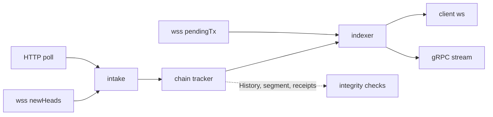

# Chain tracker: one head, reorg and logs pipeline

Status: proposal, 2026-10-14. No code yet. Plan: [plan.md](plan.md). Supersedes the window, follower and fork-adoption parts of [data-integrity/chain-view.md](../data-integrity/chain-view.md).

Decisions already taken:

1. Logs come from `eth_getBlockReceipts`, not from vendor `logs` subscriptions.
2. Logs stay gap-free on every network, including networks with only wss sources.
3. Only policy-eligible upstreams can push heads.
4. HTTP polling is a subscription source by opt-in per upstream; wss is one by default.
5. Sources stop 60s after the last consumer leaves.
6. `Gap` closes each connection with a `logs` subscription on that network with `1013`, as buffer overflow does today.
7. gRPC `StreamBlocks` resends the new branch on a reorg; it has no removal message (§6.1).
8. gRPC `StreamBlocks` resumes from the last header the client applied (§6.1).

## 1. Terms

| Term | Meaning |
|---|---|
| subscription source | Upstream that feeds headers to the chain tracker, by wss push or HTTP poll |
| header | One block header: number, hash, parentHash, logsBloom, roots, raw JSON |
| intake | The gates a header passes before the tracker sees it |
| chain tracker | Per-network state: hash-linked window, fork choice, gap fill, receipts |
| head cursor | Highest block the tracker has emitted as `Head` |
| logs cursor | Highest block whose logs the tracker has emitted; never passes the head cursor |
| indexer | Transport-neutral subscription core: filters, matching, fan-out |
| egress | Consumer of indexer events: client WebSocket, gRPC `StreamBlocks` |

## 2. Today

| Component | Loop | Fetches | Keeps |
|---|---|---|---|
| `EvmStatePoller` | per upstream, `statePollerInterval` (30s) + traffic | `eth_getBlockByNumber(latest)` | number, timestamp; drops hash, parentHash |
| `chainFollower` (`integrity_chainfollower.go`) | per network+group, 1s ticker | `eth_getBlockByNumber(n)` per block, fresh | linked segment, 32 headers |
| `blockStreamHub` (`erpc/block_stream.go`) | `OnLatestBlock` of every upstream | `eth_getBlockByNumber(n)` per block | nothing |
| indexer + `wsupstream` | vendor wss pushes | none | last head number and hash |

Problems:

- 3 loops track one head; 2 of them fetch every block again.
- WebSocket heads are never checked against parentHash.
- A vendor drop loses every event in the gap; monad has one wss vendor.
- `logs` uses N vendors × M filters upstream subscriptions; reorg semantics are each vendor's own.
- An HTTP-only upstream can never serve subscriptions.

## 3. Shape



| Layer | Home | Owns | Knows transport? |
|---|---|---|---|
| Transport | `indexer/adapters/wsupstream`, `EvmStatePoller` | wss newHeads + pendingTx subscriptions, reconnect; HTTP latest-header poll | yes |
| Intake | `EvmStatePoller.ObserveHead`, `Network.intakeHead` | chain-identity gate, per-upstream head counter, eligibility, fallback tier, header integrity | no |
| Chain tracker | `architecture/evm/chain_tracker.go` (from `integrity_chainview.go`) | window, fork choice, gap fill, reorg, receipts, logs cursor | no |
| Indexer core | `indexer/` | client subscriptions, log filter matching, bloom demand, pendingTx dedup, fan-out | no |
| Egress | `indexer/adapters/wsclient`, gRPC `StreamBlocks` | writes to clients | own side only |

Dependencies point inward: transports → intake → tracker → indexer → egress. The indexer never imports `architecture/evm`; the tracker imports the indexer's event contract.

## 4. Contracts

```go
// indexer: the event contract the tracker produces into. Neutral types only.
type ChainSink interface {
    // WantsLogs reports whether any active logs filter may match a block
    // with this logsBloom (256 bytes). The tracker fetches receipts only then.
    WantsLogs(networkId string, bloom []byte) bool
    Head(ev ChainBlock)                     // ascending, once per adoption
    Logs(ev ChainBlock, logs [][]byte)      // chain order, verbatim log JSON
    Unwind(ev ChainBlock, logs [][]byte)    // descending, before the new branch
    Gap(networkId string, from, to int64)   // unrecoverable; closes logs connections and gRPC streams
}

type ChainBlock struct {
    NetworkId string
    Number    int64
    Hash      string
    Header    []byte // newHeads payload, verbatim projection
}

// architecture/evm: one tracker per (network, group).
func (t *ChainTracker) ObserveHeader(h *TrackedHeader) // after intake gates
func (t *ChainTracker) ObserveTarget(height int64)     // served tip, while no source is live
// Still implements integrity.History, ChainSegment, ReceiptCache, PinReconfirmer.

// architecture/evm: the poller is the one intake for an upstream.
func (e *EvmStatePoller) ObserveHead(raw []byte) (accepted bool)
// Network registers this once per upstream; it calls Network.intakeHead.
// Same lifetime rule as OnLatestBlock: never per request, must not block.
func (e *EvmStatePoller) OnHeader(cb func(raw []byte))
```

`EventIngress`, `StreamEvent` and `IngressSelector` stay for `newPendingTransactions` only.

## 5. Head path

Example, one wss push:

```
1  wss newHeads    {number:0x12d, hash:0xaa, parentHash:0x9f}  from up=alchemy
2  ObserveHead     identity gate ok; counter alchemy 300 → 301
3  intakeHead      alchemy eligible; tier primary
4  tracker         held[300]=0x9f, parent matches → adopt 301
5  NoteObserved    network delivered-head floor 301
6  indexer Head    newHeads to 1,240 client subs
```

### 5.1 Gates

| # | Gate | Today | New home | On fail |
|---|---|---|---|---|
| 1 | Chain identity on major jump | `SuggestLatestBlock` | `ObserveHead` | drop; async verify as today |
| 2 | Per-upstream counter | poller | `ObserveHead` | n/a |
| 3 | Policy eligibility (`tipCandidateUpstreams("*")`) | none | `intakeHead` | counter only |
| 4 | Fallback tier hold-back | `deliversHeadsFrom` | `intakeHead` | counter only |
| 5 | Header integrity (integrity on) | follower fetches only | `intakeHead` | drop; recorded as upstream failure |
| 6 | Linkage | indexer number/hash dedup | tracker | gap fill or fork choice |

- Gate 4 asks whether a primary source is live: wss subscription live, or HTTP poll succeeded within 2 periods.
- Same-hash repeats are race losers: no-op, counted as `erpc_subscription_dedup_dropped_total{kind="newHeads"}`.

### 5.2 Where headers come from

| Source | Trigger | Cadence | Extra calls |
|---|---|---|---|
| wss `newHeads` | vendor push | per block | 0 |
| HTTP poll | poller timer while tracked | `resolveDebounce` (block time × 0.7, or `statePollerDebounce`) | 1 `eth_getBlockByNumber` per period |
| Client response | `eth_getBlockByNumber(latest)` through eRPC | traffic | 0 |
| Height only | `eth_blockNumber`, remote pod counter, served tip | traffic, 30s poll | header by number, only while no source is live |

- HTTP sources reuse `fetchBlock("latest")`; it already returns the full header and stops discarding it.
- The fast timer lives in the poller's existing goroutine; `TryUpdateIfLocallyStale` still collapses it with traffic polls.
- Sources start on the network's first demand and stop 60s after the last consumer leaves.
- Demand: a client subscription, a gRPC stream, or `integrity.follow.enabled` on the network.

## 6. Fork choice, gaps, reorgs

The tracker is the only writer of the number→hash pin. Two kinds of evidence reach it:

| Evidence | Examples | Authority |
|---|---|---|
| Network answer | client `eth_getBlockByNumber` response, tracker fetch, `ReconfirmPin` | adopted, as chain-view decision 1 ("trust `network.Forward`") |
| Source push | wss `newHeads`, HTTP poll header | adopted when it extends the head; confirmed first when it conflicts |

Rules, applied per header in order:

1. Hash already held → no-op.
2. Parent is the held head → adopt, emit `Head`.
3. Number > head + 1 and parent unknown → gap fill: fetch head+1 … number−1 by number, bounded concurrency; then link.
4. Conflict (a held height has another hash, or the parent is not the held block) → walk back by parentHash to the common ancestor, at most `reorgWindow` blocks.
5. A pushed branch needs one confirmation: `ReconfirmPin(ancestor+1)`, a fresh by-number network answer, cooldown 1s. Adopt the branch it names; drop the other.
6. Adopting a branch: `Unwind` held blocks above the ancestor, newest first; then `Head` for the new branch, oldest first.
7. No ancestor within `reorgWindow` → drop branch, `stall{reason="unreconciled"}`.
8. Gap above `maxBackfill` → re-anchor at the header, emit `Gap`, `stall{reason="backfill_exceeded"}`.
9. No live source → `ObserveTarget(served tip)` fetches missing heights by number, as the follower does today.

Reorg example, two sources racing:

```
t0    held      99 0x01 ← 100 0xaa                 (A pushed 100)
t1    B pushes  100 0xbb, parent 0x01              conflict at 100
        reconfirm 100 → network answers 0xaa       keep 0xaa; drop 0xbb
t2    B pushes  101 0xcc, parent 0xbb              conflict at 100
        fetch 0xbb by hash; ancestor 99
        reconfirm 100 → network answers 0xbb       adopt branch
        Unwind  100 0xaa                           its logs sent with removed:true
        Head    100 0xbb, 101 0xcc
        Logs    100 0xbb, 101 0xcc                 after receipts arrive
```

- A client response that changes a pin inside the emitted range produces the same `Unwind`/`Head` events.
- Every fetch goes through `network.Forward`: routing, block-availability gate, failsafe, consensus when configured.

### 6.1 Reorg on the wire

The reorg above, per consumer:

| Consumer | Receives | Precedent |
|---|---|---|
| ws `newHeads` | `100 0xbb`, `101 0xcc` | geth sends only the new head, `0xcc` |
| ws `logs` | logs of `100 0xaa` with `removed:true`; then logs of `100 0xbb`, `101 0xcc` | geth; the `eth_subscribe` contract |
| gRPC `StreamBlocks` | `100 0xbb`, `101 0xcc` | QuickNode Streams "restream on reorg" |

gRPC client rule: a header with a number at or below the last one received replaces that number and every number above it.

- The first resent number is ancestor + 1: the same fact as Substreams `BlockUndoSignal.last_valid_block`, with no extra message.
- Per-block removal (Firehose `STEP_UNDO`, geth `removed:true`) costs one message per dropped block and keeps every sent payload until finality.
- Each header carries `hash` and `parentHash`: a client can check linkage itself.
- `Gap` ends the stream with `DATA_LOSS`; the message names the missing range.
- Proto: `blockchain-data-standards/manifesto` `evm/stream.proto`. "Ascending, once per block" becomes "ascending; after a reorg, restarts at the fork point". Resume adds 2 optional fields.

Resume:

- Without it, a reorg or block between disconnect and reconnect is lost to the client.
- `StreamBlocksRequest` gains `optional uint64 fromBlock` and `optional bytes fromHash`: the last header the client applied.
- Both set, or neither; one alone is `INVALID_ARGUMENT`. Neither: start at the tip, as today.
- Replay starts at `fromBlock + 1` when `fromHash` is canonical, else at `fromBlock − reorgWindow`. The client rule makes over-replay safe, so no ancestor search.
- Canonical check: the tracker window; below it, one header by number through `network.Forward`.
- `fromBlock` above this pod's head (reconnect to a lagging pod): the stream sends nothing until the head reaches `fromBlock`, then checks `fromHash`.
- Replay reads the tracker window; older heights come by number through `network.Forward`, at most `maxBackfill`.
- Beyond `maxBackfill`: `OUT_OF_RANGE`; the client backfills by unary calls.
- Replay then live: one ordered sequence per stream; live heads wait until replay reaches them.
- Same shape as Firehose and Substreams cursors, without an opaque cursor.

## 7. Logs path

```
1  Head 101 0xcc     logsBloom has Transfer topic bits
2  WantsLogs         filter {topics:[Transfer]} may match → true
3  fetch             eth_getBlockReceipts(0xcc) → 255 receipts, 790 logs
4  store             receipts by hash in window (integrity ReceiptCache)
5  Logs 101          indexer matches 790 logs × 2 filters → 41 notifications
```

- No fetch when `transactionsRoot` is the empty-trie root, or `WantsLogs` is false.
- Bloom skip is proven per network: the first 8 blocks with transactions are fetched regardless. Header bloom must equal OR of receipt blooms; any later mismatch turns the skip off for the process.
  - Checked 2026-10-14, one block each: equal on eth, sepolia, hoodi, monad.
- Logs cursor: `Logs` strictly in chain order; heads never wait for it.
- A receipts fetch that fails retries with backoff. When its block leaves the window, `Gap` fires for logs.
- `Gap` closes each connection with a `logs` subscription on the network with `1013`; the client resubscribes and backfills with `eth_getLogs`.
- Logs travel as verbatim JSON. Receipt logs carry `blockTimestamp`; `integrity.Log` does not model it.
- Matching uses `LogsFilter.Matches` (geth `filterLogs`), moved out of `integrity` into `architecture/evm/logfilter`. Integrity and indexer share it.
- `Unwind` replays the block's stored logs with `removed:true` to every filter matching now, as geth does.
- `fromBlock`/`toBlock` in client subscribe params are ignored, as for a live geth subscription.

Cost, measured 2026-10-14 on public RPCs, 5 consecutive blocks each:

| Chain | Block time | Receipts KB/block | All logs KB/block | Receipts RTT ms |
|---|---|---|---|---|
| eth | 12s | 540–1,790 | 339–1,212 | 116–163 |
| sepolia | 12s | 677–1,388 | 507–1,188 | 97–124 |
| hoodi | 12s | 16–173 | 11–147 | 64–130 |
| monad | ~0.4s | 41–158 | 32–136 | 68–96 |

- One pod with a matching filter: about 7.5 GB/day on eth, 22 GB/day on monad.
- Logs reach clients one receipts round trip after the head (about 70–160 ms above).
- Window memory: 34 blocks × ~1 MB ≈ 35 MB per tracked eth network.

## 8. Integrity

| Guarantee | Integrity off | Integrity on |
|---|---|---|
| parentHash linkage, fork choice, gap fill | yes | yes |
| Header: `blockHashRecompute`, `headerConsensusInvariants`, `headerFieldShapes` | no | every header, every source |
| Consecutive: `baseFeeDerivation`, `timestampMonotonicity` | no | over the tracker segment |
| Receipts: `receiptsRootRecompute`, `bloomMatch`, `logIndexContiguity`, `sameBlockHash` | no | every receipts fetch |
| Client `eth_getLogs` completeness (`getLogsCompleteness`) | n/a | warm cache whenever logs subscriptions run |

- With integrity on, every delivered log is proven against `receiptsRoot` of a hash-linked header.
- Change: tracker fetches run the integrity checks. Today `IsInternal` skips validation for every internal request.
  - `IsInternal` keeps its retry/hedge/breaker and metrics meaning.
  - A new explicit flag exempts only the resolver's corroboration fetches.
  - Recursion stays bounded: `receiptsRootRecompute` asks for a header the tracker already holds.
- Chain profiles still apply: Kaia excludes `receiptsRootRecompute`.

## 9. Config

```yaml
upstreams:
  - id: monad-http
    endpoint: https://rpc.vendor.example/monad
    evm:
      subscriptionSource: true    # unset: true for ws/wss, false for http/https
networks:
  - architecture: evm
    evm:
      chainId: 143
      chainTracker:
        reorgWindow: 32           # was networks[].integrity.reorgWindow
        maxBackfill: 5m           # chain progress; converted to blocks by block time
    integrity:
      follow:
        enabled: true             # integrity as a tracker consumer
```

| Key | Change |
|---|---|
| `upstreams[].evm.subscriptionSource` | new |
| `networks[].evm.chainTracker.reorgWindow` | moved from `integrity.reorgWindow` (project, network, profiles) |
| `networks[].evm.chainTracker.maxBackfill` | new; replaces `integrity.follow.maxBlocksPerTick` |
| `integrity.follow.interval` (project, network, profiles) | deleted: event-driven |
| `networks[].evm.stripSubscribeFromBlockZero` | deleted: no upstream `logs` subscribe |
| `indexer.canonicalChainDepth` (deprecated, ignored) | deleted; `indexer.dedupWindowSize` stays for pendingTx |

Strict decoding rejects the deleted keys: a breaking config change, no aliases.

## 10. Metrics

| Metric | Change |
|---|---|
| `erpc_chain_tracker_source_heads_total{project,network,upstream,outcome}` | new; outcome: `adopted`, `duplicate`, `gated_identity`, `gated_eligibility`, `gated_tier`, `gated_integrity`, `unlinked` |
| `erpc_integrity_follow_head`, `_lag`, `_stall_total` | renamed `erpc_chain_tracker_head`, `_lag`, `_stall_total` |
| `erpc_integrity_reorg_depth` | renamed `erpc_chain_tracker_reorg_depth` |
| `erpc_integrity_aux_request_total` | new `kind="chain_logs"`, `kind="chain_header"` |
| `erpc_upstream_subscriptions_active` | `kind="logs"` disappears |
| `erpc_subscription_dedup_*` | `kind="logs"` disappears |

## 11. Removed, merged, one home

| Today | Fate |
|---|---|
| `chainFollower`: ticker, `advance`, `step`, `ingest` | merged into tracker gap fill; ticker deleted |
| `chainView` | becomes `ChainTracker` |
| `blockStreamManager`, `blockStreamHub`, `fetchBlockHeader`, `blockStreamMaxBackfill` | deleted; `StreamBlocks` is an indexer egress |
| indexer `headMarker`, `lastHead`, `headMu` | deleted; tracker adoption is the dedup |
| `NetworkHandle.SuggestLatestBlock`, `networkHandle.heads`, `headSource` | replaced by `ObserveHead` + `intakeHead` |
| wsupstream logs: `EnsureFilter` for logs, `stripFromBlockZero` | deleted |
| logs case of `DedupKeyForFilter`, logs dedup windows | deleted |
| `subIngressSelector`, `reconcile`, `partitionIngresses` | kept, pendingTx only |
| `NoteObservedLatestBlock` call in subscription manager | moved to tracker `Head` |
| `stateProberFor(...).onNewHead` call in `chainFollower.advance` | moved to tracker `Head` |
| `ErrNoWsUpstreamAvailable` | renamed `ErrNoSubscriptionSource` |

One home per fact:

| Fact | Home |
|---|---|
| Head acceptance | intake |
| Canonical chain, reorgs, gaps | tracker |
| newHeads payload: block JSON minus `transactions`, `uncles`, `withdrawals`, `size` | tracker header projection |
| Log filter semantics and bloom test | `architecture/evm/logfilter` |
| Fan-out to clients and gRPC | indexer |
| Reorg window | `chainTracker.reorgWindow` |

## 12. Risks

- Logs latency rises by one receipts round trip versus vendor log pushes.
- Receipts bandwidth: see §7; every pod fetches its own.
- `eth_getBlockReceipts` support checked on public RPCs only; Edge vendors unchecked.
- A conflicting push waits one fresh by-number fetch (about 100 ms) before it can switch the branch.
- When upstreams disagree at the tip, each network answer can move the pin; subscribers see every move as `Unwind`/`Head`.
- A polled header and a vendor push can differ in optional fields; first adopted wins.
- Breaking config and metric renames: dashboards and configs need updates in the same release.
- `newPendingTransactions` keeps today's wss-only path.
- `StreamBlocks` consumers that expect strictly ascending numbers see a repeat after a reorg. Known consumers: `edge-api` relays it; a Turbo tip-detection experiment (`streamling-goldsky-plugins` #162) reads it. Neither checked.
