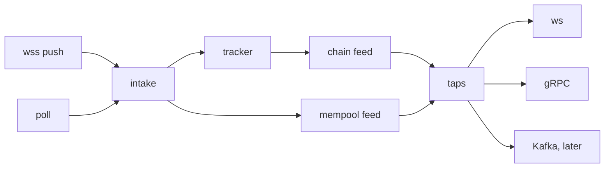

# Chain tracker: one chain feed, any source in, any transport out

Status: ready for review, 2026-10-20; covers `main` through [#1287](https://github.com/erpc/erpc/pull/1287). No code yet. Plan: [plan.md](plan.md). Supersedes the window, follower and fork-adoption parts of [data-integrity/chain-view.md](../data-integrity/chain-view.md).

Decisions:

1. Logs come from `eth_getBlockReceipts`; `eth_getLogs` by block hash is the fallback while integrity is off.
2. Any upstream can be a source, by opt-in per upstream; wss upstreams are sources by default. A source pushes when its transport and its upstream can, and polls otherwise.
3. Sources vote: the newest held header of each live authoritative source is one vote, and the branch with the most votes is canonical. Client and integrity answers never vote; settles and no-source asks vote only as §6 rules 5 and 6 say.
4. Consumers read shared feed state from their own cursor; the core keeps no per-consumer queue. Reorgs, resume, slow consumers and catch-up are one code path.
5. The window holds `maxBackfill` of chain time, at least `reorgWindow` blocks. Resumable taps catch up inside it; ws taps keep within `reorgWindow` blocks. A reorg inside a tap's range reaches it as Reverted; anything else ends it with its transport's signal.
6. On a reorg, resumable transports resend from the fork point; ws `logs` gets `removed:true`, as geth does.
7. Resumable transports resume from the last block they applied; a cursor the pod cannot place ends the stream, so a client never keeps a branch it was not told about.
8. `newPendingTransactions` uses the same sources and taps, over a mempool feed.
9. Polls and pending-transaction subscriptions stop 60s after the last tap closes. wss `newHeads` starts with the network, whether or not a WebSocket or gRPC server runs, and stays on: it also keeps routing heads fresh.
10. Nothing needs a person: every degraded state has a detector, an automatic recovery and a time bound (§13). No switch stays set until a restart.
11. Vendors serve a block's receipts as soon as they announce its head. Assumed, not measured at the tip; §10 covers a vendor that lags.

## 1. Terms

| Term | Meaning |
|---|---|
| source | Upstream that feeds headers, by push (wss) or poll (any RPC client) |
| observation | One header or pending transaction from one upstream |
| intake | Parsing, validity and authority checks on each observation |
| accepted | A source header that passed intake checks 0–2 on this pod |
| newest known block | The higher of the tracker's head and the network's served tip (`EvmHighestLatestBlockNumber`: the freshest block that `evm.servedTip.quorum` non-benched upstreams have); never a single vote |
| live bound | `max(3 × block time, 2s)`, at most 60s |
| live | A source with an accepted header, unless the newest known block has stayed above that header for longer than the live bound |
| authoritative | Policy-eligible; with failover on, fallback tier only until a primary source has been live for 60s |
| vote | The newest held header of one live authoritative source |
| tracker | Fork choice for one (network, group), on one goroutine; the only writer of its chain feed |
| network-wide tracker | The tracker of group `""`: it serves taps and moves the network's latest block |
| group tracker | The tracker of one use-upstream group; it serves integrity, as today |
| chain feed | What one tracker holds: headers by hash, pins, receipts |
| root | A held header whose parent is not held; held headers form one tree per root |
| pin | The canonical hash at a height; the head is the highest pin |
| orphan | A held header that is not pinned |
| fork point | The highest pinned block two branches share; replay starts at fork point + 1 |
| settle | `latest` fetched from up to 3 upstreams that do not vote, to break a tie |
| re-anchor | The pins move to another tree |
| window | What the network-wide tracker holds: the last `maxBackfill` of chain time, at least `reorgWindow` blocks |
| reorgWindow | Floor of the window; window of group trackers; walk depth; receipts depth; ws lag bound |
| logs head | The highest pin up to which every block's receipts are held or not needed |
| scheduler | Per (network, pod) limit, classes and backoff for every tracker fetch |
| mempool feed | Rings of deduplicated pending transactions, one per (network, variant) |
| tap | One consumer of a feed: its cursor and its read loop |
| cursor | Number and hash of the last block a tap applied |
| out of range | A cursor the feed cannot continue: below the window, on a branch whose fork point left the window, or unknown to every upstream |
| demand | Topics that open taps need; a topic is `newHeads` or `newPendingTransactions:<variant>` |
| transport | Encodes a tap's reads for one wire: ws, gRPC; Kafka later |
| resumable transport | One whose consumers reconnect from a cursor: gRPC, Kafka |

Block time: the mean header-time step over the last `reorgWindow` pins; until 2 pins exist, `GetNetworkBlockTime`, else 12s.

## 2. Today

| Component | Loop | Fetches | Keeps |
|---|---|---|---|
| `EvmStatePoller` | per upstream, `statePollerInterval` (30s) + traffic | `eth_getBlockByNumber(latest)` | number, timestamp; drops hash, parentHash |
| `chainFollower` (`integrity_chainfollower.go`) | per network+group, 1s ticker | `eth_getBlockByNumber(n)` per block, fresh | linked segment, 32 headers |
| `blockStreamHub` (`erpc/block_stream.go`) | `OnLatestBlock` of every upstream | `eth_getBlockByNumber(n)` per block | highest number |
| indexer + `wsupstream` | vendor wss pushes; `newHeads` subscribed at startup while the WebSocket server is on | none | indexer: last head number and hash |

Problems:

- 3 loops track one head; 2 of them fetch every block again.
- WebSocket heads are never checked against parentHash.
- A wss drop loses every event in the gap; a network with one wss upstream then delivers nothing.
- `logs` uses N vendors × M filters upstream subscriptions; reorg semantics are each vendor's own.
- An HTTP-only upstream can never serve subscriptions.
- A wss upstream that refuses `newHeads` as unsupported feeds no subscription heads until its socket reconnects.
- Each transport delivers its own way: indexer fan-out into per-subscription buffers for ws; a polling hub for gRPC.
- One answer decides a pin: client and integrity answers rewrite pins (`chainView.observe`), and `ReconfirmPin` trusts whichever upstream routing picks.
- Some degraded states last until a restart: auto-ignored methods, the poller give-up, the chain-identity cordon, the follower's retry of an unreconciled block.

## 3. Shape



| Layer | Home | Owns |
|---|---|---|
| Sources | `indexer/adapters/wsupstream`, `EvmStatePoller` | wss subscriptions, reconnect, silent-`newHeads` watch; latest-header poll |
| Source reconciler | `erpc` network | which topics each source feeds |
| Intake | network intake, `EvmStatePoller.ObserveHead` | parsing, header integrity, chain identity, head counter, liveness, authority |
| Tracker and chain feed | `architecture/evm/chain_tracker.go`, from `integrity_chainview.go` | votes, fork choice, window, receipts |
| Scheduler | `architecture/evm/chain_fetch.go` | every tracker fetch: limit, classes, backoff |
| Mempool feed | `indexer/mempool` | dedup ring per subscribe variant |
| Taps | `indexer/taps.go` | read loops, demand |
| Transports | `erpc` ws server, gRPC server | encoding, auth, wire signals |

- Dependencies point to `indexer`: sources, transports and the tracker use its interfaces. `indexer` imports neither `erpc` nor `architecture/evm`.
- EVM encoding (newHeads projection, log matching, proto conversion) reaches each transport from `architecture/evm` at construction.

Execution model:

- Each tracker is one goroutine with a mailbox. Observations, fetch results and ticks are messages; the loop never holds a lock across I/O.
- The mailbox never blocks a sender, and never drops fetch results or ticks: at most 16 fetches are in flight. When headers fill it, answers drop first, then each source keeps only its newest header; walks fill the heights that dropped.
- Fetches run in the scheduler; their results return to the mailbox.
- Taps read the state the tracker publishes after each change; a Read never takes a lock the tracker waits on.
- Tracker, reconciler and tap loops run under `recover`, counted in `erpc_unexpected_panic_total`, as the ws server's handlers do (`erpc/ws_server.go:255`). In the tracker, a panic drops only the message it was handling; 3 in a row reset it (§6).

## 4. Contracts

```go
// indexer: chain- and transport-neutral.

type Cursor struct {
    Number uint64
    Hash   [32]byte
}

type Block struct {
    Number     uint64
    Hash       [32]byte
    ParentHash [32]byte
    Header     json.RawMessage // verbatim, as first held
    Receipts   json.RawMessage // verbatim; set only for blocks ReadOpts asked for
}

type Batch struct {
    Reverted []Block // the tap's old branch, newest first
    Applied  []Block // pinned blocks from the fork point + 1, oldest first; at most reorgWindow
    Next     Cursor
}

type ReadOpts struct {
    // MayMatch: Read also returns receipts of each block whose logsBloom
    // may match. Nil: headers only.
    MayMatch func(bloom []byte) bool
}

// ChainFeed is the reader side of one tracker.
type ChainFeed interface {
    // Head is a new tap's start: the head while a source is live, else the
    // next pin change.
    Head(ctx context.Context) (Cursor, error)
    // Read returns the next non-empty batch from c (§9.1), waiting as
    // needed, bounded by ctx. ErrOutOfRange: the feed cannot continue c.
    Read(ctx context.Context, c Cursor, o ReadOpts) (Batch, error)
    // Want registers a tap's ReadOpts until release; the feed fetches
    // receipts when a block is pinned and any registered MayMatch wants it.
    Want(o ReadOpts) (release func())
    // LogsHead is the logs head (§1); ws logs taps measure lag from it.
    LogsHead() Cursor
}

var ErrOutOfRange = errors.New("cursor out of range")

// MempoolFeed is the reader side of one network's pending transactions.
type MempoolFeed interface {
    Tail(variant string) uint64 // newest sequence; a new tap starts after it
    // Read waits for payloads after seq, bounded by ctx.
    // ErrOutOfRange: seq left the ring.
    Read(ctx context.Context, variant string, after uint64) (txs []json.RawMessage, next uint64, err error)
}

// Taps runs read loops: read, emit, repeat. A loop ends when ctx ends, emit
// fails, or the feed returns an error. transport and kind label metrics.
func NewTaps(onDemandChange func(networkId string)) *Taps // the callback never blocks
func (t *Taps) RunChain(ctx context.Context, networkId, transport, kind string,
    f ChainFeed, start *Cursor, o ReadOpts, emit func(Batch) error) error // start nil: f.Head
func (t *Taps) RunMempool(ctx context.Context, networkId, transport, variant string,
    f MempoolFeed, emit func([]json.RawMessage) error) error
func (t *Taps) Demand(networkId string) []Topic

// Intake is what sources report into; erpc implements it per network.
type Intake interface {
    Header(upstreamId string, raw json.RawMessage)
    PendingTx(upstreamId, variant string, raw json.RawMessage)
    // Subscribed reports a push subscribe's answer for t: nil once it is
    // live, else the upstream's error (§5.1, §11).
    Subscribed(upstreamId string, t Topic, err error)
}

// Source feeds one upstream's observations over one transport.
type Source interface {
    Set(topics []Topic) // what to feed now; idempotent; empty stops
}
```

```go
// architecture/evm: writer side, one tracker per (network, group).
// Observe is the only input. vote is true for a source header that passed
// intake, and for settle and no-source answers (§6 rules 5, 6); client and
// integrity answers never vote.
func (t *ChainTracker) Observe(upstreamId string, raw json.RawMessage, vote bool)
// Implements indexer.ChainFeed, integrity.History, ChainSegment, ReceiptCache, PinReconfirmer.

// Per-upstream part of intake, shared with SuggestLatestBlock (heights).
func (e *EvmStatePoller) ObserveHead(raw json.RawMessage) (accepted bool)
```

- Client subscriptions and streams read the network-wide tracker; only it calls `NoteObservedLatestBlock`.
- Source headers vote in the network-wide tracker and in every group tracker whose selector matches their upstream. Answers to selector-scoped requests go only to their group's tracker.

## 5. Sources and intake

Example, one wss push:

```
1  wss newHeads   {number:0x12d, hash:0xaa, parentHash:0x9f}   up=rpc-a
2  intake         parsed; identity ok; counter rpc-a 300 → 301; accepted; rpc-a authoritative
3  tracker        vote rpc-a → 301 0xaa; parent 300 0x9f is the head → pin 301
4  network        NoteObservedLatestBlock(301)
5  1,240 taps     wake; Read(300 0x9f) → Applied [301 0xaa]
```

### 5.1 Transports

| Upstream endpoint | Mode | Topics | Cadence |
|---|---|---|---|
| `ws`, `wss` | push, `eth_subscribe` | `newHeads`, `newPendingTransactions:<variant>` | per event |
| `http`, `https`, `grpc` | poll, `eth_getBlockByNumber(latest)` through the upstream's client | `newHeads` | block time × 0.7, at most 12s; `statePollerDebounce` overrides |
| gRPC `StreamBlocks` client, Kafka consumer | push | `newHeads` | not planned; each is one `Source` |

- `upstreams[].evm.subscriptionSource`: unset is true for `ws`/`wss`, false otherwise.
- Poll mode runs in the poller's goroutine. `fetchBlock("latest")` returns the header bytes it drops today; `TryUpdateIfLocallyStale` still merges polls with traffic.
- A poll source never stops for good: after errors it backs off up to 60s and keeps polling.
- A wss upstream that refuses `eth_subscribe newHeads` as unsupported (`ErrCodeEndpointUnsupported`) feeds `newHeads` by poll, under the poll rule of §5.2, until a subscribe succeeds. Its source asks again on each reconnect and every 10 min. Other failed subscribes retry with backoff up to 30s, as today.
- A source on a new transport registers as an upstream, so intake can gate it.

### 5.2 Which topics each source feeds

```
push u:  newHeads                       always, from network init
poll u:  newHeads                       while demand has newHeads and authoritative(u)
push u:  newPendingTransactions:<v>     while demand has it and authoritative(u)

authoritative(u) = u in tipCandidateUpstreams(ctx), ctx without a selector: the policy's eligible set
                   and (failover off, or u is not fallback tier,
                        or no primary source has been live for 60s without a break)
```

- A primary source counts as live only while it is policy-eligible.
- One reconciler per network, on one goroutine, calls `Set`: at network init, whether or not a WebSocket or gRPC server runs; then on demand changes, liveness changes, subscribe answers (`Intake.Subscribed`), and on a timer at the live bound.
- Idle: no demand for 60s → polls and pending-transaction subscriptions stop.
- Silent `newHeads`: a connected push source whose `newHeads` pushed nothing for 15s, while its own head counter stood above its last push when those 15s began, reconnects its socket (`watchHeads`). A halted chain or a lagging node trips neither half. Pushes count before intake, so a gated source is not silent. The source stops voting after the live bound, before the reconnect.
- A pending-transaction topic with no message for 60s, while heads carry transactions, is subscribed again.

### 5.3 Intake

| # | Check | Home | On fail |
|---|---|---|---|
| 0 | Parse number, hash, parentHash, timestamp, logsBloom, transactionsRoot into fixed types | network intake | drop; `outcome="malformed"` |
| 1 | Header integrity, while integrity is on (§12) | network intake | drop; `erpc_integrity_violation_total` |
| 2 | Chain identity on a major jump | poller, the `SuggestLatestBlock` code path | drop; async verify, as today |
| 3 | Per-upstream head counter | poller | — |
| 4 | `authoritative(u)` | network intake | no vote |

- Checks run in this order, so a header that fails parsing, integrity or identity never moves the head counter.
- One predicate decides which topics run and which headers vote.
- Liveness uses accepted headers; the head counter, which pods share, does not decide it.
- Liveness is not the served tip's head bench (`IsHeadBenched`). The bench waits at least 30s, so poll skew never benches anyone; liveness reacts within the live bound, so a silent primary hands over before clients see a gap. The bench still shapes liveness through the served tip.
- Hashes compare as bytes: `0xAB…` and `0xab…` are one block.
- Client answers to `eth_getBlockByNumber(latest)` move the head counter, as today, and reach the trackers without a vote.
- The chain-identity cordon (`cordonForChainIdMismatch`) expires: the poller checks `eth_chainId` again every 5 min and uncordons on a match, as the consensus sit-out does (`consensus/executor.go:1468`).
- The poller give-up (`skipLatestBlockCheck` after 10 failures, `architecture/evm/evm_state_poller.go:523`) does not apply to a poll source, and expires after 10 min for other upstreams.
- Pending transactions pass check 4, then enter the mempool feed.

## 6. Tracker: votes, fork choice, reorgs

Each tracker runs one goroutine. It holds headers by hash; a header whose parent is held hangs under it, so held headers form one tree per root.

Rules:

1. Hold: an empty tracker holds the first vote as a root. A vote more than `maxBackfill` after the head, by header time, becomes a root at once. Any other vote whose parent is not held is walked (§7, class 1): missing heights by number, each checked against the parentHash of the block above, and a mismatch fetched by hash from its sender. The walk stops at a held header, or after `reorgWindow` blocks, where its lowest header becomes a root. Client and integrity answers inside the window are held; they never walk.
2. Fill: every root is extended downward (§8, class 3) until it joins another tree or reaches the window base.
3. Vote: a source's vote moves to its newest header once that header is held; until then its previous vote stays. An ancestor of the current vote does not move it back.
4. Choose: take the tree with the most votes; a tie keeps the tree of the pins. In it, from the root, follow the child whose subtree holds the most votes; a tie keeps the pinned child; a block with no voted child follows its pinned child. Stop at a block with no child to follow, or at a tie with no pinned child. The last block followed is the head; the path from the root to it is the pins.
5. Settle: a tie in rule 4 asks up to 3 authoritative upstreams that do not vote for `latest`. Each answer is walked like a vote and, once held, adds one vote for this decision. No answer, or no such upstream: the pins stay, and the settle runs again after backoff (§7).
6. No live source, with demand: each block time, at most every 12s, the tracker asks the first authoritative upstream in selection order for `latest`. That answer is the only vote until the next one; an answer that conflicts with the pins starts a settle.

- A re-anchor is counted in `erpc_chain_tracker_reanchor_total`.
- A message's changes are computed first and applied in one step. A panic drops the message and counts the header as `malformed` for its sender. 3 panics in a row reset the tracker to empty, counted in `erpc_chain_tracker_reset_total`; taps continue from their cursors (§9.1).
- Each pin change: `NoteObservedLatestBlock` (network-wide tracker only), then taps wake.
- `ReconfirmPin(n)` returns the pin at n while a source voted within the live bound; otherwise it settles first.
- A majority branch that reverts a block at or below the finalized height is followed, and logged as an error: clients stay on the chain the upstreams serve.
- By-number answers at or below the finalized height feed integrity's finalized anchors below the window, as today (`observeNarrowAnchors`). Inside the window, pins win.

Reorg example, three sources:

```
t0  pins 99 0x01, 100 0xaa            votes A, B, C → 100 0xaa         tap cursor 100 0xaa
t1  B, C push 101 0xcc (p 0xbb)       walk: 0xbb by hash from B; links to 99 0x01
t2  choose                            0xaa {A}, 0xbb {B, C} → pins 100 0xbb, 101 0xcc; 0xaa orphan
t3  tap Read(100 0xaa)                Reverted [100 0xaa]; Applied [100 0xbb, 101 0xcc]
```

## 7. Fetches

Every tracker fetch goes through one scheduler per (network, pod).

| Class | Fetches | Share |
|---|---|---|
| 1 head | walks of voted headers, settles, no-source asks | at least 1 slot |
| 2 tip receipts | receipts within `reorgWindow` of the head | at least 1 slot |
| 3 fill | fill, cursor fetches, older receipts | at least 1 slot |

- Limit: 16 fetches in flight per (network, pod). A sweep that ends in capacity errors on every upstream it tried (HTTP 429, `-32005`, compute units, a denied upstream permit) halves the share of the lowest busy class, never below 1 slot; 10 successes in a row in a class add 1 slot back. One throttled upstream is the selection policy's job (`ThrottledRate`).
- One fetch makes one sweep over the upstreams the selection policy orders, or the one upstream it names: no hedge, no network retry, timeout 10s. Failsafe config does not apply to it, an `internal` consensus policy included.
- A sweep skips an upstream whose breaker is open, and tracker fetches never feed a breaker: tracker load, such as slow receipts of large blocks, must not open a breaker that blocks clients. Subscription calls bypass the breaker entirely, as today.
- Tracker fetches skip project and network rate limits, which budget clients. Classes 1 and 2 take upstream rate permits as client requests do. Class 3 takes one only when one is free, so catch-up never crowds out clients; a denied permit counts as a capacity error. Upstream scores count every tracker fetch.
- By-hash fetches use the cache. Every other tracker fetch skips cache reads, tags included, because a cached answer is not a fresh view.
- The scheduler's backoff is the only retry: 200 ms, doubling, capped at 5 s, per key.
- Single-flight per (selector, upstream, method, params); a fetch that names one upstream is keyed without the selector, so trackers share it. Every fetch the tracker submits keeps the tracker as a waiter. A Read's own fetch is dropped while queued when its last Read leaves. Submit never blocks: the queue holds at most one request per key.
- Tracker fetches run integrity checks. A check on a tracker fetch reads only held data and skips when it needs more, so validation never fetches recursively.

## 8. Window

- Network-wide tracker: held headers whose timestamp is within `maxBackfill` of the head's, at least `reorgWindow` blocks below the head.
- Group trackers: `reorgWindow` blocks.
- Orphans: at most 4 per height; the oldest goes first.
- Receipts: held for blocks within `reorgWindow` of the head, orphans included. Older receipts are fetched for the Read that needs them and not kept.
- Matched logs: positions into the held receipts, per (block, filter).
- Fill extends a root downward (class 3): by number, each checked against the parentHash of the block above, and a mismatch fetched by hash. It runs for every root (§6 rule 2) and for a Read that needs an older height. When fill reaches a held header, the two trees join.
- A chain halt does not empty the window: the floor of `reorgWindow` blocks stays.

## 9. Taps and transports

### 9.1 Read

From cursor `c`, first matching case:

| Case | Result |
|---|---|
| `c` below the window | `ErrOutOfRange` |
| `c` pinned | Applied: `c + 1` … |
| `c` held in the pinned tree | Reverted: `c` … fork point + 1; Applied: fork point + 1 … |
| `c` held in another tree | wait while fill links it, then the row above; fill reaches the window base first → `ErrOutOfRange` |
| `c` not held, above the head | wait until the head reaches it |
| `c` not held, inside the window | fill down to `c.Number`; `c` pinned → that row. Else fetch `c.Hash` by hash: found → held and walked, and the rows above apply; not found → `ErrOutOfRange` |

- Applied ends at the head, after `reorgWindow` blocks, or before the first block whose receipts the tap needs and the feed does not hold yet.
- Receipts a logs tap needs for a Reverted block, and the feed lacks, are fetched by hash; Read waits for them as for Applied.
- Read returns once the batch is not empty. Until then it waits for the next pin change, a fill or those receipts; a new head alone does not restart a receipts wait.
- A tap at the head reads one block per head.
- Per-block work is shared: one receipts parse with an index by address and topic0, one match per filter, one encoding per transport.

### 9.2 Per transport

| Transport | Reads | Reorg on the wire | Out of range | Wait bounds |
|---|---|---|---|---|
| ws `newHeads` | headers | each new-branch head, oldest first | restart after the head | more than `reorgWindow` behind the head, nothing Reverted → restart after the head |
| ws `logs` | receipts where the filter bloom may match | `removed:true` logs of Reverted, newest first; then logs of Applied | close `1013`; closes from one event spread over 60s | more than `reorgWindow` behind the logs head → out of range; 60s on one block's receipts → out of range |
| ws `newPendingTransactions` | mempool | none | skip to the newest | — |
| gRPC `StreamBlocks` | headers | resend from the fork point | end, `OUT_OF_RANGE` | any Read wait 60s → `UNAVAILABLE`; one `Send` 10s → `UNAVAILABLE` |
| Kafka, later | headers, receipts | resend from the fork point | write a reset record, then restart after the head | — |

- geth sends only the new head after a reorg; ws `newHeads` sends each new-branch head.
- ws `newHeads` is lossy, as today and as in geth: a restart shows as a jump in numbers.
- `removed:true` logs go to every filter matching now, as geth does. They are the sent logs, from the same receipts.
- ws writes keep today's deadline of 10s per message (`wsWriteDeadline`).
- gRPC client rule: a header with a number at or below the last one replaces that number and every number above it.
  - The first resent number is fork point + 1: the same fact as Substreams `BlockUndoSignal.last_valid_block`, with no extra message.
  - Per-block removal (Firehose `STEP_UNDO`, geth `removed:true`) costs one message per dropped block and keeps every sent payload until finality.
  - Each header carries `hash` and `parentHash`: a client can check linkage itself.
- `UNAVAILABLE` tells a gRPC client to reconnect; `OUT_OF_RANGE` tells it the cursor is gone, so it backfills by unary calls.

### 9.3 Resume

- `StreamBlocksRequest` gains `optional uint64 fromBlock` and `optional bytes fromHash`: the last header the client applied.
- Both set, or neither; one alone is `INVALID_ARGUMENT`. Neither: start after the head, as today.
- The cursor goes to Read as is; §9.1 decides replay, wait and `OUT_OF_RANGE`.
- A cursor the pod cannot place, not held and not served by hash, is `OUT_OF_RANGE`: the client backfills, so it never keeps a fork the pod cannot see.
- Proto: `blockchain-data-standards/manifesto` `evm/stream.proto`. "Ascending, once per block" becomes "ascending; after a reorg, restarts at the fork point".
- Auth and rate limits run once when the stream opens, as for ws subscriptions; no per-block `eth_getBlockByNumber` through the request path.

### 9.4 Adding a transport

- One tap per consumer and one encoder: its own package and one registration point.
- Kafka:
  - One writer per (network, topic) across pods: a `data.Connector.Lock` lease, renewed at half its TTL. The tap stops when a renewal fails.
  - Fencing: Kafka's transactional producer, one `transactional.id` per (network, topic). Its epoch fences a writer that lost the lease; the new writer reads the cursor after `initTransactions`.
  - Cursor: number and hash of the topic's last record. Records keyed by block number; consumers apply the gRPC client rule.
- gRPC logs: `stream.proto` reserves content-selection flags; a logs flag sets `ReadOpts.MayMatch`.

## 10. Logs path

```
1  chain feed      pin 101 0xcc; logsBloom has Transfer bits; a registered MayMatch wants it
2  scheduler       eth_getBlockReceipts(0xcc), class 2 → 255 receipts, 790 logs
3  chain feed      receipts held with 0xcc; parsed once; index by address and topic0
4  tap Read        filter {topics:[Transfer]} → 41 logs
5  ws transport    41 notifications for each subscription with this filter
```

- Receipts are fetched when a block is pinned, not when a tap reaches it.
- A receipts answer counts only when it is non-null, every receipt names the requested `blockHash`, and it is non-empty unless `transactionsRoot` is the empty-trie root. Anything else is a failed fetch, never "no logs".
- Bloom check: the OR of the receipt blooms must equal the header's logsBloom, on every answer.
  - A mismatch counts against that upstream (`bloomMatch`), and the block is fetched from an upstream of another vendor (`Upstream.VendorName`).
  - When at least 2 vendors mismatch on 2 blocks in a row, and none matches, the chain's bloom differs: the check and the skip below turn off for the network, and those 2 blocks are fetched again. On a network whose upstreams are all one vendor, 8 mismatching blocks in a row do the same. With 2 or more vendors, one vendor alone never turns the check off. 8 matching blocks in a row turn it on again.
- Skip: after 8 matching blocks with transactions in a row, a block that no registered `MayMatch` wants is not fetched. Blocks whose `transactionsRoot` is the empty-trie root are never fetched.
  - Both skips apply only to headers whose hash recomputes: `blockHashRecompute` runs for this decision with integrity off too.
  - Chain profiles can turn the bloom check and both skips off, as they turn checks off today.
  - Checked 2026-10-14, one block each: bloom equal on eth, sepolia, hoodi, monad.
- Fallback, integrity off: receipts that fail on every upstream for 5s switch that block to `eth_getLogs` by `blockHash`. Its logs must name the block hash and pass the bloom check.
- A `logs` subscribe is refused with `ErrNoSubscriptionSource` when no upstream serves a usable method (receipts, or, with integrity off, `eth_getLogs`), or while every fetch of each usable method has failed for 60s. During that refusal, the feed fetches the head block's receipts every block time, at most every 12s; the first success ends it.
- Auto-ignored methods (`IgnoreMethod`, `upstream/upstream.go:1233`) expire after 10 min, so a vendor that answered "unsupported" during a deploy serves again.
- Logs travel as verbatim JSON. Receipt logs carry `blockTimestamp`; `integrity.Log` does not model it.
- Matching uses `LogsFilter.Matches` (geth `filterLogs`), moved out of `integrity` into `architecture/evm/logfilter`. Integrity and the ws `logs` transport share it.
- A `logs` subscribe parses its filter as geth does (`address`, `topics`); one that does not parse fails with `-32602` before any fetch. `fromBlock`/`toBlock` are ignored, as for a live geth subscription.

Cost, measured 2026-10-14 on public RPCs, 5 consecutive blocks each:

| Chain | Block time | Receipts KB/block | All logs KB/block | Receipts RTT ms |
|---|---|---|---|---|
| eth | 12s | 540–1,790 | 339–1,212 | 116–163 |
| sepolia | 12s | 677–1,388 | 507–1,188 | 97–124 |
| hoodi | 12s | 16–173 | 11–147 | 64–130 |
| monad | ~0.4s | 41–158 | 32–136 | 68–96 |

- Sizes above are uncompressed. eRPC sends `Accept-Encoding: gzip` (`clients/http_json_rpc_client.go:829`); gzip cuts receipts 8–12×.
- One pod with a matching filter, on the wire: about 0.7 GB/day on eth and 2.5 GB/day on monad with gzip; about 10× more from an upstream without gzip.
- Every pod fetches its own receipts unless a shared cache serves them by hash: 2.5 receipts calls/s per pod on monad.
- Logs reach clients one receipts round trip after the head (about 70–160 ms above).
- Receipts held: eth 32 blocks × ~1 MB ≈ 32 MB; monad 32 blocks × ~125 KB ≈ 4 MB.

## 11. Mempool feed

- Sources: push transports only. A network with no push source refuses `newPendingTransactions` with `ErrNoSubscriptionSource`.
- Feed: one ring per (network, variant) of the last 10,000 entries. A variant is one distinct set of subscribe params; at most 16 per network, then subscribe is refused with `ErrSubscriptionLimitExceeded`.
- A subscribe that opens a new variant waits up to 10s for its push sources' first answers (`Intake.Subscribed`). When every authoritative push source answers with an error other than a capacity error, the subscribe fails with the first one, as the upstream sent it: `-32602` for bad params. Capacity errors, connection errors and timeouts open the subscription; each source retries with its backoff.
- Dedup by transaction hash over 60s, at most 100,000 hashes per network.
- A new tap starts after `Tail`. A tap wakes at most every 50 ms and reads everything after its sequence. Out of range skips to the newest. No reorgs, no resume.
- Authority as for heads: fallback-tier sources subscribe only while they are authoritative, as `IngressSelector` does today.

## 12. Integrity

| Guarantee | Integrity off | Integrity on |
|---|---|---|
| parentHash linkage, fork choice, gap fill | yes | yes |
| Header: `blockHashRecompute`, `headerConsensusInvariants`, `headerFieldShapes` | only `blockHashRecompute`, for the receipts skips (§10) | every header, every source |
| Consecutive: `baseFeeDerivation`, `timestampMonotonicity` | no | each header against its parent, found by parentHash |
| Receipts: `receiptsRootRecompute`, `bloomMatch`, `logIndexContiguity`, `sameBlockHash` | bloom only (§10) | every receipts fetch |
| Client `eth_getLogs` completeness (`getLogsCompleteness`) | n/a | warm cache whenever logs taps run |

- Consecutive checks find the parent among held headers by parentHash, never by number; a parent that is not held skips the check. Today `parentInSegment` takes `HeaderAt(number − 1)` (`architecture/evm/integrity/history.go:103-113`), so every reorg 2 or more blocks deep fails `baseFeeDerivation`.
- Unanimous failure: when no header at 2 heights in a row passes a check within the live bound, from any upstream, the check is suspended for the network and those headers are kept. `erpc_integrity_check_suspended_total{check}` counts it. After 100 blocks the check runs in observe-only mode, and it enforces again once it passes 2 heights in a row. A check that every upstream fails is wrong, for example after a hard fork; with one upstream, that upstream alone decides.
- Tracker fetches run the checks (§7); `IsInternal` no longer skips them.
- `integrity.follow.enabled` opens one integrity follow tap per tracker. It holds demand, so polls run without clients, and it feeds `stateProberFor(...).onNewHead`. Out of range restarts it after the head.
- Group trackers: their upstreams' headers vote before the authority gate; their settles carry the group selector.
- With integrity on, every delivered log is proven against `receiptsRoot` of a hash-linked header.
- Chain profiles still apply: Kaia excludes `receiptsRootRecompute`.

## 13. Resilience

### 13.1 Failure model

| Component | Failure | Detection | Automatic recovery | Bound |
|---|---|---|---|---|
| wss source | socket drops | disconnect | reconnect, jittered 1–30s backoff (today); others vote; fallbacks start; walks link the missed blocks | 30s |
| wss source | socket alive, `newHeads` silent | no push for 15s while its own head counter stands above its last push | not live after the live bound; reconnect (`watchHeads`) | 30s after its head counter passes its last push |
| wss source | `newHeads` refused as unsupported | `Intake.Subscribed` error | polls instead; asks again on each reconnect and every 10 min | 10 min |
| any source | lags but keeps advancing | the newest known block stays above its vote | not live after the live bound; fallbacks and settles lead | live bound |
| any source | the chain makes no blocks | nothing newer is known | stays live; nothing reconnects or resubscribes | — |
| poll source | errors, 429 | failed polls | backoff up to 60s; never stops for good | 60s |
| other upstreams | poller give-up | `skipLatestBlockCheck` | expires | 10 min |
| intake | chain-identity cordon | cordon reason | `eth_chainId` checked every 5 min; uncordon on a match | 5 min |
| intake, integrity | a check no upstream passes | no passing header at 2 heights | suspended; observe-only after 100 blocks; enforced after 2 passing heights | 2 heights |
| tracker | sources disagree | split votes | the branch with the most votes; ties settle | 1 settle |
| tracker | reorg deeper than the window, or a gap past it | the majority's tree is not the pinned one | re-anchor; fill joins trees inside the window; other taps end with their transport's signal | `reorgWindow` blocks of walk |
| tracker | a message panics | `recover` | the message drops; 3 in a row reset the tracker to empty | 3 messages |
| tracker | every source down | no live source | one `latest` ask per block time, a settle on conflict | 12s |
| scheduler | rate limits | a sweep fails on capacity everywhere | halve the lowest busy class's share, never below 1 slot; classes 1 and 2 keep taking permits as clients do | 10 successes per slot |
| scheduler | fetch hangs | timeout | 10s, then backoff | 10s |
| receipts | one block not served | failed fetches | other upstreams; `eth_getLogs` fallback with integrity off; after 60s, ws `logs` taps out of range, closes spread over 60s | 60s |
| receipts | every fetch fails | 60s of failures | new `logs` subscribes refused; the head block's receipts are fetched every block time until one succeeds | 60s |
| receipts | method auto-ignored | ignore entry | the entry expires | 10 min |
| receipts | wrong bloom from one vendor | answer check | counted on it; refetch from another vendor | 1 fetch |
| reconciler | panic, missed wake | `recover`, timer | restart; timer at the live bound | live bound |
| taps | slow client | lag | ws `logs` out of range and ws `newHeads` restart past `reorgWindow`; gRPC `UNAVAILABLE` after a 10s `Send` | `reorgWindow` blocks |
| gRPC | pod lags, restarted, or fill is slow | a Read wait | 60s, then `UNAVAILABLE`; the client reconnects | 60s |
| mempool | subscription silent | no message for 60s while blocks carry transactions | resubscribe | 60s |
| integrity follow tap | out of range | Read error | restart after the head | 1 Read |
| Kafka writer | lease lost | renewal fails | tap stops; the transactional epoch fences it; the next holder resumes from the last record | lease TTL |
| block time | halt or restart | header timestamps | caps: poll cadence and no-source asks 12s, live bound 60s; the mean recovers after `reorgWindow` pins | `reorgWindow` blocks |

### 13.2 Bounds

| Resource | Bound | At the bound |
|---|---|---|
| Held headers | the window | the oldest leave |
| Orphans | 4 per height | the oldest leave |
| Receipts | blocks within `reorgWindow` of the head | older ones are fetched per Read and not kept |
| Matched logs | positions into held receipts | — |
| Batch | `reorgWindow` Applied blocks | the next Read continues |
| Walk | `reorgWindow` blocks in class 1 | a new root; fill continues in class 3 |
| Tracker fetches | 16 in flight per (network, pod), at least 1 per class | lower classes wait |
| Fetch queue | one request per key, and only while someone waits for it | joins the request in flight; dropped when its last waiter leaves |
| Fetch attempts | one sweep, then backoff from 200 ms to 5 s | — |
| Tracker mailbox | fetch results and ticks never drop; headers: the newest per source | answers drop first |
| Mempool | 10,000 entries per ring; 100,000 hashes over 60s per network; 16 variants per network | the oldest leave; subscribe refused |
| ws subscriptions per connection | `server.webSocket.maxSubscriptionsPerConnection` (100), as today | subscribe refused, `-32005` |
| ws subscriptions per instance | `server.webSocket.maxSubscriptions`, as today; 0 = unlimited | subscribe refused, `-32005` |
| ws connections | `server.webSocket.maxConnections` per instance and `maxConnectionsPerIP` per client IP, as today; 0 = unlimited | `429` before the upgrade |
| ws write | 10s per message, as today | the connection closes |
| gRPC send | 10s per message | the stream ends `UNAVAILABLE` |

The `server.webSocket` limits stay config, as today; every other bound is a constant. Distinct log filters have no cap: each costs one index lookup per block per address or topic it names.

### 13.3 Invariants

| Invariant | Holds by |
|---|---|
| Pins form one parentHash-linked chain from a root to the head | §6 rules 1, 2, 4 |
| Pins change only when votes point to another branch, or a settle breaks a tie | §6 rules 3–6; one goroutine; only by-hash fetches read the cache (§7) |
| ws `logs` and resumable taps get a parentHash-linked sequence; every break comes with Reverted to a delivered ancestor, or with an end signal | §9.1, §9.2 |
| ws `newHeads` breaks only as a jump in numbers, after a restart | §9.2 |
| Every `removed:true` log is a sent log, from the same receipts | §8, §9.1 |
| The head follows the vote majority after at most `reorgWindow` blocks of walk; no state stops it | §6; §13.1 |
| A slow tap never delays the tracker or another tap | §3 execution model |
| No degraded state lasts until a restart | §13.1 |

## 14. Config

```yaml
upstreams:
  - id: monad-http
    endpoint: https://rpc.vendor.example/monad
    evm:
      subscriptionSource: true    # unset: true for ws/wss, false otherwise
networks:
  - architecture: evm
    evm:
      chainId: 143
      chainTracker:
        reorgWindow: 32           # was networks[].integrity.reorgWindow
        maxBackfill: 5m           # chain time, compared on header timestamps
    integrity:
      follow:
        enabled: true             # an integrity follow tap: polls run without clients
```

| Key | Change |
|---|---|
| `upstreams[].evm.subscriptionSource` | new |
| `networks[].evm.chainTracker.reorgWindow` | moved from `integrity.reorgWindow` (project, network, profiles) |
| `networks[].evm.chainTracker.maxBackfill` | new; replaces `integrity.follow.maxBlocksPerTick` |
| `integrity.follow.interval` (project, network, profiles) | deleted: event-driven |
| `networks[].evm.stripSubscribeFromBlockZero` | deleted: no upstream `logs` subscribe |
| `server.webSocket.subscriptionBufferSize` | deleted: no per-subscription queue |
| `indexer` (`canonicalChainDepth`, `dedupWindowSize`) | deleted: the mempool bounds in §13.2 replace `dedupWindowSize` |

Strict decoding rejects the deleted keys: a breaking config change, no aliases.

## 15. Metrics

| Metric | Change |
|---|---|
| `erpc_chain_tracker_source_heads_total{project,network,upstream,outcome}` | new; outcome: `voted`, `duplicate`, `malformed`, `gated_identity`, `gated_integrity`, `gated_authority` |
| `erpc_integrity_follow_head`, `_lag` | renamed `erpc_chain_tracker_head`, `_lag` |
| `erpc_integrity_follow_stall_total` | deleted: no stall states; see re-anchor and settle |
| `erpc_integrity_reorg_depth` | renamed `erpc_chain_tracker_reorg_depth` |
| `erpc_chain_tracker_reanchor_total{project,network}` | new |
| `erpc_chain_tracker_reset_total{project,network}` | new: resets after 3 panics in a row |
| `erpc_chain_tracker_settle_total{project,network,outcome}` | new; outcome: `decided`, `undecided` |
| `erpc_chain_tracker_fetch_total{project,network,kind,class,outcome}` | new; kind: `header`, `receipts`, `logs`; outcome: `ok`, `error`, `capacity` |
| `erpc_chain_tracker_fetch_slots{project,network,class}` | new gauge: current share per class |
| `erpc_source_live{project,network,upstream}` | new gauge: 1 while live |
| `erpc_source_resubscribe_total{project,network,upstream,topic}` | new: silent pending-transaction topics (§5.2) |
| `erpc_upstream_websocket_heads_stall_reconnects_total` | existing; counts silent-`newHeads` reconnects (§5.2) |
| `erpc_taps{project,network,transport,kind}` | new gauge: open taps; replaces `erpc_websocket_subscriptions_active` |
| `erpc_tap_out_of_range_total{project,network,transport,kind,reason}` | new; reason: `below_window`, `fork_left_window`, `cursor_unknown`, `receipts_timeout`, `lag`; replaces `erpc_websocket_subscription_notifications_dropped_total` |
| `erpc_websocket_send_queue_length` | deleted with the per-subscription buffers |
| `erpc_network_subscription_last_head_timestamp_seconds` | existing; set on each head change of the network-wide tracker |
| `erpc_subscription_withheld_heads_total` | deleted: `erpc_chain_tracker_source_heads_total{outcome="gated_*"}` counts the same heads per upstream and reason |
| `erpc_subscription_undelivered_total` | deleted: taps read the feed, so no event goes undelivered |
| `erpc_integrity_check_suspended_total{project,network,check}` | new |
| `erpc_unexpected_panic_total` | existing; tracker, reconciler and tap loops report to it |
| `erpc_integrity_aux_request_total` | `kind="chain_follow"` disappears |
| `erpc_upstream_subscriptions_active` | `kind="logs"` disappears |
| `erpc_subscription_dedup_dropped_total` | `kind="logs"`, `kind="newHeads"` disappear; mempool only |
| `erpc_subscription_dedup_entries` | mempool only |

## 16. Removed, merged, one home

| Today | Fate |
|---|---|
| `chainFollower`: ticker, `advance`, `step`, `ingest`, the retry of an unreconciled block | merged into the tracker's walk and fill; re-anchor replaces the retry |
| `chainView` | becomes `ChainTracker` |
| pin writes of `chainView.observe` from `observeBlockView`, `resolveHeaderKind` and `ReconfirmPin` | replaced by `Observe` without a vote; only votes move pins |
| `matchRequestKind: internal` consensus for integrity's canonical fetches | no longer applies: tracker fetches follow §7, and settles replace the quorum |
| `blockStreamManager`, `blockStreamHub`, `fetchBlockHeader`, `blockStreamMaxBackfill`, `ProcessBlockStream` | deleted; gRPC is a transport over taps |
| indexer `Sink`, `StreamEvent`, `IndexedEvent`, `EventIngress`, `EventEgress`, `IngressSelector`, `NetworkHandle` | replaced by `Intake`, `Source`, feeds and taps |
| indexer `EnsureFilter`, `ReleaseFilter`, `subscribe`, `reconcile`, `partitionIngresses`, `Ingest`, `dedupe`, `fanOut`, `headMarker` | deleted |
| `networkHandle.heads`, `headSource`, `deliversHeadsFrom`, `subIngressSelector`, `tierWsIngresses`, wsupstream `HeadsLive` | replaced by `authoritative(u)`, liveness, votes and the source reconciler |
| `PrewarmUpstreamSubscriptions`, `prewarmInterval`, `bootstrapNetwork`, `SubscriptionManager.networks`, `bootstrapMu` | replaced by the source reconciler, which starts with each network (§5.2) |
| wsupstream `headsUnsupported`: no `newHeads` until the socket reconnects | replaced by poll mode and a re-ask every 10 min (§5.1) |
| wsupstream `EnsureFilter`, `RemoveFilter`, `FilterLive`, `stripFromBlockZero`, `isZeroBlockRef` | replaced by `Source.Set` |
| wsclient `enqueue`, `isLossy`, `runWriter`, per-subscription buffers; `WsConnection.NotificationDropped` | replaced by taps and their wait bounds |
| logs case of `DedupKeyForFilter`, logs dedup windows, `logRemoved` | deleted |
| `nullingress` | deleted |
| `IsInternal` | split: request kind `internal` for failsafe matching; the retry, hedge and breaker bypass for subscription calls, state-poller and chainId probes only; tracker fetches skip open breakers and never feed them (§7) |
| permanent switches: `IgnoreMethod` entries, `skipLatestBlockCheck`, the chain-identity cordon | each expires (§13.1) |
| `NoteObservedLatestBlock` call in the subscription manager | moved to the tracker's pin change |
| `stateProberFor(...).onNewHead` call in `chainFollower.advance` | the integrity follow tap |
| `ErrNoWsUpstreamAvailable` | renamed `ErrNoSubscriptionSource` |

One home per fact:

| Fact | Home |
|---|---|
| Which headers vote, which topics run | `authoritative(u)` and liveness, in network intake |
| Silent `newHeads` | the wss source's `watchHeads`, against its own head counter |
| Served tip: the number HTTP `latest` resolves to | `EvmHighestLatestBlockNumber` (`evm.servedTip.quorum`, head bench), unchanged; the network-wide tracker's pin changes floor it through `NoteObservedLatestBlock` |
| Canonical chain | the tracker's votes and fork choice (§6) |
| Pins, orphans, receipts | chain feed; only the tracker writes it |
| Fetch limits, classes, retries, cache use | the scheduler (§7) |
| Catch-up, reorg replay, out of range | `ChainFeed.Read` |
| Wire encoding, wire signals, wait bounds | each transport (§9.2) |
| newHeads payload: block JSON minus `transactions`, `uncles`, `withdrawals`, `size` | ws transport, from `architecture/evm` |
| Log filter semantics and bloom test | `architecture/evm/logfilter` |
| Resource bounds | §13.2 |
| Reorg depth, window | `chainTracker.reorgWindow`, `chainTracker.maxBackfill` |

## 17. Risks and behaviour changes

- Logs latency rises by one receipts round trip versus vendor log pushes.
- Receipts bandwidth: see §10; every pod fetches its own unless a shared cache serves them.
- An upstream that does not gzip sends about 10× the receipts bytes.
- Decision 11 is an assumption: a vendor that announces heads before its receipts are ready delays logs by one retry per block.
- Each poll source costs one call per 0.7 block time per pod: about 3.6 calls/s per pod on monad.
- wss upstreams subscribe `newHeads` at network init, even when no WebSocket or gRPC server runs: one push per block per upstream per pod.
- With integrity on, a network where no upstream serves `eth_getBlockReceipts` refuses `logs` subscriptions; today vendor `logs` subscriptions serve it.
- A network with one source follows that source: a fork it alone is on reaches clients until a second source or a settle outvotes it.
- With no live source, one upstream's `latest` moves the head each block time, until an answer conflicts and a settle decides.
- A tie with no upstream left to settle keeps the pinned branch.
- A majority branch that reverts a finalized block is followed, and logged as an error.
- A source that stays behind the newest known block for the live bound stops being live, so a slow primary hands over to fallbacks.
- A polled header and a vendor push can differ in optional fields; the first held wins.
- Fallback-tier polls run while no primary has been live for 60s: after a primary fails, seconds of head latency, no gap.
- ws `logs` slow client: today a full 256-notification buffer closes it with `1013`; now `reorgWindow` blocks of lag behind the logs head do.
- One block whose receipts fail for 60s closes every ws `logs` connection of the network with `1013`, spread over 60s.
- gRPC slow client: today it silently skips forward past `blockStreamMaxBackfill` (256) blocks; now the stream ends with `OUT_OF_RANGE` past the window, or `UNAVAILABLE` after a 10s `Send`.
- A gRPC client whose cursor is an orphan no upstream serves gets `OUT_OF_RANGE` and backfills, even after a 1-block reorg.
- gRPC `StreamBlocks` stops sending `eth_getBlockByNumber` per block through the request path: per-block rate-limit counting ends, as for ws notifications.
- Tracker fetches leave client rate limits. They share upstream permits with clients, except catch-up, which yields; when clients use a whole upstream budget, tracker fetches fail with them until load drops.
- Expiring switches re-probe failing vendors: one request per method every 10 min, one `eth_chainId` per cordoned upstream every 5 min.
- A check that no upstream passes is suspended after 2 heights; on a network with one upstream, that upstream alone can suspend it.
- On a network whose upstreams are all one vendor, that vendor's answers decide the bloom check: 8 truncated receipts answers in a row turn it off, and their missing logs are lost.
- Breaking config and metric renames: dashboards and configs need updates in the same release.
- `StreamBlocks` consumers that expect strictly ascending numbers see a repeat after a reorg.
