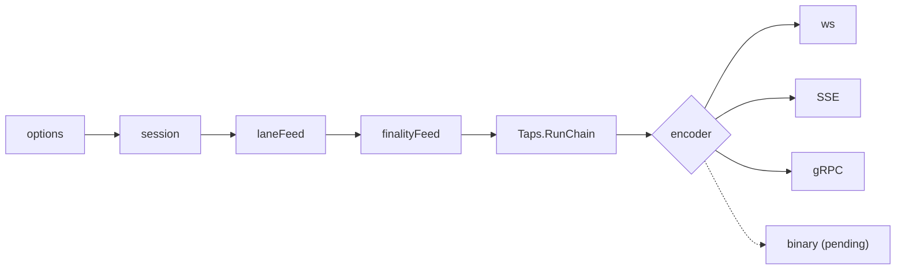

# Streams: one contract for backend apps, every transport

Status: draft for review. Plan: [plan.md](plan.md). Builds on [chain-tracker/feature.md](../chain-tracker/feature.md) (cited as CT§n); every block still comes from the chain tracker's taps (CT§10).

Decisions:

1. One contract: the options, messages, guarantees and end reasons below are the same on ws extended, SSE and gRPC; a transport only encodes them (§3, §4).
2. No second delivery path: every option is a cursor, a `ReadOpts` field, a feed wrapper or an encoder rule over `Taps.RunChain` and `ChainFeed.Read` (§3.7).
3. Standard `eth_subscribe` is unchanged; ws extensions are opt-in, per subscription or as URL defaults; data frames stay standard, control frames use their own method (§5).
4. Resume token = the cursor of the last block the client applied, `<numberHex>:<hash>`; any instance resumes it (§3.5).
5. Reorg modes: `geth` (ws only, today's), `undo` (one fork-point message), `none` (finalized only) (§3.1).
6. Finality modes cut what a tap applies at a bound; `safe` and `finalized` taps make the tracker hold headers down to each final tap's cursor (§4).
7. Heartbeats only on an idle stream, default W clamped to 5–30s, each carrying head, finalized, safe (§3.2).
8. SSE is a GET of the network URL with `Accept: text/event-stream`; `Last-Event-ID` is the resume token (§6).
9. gRPC gains `StreamLogs` and `StreamPendingTransactions`; `StreamBlocks` gains finality and opt-in control messages, wire-compatible with manifesto#26 (§7).
10. A binary transport (QUIC or other) is one more encoder of the same session: **pending the QUIC decision** (§8).
11. `X-ERPC-Min-Block: n` makes an HTTP read wait up to W for the lane's `Latest` ≥ n, then serve; else `-32015`, never "header not found" (§9).
12. Toolkit: Go (`sdk/go/streams`) and TypeScript/Node (`@erpc-cloud/streams`) with one API; one integration guide for coding agents, generated from the docs (§10).

## 1. Terms

Tracker terms (cursor, tap, window, confirmed head, `Head`, W, bt, lane, `reorgWindow`) as CT§1.

| Term | Meaning |
|---|---|
| session | One client stream: options, its feed composition, one `RunChain`, one encoder |
| encoder | Writes session events to one wire: ws, SSE, gRPC, later binary |
| extended | A ws subscription with any option set (param or URL default) |
| bound | The highest block a finality mode lets a tap apply (§3.1) |
| token | Resume token: the cursor as `<numberHex>:<hash>` |
| control message | `blockEnd`, `undo`, `heartbeat`, `status`, `end` |
| final tap | A tap with finality `safe` or `finalized` |

## 2. Shape



| Part | Home | Owns |
|---|---|---|
| Options | `erpc/stream_options.go` | parse and validate every encoding into one `StreamOptions` |
| Session | `erpc/stream_session.go` | start cursor, feed composition, `ReadOpts`, heartbeat timer, status watch, end mapping |
| Finality bound | `erpc/tap_finality.go` | `finalityFeed`: cuts Applied at the bound, as `laneFeed` cuts at the lane's `Latest` |
| Event encoding | `erpc/stream_events.go` | control message JSON, shared by ws and SSE |
| Encoders | `erpc/ws_stream.go`, `erpc/sse_stream.go`, `erpc/grpc_stream_*.go` | wire framing, write deadlines, wire end signals |
| Final hold | `architecture/evm/chain_tracker.go` | headers from the lowest open final cursor up (§4) |
| `Head.Safe` | `erpc/networks.go`, `common/served_tip.go` | safe ballot, computed only while a `safe` tap is registered (§4) |
| Min block | `erpc/networks.go` (request path) | §9 wait |

- `runNewHeads`, `runLogs` and `StreamBlocks`' emit loop become the session plus three encoders: standard ws subscriptions run the same session with the legacy defaults of §5.4.
- Session events, in order: `data(block, payload)`, `removed(block, logs)`, `undo(forkPoint)`, `blockEnd(block, n)`, `heartbeat`, `status`, `end`. An encoder implements one method per event.

## 3. Contract

### 3.1 Options

| Option | Values | Default | Kinds | Rule |
|---|---|---|---|---|
| `from` | token, or `{number, hash}` | start after the bound at subscribe | heads, logs | the last block the client applied; the tap resumes after it (§3.5) |
| `finality` | `latest`, `safe`, `finalized`, `depth:N` | `latest` | heads, logs | bound: confirmed head; `Head.Safe`; `Head.Finalized`; confirmed head − N. N in 1…`reorgWindow` |
| `reorg` | `geth`, `undo`, `none` | ws `geth`; SSE and gRPC `undo` | heads, logs | `geth` ws only; `none` only with `finalized` |
| `heartbeat` | seconds 1–30; 0 = server default | W clamped to 5–30s | all | sent only after `heartbeat` seconds with no message |
| `blockEnd` | `true`, `false` | `false` | ws logs | SSE and gRPC logs always send one message per block, which is its block end |
| filter | `address`, `topics` | — | logs | geth semantics and limits, `logfilter.ParseSubscribe` (CT§11) |
| `fullTransactions` | `true`, `false` | `false` | pending | the mempool variant (CT§12) |

- Any other key, a value out of range, or an option on a kind that has no row: `-32602` (ws, SSE) or `INVALID_ARGUMENT` (gRPC), naming the key.
- Pending transactions take `heartbeat` only: no cursor, no reorgs (CT§12).
- `depth:N` above `reorgWindow`: refused; use `finalized`.

### 3.2 Messages

| Message | Fields | When |
|---|---|---|
| data | the block's header (heads) or its matched logs (logs) | each applied block, oldest first |
| removed | the logs with `removed:true`, newest first | `geth` mode, each reverted block the client applied |
| `undo` | `forkPoint {number, hash}` | `undo` mode, before the new branch; the client drops everything above `forkPoint.number` |
| `blockEnd` | `block {number, hash, parentHash}`, `logs` count | after each applied block's logs |
| `heartbeat` | `head {number, hash}` (confirmed head), `finalized`, `safe` | no message for `heartbeat` seconds |
| `status` | `state`: `ok`, `degraded`, `lagging`; `reason` | on each state change (§3.4) |
| `end` | `reason`, `detail`, `oldest {number, hash}` when out of range | last message; the stream or subscription ends |

### 3.3 Guarantees

| Mode | Guarantee |
|---|---|
| `from` + `undo` (+ `blockEnd` on ws logs) | gap-free, ordered, parentHash-linked; each block once per branch; every break is an `undo` to a block the client applied, or an `end` |
| `from` + `geth` | as above, with `removed:true` logs for the reverted blocks the client applied, in any earlier connection |
| `finalized` + `none` | no reorg; a majority revert of a delivered final block ends the stream `final_reverted` (CT§6.5) |
| `depth:N` | reorgs up to N blocks deep never reach the client; deeper ones arrive as `undo` or removed logs |
| any | no block above the lane's `Latest` or without `q.Of(hash voters)` votes (CT§15.3); every delivered block loads over HTTP on every instance (CT§6.4) |
| no `from` | starts after the bound at subscribe; ws standard keeps CT§10.2 (lossy `newHeads` restart, logs `1013`) |

- Dedup key: logs `(blockHash, logIndex)`; heads `hash`; pending `hash`. Stable across instances and reconnects.
- Two connections (two instances or regions) each resume from the merged cursor; the client merges by the dedup key (§10.4). Two instances may sit on different branches for at most W (CT§19 oracle); each stream stays linked, so the merge sees an `undo`.

### 3.4 Status and end

| State | Enter | Leave |
|---|---|---|
| `degraded` (`no_fresh_source`) | the tap waits and no hash voter exists for W (`ChainTracker.HashVoting` false) | a hash voter returns |
| `lagging` | the tap's next block has been deliverable for more than half the lag bound (`reorgWindow` × bt / 2, CT§10.2) | under a quarter of it |
| `ok` | after either | — |

| End reason | Detail | Cause | ws extended | SSE | gRPC | ws standard (unchanged) |
|---|---|---|---|---|---|---|
| `out_of_range` | `below_window`, `fork_left_window`, `cursor_unknown`, `receipts_timeout`, `reorg_depth`, `finality_span` | `ErrOutOfRange`; `oldest` = lowest pin (`FollowedRange`, `HashAt`) | `end`, subscription removed | `end`, `retry: 60000` | `OUT_OF_RANGE` + `ErrorInfo` | heads restart, logs `1013` |
| `lagging` | `lag` | lag bound passed | `end` | `end`, `retry` 1–3s | `UNAVAILABLE` | as today |
| `stalled` | — | resumable tap waited 60s while this instance lags (the CT§10.2 gRPC rule, now for every tap with `from`) | `end` | `end`, `retry` 1–3s | `UNAVAILABLE` | — |
| `final_reverted` | block | `none` mode saw a Reverted batch | `end` | `end`, `retry: 60000` | `ABORTED` | — |
| `draining` | — | instance shutdown | `end`, then close `1001` | `end`, `retry` 1–3s | `UNAVAILABLE` | close `1001` |
| `slow_client` | — | a write or send took 10s | connection closes | stream closes | `UNAVAILABLE` | connection closes |

- `retry` values are SSE `retry:` fields; 1–3s is jittered, so a drain does not move every client at once.
- gRPC `ErrorInfo` (`google.rpc.ErrorInfo`): `reason` = detail; metadata `oldestBlock`, `oldestHash`.
- Status and end are always on for extended subscriptions, SSE, `StreamLogs`, `StreamPendingTransactions`; on `StreamBlocks` only when the request sets `heartbeatSeconds` (§7).

### 3.5 Cursor and token

- Token: `<numberHex>:<hash>`, for example `0x1406f40:0x5c1e…`. The client's cursor is the newest of: the last data block (heads), the last `blockEnd` or per-block logs message (logs), the fork point of the last `undo`.
- A client that drops mid-block resumes from the previous block and gets the whole block again; the dedup key removes the repeats. No intra-block position.
- Resume = `RunChain(start = cursor, ReadOpts{Resumable: true})`; CT§10.1 decides replay, `undo`, wait or out of range. No server state per client.

### 3.6 Heartbeat

- Interval: the option, else W (CT§1) clamped to 5–30s: eth 30s, Base 6s, monad 5s.
- Idle only: any message resets the timer. Read from the tracker's published state and the lane's `Head`; never a lock the tracker waits on (CT§3).
- 30s cap keeps one lost beat under a 60s proxy idle timeout. ALB counts HTTP/2 PING as idle, so gRPC heartbeats are DATA frames that keep a quiet stream open (research §3).
- Client watchdog: no message for 3 × interval → reconnect (§10.3).

### 3.7 Mapping to taps and Read

| Option | Mechanism | Read case (CT§10.1) | Home |
|---|---|---|---|
| `from` | start cursor; `ReadOpts.Resumable` | every row; out of range ends `out_of_range` | session |
| no `from` | start = bound at subscribe (`HeadAsOf` for `latest`; `HashAt(bound)` otherwise), fixed before the id or headers are written | `c` pinned | session |
| `finality` | `finalityFeed` cuts Applied at the bound, Reverted pass, Ready = when the bound first reached the block | Applied rows; waits on the bound's channel | `tap_finality.go` |
| `safe`, `finalized` | `ReadOpts.Hold` (§4) | `c` inside the window | tracker |
| `reorg` | encoder rule over `Batch.Reverted` | Reverted rows | encoders |
| `blockEnd` | encoder writes after each Applied block | Applied | encoders |
| `heartbeat`, `status` | session timers over published state | — | session |
| end reasons | the error `RunChain` returns, plus `stalled` and `draining` | out-of-range rows | session |
| lane | `laneFeed` (CT§4), composed under `finalityFeed` | — | `tap_lane.go` |

## 4. Tracker changes

- `indexer.ReadOpts.Hold *indexer.FinalHold`: a final tap's place, its start bound from subscribe, then its cursor (`RunChain` moves it). While taps with one are registered (`Want`), the network-wide window also holds every header from `reorgWindow` below the lowest place up, and fill extends down to it (class 3, CT§8).
  - Places, not `Head.Finalized`: L2s move `Finalized` hundreds of blocks in one step, `Finalized` can be unknown (0) for a moment, and a `use-upstream` lane's `Finalized` can sit below the network's; a hold keyed to `Finalized` evicted cursors in each case. A lane tap's bound is its lane's `Finalized`; the hold covers its start and cursor, so bound and hold agree.
  - Bound: a tap whose place lies more than 20,000 headers below the window it holds without (`FinalHoldMax`) is spanned for good: it ends `out_of_range` (`finality_span`) and holds nothing. A final subscribe whose start lies more than 18,000 below (`FinalHoldAdmit`, 9/10) is refused `-32005` / `RESOURCE_EXHAUSTED` (`finality_span`), so a tap just admitted never ends at once. While the window's base is unknown (no pins, or every pin inside the time window with no time span to tell the block time from) nothing is spanned or refused.
  - Why: on eth `Finalized` trails head by 64+ blocks (12.8+ min); the default window is 5 min (CT§16). Without it every eth final tap would be `below_window`.
  - Receipts below `reorgWindow` stay unheld: a final logs Read fetches them by hash (class 3), single-flight, so taps at the same frontier share one fetch (CT§8, §10.1).
- `Head.Safe`, demand-driven: voters' `safe` tags are polled only while a `safe` tap is registered on the network, with that tap's finalized refreshes; with none open, no `safe` poll runs and `Head.Safe` is not computed.
  - Ballot: as `Finalized`, over voters' `safe` numbers; never below `Finalized`; a voter whose `safe` tag is refused has no safe vote; no safe vote → `Safe = Finalized`. `evm.safeBlockSource` set → only that source's number.
  - The first `safe` tap starts a finalized refresh and waits for its safe ballot, at most W, before its start is fixed.
- ws `logs` `removed_unsent` invariant: a removed log is a sent log, or a log of a block at or below the tap's start cursor (sent in an earlier connection).
- `erpc_tap_end_total{reason,detail}` replaces `erpc_tap_out_of_range_total` in erpc#1335, before its release (plan prerequisite); §13 is the target label set.

## 5. ws extended

### 5.1 Opt-in

| Where | Example | Scope |
|---|---|---|
| last subscribe param, object with the one key `erpc` | `["logs", {filter}, {"erpc": {...}}]`, `["newHeads", {"erpc": {...}}]` | that subscription |
| ws URL query, same names as SSE | `wss://host/main/evm/1?finality=finalized&heartbeat=15` | every subscription on the connection; a subscribe's own `erpc` keys win per key |

- `from` only per subscription; in a URL it is `-32602` at upgrade (400).
- Pending: the `erpc` object is stripped before the variant is named (CT§12), so it never reaches an upstream.
- Query, not headers: one parser with SSE, and every client library takes a URL.

### 5.2 Wire

Subscribe (result unchanged: the subscription id):

```json
{"jsonrpc":"2.0","id":1,"method":"eth_subscribe","params":["logs",{"address":"0xa0b8…","topics":[["0xddf2…"]]},{"erpc":{"from":"0x1406f3c:0x5c1e…","finality":"latest","reorg":"undo","heartbeat":15,"blockEnd":true}}]}
```

Data stays `eth_subscription` with the standard payload. Control messages use method `erpc_subscription`, which standard libraries ignore:

```json
{"jsonrpc":"2.0","method":"erpc_subscription","params":{"subscription":"0x9cef…","result":{"type":"blockEnd","block":{"number":"0x1406f40","hash":"0x77aa…","parentHash":"0x5c1e…"},"logs":3}}}
{"jsonrpc":"2.0","method":"erpc_subscription","params":{"subscription":"0x9cef…","result":{"type":"undo","forkPoint":{"number":"0x1406f3d","hash":"0x0c4d…"}}}}
{"jsonrpc":"2.0","method":"erpc_subscription","params":{"subscription":"0x9cef…","result":{"type":"heartbeat","head":{"number":"0x1406f41","hash":"0x91b0…"},"finalized":"0x1406f00","safe":"0x1406f20"}}}
{"jsonrpc":"2.0","method":"erpc_subscription","params":{"subscription":"0x9cef…","result":{"type":"status","state":"degraded","reason":"no_fresh_source"}}}
{"jsonrpc":"2.0","method":"erpc_subscription","params":{"subscription":"0x9cef…","result":{"type":"end","reason":"out_of_range","detail":"below_window","oldest":{"number":"0x1406e10","hash":"0x3e2f…"}}}}
```

- Numbers are hex quantities, as JSON-RPC. `safe` is absent while `Head.Safe` is not computed (§4).
- After `end` the subscription is gone; `eth_unsubscribe` of it answers `false`; the connection stays.
- `geth` mode on heads: each new-branch head, as CT§10.2; `undo` mode: `undo`, then the new branch from fork point + 1.

### 5.3 Ordering

- Control and data share the connection's write lock, so `blockEnd` follows its block's last log and `undo` precedes the new branch.
- The id reaches the client before any message (CT§10.2).

### 5.4 Standard subscriptions

- No param, no URL options: the session runs with `latest`, `geth`, no heartbeat, no status, and today's ends (heads restart, logs `1013`). Transcripts equal today's (§14 W6).

## 6. SSE

| Item | Rule |
|---|---|
| Request | `GET /<project>/evm/<chainId>` (aliases as HTTP) with `Accept: text/event-stream`; dispatched beside the ws upgrade check, before the healthcheck fallback (`http_server.go` `parseUrlPath`) |
| Kind | `kind=newHeads`, `logs`, `newPendingTransactions` (required) |
| Options | `from`, `finality`, `reorg`, `heartbeat`, `fullTransactions` as query params; logs filter `filter=<url-encoded JSON {address, topics}>` |
| Resume | `Last-Event-ID` header wins over `from` |
| Auth | as HTTP (header or query: `secret`, `jwt`, `Authorization`); method `eth_subscribe`; rate limits once at open |
| Enable | `server.sse.enabled` (default `false`, like ws) |
| Errors before the stream | HTTP status with a JSON-RPC error body: 400 bad option, 401/403 auth, 429 limit, 503 no source |

Response headers: `Content-Type: text/event-stream`, `Cache-Control: no-cache, no-transform`, `X-Accel-Buffering: no`; `Content-Encoding: gzip` only when the request sends `Accept-Encoding: gzip`, never forced. The toolkit's SSE clients send it.

Events (data is one line of compact JSON; the control objects equal the ws `result` minus `type`):

```text
retry: 1000

event: block
id: 0x1406f40:0x77aa…
data: {"number":"0x1406f40","hash":"0x77aa…","parentHash":"0x5c1e…",…}

event: logs
id: 0x1406f40:0x77aa…
data: {"block":{"number":"0x1406f40","hash":"0x77aa…","parentHash":"0x5c1e…"},"logs":[{…},{…}]}

event: undo
id: 0x1406f3d:0x0c4d…
data: {"forkPoint":{"number":"0x1406f3d","hash":"0x0c4d…"}}

event: heartbeat
data: {"head":{"number":"0x1406f41","hash":"0x91b0…"},"finalized":"0x1406f00"}

event: txs
data: ["0x8e1f…","0x02ab…"]

event: end
retry: 60000
data: {"reason":"out_of_range","detail":"below_window","oldest":{"number":"0x1406e10","hash":"0x3e2f…"}}
```

- `id` only on events that move the cursor (`block`, `logs`, `undo`); others keep the last id (WHATWG SSE).
- `logs` is sent for every applied block, `[]` included: it is the block end.
- Proxies: one flush per event; with gzip, a deflate flush per event too. A heartbeat every 5–30s keeps nginx (`proxy_read_timeout` 60s) and ALB (60s) open.
- Deadlines: the stream bypasses `TimeoutHandler` (`server.maxTimeout`, 150s) and the server `WriteTimeout` (120s): each write sets its own 10s deadline (`http.ResponseController`), as ws writes do.
- Verbatim upstream JSON is compacted once per block per encoding (CT§10.1 shared encodings).

## 7. gRPC

Manifesto change on top of manifesto#26 (fields 3, 4 of `StreamBlocksRequest` stay):

```proto
service StreamService {
  rpc StreamBlocks(StreamBlocksRequest) returns (stream StreamBlocksResponse);
  rpc StreamLogs(StreamLogsRequest) returns (stream StreamLogsResponse);
  rpc StreamPendingTransactions(StreamPendingTransactionsRequest) returns (stream StreamPendingTransactionsResponse);
}

enum Finality { FINALITY_LATEST = 0; FINALITY_SAFE = 1; FINALITY_FINALIZED = 2; FINALITY_DEPTH = 3; }
enum Reorg { REORG_UNDO = 0; REORG_NONE = 1; }

message StreamBlocksRequest {
  optional uint64 chainId = 1;
  optional bytes chainGenesisHash = 2;
  optional uint64 fromBlock = 3;
  optional bytes fromHash = 4;
  Finality finality = 5;
  uint32 depth = 6;                     // FINALITY_DEPTH only: 1..reorgWindow
  // Unset: header messages only, as before. Set: heartbeat and status
  // messages too; 0 = server default, else 1..30.
  optional uint32 heartbeatSeconds = 7;
}
message StreamBlocksResponse {
  oneof message {                       // header moves into a new oneof: wire-compatible
    BlockHeader header = 1;
    Heartbeat heartbeat = 2;
    StreamStatus status = 3;
  }
}

message StreamLogsRequest {
  optional uint64 chainId = 1;
  optional bytes chainGenesisHash = 2;
  optional uint64 fromBlock = 3;        // both or neither, as StreamBlocks
  optional bytes fromHash = 4;
  LogFilter filter = 5;                 // query.proto
  Finality finality = 6;
  uint32 depth = 7;
  Reorg reorg = 8;                      // REORG_NONE needs FINALITY_FINALIZED
  optional uint32 heartbeatSeconds = 9; // unset or 0 = server default
}
message StreamLogsResponse {
  oneof message {
    BlockLogs block = 1;
    Undo undo = 2;
    Heartbeat heartbeat = 3;
    StreamStatus status = 4;
  }
}
message BlockLogs {
  BlockRef block = 1;                   // number, hash, parentHash
  repeated Log logs = 2;                // at most 1,000 per message
  bool complete = 3;                    // the block's last message: its block end
}

message StreamPendingTransactionsRequest {
  optional uint64 chainId = 1;
  optional bytes chainGenesisHash = 2;
  bool fullTransactions = 3;
  optional uint32 heartbeatSeconds = 4;
}
message StreamPendingTransactionsResponse {
  oneof message {
    PendingTransactions transactions = 1;
    Heartbeat heartbeat = 2;
    StreamStatus status = 3;
  }
}
message PendingTransactions {
  repeated bytes hashes = 1;            // fullTransactions false
  repeated Transaction transactions = 2;// fullTransactions true; at most 1,000 per message
}

message Undo { BlockRef forkPoint = 1; }
message Heartbeat { BlockRef head = 1; uint64 finalized = 2; uint64 safe = 3; } // safe 0 while Head.Safe is not computed
message StreamStatus {
  enum State { STATE_OK = 0; STATE_DEGRADED = 1; STATE_LAGGING = 2; }
  State state = 1;
  string reason = 2;
}
```

- Compatibility: a client built on #26 sends no field ≥ 5 and gets only `header` messages, byte-identical to today (§14 G5). Moving one existing field into a new oneof is wire-safe (protobuf "Updating a message type"); Go code that builds `StreamBlocksResponse{Header: h}` changes to the oneof wrapper (eRPC: `streamBlocksResponse`, its tests).
- `StreamBlocks` keeps its reorg rule (resend from fork point + 1, CT§10.2): that is `undo` with no extra message. No `geth` mode on gRPC.
- CT§10.4's "a logs flag on `StreamBlocks`" is replaced by `StreamLogs`: logs need their own filter, `Undo` and block ends.
- Auth: `StreamLogs` as `eth_getLogs`; `StreamPendingTransactions` as `eth_subscribe`; once at open. Rate limits once at open (CT§10.3).
- Pending batches: one message per mempool Read (wake ≤ 50 ms, CT§12); the variant is `[]` or `[true]`, so ws and gRPC share rings.
- Ends: §3.4. Stall (60s) and send (10s) bounds as CT§10.2.
- Conversion: `JsonRpcLog.ToProto`, `ParseJsonRpcTransaction` (manifesto `evm/json_rpc.go`), once per block per encoding.

## 8. Binary transport: pending the QUIC decision

- Slot: one encoder over the session (§2), framing the §7 messages; no option, message or end reason of its own.
- Decided by the QUIC brief (measurements, AWS reach, client libraries); until then no binary transport beyond gRPC is specified.

## 9. `X-ERPC-Min-Block`

| Item | Rule |
|---|---|
| Directive | header `X-ERPC-Min-Block`, query `min-block`; decimal or `0x` hex; governed by `allowClientDirectives` like every directive (`common/request.go` registry) |
| Meaning | the request answers at or after block n |
| Where | before the request reads `Head` (CT§7), so tags, cache keys and every retry use the waited value |
| `Latest` ≥ n | no wait |
| n within the near-future bound (ceiling + (W + A) / bt, CT§6.4) | wait for the lane's `Latest` ≥ n, at most W, Asking the lane's voters below n with a number need (single-flight, CT§6.8) |
| n above it, or the wait ends | JSON-RPC `-32015` "block n not reached", data `{minBlock, latest}`, HTTP 503; counted `future` or `timeout` |
| Lanes | waits on the request's lane (`use-upstream`); a selector without a lane on its stateless pick each head pass |
| Cache | none bypassed: the interpolated number ≥ n keys the read |
| Refusal band | unchanged; after the wait, explicit numbers above `Latest` follow CT§6.4 |
| Tags sent as is (`skip-interpolation`, `translateLatestTag: false`) | the wait applies; upstreams are ordered head ≥ n first (CT§6.4 order); no further guarantee |
| `finalized`, `safe` tags | unaffected |
| Batch | the header applies to each request; one Ask round serves them all |
| ws | not supported: messages carry no headers |

Case it fixes: block N streamed from instance A; `eth_call(latest)` on instance B, whose `Latest` trails one poll (CT§21), answers at N−1. With the header it answers at ≥ N.

## 10. Toolkit

### 10.1 Languages

| Evidence | TS/JS | Go | Rust | Python |
|---|---|---|---|---|
| Client libraries in the complaint sources (research §1) | viem, ethers, web3.js | geth | alloy | — |
| Main language of named eRPC users' public repos (erpc.cloud logo wall, `gh api`) | Pimlico alto, Openfort node, Moonwell SDK | ethPandaOps xatu, Chronicle go-lib | Chronicle challenger-rs | — |
| GitHub repos whose README names `erpc/erpc` or `erpc.cloud` (search 2026-10-29) | 9 | 7 | 3 | 4 |
| Existing bindings | `@erpc-cloud/config` | eRPC, manifesto Go | manifesto `rust/` | — |

- Build: TypeScript/Node and Go. Next candidate: Rust (manifesto bindings exist).
- Small samples; logo-wall repos show each team's main language, not the code that calls eRPC `[INFERENCE]`.

### 10.2 Packages

| | Go | TypeScript/Node |
|---|---|---|
| Path | `sdk/go/streams/` (own `go.mod`) | `typescript/streams/` (pnpm workspace) |
| Name | `github.com/erpc/erpc/sdk/go/streams` | `@erpc-cloud/streams` |
| Transports | gRPC (default), SSE | SSE (default), ws extended |
| Runtime | Go ≥ 1.24 (lower than eRPC's own `go.mod`, so apps need not upgrade); grpc, manifesto | Node ≥ 22 (global `fetch`, `WebSocket`); no runtime dependency |
| Guide copy | `INTEGRATION.md`, `go generate` | `INTEGRATION.md`, `prepack` |

### 10.3 API

```ts
const s = stream({
  endpoints: ["https://erpc-a.example/main/evm/1"],      // 1 or 2 (merge)
  kind: "logs",                                           // "newHeads" | "newPendingTransactions"
  filter: { address: ["0xa0b8…"], topics: [["0xddf2…"]] },
  finality: "latest",                                     // "safe" | "finalized" | "depth:12"
  cursor: fileCursor("./erpc.cursor"),                    // { load(), save(token) }
  headers: { "X-ERPC-Secret-Token": process.env.ERPC_TOKEN! },
});
await s.run({
  apply: async (block) => { /* block.logs; idempotent by log.key */ },
  undo: async (forkPoint) => { /* drop state above forkPoint.number */ },
  status: (st) => {},                                     // ok | degraded | lagging | reconnecting
});
```

```go
err := streams.Run(ctx, streams.Config{
    Endpoints: []string{"grpcs://erpc-a.example:443/main/evm/1"},
    Kind: streams.Logs, Filter: f, Finality: streams.Latest, Cursor: streams.FileCursor("erpc.cursor"),
}, streams.Handler{Apply: apply, Undo: undo, Status: status})
```

- `run` / `Run` return only on stop or a terminal end: `OutOfRangeError{Cursor, Oldest}`, `FinalRevertedError`, auth or option errors. No backfill helper: backfill older than the window is "never".
- The cursor is saved after `apply` or `undo` returns without error: at-least-once; `Log.Key()` = `blockHash:logIndex`.
- The library always asks for `undo` (or `none` with `finalized`), so apps see one reorg shape on every transport.
- Pending: `apply` gets a transaction batch; no cursor, no `undo`.
- Endpoint `grpc(s)://host:port/<project>/evm/<chainId>`: the library dials `host:port` and sends the path as `x-erpc-project`, `x-erpc-chain-id` metadata (`erpc/grpc_server.go` `extractRequestInput`). `http(s)://` endpoints use SSE or ws.

### 10.4 Behaviour

| Concern | Rule |
|---|---|
| Connect | the transport per §10.2; options from config; `from` = saved cursor |
| Watchdog | no message for 3 × heartbeat → close, status `reconnecting` |
| Reconnect | jittered exponential backoff 0.5s → 30s; reset after 60s connected; `end` `draining`, `stalled`, `lagging`: reconnect at once |
| Terminal | `out_of_range`, `final_reverted`, 401/403, bad option: stop and return the error |
| Dedup | `apply` skips a block whose hash is already applied on the current branch |
| Merge (2 endpoints) | each connection resumes from the merged cursor; the library keeps each connection's last `reorgWindow` (number, hash) and the merged chain; it follows the connection with the highest tip, ties keep the current one; switching branch emits `undo` to the fork point of the two chains, then that connection's blocks above it; a block already applied (same hash) is skipped |

### 10.5 Guide

- One page: `docs/pages/operation/streams-integration.mdx`; the docs build emits `/operation/streams-integration.llms.txt` (`docs/scripts/build-llms.mjs`), and both packages ship that file as `INTEGRATION.md`.
- Written for a coding agent: choose transport and finality (table), install, cursor store, `apply` idempotency, `undo`, merge, out-of-range handling (the library ends with the cursor and the oldest held block; neither eRPC nor the library backfills older than the window), and a check list.
- Every code block in it is a file under each package's `examples/`, compiled and run by the toolkit tests (§14 T7).

## 11. Limits

| Resource | Bound | At the bound |
|---|---|---|
| ws subscriptions per connection, per instance; connections per instance, per IP | `server.webSocket.*` (CT§15.2) | `-32005`, `429` |
| `heartbeat` | 1–30s | `-32602` / `INVALID_ARGUMENT` |
| `depth:N` | 1…`reorgWindow` | `-32602` / `INVALID_ARGUMENT` |
| Final hold | 20,000 headers per network below the time window; subscribe admits 18,000 | refuse `finality_span`; the spanned tap ends |
| Replay per Read | `reorgWindow` Applied blocks (CT§15.2) | next Read |
| Logs filter | 1,000 addresses, 4 positions, 1,000 values (CT§11) | `-32602` / `INVALID_ARGUMENT` |
| SSE streams | `server.sse.maxStreams` per instance, `maxStreamsPerIP` per client IP; 0 = unlimited | `429` |
| SSE request line | Go server default header limit (1 MB) | `431` |
| Writes (ws, SSE) | 10s per message or batch | connection closes, `slow_client` |
| gRPC send | 10s | `UNAVAILABLE` |
| gRPC long-lived streams per connection | 100 | `RESOURCE_EXHAUSTED` |
| gRPC logs and pending per message | 1,000 | next message |
| Pending variants | 16 per network (CT§12) | refused |
| Min-block wait | W, inside the request timeout | `-32015` |

## 12. Config

```yaml
server:
  sse:
    enabled: false        # like webSocket.enabled
    maxStreams: 0         # per instance; 0 = unlimited
    maxStreamsPerIP: 0    # per client IP; 0 = unlimited
```

No other key: every other bound is a constant (§11).

## 13. Signals

| Metric | Change |
|---|---|
| `erpc_tap_end_total{project,network,transport,kind,reason,detail}` | lands in erpc#1335, replacing `erpc_tap_out_of_range_total`; reason: `out_of_range`, `lagging`, `stalled`, `final_reverted`, `draining`, `slow_client`, `client`; detail: the out-of-range cause (`below_window`, `fork_left_window`, `cursor_unknown`, `receipts_timeout`, `reorg_depth`, `finality_span`), `lag`, else empty. Streams PRs add reasons only |
| `erpc_stream_messages_total{project,network,transport,kind,type}` | new; type: `data`, `removed`, `undo`, `block_end`, `heartbeat`, `status`, `end` |
| `erpc_stream_bytes_total{project,network,transport,kind}` | new: bytes written after compression |
| `erpc_stream_resume_total{project,network,transport,kind,outcome}` | new; outcome: `replayed`, `at_head`, `out_of_range` |
| `erpc_stream_replay_blocks{project,network,transport,kind}` | new histogram: blocks behind the bound at resume |
| `erpc_stream_status_total{project,network,transport,kind,state}` | new: status transitions |
| `erpc_tap_delivery_seconds{transport,kind,finality}` | `finality` label added; measured from Ready |
| `erpc_taps{project,network,transport,kind}` | transport `sse`; kind `newPendingTransactions` on gRPC |
| `erpc_chain_tracker_final_hold_headers{project,network}` | new gauge: headers held for final taps below the time window |
| `erpc_network_served_tip_block_number{…,axis}` | axis `safe` added, exported only while `Head.Safe` is computed |
| `erpc_min_block_total{project,network,outcome}` | new; outcome: `ready`, `waited`, `timeout`, `future` |
| `erpc_min_block_wait_seconds{project,network}` | new histogram |
| `erpc_sse_rejected_total{project,reason}` | new; reason: `disabled`, `instance`, `ip`, `bad_request`, `auth` |
| `erpc_grpc_streams_rejected_total{project,reason}` | new; reason: `per_connection` |

- Logs: one `TransitionLog` per end with cursor, bound, reason and `oldest`; one per status transition, rate-limited per (network, kind) (CT§17).
- Traces: a span per session open and per resume replay, under detailed tracing.

## 14. Scenarios

Run on CT§19 baseline B, extended per instance with 2 extended ws logs clients, 2 SSE logs clients, 2 gRPC `StreamLogs` clients, each resuming on the other instance. New harness parts: drivers for ws extended, SSE, gRPC logs and pending, and both toolkits (Go in-process, Node subprocess); a fault proxy on client links; chainsim `SafeDepth` and a `FinalityDepth` above the window. Every row fails before its step's PR for the reason given, and asserts CT§19's invariants.

| ID | Step | Setup and fault | Expected | Red before because |
|---|---|---|---|---|
| W1 | s1 | ws logs client with `from`, connection cut for 10 blocks, resumes on instance 2 | no gap, no duplicate key; `blockEnd` per block | `from` ignored: live tail only, 10 blocks lost |
| W2 | s1 | W1 with a 3-deep reorg during the cut, `geth` mode | `removed:true` for exactly the orphan logs it applied; then the new branch | no resume, no removed logs for an earlier connection |
| W3 | s1 | no blocks for 3 min (CT C6); extended and standard subs on one connection | extended: heartbeat every `heartbeat` s with head and finalized; standard: none | no heartbeat |
| W4 | s1 | filter matching 1 block in 10 | `blockEnd` for every block, linked by parentHash | no marker; gaps invisible |
| W5 | s1 | cursor below the window; slow reader (CT D1) | `end` `out_of_range`/`below_window` with `oldest`, then `end` `lagging`; the connection still answers `eth_blockNumber` | logs close the whole connection `1013`, no reason |
| W6 | s1 | geth `rpc.Client` and raw JSON clients, no options | transcripts equal today's: no `erpc_subscription` frame | — (guard; green before and after) |
| W7 | s1 | URL `?heartbeat=10`; one sub overrides `heartbeat: 20` | 10s on the others, 20s on that one | URL options ignored |
| W8 | s1 | `heartbeat: 0.5`, unknown key, malformed token, `from` in URL | `-32602` naming the key; `400` for the URL | silently accepted |
| W9 | s1 | instance 1 cut from every vendor 2 min (CT N4) | `status` `degraded` within W + 1s; resumable subs `end` `stalled` at 60s; resume on instance 2, no gap | ws waits silent |
| F1 | s2 | `finality: finalized`, vendors' finalized 64 below head, window 5 min of 12s blocks | every delivered block ≤ `Head.Finalized` at send; never `undo`; logs equal canonical | option refused; would be `below_window` |
| F2 | s2 | `depth:3`; reorgs 1–3 deep (CT C1), then `reorgWindow` − 1 deep (C2) | C1 never reaches the client; C2 arrives as one `undo` | no depth mode |
| F3 | s2 | `reorg: undo` on ws logs and heads, C1 | one `undo` with the fork point, no `removed:true`; final log set canonical | no undo mode |
| F4 | s2 | `reorg: none` without `finalized`; with `finalized` and CT C12 | `-32602`; `end` `final_reverted` | no none mode |
| F5 | s2 | `SafeDepth` 8, `FinalityDepth` 64; one vendor refuses `safe`; then the last `safe` tap closes | delivered ≤ `Head.Safe`; `Safe` from the others; all refuse → `Safe = Finalized`; after the close no `safe` poll reaches any vendor | no `Head.Safe` |
| F6 | s2 | 0.2s blocks, finalized 4,000 below head; then 25,000 below | final tap fills and flows; hold gauge back to 0 when it closes; at 25,000 subscribe refused `finality_span` | `below_window` |
| F7 | s2 | use-upstream lane trailing the network head, `depth:2` | never above min(lane `Latest`, confirmed − 2) | no composition |
| E1 | s3 | SSE logs through a Go reverse proxy | each block's `logs` event within CT delivery bound; headers `X-Accel-Buffering: no`, `no-transform` | no SSE |
| E2 | s3 | `kill -9` instance 1; client reconnects to instance 2 with `Last-Event-ID` | no gap, no duplicate key | no SSE |
| E3 | s3 | client proxy closes after 60s idle; chain halted 5 min | stream open throughout; heartbeat ≤ 30s apart | no SSE |
| E4 | s3 | cursor below window; reconnect with the same id | `end` + `retry: 60000` both times | no SSE |
| E5 | s3 | `Accept-Encoding: gzip`, logs of CT C11 blocks | bytes ≤ 1/5 of plain (`erpc_stream_bytes_total`); per-block latency unchanged | no SSE |
| E6 | s3 | stream open 10 min; `maxStreamsPerIP: 2` + third stream; SIGTERM | survives 150s and 120s server timeouts; third `429`; `end` `draining` + `retry` ≤ 3s, resume without gap | no SSE |
| G1 | s4 | `StreamLogs` resume across instances, C1 | `Undo` then new branch; `complete` per block; logs canonical | `Unimplemented` |
| G2 | s4 | block with 10,000 matching logs | messages of ≤ 1,000 logs; one `complete`; each < 4 MB | `Unimplemented` |
| G3 | s4 | `StreamPendingTransactions` hashes and full; ws subscriber of the same variant | one upstream subscription per variant; batches ≤ 50 ms apart | `Unimplemented` |
| G4 | s4 | quiet chain 3 min through an HTTP/2 proxy that ends streams idle 60s and ignores PING | with `heartbeatSeconds`: open; without: cut at 60s | no gRPC heartbeat |
| G5 | s4 | #26-era client (no field ≥ 5) | header-only messages, byte-identical to before | — (guard) |
| G6 | s4 | `StreamBlocks` `FINALITY_FINALIZED`; cursor below window | headers ≤ `Finalized`; `OUT_OF_RANGE` with `ErrorInfo` `oldestBlock`, `oldestHash` | fields absent |
| G7 | s4 | 101 long-lived streams on one connection | 101st `RESOURCE_EXHAUSTED` | unlimited |
| M1 | s5 | instance 2 serves only numbered calls (CT X2); block N from instance 1's ws; `eth_call(latest)` Multicall3 `getBlockNumber()` on instance 2 with `X-ERPC-Min-Block: N` | ≥ N every time | answers N − 1 |
| M2 | s5 | n inside the near-future bound; n far above | served once the chain reaches n, ≤ W; far: `-32015` with no dispatch | `header not found` or N − 1 |
| M3 | s5 | `latest` cached at N − 1, then a read with min-block N | answered at ≥ N | cached N − 1 served |
| M4 | s5 | lane trails; batch of 20 with the header | each ≥ n on the lane; Asks ≤ voters per round | header ignored |
| T1 | toolkit | Go toolkit, gRPC, 2 endpoints; `kill -9` instance 1; C1 reorgs | app log set canonical; each key applied once per branch; switch within the watchdog | no toolkit |
| T2 | toolkit | TS toolkit, SSE, T1's faults | as T1 | no toolkit |
| T3 | toolkit | both; client link black-holed with the socket kept | reconnect within 3 × heartbeat; no gap | no toolkit |
| T4 | toolkit | app killed after `apply`, before cursor save | the block applied again with the same keys; final state canonical | no toolkit |
| T5 | toolkit | app offline longer than the window | `OutOfRangeError{cursor, oldest}`; nothing applied past the gap | no toolkit |
| T6 | toolkit | TS toolkit over ws extended, `finalized` | as F1 through the library | no toolkit |
| T7 | toolkit | every guide example under `examples/` against local eRPC | each runs and exits 0 | no guide |

## 15. Risks and behaviour changes

- Final taps on chains with long finality fill up to 20,000 headers once per instance and network (class 3): about 5,000 fetches on a chain finalizing 20 min at 0.25s blocks `[INFERENCE]`; the first final block waits for that fill.
- Final logs taps fetch receipts below `reorgWindow` by hash: up to one more receipts call per wanted block per instance when tip taps also run.
- `Head.Safe` costs one `safe` tag poll per voter per finalized refresh, only on networks and instances with a `safe` tap open; none otherwise.
- SSE and gRPC logs send one message per block, empty ones included: about 0.2 KB × blocks/s per stream before gzip.
- gzip on SSE (only on `Accept-Encoding: gzip`) relies on intermediaries passing flushed chunks; a buffering proxy delays events until its buffer fills.
- ws URL defaults with `reorg=undo` make standard libraries miss reorgs: they ignore `erpc_subscription`. The docs say so.
- `StreamBlocksResponse.header` moves into a oneof: Go code that builds the message changes; readers using `GetHeader()` do not.
- Resumable ws taps now end `stalled` after 60s on a lagging instance, as gRPC does.
- Two instances can be on different branches for up to W: a merged client may see one extra `undo` per tie.

## 16. One home

| Fact | Home |
|---|---|
| Option names, values, validation | `erpc/stream_options.go` |
| Start, feeds, timers, end mapping | `erpc/stream_session.go` |
| Finality bound | `finalityFeed` |
| Control message JSON | `erpc/stream_events.go` (ws and SSE) |
| Proto messages | manifesto `evm/stream.proto` |
| Wire framing and signals | each encoder |
| Toolkit semantics | this spec §10; packages implement it |
| Integration guide | `docs/pages/operation/streams-integration.mdx` |
