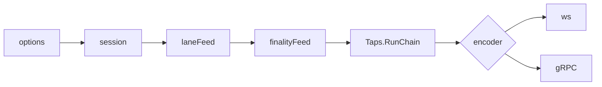

# Streams: one contract for backend apps, ws and gRPC

Status: draft for review. Plan: [plan.md](plan.md). Builds on [chain-tracker/feature.md](../chain-tracker/feature.md) (cited as CT§n); every block still comes from the chain tracker's taps (CT§10).

Cited as [bench]: transport benchmark of 2026-10-29: Go 1.26, loopback TLS 1.3, mainnet headers, logs and mempool samples; gRPC (grpc-go), JSON over SSE and ws, Arrow, Kafka, QUIC (quic-go v0.64); a client delay proxy for RTT rows. Localhost hides TCP loss and Linux GSO.

Decisions:

1. Transports: standard ws (unchanged), ws extended (opt-in, for clients that want higher accuracy and data guarantees on ws), and gRPC with the BDS proto, the one binary transport (§5, §6, §7).
2. One contract: the options, messages, guarantees and end reasons below are the same on ws extended and gRPC; a transport only encodes them (§3).
3. No second delivery path: every option is a cursor, a `ReadOpts` field, a feed wrapper or an encoder rule over `Taps.RunChain` and `ChainFeed.Read` (§3.7).
4. Standard `eth_subscribe` is unchanged; ws extensions are opt-in, per subscription or as URL defaults; data frames stay standard, control frames use their own method (§5).
5. Resume token = the cursor of the last block the client applied, `<numberHex>:<hash>`; any instance resumes it (§3.5).
6. Reorg modes: `geth` (ws only, today's), `undo` (one fork-point message), `none` (finalized only) (§3.1).
7. Finality modes cut what a tap applies at a bound; `safe` and `finalized` taps make the tracker hold headers down to `Finalized` (§4).
8. Heartbeats only on an idle stream, default W clamped to 5–30s, each carrying head, finalized, safe; on gRPC they are DATA messages, since the AWS ALB ignores HTTP/2 PING (§3.6).
9. gRPC gains `StreamLogs` and `StreamPendingTransactions`, one message per block or batch, never per log; `StreamBlocks` gains finality and opt-in control messages, wire-compatible with manifesto#26; fixed flow-control windows and a shared write buffer (§6).
10. No SSE, QUIC or other binary transport (§7).
11. `X-ERPC-Min-Block: n` makes an HTTP read wait up to W for the lane's `Latest` ≥ n, then serve; else `-32015`, never "header not found" (§8).
12. Toolkit: Go (`sdk/go/streams`) and TypeScript/Node (`@erpc-cloud/streams`, on `@grpc/grpc-js`) over gRPC only, one API; Python, Rust and Java get generated stubs and a guide section; ws extended gets a guide section; one guide for coding agents, generated from the docs (§9).

## 1. Terms

Tracker terms (cursor, tap, window, confirmed head, `Head`, W, bt, lane, `reorgWindow`) as CT§1.

| Term | Meaning |
|---|---|
| session | One client stream: options, its feed composition, one `RunChain`, one encoder |
| encoder | Writes session events to one wire: ws or gRPC |
| extended | A ws subscription with any option set (param or URL default) |
| bound | The highest block a finality mode lets a tap apply (§3.1) |
| token | Resume token: the cursor as `<numberHex>:<hash>` |
| control message | `blockEnd`, `undo`, `heartbeat`, `status`, `end` |
| final tap | A tap with finality `safe` or `finalized` |

## 2. Shape



| Part | Home | Owns |
|---|---|---|
| Options | `erpc/stream_options.go` | parse and validate every encoding into one `StreamOptions` |
| Session | `erpc/stream_session.go` | start cursor, feed composition, `ReadOpts`, heartbeat timer, status watch, end mapping |
| Finality bound | `erpc/tap_finality.go` | `finalityFeed`: cuts Applied at the bound, as `laneFeed` cuts at the lane's `Latest` |
| Control JSON | `erpc/stream_events.go` | ws control messages |
| Encoders | `erpc/ws_stream.go`, `erpc/grpc_stream_blocks.go`, `erpc/grpc_stream_logs.go`, `erpc/grpc_stream_pending.go` | wire framing, write deadlines, wire end signals |
| Final hold | `architecture/evm/chain_tracker.go` | headers from `Finalized` up while a final tap is registered (§4) |
| `Head.Safe` | `erpc/networks.go`, `common/served_tip.go` | safe ballot, computed only while a `safe` tap is registered (§4) |
| Min block | `erpc/networks.go` (request path) | §8 wait |

- `runNewHeads`, `runLogs` and `StreamBlocks`' emit loop become the session plus encoders: standard ws subscriptions run the same session with the legacy defaults of §5.4.
- Session events, in order: `data(block, payload)`, `removed(block, logs)`, `undo(forkPoint)`, `blockEnd(block, n)`, `heartbeat`, `status`, `end`. An encoder implements one method per event.

## 3. Contract

### 3.1 Options

| Option | Values | Default | Kinds | Rule |
|---|---|---|---|---|
| `from` | token, or `{number, hash}` | start after the bound at subscribe | heads, logs | the last block the client applied; the tap resumes after it (§3.5) |
| `finality` | `latest`, `safe`, `finalized`, `depth:N` | `latest` | heads, logs | bound: confirmed head; `Head.Safe`; `Head.Finalized`; confirmed head − N. N in 1…`reorgWindow` |
| `reorg` | `geth`, `undo`, `none` | ws `geth`; gRPC `undo` | heads, logs | `geth` ws only; `none` only with `finalized` |
| `heartbeat` | seconds 1–30; 0 = server default | W clamped to 5–30s | all | sent only after `heartbeat` seconds with no message |
| `blockEnd` | `true`, `false` | `false` | ws logs | gRPC logs always send one message per block, which is its block end |
| filter | `address`, `topics` | — | logs | geth semantics and limits, `logfilter.ParseSubscribe` (CT§11) |
| `fullTransactions` | `true`, `false` | `false` | pending | the mempool variant (CT§12) |

- Any other key, a value out of range, or an option on a kind that has no row: `-32602` (ws) or `INVALID_ARGUMENT` (gRPC), naming the key.
- Pending transactions take `heartbeat` only: no cursor, no reorgs (CT§12).
- `depth:N` above `reorgWindow`: refused; use `finalized`.

### 3.2 Messages

| Message | Fields | When |
|---|---|---|
| data | the block's header (heads) or its matched logs (logs) | each applied block, oldest first |
| removed | the logs with `removed:true`, newest first | `geth` mode, each reverted block the client applied |
| `undo` | `forkPoint {number, hash}` | `undo` mode, before the new branch; the client drops everything above `forkPoint.number` |
| `blockEnd` | `block {number, hash, parentHash}`, `logs` count | after each applied block's logs |
| `heartbeat` | `head {number, hash}` (confirmed head), `finalized`, `safe` | no message for `heartbeat` seconds |
| `status` | `state`: `ok`, `degraded`, `lagging`; `reason` | on each state change (§3.4) |
| `end` | `reason`, `detail`, `oldest {number, hash}` when out of range | last message; the stream or subscription ends |

### 3.3 Guarantees

| Mode | Guarantee |
|---|---|
| `from` + `undo` (+ `blockEnd` on ws logs) | gap-free, ordered, parentHash-linked; each block once per branch; every break is an `undo` to a block the client applied, or an `end` |
| `from` + `geth` | as above, with `removed:true` logs for the reverted blocks the client applied, in any earlier connection |
| `finalized` + `none` | no reorg; a majority revert of a delivered final block ends the stream `final_reverted` (CT§6.5) |
| `depth:N` | reorgs up to N blocks deep never reach the client; deeper ones arrive as `undo` or removed logs |
| any | no block above the lane's `Latest` or without `q.Of(hash voters)` votes (CT§15.3); every delivered block loads over HTTP on every instance (CT§6.4) |
| no `from` | starts after the bound at subscribe; ws standard keeps CT§10.2 (lossy `newHeads` restart, logs `1013`) |

- Dedup key: logs `(blockHash, logIndex)`; heads `hash`; pending `hash`. Stable across instances and reconnects.
- Two connections (two instances or regions) each resume from the merged cursor; the client merges by the dedup key (§9.4). Two instances may sit on different branches for at most W (CT§19 oracle); each stream stays linked, so the merge sees an `undo`.

### 3.4 Status and end

| State | Enter | Leave |
|---|---|---|
| `degraded` (`no_fresh_source`) | the tap waits and no hash voter exists for W (`ChainTracker.HashVoting` false) | a hash voter returns |
| `lagging` | the tap's next block has been deliverable for more than half the lag bound (`reorgWindow` × bt / 2, CT§10.2) | under a quarter of it |
| `ok` | after either | — |

| End reason | Detail | Cause | ws extended | gRPC | ws standard (unchanged) |
|---|---|---|---|---|---|
| `out_of_range` | `below_window`, `fork_left_window`, `cursor_unknown`, `receipts_timeout`, `reorg_depth`, `finality_span` | `ErrOutOfRange`; `oldest` = lowest pin (`FollowedRange`, `HashAt`) | `end`, subscription removed | `OUT_OF_RANGE` + `ErrorInfo` | heads restart, logs `1013` |
| `lagging` | `lag` | lag bound passed | `end` | `UNAVAILABLE` | as today |
| `stalled` | — | resumable tap waited 60s while this instance lags (the CT§10.2 gRPC rule, now for every tap with `from`) | `end` | `UNAVAILABLE` | — |
| `final_reverted` | block | `none` mode saw a Reverted batch | `end` | `ABORTED` | — |
| `draining` | — | instance shutdown, or the gRPC connection's maximum age (§6.4) | `end`, then close `1001` | `UNAVAILABLE` | close `1001` |
| `slow_client` | — | a write or send took 10s | connection closes | `UNAVAILABLE` | connection closes |

- gRPC `ErrorInfo` (`google.rpc.ErrorInfo`): `reason` = detail; metadata `oldestBlock`, `oldestHash`.
- Status and end are always on for extended subscriptions, `StreamLogs`, `StreamPendingTransactions`; on `StreamBlocks` only when the request sets `heartbeatSeconds` (§6).
- `erpc_tap_end_total{reason,detail}` counts every end (§12).

### 3.5 Cursor and token

- Token: `<numberHex>:<hash>`, for example `0x1406f40:0x5c1e…`. The client's cursor is the newest of: the last data block (heads), the last `blockEnd` or `BlockLogs` with `complete` (logs), the fork point of the last `undo`.
- A client that drops mid-block resumes from the previous block and gets the whole block again; the dedup key removes the repeats. No intra-block position.
- Resume = `RunChain(start = cursor, ReadOpts{Resumable: true})`; CT§10.1 decides replay, `undo`, wait or out of range. No server state per client.

### 3.6 Heartbeat

- Interval: the option, else W (CT§1) clamped to 5–30s: eth 30s, Base 6s, monad 5s.
- Idle only: any message resets the timer. Read from the tracker's published state and the lane's `Head`; never a lock the tracker waits on (CT§3).
- On gRPC a heartbeat is a `Heartbeat` DATA message: the ALB ignores HTTP/2 PING and closes a connection idle for 60s by default ([ALB attributes](https://docs.aws.amazon.com/elasticloadbalancing/latest/application/edit-load-balancer-attributes.html)). The 30s cap keeps one lost beat under that.
- Client watchdog: no message for 3 × interval → reconnect (§9.4).

### 3.7 Mapping to taps and Read

| Option | Mechanism | Read case (CT§10.1) | Home |
|---|---|---|---|
| `from` | start cursor; `ReadOpts.Resumable` | every row; out of range ends `out_of_range` | session |
| no `from` | start = bound at subscribe (`HeadAsOf` for `latest`; `HashAt(bound)` otherwise), fixed before the id or first message is written | `c` pinned | session |
| `finality` | `finalityFeed` cuts Applied at the bound, Reverted pass, Ready = when the bound first reached the block | Applied rows; waits on the bound's channel | `tap_finality.go` |
| `safe`, `finalized` | `ReadOpts.HoldFinalized` (§4) | `c` inside the window | tracker |
| `reorg` | encoder rule over `Batch.Reverted` | Reverted rows | encoders |
| `blockEnd` | encoder writes after each Applied block | Applied | encoders |
| `heartbeat`, `status` | session timers over published state | — | session |
| end reasons | the error `RunChain` returns, plus `stalled` and `draining` | out-of-range rows | session |
| lane | `laneFeed` (CT§4), composed under `finalityFeed` | — | `tap_lane.go` |

## 4. Tracker changes

- `indexer.ReadOpts.HoldFinalized bool`: while a tap with it is registered (`Want`), the network-wide window also holds every header from `Head.Finalized` up, and fill extends down to it (class 3, CT§8). At most 20,000 headers below the time window (`finalHold`); past that, final subscribes are refused `-32005` / `RESOURCE_EXHAUSTED` (`finality_span`) and open final taps end `out_of_range` (`finality_span`).
  - Why: on eth `Finalized` trails head by 64+ blocks (12.8+ min); the default window is 5 min (CT§16). Without it every eth final tap would be `below_window`.
  - Receipts below `reorgWindow` stay unheld: a final logs Read fetches them by hash (class 3), single-flight, so taps at the same frontier share one fetch (CT§8, §10.1).
- `Head.Safe`, demand-driven: voters' `safe` tags are polled only while a `safe` tap is registered on the network, with that tap's finalized refreshes; with none open, no `safe` poll runs and `Head.Safe` is not computed.
  - Ballot: as `Finalized`, over voters' `safe` numbers; never below `Finalized`; a voter whose `safe` tag is refused has no safe vote; no safe vote → `Safe = Finalized`. `evm.safeBlockSource` set → only that source's number.
  - The first `safe` tap starts a finalized refresh and waits for its safe ballot, at most W, before its start is fixed.
- ws `logs` `removed_unsent` invariant: a removed log is a sent log, or a log of a block at or below the tap's start cursor (sent in an earlier connection).

## 5. ws extended

### 5.1 Opt-in

| Where | Example | Scope |
|---|---|---|
| last subscribe param, object with the one key `erpc` | `["logs", {filter}, {"erpc": {...}}]`, `["newHeads", {"erpc": {...}}]` | that subscription |
| ws URL query, §3.1 names | `wss://host/main/evm/1?finality=finalized&heartbeat=15` | every subscription on the connection; a subscribe's own `erpc` keys win per key |

- `from` only per subscription; in a URL it is `400` at upgrade.
- Pending: the `erpc` object is stripped before the variant is named (CT§12), so it never reaches an upstream.
- Query, not upgrade headers: every client library takes a URL; few let a caller set upgrade headers.
- No eRPC library speaks ws extended; the guide documents it for clients that stay on ws (§9.6).

### 5.2 Wire

Subscribe (result unchanged: the subscription id):

```json
{"jsonrpc":"2.0","id":1,"method":"eth_subscribe","params":["logs",{"address":"0xa0b8…","topics":[["0xddf2…"]]},{"erpc":{"from":"0x1406f3c:0x5c1e…","finality":"latest","reorg":"undo","heartbeat":15,"blockEnd":true}}]}
```

Data stays `eth_subscription` with the standard payload. Control messages use method `erpc_subscription`, which standard libraries ignore:

```json
{"jsonrpc":"2.0","method":"erpc_subscription","params":{"subscription":"0x9cef…","result":{"type":"blockEnd","block":{"number":"0x1406f40","hash":"0x77aa…","parentHash":"0x5c1e…"},"logs":3}}}
{"jsonrpc":"2.0","method":"erpc_subscription","params":{"subscription":"0x9cef…","result":{"type":"undo","forkPoint":{"number":"0x1406f3d","hash":"0x0c4d…"}}}}
{"jsonrpc":"2.0","method":"erpc_subscription","params":{"subscription":"0x9cef…","result":{"type":"heartbeat","head":{"number":"0x1406f41","hash":"0x91b0…"},"finalized":"0x1406f00","safe":"0x1406f20"}}}
{"jsonrpc":"2.0","method":"erpc_subscription","params":{"subscription":"0x9cef…","result":{"type":"status","state":"degraded","reason":"no_fresh_source"}}}
{"jsonrpc":"2.0","method":"erpc_subscription","params":{"subscription":"0x9cef…","result":{"type":"end","reason":"out_of_range","detail":"below_window","oldest":{"number":"0x1406e10","hash":"0x3e2f…"}}}}
```

- Numbers are hex quantities, as JSON-RPC. `safe` is absent while `Head.Safe` is not computed (§4).
- After `end` the subscription is gone; `eth_unsubscribe` of it answers `false`; the connection stays.
- `geth` mode on heads: each new-branch head, as CT§10.2; `undo` mode: `undo`, then the new branch from fork point + 1.

### 5.3 Ordering

- Control and data share the connection's write lock, so `blockEnd` follows its block's last log and `undo` precedes the new branch.
- The id reaches the client before any message (CT§10.2).

### 5.4 Standard subscriptions

- No param, no URL options: the session runs with `latest`, `geth`, no heartbeat, no status, and today's ends (heads restart, logs `1013`). Transcripts equal today's (§13 W6).

## 6. gRPC

### 6.1 Proto

Manifesto change, after manifesto#26 merges (its fields 3, 4 of `StreamBlocksRequest` stay):

```proto
service StreamService {
  rpc StreamBlocks(StreamBlocksRequest) returns (stream StreamBlocksResponse);
  rpc StreamLogs(StreamLogsRequest) returns (stream StreamLogsResponse);
  rpc StreamPendingTransactions(StreamPendingTransactionsRequest) returns (stream StreamPendingTransactionsResponse);
}

enum Finality { FINALITY_LATEST = 0; FINALITY_SAFE = 1; FINALITY_FINALIZED = 2; FINALITY_DEPTH = 3; }
enum Reorg { REORG_UNDO = 0; REORG_NONE = 1; }

message StreamBlocksRequest {
  optional uint64 chainId = 1;
  optional bytes chainGenesisHash = 2;
  optional uint64 fromBlock = 3;
  optional bytes fromHash = 4;
  Finality finality = 5;
  uint32 depth = 6;                     // FINALITY_DEPTH only: 1..reorgWindow
  // Unset: header messages only, as before. Set: heartbeat and status
  // messages too; 0 = server default, else 1..30.
  optional uint32 heartbeatSeconds = 7;
}
message StreamBlocksResponse {
  oneof message {                       // header moves into a new oneof: wire-compatible
    BlockHeader header = 1;
    Heartbeat heartbeat = 2;
    StreamStatus status = 3;
  }
}

message StreamLogsRequest {
  optional uint64 chainId = 1;
  optional bytes chainGenesisHash = 2;
  optional uint64 fromBlock = 3;        // both or neither, as StreamBlocks
  optional bytes fromHash = 4;
  LogFilter filter = 5;                 // query.proto
  Finality finality = 6;
  uint32 depth = 7;
  Reorg reorg = 8;                      // REORG_NONE needs FINALITY_FINALIZED
  optional uint32 heartbeatSeconds = 9; // unset or 0 = server default
}
message StreamLogsResponse {
  oneof message {
    BlockLogs block = 1;
    Undo undo = 2;
    Heartbeat heartbeat = 3;
    StreamStatus status = 4;
  }
}
message BlockLogs {
  BlockRef block = 1;                   // number, hash, parentHash
  repeated Log logs = 2;                // at most 1,000 per message
  bool complete = 3;                    // the block's last message: its block end
}

message StreamPendingTransactionsRequest {
  optional uint64 chainId = 1;
  optional bytes chainGenesisHash = 2;
  bool fullTransactions = 3;
  optional uint32 heartbeatSeconds = 4;
}
message StreamPendingTransactionsResponse {
  oneof message {
    PendingTransactions transactions = 1;
    Heartbeat heartbeat = 2;
    StreamStatus status = 3;
  }
}
message PendingTransactions {
  repeated bytes hashes = 1;            // fullTransactions false
  repeated Transaction transactions = 2;// fullTransactions true; at most 1,000 per message
}

message Undo { BlockRef forkPoint = 1; }
message Heartbeat { BlockRef head = 1; uint64 finalized = 2; uint64 safe = 3; } // safe 0 while Head.Safe is not computed
message StreamStatus {
  enum State { STATE_OK = 0; STATE_DEGRADED = 1; STATE_LAGGING = 2; }
  State state = 1;
  string reason = 2;
}
```

- Compatibility: a client built on #26 sends no field ≥ 5 and gets only `header` messages, byte-identical to today (§13 G5). Moving one existing field into a new oneof is wire-safe (protobuf "Updating a message type"); Go code that builds `StreamBlocksResponse{Header: h}` changes to the oneof wrapper (eRPC: `streamBlocksResponse`, its tests).
- `StreamBlocks` keeps its reorg rule (resend from fork point + 1, CT§10.2): that is `undo` with no extra message. No `geth` mode on gRPC.
- CT§10.4's "a logs flag on `StreamBlocks`" is replaced by `StreamLogs`: logs need their own filter, `Undo` and block ends.

### 6.2 Messages per block

- Logs: one `BlockLogs` per applied block, empty blocks included; a block with more than 1,000 matched logs spans messages, the last `complete`. Never one message per log: one 1,000-log batch costs 453 µs to send, 1,000 single logs 1,320 µs [bench].
- Pending: one `PendingTransactions` per mempool Read (wake ≤ 50 ms, CT§12), at most 1,000 per message. The variant is `[]` or `[true]`, so ws and gRPC share rings.
- Conversion: `JsonRpcLog.ToProto`, `ParseJsonRpcTransaction` (manifesto `evm/json_rpc.go`), once per log per block, cached with the block's encodings and shared by every filter and subscriber: 24 ms per 927-log block, then 0.45–0.48 ms per subscriber send [bench].

### 6.3 Server tuning

| Setting | Value | Why |
|---|---|---|
| `grpc.InitialWindowSize` | 4 MiB per stream, fixed | log-burst p99 at 20 ms RTT 77 → 13.5 ms [bench]; the 64 KB default grows by BDP estimation only |
| `grpc.InitialConnWindowSize` | 16 MiB per connection, fixed | as above |
| `grpc.SharedWriteBuffer` | `true` | part of the measured tuning; write buffers released between writes |
| Toolkit clients | the same windows on their dial (grpc-go `WithInitialWindowSize`, `WithInitialConnWindowSize`; grpc-js `grpc-node.flow_control_window`) | the receiver's window paces the server's sends [INFERENCE] |

### 6.4 Connection age

- `MaxConnectionAge` stays 10 min with 30s grace and ±10% jitter (`erpc/grpc_server.go`): it rebalances clients across pods.
- Each stream on the aged connection ends `UNAVAILABLE` (reason `draining` in `erpc_tap_end_total`); a client that resumes from its cursor loses nothing (§3.3). The toolkit does so at once, without backoff (§9.4).
- The ALB's own keepalive duration (default 3,600s) sends GOAWAY too; the same resume applies.

### 6.5 Auth and limits

- Auth: `StreamLogs` as `eth_getLogs`; `StreamPendingTransactions` as `eth_subscribe`; once at open. Rate limits once at open (CT§10.3).
- Ends: §3.4. Stall (60s) and send (10s) bounds as CT§10.2.

## 7. Other transports

Not built: SSE, QUIC, Kafka protocol, Arrow and binary ws. Reasons [bench]: gRPC with the BDS proto sends 2.5× fewer bytes than JSON (285 vs 714 B per log) with no per-subscriber compression CPU, and already passes the ALB; QUIC costs 6–8× gRPC CPU per message, gains nothing under loss on one ordered stream ([RFC 9000 §2](https://www.rfc-editor.org/rfc/rfc9000#section-2)), and needs an NLB passthrough path and a TCP fallback.

## 8. `X-ERPC-Min-Block`

| Item | Rule |
|---|---|
| Directive | header `X-ERPC-Min-Block`, query `min-block`; decimal or `0x` hex; governed by `allowClientDirectives` like every directive (`common/request.go` registry) |
| Meaning | the request answers at or after block n |
| Where | before the request reads `Head` (CT§7), so tags, cache keys and every retry use the waited value |
| `Latest` ≥ n | no wait |
| n within the near-future bound (ceiling + (W + A) / bt, CT§6.4) | wait for the lane's `Latest` ≥ n, at most W, Asking the lane's voters below n with a number need (single-flight, CT§6.8) |
| n above it, or the wait ends | JSON-RPC `-32015` "block n not reached", data `{minBlock, latest}`, HTTP 503; counted `future` or `timeout` |
| Lanes | waits on the request's lane (`use-upstream`); a selector without a lane on its stateless pick each head pass |
| Cache | none bypassed: the interpolated number ≥ n keys the read |
| Refusal band | unchanged; after the wait, explicit numbers above `Latest` follow CT§6.4 |
| Tags sent as is (`skip-interpolation`, `translateLatestTag: false`) | the wait applies; upstreams are ordered head ≥ n first (CT§6.4 order); no further guarantee |
| `finalized`, `safe` tags | unaffected |
| Batch | the header applies to each request; one Ask round serves them all |
| ws, gRPC | not supported: ws messages carry no headers; gRPC unary calls are out of scope |

Case it fixes: block N streamed from instance A; `eth_call(latest)` on instance B, whose `Latest` trails one poll (CT§21), answers at N−1. With the header it answers at ≥ N.

## 9. Toolkit

### 9.1 Languages

| Evidence | TS/JS | Go | Rust | Python | Java |
|---|---|---|---|---|---|
| Client libraries in the complaint sources (research §1) | viem, ethers, web3.js | geth | alloy | — | — |
| Main language of named eRPC users' public repos (erpc.cloud logo wall, `gh api`), repos | 3 | 2 | 1 | — | — |
| GitHub repos whose README names `erpc/erpc` or `erpc.cloud` (search 2026-10-29) | 9 | 7 | 3 | 4 | — |
| Active gRPC library, release in October 2026 [bench] | `@grpc/grpc-js` | grpc-go | tonic | grpcio | grpc-java |

- Libraries: Go and TypeScript/Node. Generated stubs and a guide section: Python, Rust, Java.
- Small samples; logo-wall repos show each team's main language, not the code that calls eRPC `[INFERENCE]`.

### 9.2 Node gRPC library: `@grpc/grpc-js`

| | `@grpc/grpc-js` | connect-es (`@connectrpc/connect-node`) |
|---|---|---|
| npm downloads, last month (2026-10-29) | 236,962,935 | 11,613,404 |
| Latest | 1.14.7 | 2.3.0 |
| Maintainer | gRPC project | Buf |
| Flow-control window option | `grpc-node.flow_control_window` (`channel-options.ts`) | Node `http2` session settings |

- Pick `@grpc/grpc-js`: 20× the adoption, the gRPC project's own client, and a window option the §6.3 tuning needs. Types from `ts-proto` (`outputServices=grpc-js`), generated from the pinned manifesto protos into the package.

### 9.3 Packages

| | Go | TypeScript/Node | Python, Rust, Java |
|---|---|---|---|
| Path | `sdk/go/streams/` (own `go.mod`) | `typescript/streams/` (pnpm workspace) | manifesto generated packages (Rust: existing `rust/` crate) |
| Name | `github.com/erpc/erpc/sdk/go/streams` | `@erpc-cloud/streams` | chosen in the manifesto stubs PR |
| Runtime | Go ≥ 1.24; grpc-go, manifesto Go | Node ≥ 22; `@grpc/grpc-js` | each language's official gRPC |
| Guide copy | `INTEGRATION.md`, `go generate` | `INTEGRATION.md`, `prepack` | linked from each package README |

### 9.4 API

```ts
const s = stream({
  endpoints: ["grpcs://erpc-a.example:443/main/evm/1"],  // 1 or 2 (merge)
  kind: "logs",                                           // "newHeads" | "newPendingTransactions"
  filter: { address: ["0xa0b8…"], topics: [["0xddf2…"]] },
  finality: "latest",                                     // "safe" | "finalized" | "depth:12"
  cursor: fileCursor("./erpc.cursor"),                    // { load(), save(token) }
  metadata: { "x-erpc-secret-token": process.env.ERPC_TOKEN! },
});
await s.run({
  apply: async (block) => { /* block.logs; idempotent by log.key */ },
  undo: async (forkPoint) => { /* drop state above forkPoint.number */ },
  status: (st) => {},                                     // ok | degraded | lagging | reconnecting
});
```

```go
err := streams.Run(ctx, streams.Config{
    Endpoints: []string{"grpcs://erpc-a.example:443/main/evm/1"},
    Kind: streams.Logs, Filter: f, Finality: streams.Latest, Cursor: streams.FileCursor("erpc.cursor"),
}, streams.Handler{Apply: apply, Undo: undo, Status: status})
```

- Endpoint `grpc(s)://host:port/<project>/evm/<chainId>`: the library dials `host:port` and sends the path as `x-erpc-project`, `x-erpc-chain-id` metadata (`erpc/grpc_server.go` `extractRequestInput`).
- `run` / `Run` return only on stop or a terminal end (§9.5): `OutOfRangeError{Endpoint, Cursor, Oldest}` (`Cursor`: the one that endpoint's stream resumed from), `FinalRevertedError{Endpoint}`, auth or option errors, or the handler's error. No handler call starts after stop or after a terminal end. No backfill helper: backfill older than the window is "never".
- The cursor is saved after `apply` or `undo` returns without error: at-least-once; `Log.Key()` = `blockHash:logIndex`.
- The library asks for `undo` (or `none` with `finalized`), so apps see one reorg shape; `StreamBlocks`' resend from fork point + 1 becomes an `undo` call.
- Pending: `apply` gets a transaction batch; no cursor, no `undo`.

### 9.5 Behaviour

| Concern | Rule |
|---|---|
| Connect | gRPC with §6.3 windows; `heartbeatSeconds` always sent, 5 when the app leaves it 0 (the server's lowest default), so the watchdog runs on the server's actual interval; `from` = saved cursor |
| Watchdog | no message for 3 × heartbeat while not waiting on the handler → cancel the stream, status `reconnecting`; messages the cancelled stream buffered are dropped |
| Reconnect | `UNAVAILABLE` or watchdog after messages flowed (connection age, drain, stall, lag): resume at once; otherwise, a stream the library restarted included, jittered exponential backoff 0.5s → 30s, reset after 60s connected |
| Terminal, per run | `UNAUTHENTICATED`, `PERMISSION_DENIED`, `INVALID_ARGUMENT`, a handler error: stop every connection at once and return the error |
| Terminal, per endpoint | `OUT_OF_RANGE`, `ABORTED` (`final_reverted`): that endpoint's view of the chain (a new pod's window, a cursor on a branch it never saw: `cursor_unknown`). Stop and return the error when no other connection's stream is open; else that connection reconnects with backoff |
| Dedup | `apply` skips a block whose hash is already applied on the current branch |
| Merge (2 endpoints) | each connection resumes from the merged cursor; the library keeps each connection's session blocks, linked by `parentHash` (a block that does not link restarts that connection), the last 256 of them, and the merged chain as contiguous (number, hash); it follows the open connection with the highest block, ties keep the current one, and falls back to the next open one when the leader shares no block; switching branch emits `undo` to the fork point of the two chains, then every block of that connection above it; a block already applied (same hash) is skipped. A fork deeper than 256 blocks restarts that connection, whose server then sends the `undo` (CT§10.1). A connection's `undo` counts only while it leads; a non-leader waits for its next block. Switching that needs an `undo` without `handler.undo` (`finalized`) ends with `FinalRevertedError` |

### 9.6 Guide

- One page: `docs/pages/operation/streams-integration.mdx`; the docs build emits `/operation/streams-integration.llms.txt` (`docs/scripts/build-llms.mjs`), and both libraries ship that file as `INTEGRATION.md`.
- Written for a coding agent. Sections:
  1. Choose: library (Go, TS), stubs (Python, Rust, Java), or ws extended; finality (table).
  2. Go and TS libraries: install, cursor store, `apply` idempotency, `undo`, merge, out-of-range handling (the library ends with the cursor and the oldest held block; neither eRPC nor the library backfills older than the window).
  3. Python, Rust, Java: the stubs, metadata, windows, `heartbeatSeconds`, and §9.5 rules to implement by hand.
  4. ws extended: §5 options and messages, for clients that stay on ws.
  5. Check list.
- Every code block in it is a file under `examples/` (each library; one per stub language in the guide's own directory), compiled and run by the toolkit tests (§13 T7).

## 10. Limits

| Resource | Bound | At the bound |
|---|---|---|
| ws subscriptions per connection, per instance; connections per instance, per IP | `server.webSocket.*` (CT§15.2) | `-32005`, `429` |
| `heartbeat` | 1–30s | `-32602` / `INVALID_ARGUMENT` |
| `depth:N` | 1…`reorgWindow` | `-32602` / `INVALID_ARGUMENT` |
| Final hold | 20,000 headers per network below the time window | refuse `finality_span`; open final taps end |
| Replay per Read | `reorgWindow` Applied blocks (CT§15.2) | next Read |
| Logs filter | 1,000 addresses, 4 positions, 1,000 values (CT§11) | `-32602` / `INVALID_ARGUMENT` |
| ws write | 10s per message | connection closes, `slow_client` |
| gRPC send | 10s | `UNAVAILABLE` |
| gRPC long-lived streams per connection | 100 | `RESOURCE_EXHAUSTED` |
| gRPC logs and pending per message | 1,000 | next message |
| gRPC connection age | 10 min + 30s grace (existing) | streams end `UNAVAILABLE` |
| Pending variants | 16 per network (CT§12) | refused |
| Min-block wait | W, inside the request timeout | `-32015` |

## 11. Config

No new key: every bound is a constant (§10) or an existing `server.webSocket` key.

## 12. Signals

| Metric | Change |
|---|---|
| `erpc_tap_end_total{project,network,transport,kind,reason,detail}` | from erpc#1335; streams add reasons `stalled`, `final_reverted`, `draining`, `slow_client` and detail `finality_span` |
| `erpc_stream_messages_total{project,network,transport,kind,type}` | new; type: `data`, `removed`, `undo`, `block_end`, `heartbeat`, `status`, `end` |
| `erpc_stream_bytes_total{project,network,transport,kind}` | new: bytes written |
| `erpc_stream_resume_total{project,network,transport,kind,outcome}` | new; outcome: `replayed`, `at_head`, `out_of_range` |
| `erpc_stream_replay_blocks{project,network,transport,kind}` | new histogram: blocks behind the bound at resume |
| `erpc_stream_status_total{project,network,transport,kind,state}` | new: status transitions |
| `erpc_tap_delivery_seconds{transport,kind,finality}` | `finality` label added; measured from Ready |
| `erpc_taps{project,network,transport,kind}` | kinds `logs`, `newPendingTransactions` on gRPC |
| `erpc_chain_tracker_final_hold_headers{project,network}` | new gauge: headers held for final taps below the time window |
| `erpc_network_served_tip_block_number{…,axis}` | axis `safe` added, exported only while `Head.Safe` is computed |
| `erpc_min_block_total{project,network,outcome}` | new; outcome: `ready`, `waited`, `timeout`, `future` |
| `erpc_min_block_wait_seconds{project,network}` | new histogram |
| `erpc_grpc_streams_rejected_total{project,reason}` | new; reason: `per_connection` |

- Logs: one `TransitionLog` per end with cursor, bound, reason and `oldest`; one per status transition, rate-limited per (network, kind) (CT§17).
- Traces: a span per session open and per resume replay, under detailed tracing.

## 13. Scenarios

Run on CT§19 baseline B, extended per instance with 2 extended ws logs clients and 2 gRPC `StreamLogs` clients, each resuming on the other instance. New harness parts: drivers for ws extended and gRPC logs and pending, both toolkits (Go in-process, Node subprocess), a fault proxy on client links (latency, black-hole, HTTP/2 idle cut), chainsim `SafeDepth` and a `FinalityDepth` above the window. Every row fails before its step's PR for the reason given, and asserts CT§19's invariants.

| ID | Step | Setup and fault | Expected | Red before because |
|---|---|---|---|---|
| W1 | s1 | ws logs client with `from`, connection cut for 10 blocks, resumes on instance 2 | no gap, no duplicate key; `blockEnd` per block | `from` ignored: live tail only, 10 blocks lost |
| W2 | s1 | W1 with a 3-deep reorg during the cut, `geth` mode | `removed:true` for exactly the orphan logs it applied; then the new branch | no resume, no removed logs for an earlier connection |
| W3 | s1 | no blocks for 3 min (CT C6); extended and standard subs on one connection | extended: heartbeat every `heartbeat` s with head and finalized; standard: none | no heartbeat |
| W4 | s1 | filter matching 1 block in 10 | `blockEnd` for every block, linked by parentHash | no marker; gaps invisible |
| W5 | s1 | cursor below the window; slow reader (CT D1) | `end` `out_of_range`/`below_window` with `oldest`, then `end` `lagging`; the connection still answers `eth_blockNumber` | logs close the whole connection `1013`, no reason |
| W6 | s1 | geth `rpc.Client` and raw JSON clients, no options | transcripts equal today's: no `erpc_subscription` frame | — (guard; green before and after) |
| W7 | s1 | URL `?heartbeat=10`; one sub overrides `heartbeat: 20` | 10s on the others, 20s on that one | URL options ignored |
| W8 | s1 | `heartbeat: 0.5`, unknown key, malformed token, `from` in URL | `-32602` naming the key; `400` for the URL | silently accepted |
| W9 | s1 | instance 1 cut from every vendor 2 min (CT N4) | `status` `degraded` within W + 1s; resumable subs `end` `stalled` at 60s; resume on instance 2, no gap | ws waits silent |
| F1 | s2 | `finality: finalized`, vendors' finalized 64 below head, window 5 min of 12s blocks | every delivered block ≤ `Head.Finalized` at send; never `undo`; logs equal canonical | option refused; would be `below_window` |
| F2 | s2 | `depth:3`; reorgs 1–3 deep (CT C1), then `reorgWindow` − 1 deep (C2) | C1 never reaches the client; C2 arrives as one `undo` | no depth mode |
| F3 | s2 | `reorg: undo` on ws logs and heads, C1 | one `undo` with the fork point, no `removed:true`; final log set canonical | no undo mode |
| F4 | s2 | `reorg: none` without `finalized`; with `finalized` and CT C12 | `-32602`; `end` `final_reverted` | no none mode |
| F5 | s2 | `SafeDepth` 8, `FinalityDepth` 64; one vendor refuses `safe`; then the last `safe` tap closes | delivered ≤ `Head.Safe`; `Safe` from the others; all refuse → `Safe = Finalized`; after the close no `safe` poll reaches any vendor | no `Head.Safe` |
| F6 | s2 | 0.2s blocks, finalized 4,000 below head; then 25,000 below | final tap fills and flows; hold gauge back to 0 when it closes; at 25,000 subscribe refused `finality_span` | `below_window` |
| F7 | s2 | use-upstream lane trailing the network head, `depth:2` | never above min(lane `Latest`, confirmed − 2) | no composition |
| G1 | s4 | `StreamLogs` resume across instances, C1 | `Undo` then new branch; `complete` per block; logs canonical | `Unimplemented` |
| G2 | s4 | block with 10,000 matching logs | messages of ≤ 1,000 logs; one `complete`; each < 4 MB | `Unimplemented` |
| G3 | s4 | `StreamPendingTransactions` hashes and full; ws subscriber of the same variant | one upstream subscription per variant; batches ≤ 50 ms apart | `Unimplemented` |
| G4 | s4 | quiet chain 3 min through an HTTP/2 proxy that ends streams idle 60s and ignores PING | with `heartbeatSeconds`: open; without: cut at 60s | no gRPC heartbeat |
| G5 | s4 | #26-era client (no field ≥ 5) | header-only messages, byte-identical to before | — (guard) |
| G6 | s4 | `StreamBlocks` `FINALITY_FINALIZED`; cursor below window | headers ≤ `Finalized`; `OUT_OF_RANGE` with `ErrorInfo` `oldestBlock`, `oldestHash` | fields absent |
| G7 | s4 | 101 long-lived streams on one connection | 101st `RESOURCE_EXHAUSTED` | unlimited |
| G8 | s4 | client link +20 ms RTT; 1,000-log blocks every 200 ms; tuned Go client | block send → client receive p99 under 30 ms | default windows: p99 about 77 ms [bench] |
| M1 | s5 | instance 2 serves only numbered calls (CT X2); block N from instance 1's ws; `eth_call(latest)` Multicall3 `getBlockNumber()` on instance 2 with `X-ERPC-Min-Block: N` | ≥ N every time | answers N − 1 |
| M2 | s5 | n inside the near-future bound; n far above | served once the chain reaches n, ≤ W; far: `-32015` with no dispatch | `header not found` or N − 1 |
| M3 | s5 | `latest` cached at N − 1, then a read with min-block N | answered at ≥ N | cached N − 1 served |
| M4 | s5 | lane trails; batch of 20 with the header | each ≥ n on the lane; Asks ≤ voters per round | header ignored |
| T1 | toolkit | Go toolkit, 2 endpoints; `kill -9` instance 1; C1 reorgs | app log set canonical; each key applied once per branch; switch within the watchdog | no toolkit |
| T2 | toolkit | TS toolkit, T1's faults | as T1 | no toolkit |
| T3 | toolkit | both; client link black-holed with the socket kept | reconnect within 3 × heartbeat; no gap | no toolkit |
| T4 | toolkit | app killed after `apply`, before cursor save | the block applied again with the same keys; final state canonical | no toolkit |
| T5 | toolkit | app offline longer than the window | `OutOfRangeError{cursor, oldest}`; nothing applied past the gap | no toolkit |
| T6 | toolkit | both, 25 min run with `MaxConnectionAge` 10 min, `finalized` | at least 2 `UNAVAILABLE` ends, each resumed at once; no gap, no duplicate key | no toolkit |
| T7 | toolkit | every guide example (Go, TS, Python, Rust, Java, ws extended) against local eRPC | each runs and exits 0 | no guide |

## 14. Risks and behaviour changes

- Final taps on chains with long finality fill up to 20,000 headers once per instance and network (class 3): about 5,000 fetches on a chain finalizing 20 min at 0.25s blocks `[INFERENCE]`; the first final block waits for that fill.
- Final logs taps fetch receipts below `reorgWindow` by hash: up to one more receipts call per wanted block per instance when tip taps also run.
- `Head.Safe` costs one `safe` tag poll per voter per finalized refresh, only on networks and instances with a `safe` tap open; none otherwise.
- gRPC logs send one message per block, empty ones included: tens of bytes × blocks/s per stream.
- JSON → proto conversion costs 24 ms CPU per 927-log block, once per block per instance, whatever the subscriber count.
- Every gRPC stream ends `UNAVAILABLE` about every 10.5 min (connection age) and at each ALB keepalive GOAWAY: clients that resume from their cursor lose nothing; clients without a cursor see a restart.
- Fixed 4 MiB stream windows let a client hold up to 4 MiB in flight per stream before the 10s send wait starts.
- ws URL defaults with `reorg=undo` make standard libraries miss reorgs: they ignore `erpc_subscription`. The docs say so.
- `StreamBlocksResponse.header` moves into a oneof: Go code that builds the message changes; readers using `GetHeader()` do not.
- Resumable ws taps now end `stalled` after 60s on a lagging instance, as gRPC does.
- Two instances can be on different branches for up to W: a merged client may see one extra `undo` per tie.

## 15. One home

| Fact | Home |
|---|---|
| Option names, values, validation | `erpc/stream_options.go` |
| Start, feeds, timers, end mapping | `erpc/stream_session.go` |
| Finality bound | `finalityFeed` |
| ws control message JSON | `erpc/stream_events.go` |
| Proto messages | manifesto `evm/stream.proto` |
| gRPC server tuning | `erpc/grpc_server.go` options |
| Wire framing and signals | each encoder |
| Toolkit semantics | this spec §9; libraries implement it |
| Integration guide | `docs/pages/operation/streams-integration.mdx` |
